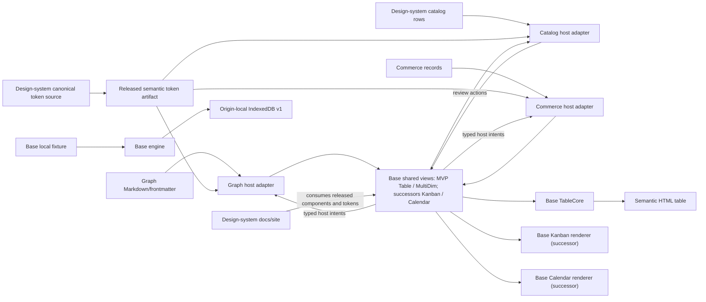

# Reference implementation: Agentic Base shared view runtime

## Revision and claim boundaries

This joined PRD–TAD–ADR–MVP–GTM specifies one reusable, product-neutral data-view runtime, with the shared table grid as the first parity-critical surface. It is grounded in source snapshots observed on 2026-10-23. The root heading labels the product-specific material as a reference implementation under the repository's neutrality contract.

This is a specification, not an implementation, runtime verification, source release, package publication, or deployment instruction. Product readiness is local `spec-complete` / delivered `undocumented`: the VCCs below are proposed and do not have satisfying runtime Evidence References yet. Do not derive product readiness from this document's existence or its source inspection.

## PRD — purpose, users, and pain

### Problem statement

Data-view consumers need a consistent, accessible table layout that can be embedded without moving their records, schemas, authorization, edits, or persistence into a shared package. Existing source provides a strong near-built solution: one shared structural table grid, an interactive host-driven React view, and a bounded offline browser adapter. However, consumers use different surfaces and revisions. The full Graph workspace includes host-owned frontmatter tabs, toolbar, hierarchy, settings, and edit flows; the design-system review page uses the smaller literal-text browser adapter. The latter therefore does not establish visual or interaction parity with the supplied Graph reference.

This evidence supports a product and integration gap, not validated market demand. No buyer interviews, frequency baseline, willingness-to-pay evidence, adoption count, or measured integration-time reduction was found in the inspected sources. Keep those claims open.

### Users and jobs

| Role | Job and value | Current owner / boundary |
|---|---|---|
| Product engineer | Render and configure a shared data view without duplicating its grid, then retain domain-specific data and actions | Consumer host maps its data and callbacks into the versioned Base host contract |
| Graph workspace user | Inspect and edit Markdown/frontmatter records through the existing workspace | Graph owns parsing, source writes, tabs, toolbar commands, graph overlays, and workspace lifecycle |
| Design-system maintainer | Review a source-linked inventory in a reusable table without treating review decisions as publication rights | Design-system site owns catalog rows, review state, and release decisions |
| Commerce maintainer | Embed an offline table in a static product surface | Commerce owns its records, semantic theme mapping, actions, and lifecycle |
| Base maintainer | Keep one shared table structure and component contract, publish exact source revisions, and remove superseded implementations after proven replacement | Base owns the shared runtime and its compatibility/release record |

Human names for these functions have not been assigned in the source records. Each phase requires one accountable function owner before it starts.

### User stories

- **PRD-VIEW-01:** As a product engineer, I can pass a typed view model and host callbacks to one table contract so that the shared grid renders without a second product-owned renderer.
- **PRD-VIEW-02:** As a Graph workspace user, I can keep the familiar frontmatter table's column order, type markers, nested-row affordances, toolbar and keyboard/touch paths while Graph retains Markdown editing and persistence.
- **PRD-VIEW-03:** As a design-system maintainer, I can show the same shared grid against a review fixture while the site retains its review-only Keep/Remove state and publication gates.
- **PRD-VIEW-04:** As a maintainer, I can pin, verify, and roll back one exact shared source revision without clearing or migrating consumer data.

### Must, Should, Could, Won't

| Priority | Outcome | Rationale / ROI input |
|---|---|---|
| Must | One Base-owned structural table grid; one versioned host contract; same reference fixture in the shared runtime and consumer previews | Explicit owner direction and existing source make this the smallest reuse path; impact, reach, and build-hour baselines remain unmeasured |
| Must | Preserve consumer ownership of source data, schemas, authorization, mutations, workspace shells, and persistence | Existing Graph and Commerce contracts already depend on these boundaries |
| Must | Compare the shared Multi-dimensional Table to the supplied Graph reference at matched viewport and zoom; meet keyboard, touch, contrast, and reduced-motion checks | Repeated user feedback identifies fidelity as a release blocker; no passing comparison result is recorded |
| Must | Zero paid spend; browser, local, edge/device, and offline paths only when supported by current source; fail closed on unknown quota or rights | User mandate; no paid plan, addon, or overage is in scope |
| Should | Publish immutable, versioned source releases with manifests, checks, and predecessor rollback information | Exact Git pins already work; package publication remains out of scope while `private: true` is set |
| Could | Add more view projections or MCP/WebMCP invocation after a concrete user job, owner, and VCC exist | No evidence justifies expanding the current table-first scope |
| Won't (this increment) | New grid package, copied Graph renderer, product-specific visual fork, hosted data store, paid service, registry publication, production migration, or claim of full parity | Conflicts with one-owner, FOSS, offline, or evidence boundaries |

**ROI calculation status:** The guideline formula is `(user impact × monthly reach) / (build hours + monthly TCO + token cost/month)`. Existing records identify three possible consumers, but not active-user reach, pain frequency, affected hours, a validated impact score, serving load, or a token workload. ROI is therefore not calculable from current evidence. Do not invent a score or treat a shared-import count as savings. Measure before authorizing implementation beyond the existing source and fixture.

### Success metrics and time-to-value

Targets below are acceptance goals, not results.

| Metric | Baseline | Target | Validation |
|---|---|---|---|
| Shared table implementations | Base has `TableCore`, `TableView`, `MultiDimTableView`, and a bounded `DataTableCore` adapter; consumer layouts differ | One shared structural grid and one canonical visual contract; no product-owned duplicate grid | Source-owner inventory and VCC-01 |
| Reference fidelity | User reports the preview is not faithful; no measured comparison | All required reference regions and columns present; no missing/duplicate controls; matched column boundaries within 4 CSS px and row heights within 2 CSS px at the recorded viewport/zoom | Golden-fixture screenshot comparison and manual interaction rubric, VCC-02 |
| Integration time-to-first-view | Not measured | At most 5 distinct manual steps and 30 elapsed minutes from a clean, authorized local checkout | Timed walk-through; record elapsed time, steps, and environment |
| Accessibility | Source has native table semantics and selected focus behavior; no end-to-end result recorded | All in-scope actions reachable by keyboard/touch; text contrast ≥4.5:1 (≥3:1 for large text), control/focus boundaries ≥3:1, visible focus, 200% text zoom, reduced motion, and usable 44 CSS px touch targets | VCC-03 and the local design-theme contract; no result recorded |
| Local/offline behavior | Base documents a same-origin IndexedDB demo and an offline browser artifact | No network request for the local fixture after assets are present; bounded inputs fail with typed errors; no user data cleared during rollback | VCC-04 and VCC-06 |
| Incremental paid spend | Not measured | $0 authorized; stop if free-tier capacity is exceeded | Cost ledger and receipt; a free quota is an assumption until observed |

TTV path: pin an exact revision → supply the documented host contract → render one fixture → invoke one host callback → verify. Target ceiling is 5 steps / 30 minutes. No clean-environment walk-through has been performed, so the estimate remains unverified.

### Ecosystem outcome and reuse

| Participant | Value exchanged | Source/owner | Evidence and gap |
|---|---|---|---|
| Consumer engineer | Less repeated layout and lower drift risk | Shared runtime owner; exact consumers listed in E-02/E-03/E-04 | Imports are visible; duplicated work avoided and support time saved are not measured |
| Consumer user | Familiar, accessible table interaction within the consuming product | Consumer owns data and product behavior; Base owns shared structure | Screenshot is a user-provided reference only; no parity or accessibility result |
| Maintainer | One reviewable source, release pin, and rollback predecessor | Base source; consumer release workflows | Exact revisions exist; a compatible versioned release and all current consumer pins do not |
| Public user / payer | No paid offer in this FOSS-first increment | No external payer or payment mechanism | WTP and demand are unknown; no revenue claim |

The reuse outcome is reduced repeated layout and drift across consumers, measured by a before/after source inventory, integration time, failed/repeated actions, and support minutes. Current savings remain unknown. The inventory count alone is not evidence of value.

### Product acceptance criteria as VCCs

Every condition is pending until a named check emits its result. The compatibility checks must run against the exact source revision and fixture recorded with that result.

| ID | Measurable end state | Stated check | Constraint / bound |
|---|---|---|---|
| VCC-01 Shared owner | One shared `TableCore` renders row, column, and multi-dimensional projections; no second product-owned grid is introduced | Base component contract suite and source-owner inventory exit 0; report the component paths and consumer pins | Preserve all consumer schemas, data, actions, and persistence; no extra store; one source lane |
| VCC-02 Graph reference parity (D-01) | The reference fixture contains the Key, Type, Scalar Value, List Value, Summary, and Output columns, nested map/list rows, type/value markers, the workspace tabs and toolbar; no required control is omitted or duplicated; geometry meets the stated tolerance | Render Base and Graph fixtures at the same 1113×952 CSS viewport and recorded 74% zoom; compare screenshots and complete the interaction checklist | No product code or data changes; disclose any browser/font variance; one fixture and at most 3 review cycles |
| VCC-03 Accessibility | Every in-scope operation has a semantic name, keyboard path, visible focus, measured theme contrast, 200% text zoom, reduced-motion behavior, usable 44 CSS px touch targets, and a usable narrow viewport | Measure final composited colors: text ≥4.5:1 (≥3:1 for large text), control/focus boundaries ≥3:1; run keyboard/touch, narrow-viewport, and offline-reload checks | No color-only meaning; no accessibility pass inferred from static markup |
| VCC-04 Offline and bounds | The same-origin fixture reloads offline after cache priming; limits and malformed inputs fail safely; the adapter never interprets cell strings as HTML | Run Base browser contract and offline network capture; report rows, columns, bytes, and typed error results | Stay within per-adapter limits; no remote storage, telemetry, or additional dependency fetch |
| VCC-05 Rights and release | The exact release source, package state, notices, input/output digests, checks, and predecessor are recorded; public bundle contains only cleared source | Compare release manifest, source commit, license/notice inventory, and consumer lock pins | Do not publish a package or bundle an uncleared old pin; no inferred rights |
| VCC-06 Recovery | A consumer can restore its previous exact source pin and generated artifact without changing user data | Revert the pinned dependency and read back prior artifact digest in a disposable local consumer | No IndexedDB deletion, schema rewrite, or production effect |
| VCC-07 Kanban successor | One Base board renderer maps stable record IDs into host-provided lanes; keyboard/touch move controls emit typed intents and the host's accepted state is read back; no consumer owns a duplicate board renderer | Run the same board fixture through Base and a host adapter; verify lane/card identity, keyboard/touch paths, and host readback | Successor scope only; Base does not own lane semantics, authorization, persistence, or product actions |
| VCC-08 Calendar successor | One Base calendar renderer maps host-provided events and time-zone-resolved dates; date navigation and event identity remain stable across month boundaries; no consumer owns a duplicate calendar renderer | Run month-boundary and daylight-saving fixtures through Base and a host adapter; verify keyboard/touch navigation, event mapping, and narrow viewport behavior | Read-only first slice; host owns time-zone policy and persistence; recurrence and event writes are excluded |

## TAD — architecture and ownership

### Component and source inventory

The following matrix is the source-of-truth boundary for the first increment. A reuse entry names a source and revision; it does not claim rights beyond that revision or prove runtime parity.

| Capability / pain-VCC | Source export / revision / consumers | Decision / smallest delta | Runtime boundary / deliberate difference | Acceptance / removal |
|---|---|---|---|---|
| Portable base and record contracts | `agentic-base@d7d7bdee978ee0dde35dd279ecf878d6853fc762`: `src/schema.mjs`, `src/engine.mjs`, `src/query.mjs`, `src/projectors.mjs`, `src/adapters/{memory,indexeddb}.mjs` | Reuse the existing engine and adapters; no second store | Base persists only data explicitly Base-owned or separately cut over; consumers keep their own records and authorization | VCC-01/VCC-04; do not migrate consumer data in a view release |
| Shared interactive table (D-01) | `agentic-base@d7d7bdee…`: `packages/views-react/src/table/{TableCore,TableView,MultiDimTableView,TableHostContext}.tsx`; Graph pin is `529f1d866974453327977595a457d5065a8dbc45` | Extend the existing Base component/host contract; do not copy a renderer | Base owns grid, column/cell structure, and reusable interaction shell; host injects domain data, copy, tokens, editors, menus, and callbacks | VCC-01/VCC-02/VCC-03; remove any proven duplicate only after replacement passes |
| Bounded offline browser table | Base `DataViewBrowserAdapter.tsx`, `DataTableCore.tsx`, `TableCore.tsx` at `d7d7bdee…`; output manifest reports 148,590 JS bytes and 1,883 CSS bytes | Retain as the literal-text, read-only browser adapter; do not present it as the full Graph workspace | Browser adapter accepts at most 64 columns, 1,000 rows, 4,096 characters/cell, and 196,608 payload bytes; React workspace view has a different host contract | VCC-04; retain as a bounded projection, never a competing rich table |
| Graph data and workspace shell | `agentic-graph@60333d43486537df7b89f46293c58f282b0394f`: `canvas/src/features/markdown-workspace/main/viewer/MultiDimTableSurface.tsx`, `MarkdownWorkspaceDerivedViewer.tsx`, `GraphTableHost.tsx`, `canvas/src/features/markdown/ui/MarkdownDataViewTableView.tsx` | Keep Graph parsing, frontmatter tabs, toolbar, actions, formatting, settings state, source writes, and graph overlay in Graph; inject them through the Base host seam | Graph provides Markdown/frontmatter semantics and user operations; Base provides the shared grid visuals and contract. Its package pin is the older `529f1d…` source | VCC-02/VCC-03; no change to Graph data/source format in this increment |
| Design-system catalog and review | Local `agentic-design-system` worktree at `8e66421aa167f4bf05b1c9f27a95eeb6c94b790f` was dirty on observation; `site/catalog.json`, `registry/owner-ledger.json`, `site/review-inventory.json`, `site/vendor/` | Consume Base through a thin host adapter; retain catalog records and Keep/Remove state in the site; use the richer shared React table for a fidelity demonstration when rights and build contract allow | Site owns catalog/review UI and publication gates, not a table renderer. Local inventory has 247 review-only rows across 23 collections; public catalog remains draft/empty; current package pin is `529f1d…` | VCC-02/VCC-05; working-tree content is not an approved release or public source |
| Commerce browser projection | `agentic-commerce-os@b6867b2a79fd609eb4c43df7eeda7fb9f704d616`; config pins Base `093d2592449d19892170eac928606cd5d5da58b8` | Keep the browser artifact and consumer data/actions in Commerce; align pin only in a separate reviewed consumer change | Same-origin static asset, consumer-owned data and lifecycle | VCC-04/VCC-05/VCC-06; no Shoply migration or deploy in this increment |
| Cross-product tokens and guidance | Proposed catalog owner is `agentic-design-system`; current Graph token source observed at `agentic-graph@60333d…:grph-shared/src/ui/kgTokens.ts`; local design-system ledger marks rights unverified | Use semantic host slots; centralize token contracts in the design-system owner after its source/rights/release record clears | Base must not import a product's token package; a host maps the approved tokens into Base variables | VCC-02/VCC-03/VCC-05; do not copy unverified token values/assets |

### MECE view and visual ownership contract

Each artifact has one implementation owner. Design-system examples may consume a released Base view, but the site does not ship a parallel view implementation. A product host maps its data and approved theme values into the contracts; it does not fork Base layout or interaction behavior.

| Surface / concern | One implementation or source owner | Host-owned boundary | Explicit exclusion to prevent conflict |
|---|---|---|---|
| Table | Base `TableCore` / `TableView` owns the shared grid, generic column/cell layout, and interaction shell | Host provides schema, rows, query execution, authorization, and product actions | No second table grid in Graph, Commerce, or the design-system site |
| Multi-dimensional Table | Base `MultiDimTableView` composes the shared table grid and hierarchy projection | Graph maps Markdown/frontmatter into the host model and keeps tabs, toolbar, source edits, graph overlays, and domain actions | No Graph-owned renderer fork; Base does not parse Markdown or own source writes |
| Kanban | Base owns the reusable lane/card renderer and keyboard/touch move-intent controls after VCC-07 admission | Host provides grouping, lane labels, authorization, persistence, and the accepted move result | No product-specific board engine or Base-owned workflow/status semantics |
| Calendar | Base owns the reusable date-grid renderer and navigation after VCC-08 admission | Host resolves event dates/time zones and owns event meaning, authorization, persistence, and actions | No duplicate calendar layout; no Base-owned recurrence or time-zone policy |
| Brand, tokens, component specs, and visual guidance | `agentic-design-system` is the intended SSOT for cleared token values, brand profiles, component API specs, visual rules, accessibility contracts, and usage examples | Hosts map one approved profile through semantic CSS-variable slots; Base consumes those slots and owns the reusable component implementation | No conflicting per-product token overrides or duplicated token values; until rights clear, existing source values remain owned by their current repo |
| Backend and domain state | Each product/service that owns the data remains its backend and persistence owner | Base emits typed interaction/query intents; the host executes and reports results | Base and the design-system site do not become another data store or service |

The one-way dependency is: the product host loads an approved token artifact and the versioned Base component; the design-system website owns the catalog/specification and demonstrates those released artifacts. Base does not import Graph theme values or the design-system website. Graph remains the current owner of its Markdown/frontmatter mapping until a separately approved transfer is recorded.

### Topology and principal flows

**Diagram D-01** · Class: Data flow · Notation: Mermaid `flowchart LR` · Version: 0.1.0 — 2026-10-23
**Caption:** Consumer data and approved theme slots enter product-owned host adapters; Base provides one Table/Multi-dimensional Table grid in the MVP and separately admitted Kanban/Calendar renderers later. User intents return to the owning consumer.

**Diagram inventory for D-01:**

| Node | Component / owner | Input / output | Persistence / boundary |
|---|---|---|---|
| `tokenSource` | Design-system canonical token source / design-system owner after clearance | Approved token values → released semantic token artifact | Versioned tokens only; source rights must clear |
| `designSystemSite` | Design-system docs/site / design-system owner | Released Base examples and token documentation | Versioned docs/examples only; no product records |
| `graphSource` | Graph Markdown/frontmatter source / Graph | Markdown source → parsed view rows | Consumer source/store |
| `catalogSource` | Design-system catalog/review rows / design-system site | Catalog records → review rows | Consumer-owned browser-local review state |
| `commerceSource` | Commerce records / Commerce | Consumer records → view rows | Commerce-owned data adapter |
| `tokens` | Released semantic token artifact / design-system owner after clearance | Approved token values → host CSS-variable mapping | No data persistence; no consumer-specific conflicting overrides |
| `graphHost` | Graph host adapter / Graph | View model and callbacks | Consumer-owned commands and writes |
| `catalogHost` | Catalog host adapter / design-system site | Read-only rows and review actions | Site-owned local choices; no rights transfer |
| `commerceHost` | Commerce host adapter / Commerce | View model and callbacks | Consumer-owned actions/lifecycle |
| `baseViews` | Base `TableView` / `MultiDimTableView`; future Kanban/Calendar renderers / Base | Typed view and host adapter → view structure | Table/MultiDim are MVP; future views require VCC-07/08 and separate admission; no domain-data persistence |
| `grid` | Base `TableCore` / Base | Rows/columns → table structure | No persistence |
| `kanban` | Planned Base Kanban renderer / Base | Host-projected records and lanes → board structure | Successor only; no lane persistence or domain rules |
| `calendar` | Planned Base Calendar renderer / Base | Host-projected events and resolved dates → calendar structure | Successor only; no event persistence or time-zone policy |
| `dom` | Browser semantic table / browser | Grid → visible HTML table | Rendered DOM only |
| `localFixture` | Base local demo / Base | Fixture data → engine request | Same-origin local demo only |
| `engine` | Base engine / Base | Validated request → projection/result | Adapter boundary |
| `indexedDb` | Base `IndexedDBAdapter` / browser | Snapshot → local records | Origin-local database version 1 |

**Data Flow table for D-01:**

| Stage | Component | Input format | Output format | Persistence | Error handling |
|---|---|---|---|---|---|
| Ingest | Graph, catalog, or Commerce host | Consumer-owned records and schema | Bounded `ViewModel`/row inputs | Consumer-owned source/state | Consumer validation and typed error UI |
| Adapt | Host adapter | View rows, semantic tokens, callbacks | Base host contract and view props | None in Base | Reject unsupported contract; report to consumer |
| Render | Base `TableView` / `MultiDimTableView` and `TableCore` in MVP; Kanban/Calendar renderers after separate admission | Typed view, host controls, semantic theme slots | Semantic view DOM | None | Empty/bounded states; host handles domain failures; noncritical views are lazy-loaded |
| Act | Base event → consumer host | Row/cell/review intent | Consumer callback/result | Graph source/store, local review choice, or Commerce store | Consumer authorization, conflict handling, and readback |
| Local demo | Base engine and IndexedDB adapter | Versioned request and snapshot | Typed projection/result | Origin-local IndexedDB v1 | Typed validation, conflict, quota, and schema errors |

| Flow | Path and owner | Data/effect boundary |
|---|---|---|
| User journey | Discover exact Base release → map one fixture → render shared view → invoke consumer callback → inspect result | Discovery/read is local; rendering itself grants no mutation authority |
| Data flow | Graph Markdown parser or Commerce data adapter → host `ViewModel`/rows → Base grid → visible cells | Base view receives bounded presentation data; consumer remains source of truth |
| Control flow | Workspace toolbar and settings → consumer callbacks → consumer query/configuration stores → new host view model | Graph owns commands, persisted view settings, permissions, and source writes |
| Persistence/recovery | Base-owned demo → IndexedDB v1; Graph → its current source/store; Commerce → its current application adapter | Separate data owners; do not clear or migrate either consumer during view rollback |
| Build/release/deploy | Base source lane → required checks → exact Git release → consumer exact pin/artifact → separately authorized deploy | Release and deploy boundaries stay closed absent their own receipts/instruction |

There is no AI/model pipeline in this scope; token usage for serving is 0 by design and no agent route is exposed. The implementation has no HTTP, MCP, WebMCP, `/`, `@`, or `#` mutation surface. Any later invocation surface requires an owner, schema, authority, budget, and dedicated VCC.

### Host contract and data model

The existing `agentic-base/table-host/v1` injects theme tokens, style classes, icons, components, a preference-store reader, data helpers, and width/density helpers into `TableView`. It is intentionally a host seam but currently uses broad `Record<string, any>` component/helper shapes. The next implementation increment should replace ambiguous fields with a small typed contract derived from the Graph host and the design-system fixture. Do not create a second renderer to avoid typing that seam.

Keep one canonical `TableCore` structural grid. `TableView` supplies the rich interactive host-driven table. `MultiDimTableView` composes that same view and an optional host graph overlay. `DataTableCore` is the bounded, literal-text browser adapter built on the same `TableCore`; its simpler read-only API is deliberate and cannot satisfy the entire workspace-shell VCC by itself.

Core request limits observed in `src/schema.mjs` and `src/engine.mjs` are 2,000 records/base, 5 MiB serialized records, 128 fields/table, 64 filter nodes, 6 filter levels, 8 sort keys, 250 records/page, and 500 KiB/operation. The browser view adapter has its own lower limits in the inventory above; never merge the two limit sets into one claim. Browser quotas can be lower and no throughput/capacity test is implied.

### Visual and accessibility contract

The user-provided Graph reference is the fixture source: a frontmatter data view with the Markdown YAML Frontmatter / Markdown Body tabs; a top control bar; columns Key, Type, Scalar Value, List Value, Summary, and Output; scalar/type chips; nested map/list disclosure; and rows such as `kgSharedRendererContract`, `index`, and `tableMode`. Its saved screenshot is 1113×952 at 74% zoom. Preserve that exact fixture, viewport, zoom, font environment, and browser version in any future baseline artifact.

Base owns the grid, shared row/column geometry, header behavior, and reusable keyboard/focus behavior. Graph owns Markdown-specific data semantics, toolbar commands, source editing, and theme-token mapping. The design-system site owns its catalog search, grouping, sorting, Keep/Remove state, export, and publication eligibility. These responsibilities may compose; they may not fork grid geometry or offer competing table layouts. Theme differences come from approved semantic tokens mapped into the same component slots.

The local design-theme contract requires semantic table headers, a named table region, keyboard-accessible row/control paths, visible focus, non-color-only type/status meaning, text contrast ≥4.5:1 (≥3:1 for large text), control/focus boundaries ≥3:1, 200% text zoom, reduced motion, a narrow touch viewport, and usable 44 CSS px touch targets. It also requires offline reload after the cache is primed. Static markup and a screenshot do not prove the contract. Record each surface and check result before changing its readiness rung.

### Native design adoption record

| Concern | Native owner at exact revision | Reused surface or utility | Acceptance check and result | Gap / next check |
|---|---|---|---|---|
| Identity and illustration | Cross-product owner not yet approved; local catalog profile has no owner/source | None required by the table runtime | No runtime result | Assign one brand-profile owner and clear asset/license evidence before publication |
| Settings and preferences | Graph `WorkspaceDataViewSettingsPanel.tsx` at `60333d…`; Base settings exports at `d7d7bdee…` | Reuse shared settings shell and host callbacks | No matched live comparison in this turn | VCC-02/03 against same fixture and state transitions |
| Tokens and render adapters | Graph token source `grph-shared/src/ui/kgTokens.ts` at `60333d…`; design-system owner ledger is local and dirty | Host maps approved semantic slots; Base remains brand-neutral | No token rights or contrast result recorded | Clear source rights, add exact token manifest and per-mode contrast evidence |
| Typography and ideograms | Graph panel typography/icons in consumer host at `60333d…`; cross-product token owner pending | Host supplies approved typography and icons to the shared component | No matched font/icon evidence | Record font/icon source, fallback, scaling, and checks; don't copy unverified assets |
| Editor surface | Graph owns Markdown editor and source-line editing at `60333d…`; Base exposes host edit callbacks | Reuse Base cell shell and consumer editor adapter | No end-to-end edit result in this turn | Verify edit, commit, cancel, focus return, and source readback under VCC-02/03 |
| Status and evidence | Design-system site owns review decisions; catalog draft is `0.1.0-draft` at local `8e66421…` plus dirty files | Base renders literal review text; site owns browser-local choices and export | Local review is not rights or publication evidence | Keep public manifest empty until owner, rights, digests, accessibility, and release evidence clear |

### Security, privacy, quality, and recovery

- The core makes no runtime network requests. The static demo's service worker caches same-origin static assets; records stay in origin-local IndexedDB. Browser eviction is possible; the demo is not backup.
- The caller authorization callback is a local policy hook, not authentication or an isolation boundary from other same-origin code. Each consumer must enforce its own trusted access boundary.
- Cells in the bounded browser adapter are literal text; test all rich host renderers for safe output independently. Treat source paths and Markdown content as untrusted data.
- IndexedDB schema is currently version 1; incompatible versions fail closed. Export/import and destructive migration are not implemented. Stop writes on an incompatible schema; preserve origin data.
- Source rollback and data recovery are separate effects. Restore the exact prior dependency pin and browser artifact; do not clear IndexedDB or consumer records. Any persistent-data migration requires a separate backup, forward-recovery, and owner-authorized plan.
- MIT applies to owner-authored Base material at the current license-bearing source revision; third-party dependencies keep their own notices/licenses. Perform an exact source and dependency notice review for every release.
- The old Graph/design-system Base pin `529f1d866974453327977595a457d5065a8dbc45` has no `LICENSE` file. Current Base main `d7d7bdee978ee0dde35dd279ecf878d6853fc762` contains the MIT license and is observed public. A public bundle must not inherit rights from a newer commit retroactively; move to an exact rights-cleared revision in a separately reviewed consumer change.

### Deployment and invocation boundaries

| Lane | Allowed in this scope | Boundary |
|---|---|---|
| Authoring | Edit this document in its admitted worktree; later implementation uses one scoped source lane | No mutation of a mirror or delivery surface |
| Source release | Exact PR, required policy check, protected squash integration, exact source receipt | A source release is not package publication or deployment |
| Delivery | No hosted Base service or website deployment is authorized here | Closed; requires exact target/artifact, free-tier proof, readback, and separate operator instruction |
| Browser, API, agent routes | Existing browser imports and consumer callbacks only | No HTTP service, MCP/WebMCP endpoint, or slash/mention/hashtag invocation is supported |

The requested design-system route is `/agentic-design-system/` on the stated domain, but route ownership, deployment, public catalog release, and rollback are not verified by this artifact. Keep the design-system static payload under its own reviewed release boundary; never publish its internal owner ledger or unapproved review inventory.

## ADR — decisions and alternatives

### ADR-01: one shared table grid, host-owned domain behavior

**Status:** proposed for the next implementation baseline. **Decision:** extend the existing Base `TableCore`/`TableView`/`MultiDimTableView` contract; use Graph as the visual interaction reference; retain consumer-owned parsing, actions, authorization, data, and persistence. Treat the smaller `DataTableCore` as a bounded read-only browser projection on the same grid, not as a full workspace substitute.

| Option | Value | Cost / consequence | Result |
|---|---|---|---|
| Extend the existing shared Base grid and typed host seam | One component owner; current consumers already import the source; supports host-owned schemas/actions | Requires an exact parity fixture and a narrow host contract; existing consumer pins need separate alignment | **Chosen** |
| Copy Graph table implementation into each consumer | Short apparent path for one page | Duplicates grid geometry, accessibility fixes, and release drift; violates one-owner requirement | Rejected |
| Put the full Graph application in an iframe | Reuses a complete shell | Brings unrelated stores, controls, lifecycle, and bundle; weakens local integration and offline bounds | Rejected |
| Use only the bounded browser adapter for every surface | Small literal-text offline table already exists | Cannot by itself supply Graph workspace tabs, editing, hierarchy behavior, settings, or full parity | Retain only for its intended read-only projection |
| Add a new third-party grid | May offer more features | Adds a dependency, licensing/maintenance review, and competing grid owner without evidence of unmet Base capability | Rejected |

**Consequences:** the implementation work must improve or document the one Base host contract; no Graph-only table fork or page CSS may redefine canonical grid geometry. Keep intentional host behavior behind typed callbacks and semantic token slots. **Revisit:** if the exact Graph fixture cannot be represented without importing product state, revise the contract before any consumer cutover. No exception creates a second grid.

### ADR-02: semantic theme slots; no product palette inside Base

**Decision:** Base exposes stable semantic slots and shared layout rules. `agentic-design-system` is the intended single source for cleared brand profiles, token values, component specifications, visual guidelines, accessibility contracts, and usage examples; each consumer maps one approved profile through the Base host adapter. Graph remains the source owner of its current theme values until a cleared, versioned transfer is recorded. The design-system website consumes released Base components for examples and does not implement duplicate views.

**Alternatives:** hard-code Graph token values in Base (rejected: product coupling and unclear rights at old pins); keep independent component CSS in each consumer (rejected: visual drift); make Base import the design-system website (rejected: dependency cycle and loss of portable host use). **Consequence:** product hosts load the approved token artifact and versioned Base component; the design-system presentation demonstrates those releases, while Base stays neutral. The local design-system branch is dirty and its catalog is draft; it is evidence of in-progress work, not a release or rights grant. **Revisit:** after the design-system owner ledger, public manifest, and matching token/contrast checks have an exact released revision.

### ADR-03: exact source pins and immutable version records; no registry publication

**Decision:** retain full Git commit pins while the package remains `private: true`. A source release should bind semantic version, exact commit, source and output digests, notices, checks, compatibility contract, and predecessor/rollback. Do not set `private: false` or publish a package as part of this increment.

**Alternatives:** mutable branch pins (rejected: non-reproducible); publish a package before rights, peer dependency, and compatibility evidence (rejected: release boundary not closed); copy a generated artifact without its manifest (rejected: source/output cannot be reconciled). **FOSS/TCO:** the current local/static path uses existing Git, browser storage, and FOSS dependencies; no new server or paid service is selected. Maintainer hours, CI quota headroom, and peer-dependency license inventory remain unmeasured. **Revisit:** after one exact source release passes VCC-05 and each consumer tests its own pin/rollback.

## MVP — smallest dependency-closed slice

The first MVP is the shared Table and Multi-dimensional Table slice: one Base grid, one typed host contract, and one deterministic Graph comparison fixture. Kanban and Calendar are explicit successor views, not hidden MVP scope. This sequencing captures the highest reuse first and avoids admitting two more renderers before the shared contract and visual fidelity are proven. It does not include product migration or public release.

**Must:**

1. Normalize the typed host inputs required by the existing Base table; preserve current consumers through one documented compatibility migration and a retirement check.
2. Build one fixture representing the supplied frontmatter table, including nested values, type chips, six named columns, tabs/toolbar shell, review controls, narrow viewport, and empty/error cases.
3. Render the fixture with the same Base grid in the Base demo and design-system preview. Graph supplies its existing data/actions; do not transplant Graph's stores or workspace commands.
4. Pass VCC-01 through VCC-04 for the Table/Multi-dimensional Table slice on an exact source candidate; record VCC-05/06 release and rollback proofs before any public catalog entry or consumer pin update. VCC-07/08 remain pending until separately admitted successor work.
5. Keep one structural grid, one semantic token contract, no new database, no network read, and $0 paid spend.

**Should:** after VCC-01 through VCC-06 and the source-rights gate pass, publish an immutable, versioned source release and update each consumer in a distinct reviewed change. Then admit Kanban (VCC-07) and Calendar (VCC-08) as separate Base view increments with their own host fixtures and owner-approved scope; Calendar is read-only-first, while Kanban's first move is a host-mediated intent.

**Could:** later add projections or agent routes only after validated user pain and a separate ADR. **Won't:** deploy a hosted service, publish to a package registry, migrate product data, make a paid offer, or claim production visual/accessibility parity from source inspection alone.

### Demo skeleton

| Beat | Time cap | Action / observable result |
|---|---:|---|
| Hook | 20 s | Open one locally served frontmatter fixture |
| Probe | 60 s | Show tabs, table controls, six columns, typed scalar/list values, and nested map rows at the reference viewport |
| Reveal | 60 s | Select, keyboard-navigate, open a host-owned action, and read the unchanged consumer source after a non-mutating preview |
| Close | 30 s | Show the same Base grid in the design-system catalog and disclose pending rights/parity gates |
| **Total** | **≤170 s** | Reveal is VCC-02; no write, network, or publication claim |

### Proposed implementation limits

These are per future source task, not results: one scoped lane; at most 3 refinement cycles with a stop if blockers do not decrease in two consecutive cycles; 60 active minutes before re-estimation; ≤6 changed source modules and ≤25 KiB of new source per task; ≤500,000 raw bytes per lazy-loaded browser chunk; zero paid spend; no runtime model calls. Keep noncritical views lazy-loaded and keep any always-loaded host adapter small. Use a 20,000-token planning ceiling per task and record actual usage if the harness exposes it. External review/CI waits have no completion ETA; name the exact blocker and recheck event.

**Planning estimate, not measured capacity:** an integrated first release of all four views is approximately 8–14 engineer-days plus 0.5–1 reviewer-days, assuming one frontend engineer, current Base/host contracts, existing data adapters, one host-mediated Kanban move path, and no new backend. Calendar event writes, recurrence, and complex time-zone policy are excluded. This estimate is not authorization or a promise; re-estimate at each lane start. The current 60-minute/6-module/25-KiB task cap can support inventory, contract work, or a small vertical slice, not four complete views. Keep the admitted MVP to Table and Multi-dimensional Table; Kanban and Calendar require separately admitted successor increments after the core gates pass.

## GTM — audience, offer, and learning

### Segment, alternatives, and market boundary

**Initial segment hypothesis:** maintainers of local-first data workspaces and static/offline product catalogs that need structured tables but must retain application-owned data and actions. Initial geography is globally distributed open-source developers because the source distribution is Git-based; this is a hypothesis, not a measured segment. The immediate reachable set is the three observed candidate repositories, with one design-system worktree still dirty.

**Offer:** free, source-available/OSS use on the rights-cleared Base revision, with exact Git pins and documented host contracts. No paid plans, addons, overages, subscription, or support SLA is offered in this increment. Alternatives are: maintain a local grid; compose native HTML table controls; adopt another FOSS grid after license/maintenance review; or defer the feature. The selected route reuses existing source and avoids another runtime owner.

**TAM/SAM/SOM:** not estimated. A defensible bottom-up method is dated counts of qualified repositories/teams × verified need × reachable maintainer conversion; a top-down method is dated population data for teams building local-first data workspaces, narrowed by runtime/offline fit. Neither dated population source nor conversion evidence is present, so customer counts and monetary market size remain unknown. Under the current $0 offer, modeled revenue is $0; that is a scope constraint, not evidence that demand or market value is zero. C02 stays deferred until both population methods and their gap reconciliation are cited.

### Acquisition, activation, and retention experiment

| Stage | Definition / denominator | Target or present gap |
|---|---|---|
| Audience | Maintainers of the three observed consumer repos | Three candidate integrations; not three active users |
| Qualified lead | Owner confirms a repeated table/layout drift problem and wants to test the shared contract | No confirmations recorded |
| Offer | A local exact Git pin and a shared fixture; $0 | No release of the design-system page |
| Activation | Clean checkout renders the target fixture through the host contract | Target ≤5 steps / 30 minutes; baseline unmeasured |
| Repeat use | Same consumer completes a second view/configuration change without local grid changes | No cohort data |
| Paid conversion / support | No paid offer is permitted; support burden still measured in maintainer minutes | Paid conversion N/A under the current mandate; support baseline unknown |

**Experiment E-01:** invite up to three internal maintainers across the observed consumers to complete the clean-checkout fixture and one accessibility walkthrough. Record actual steps/minutes, failed/repeated actions, support minutes, source changes per consumer, and whether any grid fork is required. Pass the internal integration hypothesis only if each participating host passes VCC-01 through VCC-04, median first-view time is ≤30 minutes, no competing renderer is added, and paid spend is $0. This does not prove public demand, willingness to pay, revenue, or retention. Stop and open a successor Context if rights are unclear, a consumer needs a divergent grid, or any free-tier limit would create spend. Recheck when a maintainer is available; do not invent an external-wait ETA.

### Operations, obligations, and capital

Support is maintainer-led through the source repository and consumer issues; no support response SLA or uptime is promised. Release operations reconcile exact Base commit, package manifest, generated artifact, peer dependencies, source notices, and prior rollback pin. Incident recovery preserves user data and blocks incompatible writes. Consumer migration requires each product owner to approve its own code/pin/artifact change.

**IP and jurisdiction:** current Base main is observed public and contains an MIT license for owner-authored material. The `529f1d…` consumer pin predates the `LICENSE` file; third-party notices and copied source rights must be rechecked at the exact candidate. The design-system working ledger currently marks its Graph token source rights unverified and the old Base pin local-use-only/publication-blocked. Do not republish those materials until an exact source revision, grant, notice list, and owner decision are recorded. No jurisdiction-specific legal conclusion is made.

**Capital:** not applicable to this free/FOSS, documentation-and-local-verification increment: no funding ask, equity, use of funds, or external capital is proposed. Reviewer is the product owner at the next scope baseline. Revisit only if a separately authorized business model introduces costs or a funding decision.

### Financial and time-cost model

| Scenario | Qualified consumers | Price/revenue | Incremental paid spend | Operator time / delivery cost | Status |
|---|---:|---:|---:|---|---|
| Downside | 0 adopted | $0 | $0 cap | Unknown; no receipt-based ledger | Unmeasured |
| Base | Up to 1 internal adopter | $0 | $0 cap | Unknown; no receipt-based ledger | Hypothesis |
| Upside | Up to 3 observed candidate repos | $0 | $0 cap | Unknown; no receipt-based ledger | Hypothesis, not demand |

No income, cash-flow, balance-sheet, CAC, LTV, break-even, or runway model is supportable without a paid offer and cost/reach data. C12 remains deferred. Free-tier quotas must be observed before use; if they are exceeded, reduce volume or stop—never incur a paid overage. The authoring task's own tool spend is $0; elapsed active time and model tokens are not measured in this document.

### Roadmap and gates

| Phase / outcome | Pain and reuse | Prerequisite / exit VCC | Bound | Stop, recovery, next check |
|---|---|---|---|---|
| 0. Rights and baseline | Reconcile source owners, Graph reference, consumer pins, notices, and the 247 review-only design-system entries | Exact license-bearing source, clean inventory, dated user reference fixture | ≤30 active minutes; read-only; $0 | Stop on unclear rights; preserve pins; recheck with source owner |
| 1. One shared Table contract | Reuse Base `TableCore`; implement no new grid; agree on typed host intents and one fixture | Phase 0; VCC-01 | ≤60 active minutes per task; ≤6 modules; ≤25 KiB new source | Re-estimate if limits are exceeded; no consumer cutover |
| 2. Multi-dimensional Table parity | Adapt Graph frontmatter into the same Base grid; meet the reference geometry and interaction requirements | Phase 1; VCC-02; Graph remains owner of parsing and workspace shell | At most 3 refinement cycles per task; ≤500 KB lazy chunk; $0 | Stop on source/rights ambiguity or an attempted second renderer; record variance and recheck |
| 3. Kanban successor | Add the one Base board renderer only after the shared contract release; host owns lane semantics and accepted mutations | Core release and separate lane admission; VCC-07 | One host-mediated move-intent path; Base persists nothing; lazy-loaded; each task stays inside the caps above | Stop if host requires a product-specific board fork; revise the contract before proceeding |
| 4. Calendar successor | Add the one Base calendar renderer after the Kanban contract is stable; host supplies events and resolved date policy | VCC-08; separate lane admission; no recurrence or event writes in first slice | Read-only-first; lazy-loaded; each task stays inside the caps above | Stop on ambiguous time-zone ownership or a required duplicate calendar; re-scope before proceeding |
| 5. Cross-view verification and release | Check accessibility, offline operation, bounds, bytes, rights, and exact rollback for the admitted view set | VCC-03 through VCC-06 plus VCC-07/08 for their successor releases | $0; chunks ≤500 KB; one consumer PR per write set; CI waits have no ETA | No release/deploy without receipts; revert exact pin/artifact only |
| 6. Internal integration learning | Measure integration time and friction for the shared contract and admitted views | Three invitations or available subset; E-01 records every denominator | ≤45 active minutes; 2-week observation window; no paid incentive | If no qualified participants, retain unknown demand and recheck on next owner response |

### C01–C16 coverage record

Coverage is a decision record, not readiness. `Covered` means the domain and its evidence gap/next check are recorded; it does not mean the market, product, or VCC is proven.

| ID / domain | Disposition | Join / exact source | Owner | Evidence or explicit gap | Next check |
|---|---|---|---|---|---|
| C01 Purpose, customer, pain | covered | PRD problem and users; E-01/E-02 | Product function | Shared layout and fidelity pain is supported by source split and user feedback; frequency and buyer interviews absent | Interview maintainers and measure drift |
| C02 Market and timing | deferred | GTM segment and market methods; no dated source in E-01–E-08 | Product function | TAM/SAM/SOM and both population estimates unknown | Cite two dated population sources and reconcile methods |
| C03 Offer and alternatives | covered | GTM offer; ADR-01/03 | Product function | $0 source/pin offer is in scope; alternatives are architectural, WTP absent | Validate need before any expanded offer |
| C04 Product and experience | covered | PRD stories/VCC-01–04; E-02/E-05 | Product and accessibility functions | Reference and pathways are specified; no runtime comparison or accessibility result | Run same-fixture browser/device checks |
| C05 Architecture and data | covered | TAD matrix/flows; E-01–E-04 | System architect | Current owners, imports, pins, and data boundaries observed; live performance unknown | Verify typed contract and exact consumer edges |
| C06 Quality, security, and AI | covered | TAD security and VCC-03–05; E-01 | Quality/security functions | No AI pipeline; local policy callback is not auth; backup/export and quotas have limits | Check input bounds, notices, data recovery, and browser behavior |
| C07 Decisions and tradeoffs | covered | ADR-01–03; E-01–E-04 | System architect | One grid and token slot boundaries chosen for the spec; runtime choice remains proposed | Revisit after parity fixture and rights checks |
| C08 Smallest validated slice | covered | MVP and demo skeleton; VCC-01–04 | Product engineering | Fixture and VCCs are defined; none is verified yet | Admit implementation after owner baseline |
| C09 Acquisition through retention | deferred | GTM funnel and E-01 | Product function | No qualified leads, activation cohort, repeat-use, support, or WTP data | Run bounded internal test; source external population only with evidence |
| C10 Business operations | covered | GTM operations, TAD release/recovery | Base maintainer | No uptime/support SLA; release and consumer ownership boundaries named | Record actual issue/support and CI receipts at first release |
| C11 Organization and obligations | deferred | GTM IP/jurisdiction; E-01/E-04 | Product/legal owner | Current Base main is MIT; old pin lacks LICENSE; design-system token rights/owner unresolved | Clear exact source rights/notices and assign owners before public bundle |
| C12 Financial viability | deferred | GTM financial model | Product function | $0 offer mandated; cost, reach, labor, and statements lack inputs | Instrument actual effort and free quota; only model a paid offer if separately authorized |
| C13 Capital and milestones | not-applicable | GTM capital | Product owner reviewer | No external ask or paid spend in this increment | Reconsider only if scope changes to a capital decision |
| C14 ADLC execution | covered | TAD deployment boundaries and this lane's START/RELEASE plan | ADLC operator | Documentation is in one admitted lane; this artifact itself has no deployment authority | Record exact checks/receipt before changing release state |
| C15 Audience projections | not-applicable | GTM scope | Product owner reviewer | No deck, business plan, financial projection, or external send requested | Revisit when an authorized audience needs a funding/offer decision |
| C16 Learning and next increment | covered | GTM E-01 and roadmap | Product function | Continue/pivot/stop thresholds and gaps are explicit; no experiment result exists | Create successor Context from observed E-01 results |

**Coverage count:** 16/16 domains dispositioned; 10/14 applicable domains covered; 4 deferred (C02, C09, C11, C12); 2 not applicable (C13, C15). This is specification coverage only. The 4 deferrals block market, public-bundle-rights, commercial, or financial claims as stated above.

## Evidence references and source register

| ID | Reference implementation source / revision | Observation and limit |
|---|---|---|
| E-01 | `agentic-base@d7d7bdee978ee0dde35dd279ecf878d6853fc762`: `README.md`, `docs/PRODUCT.md`, `docs/DEVELOPMENT.md`, `docs/DEPLOY.md`, `docs/ROLLBACK.md`, `package.json` | Headless core; shared table/views; private npm package; no hosted deployment; explicit consumer data and rollback boundaries. Repository README still calls itself private while provider readback on 2026-10-23 reports public visibility; reconcile the docs. |
| E-02 | `agentic-graph@60333d43486537df7b89f46293c58f282b0394f`: `canvas/package.json`, `GraphTableHost.tsx`, `MarkdownDataViewTableView.tsx`, `MultiDimTableSurface.tsx`, `MarkdownWorkspaceDerivedViewer.tsx` | Consumer imports Base React view at Base pin `529f1d…`; Graph host retains Markdown data, toolbar, source edits, and callbacks. Imports/source are not a live parity result. |
| E-03 | `agentic-commerce-os@b6867b2a79fd609eb4c43df7eeda7fb9f704d616`: `config/agentic-base-data-view.json`, local-first artifact checks | Commerce pins Base `093d259…` and uses a bounded browser artifact; no deployment claim is made here. |
| E-04 | `agentic-design-system` local branch `agent/design-system-mvp` at HEAD `8e66421aa167f4bf05b1c9f27a95eeb6c94b790f`, dirty on 2026-10-23: `README.md`, `registry/owner-ledger.json`, `site/catalog.json`, `site/index.html`, `site/vendor/` | Current local page uses Base's browser artifact at `529f1d…`; catalog is `0.1.0-draft` with no public records. Its modified files are not a released authority. Owner ledger records local use and publication blocked for the old pin. |
| E-05 | User-provided Graph Workspace data-view screenshot in this task, 1113×952 viewport, 74% zoom | Reference geometry and visible controls only; it is not a locally captured result, accessibility proof, or grant to copy third-party materials. |
| E-06 | `huijoohwee.github.io@6b1e7488719b726e979c848dd0078f29d69ca3d0`: `guidelines/prd-tad-adr-mvp-gtm-guidelines.md` and linked planning, VCC, economics, readiness, and venture modules | Authoring/coverage contract for this document; the guideline policy check does not prove product runtime behavior. |
| E-07 | Provider readback: `gh repo view huijoohwee/agentic-base --json name,visibility,isPrivate`, 2026-10-23 | Reports `PUBLIC`; package manifest remains `private: true`. Repository visibility and package publication are distinct. |
| E-08 | Base history at `529f1d866974453327977595a457d5065a8dbc45` and `d7d7bdee978ee0dde35dd279ecf878d6853fc762` | `529f1d…:LICENSE` is absent; `d7d7bdee…` contains MIT. Do not infer retroactive license coverage for a different pinned revision. |

No satisfying product VCC Evidence Reference is recorded in this revision. The source register supports architecture and gap statements only. No browser parity, screen-reader, keyboard/touch, quota, or consumer rollback check was run in this documentation task.

## Open risks, dependencies, readiness, and handoff

These rows are product risks and release dependencies, not a completed typed alignment finding set. No formal finding scan was run in this documentation task.

| Risk | Evidence / reason | Owner | Unblock / next check |
|---|---|---|---|
| R-01 Exact old package pin has no license file | E-02/E-04/E-08; current Base main carries MIT, old Base commit `529f1d…` does not contain `LICENSE` | Rights owner | Select and verify an exact license-bearing revision; consumer maintainers update pins only in separate reviewed changes |
| R-02 Table fidelity is unverified | E-05 and design-system browser-adapter boundary in E-04 | Base/product UI owners | Run VCC-02 on the same fixture and retain screenshot/result |
| R-03 Design-system source records are not released | E-04: dirty worktree, draft catalog, 247 review-only rows, empty public catalog, unresolved token/profile owners | Design-system owner | Clear each record's owner, rights, digest, accessibility evidence, and publication decision |
| R-04 Accessibility and recovery checks are pending | No satisfying VCC-03/VCC-04/VCC-06 result | Quality and consumer owners | Run named checks on exact pins; preserve data and predecessor |
| R-05 Buyer demand, market, and cost evidence are absent | C02/C09/C12; no population sources, WTP, cohort, or cost ledger | Product function | Run E-01 and separately collect dated market and cost inputs |
| R-06 Repository visibility wording disagrees | E-01 vs E-07: README says private; provider says public | Base maintainer | Correct in a separate documentation change and read back provider state |

**Coverage and readiness:** all 16 C domains are dispositioned above; artifact-bearing unknowns remain explicit. No product VCC is satisfied by a source citation alone. The current document readiness is `spec-complete` locally and `undocumented` as a delivered product capability. Design-system catalog release, Base package publication, consumer cutover, deployment, production verification, and revenue remain separate statuses.

**Next bounded action:** after this PRD is reviewed, the Base maintainer may admit one implementation lane for VCC-01/VCC-02 fixture/host work only after resolving R-01 for the exact candidate. Recheck the source pins, owner ledger, and free-tier constraints at lane start. Completion requires the exact local check outputs, source revision, screenshot and accessibility results, and a successor revision of this artifact. Do not merge, publish, deploy, or migrate consumers under this document alone.

## Authoring checkpoint

This revision is in lane `agent/device-0232231d4a19/agentic-base-prd` from base `6b1e7488719b726e979c848dd0078f29d69ca3d0`. The separate committed planning record landed through PR #297 at canonical `6b1e7488719b726e979c848dd0078f29d69ca3d0`; `adlc-policy-contract` and `guideline-contract-check` both passed. The plan lane finish receipt bound candidate `d824d8275fed084bc12d87597d87d7a3dd7d1722` to that integration; the retained lane remains cleanup-pending and was not removed.

The PRD is 440 lines. `npm run prd-tad-adr-mvp-gtm:policy:check` exited 0 after this revision and reported the guideline contract valid; the checker states that source bytes and runtime/deployment behavior were not evaluated. No Base, Graph, Commerce, or design-system code, package pin, or deployment was changed or live-verified in this lane.

Environment note: `npm ci` completed; `npm audit` reports one high-severity issue in the documentation repository's authoring dependency `js-yaml@4.3.1` (fixed version reported as 4.3.2). It is outside the Base runtime scope; no lockfile or dependency change was made here. Reconcile it in a separate dependency-maintenance lane.

Next bounded action: user review of this PRD and its explicit gaps. Only after review and resolution of R-01 should a separate implementation lane target VCC-01/VCC-02. Recheck exact source pins, rights, owner ledger, and free-tier constraints at that lane's start; completion requires named local checks, the matched screenshot and accessibility results, and a successor revision of this artifact.
