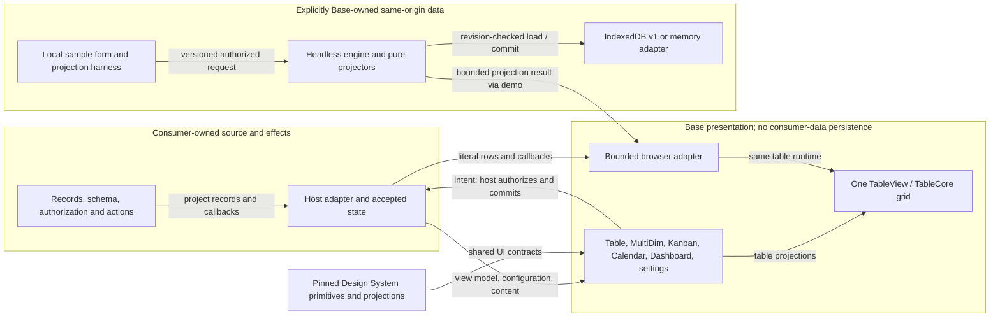

# Reference implementation: Agentic Base shared data-view runtime

## Reference implementation — revision and claim boundaries

This joined artifact, `SHARED-VIEW-RUNTIME-001@0.2.0`, follows [PRD, TAD & ADR Guidelines v3.5.0](../../guidelines/prd-tad-adr-mvp-gtm-guidelines.md) at documentation-source commit `99ea1f49211361528256045719b54f1634eee41a`. It refreshes the October specification against the actual local `agentic-base` checkout at `81e4608280be4ec515c5dd28df7b97d1438a0fc0`, observed on 2026-11-17. All Base source paths below resolve at that exact commit unless stated otherwise; evidence IDs resolve in the source register. This is a reference implementation, not a universal choice of framework, provider, or product.

**Material change:** Table, Multi-dimensional Table, Kanban, Calendar, Dashboard, settings, field workbenches and menu controls already have source implementations. Kanban and Calendar are no longer proposed successor renderers. The bounded browser adapter now composes `TableView` or `MultiDimTableView`; the old `DataTableCore.tsx` is absent. Shared panels, disclosure, rich text, hover and Viewer surfaces belong to Design System and are consumed directly rather than implemented or re-exported by Base.

**Evidence limit:** E-03 satisfies the bounded headless VCC-09, earning local `dev-proven`; it does not satisfy the full UI, browser, release or recovery criteria. E-02 records a failed full Base check in the current installed dependency environment. Delivered readiness remains `undocumented`: no current consumer runtime, live parity, package publication, deployment, payment or repeat-demand proof was collected. The document remains proposed; source inspection and documentation checks do not discharge Phase 3 baseline sign-off.

The inspected checkout has no tracked modifications and has three untracked planning drafts. They were preserved and excluded from implementation evidence. This task changes only this document; it does not implement repairs in Base, update consumers, or open a delivery boundary.

## Reference implementation — PRD: purpose, users and pain

### Problem, users and jobs

Maintainers need portable data projections and reusable views while retaining their own schemas, records, authorization, actions and persistence. The near-built solution is the existing Base engine and shared view package, rather than another grid or store. The current problem is reconciling the implemented contracts, dependency pins and evidence before further adoption. No measured buyer pain frequency, willingness to pay, integration savings or active-user count is available.

| Participant / job | Value exchanged / payer | Owner and interface | Trust, cost and unresolved dependency |
|---|---|---|---|
| User / inspect and act on records | Consistent views within the owning product; no payer established | Base view contracts; host supplies records and accepted action results | Browser-local presentation; full keyboard, touch and accessibility checks pending |
| Integrating developer / reuse views | One grid and host seam instead of repeated presentation; savings unknown | Base package exports in E-01; exact Git pins in each consumer | No consumer data transfer; integration time and current consumer pins need readback |
| Operator / release and recover | Exact source/artifact identity and prior revision | Base and consumer release workflows; E-01/E-05 | Each owner retains effect authority; unknown provider fees/headroom block the dependent effect |
| Design System maintainer / own shared primitives | Central panels, profiles, controls and accessibility contracts | Exact dependency and generated projections in E-01/E-06 | FOSS notices and source digests remain revision-specific; installed package drift observed |
| Assurance / check bounded claims | Reproducible pass/fail evidence | Existing TypeScript, Node, artifact and policy checks | Checks grant no mutation authority and cannot substitute for production evidence |
| Agent / provider | No runtime model job or payment flow in this slice | No Base agent transport or model provider | Zero serving model calls; external agent routes and financial settlement are out of scope |

Graph and Shoply/Commerce are consumers documented by Base, not independently verified current integrations in this revision. Design System is the upstream primitive owner; its old catalog inventory is not used as current adoption, rights or release evidence. Named human owners remain unassigned; accountable functions are specified per outcome.

### Ranked pain-to-feature record

| Rank / pain and evidence | Hook → break → fix → close | Reuse/build split and trace |
|---|---|---|
| 1. Integrator cannot reproduce a green current package check; observed E-02, not buyer/WTP validation | Use exact source → installed dependency cannot resolve Viewer → reconcile the existing dependency installation and rerun intact checks → retain exact result | Reuse dependency/lock and existing check owner; no new runtime. PRD-VIEW-04 → VCC-05; next bounded outcome |
| 2. Specification and provenance drift; observed E-01/E-04 | Find shared views → October plan omits implemented surfaces and provenance includes removed paths → refresh this joined record and then the owner manifest → locate actual exports and current digests | Reuse Base source/manifest; this documentation update adds no package. PRD-VIEW-01 → VCC-01/05 |
| 3. Consumer fidelity/accessibility friction; unvalidated in current runtime | Embed existing views → no current matched fixture result → test existing owner components and host callbacks → disclose measured behavior | Reuse Base + Design System; extend an owner only after a concrete failure. PRD-VIEW-02/03 → VCC-02/03/07/08/10 |

This ordering uses observed integration failures, then proximity to built source. It does not claim validated market demand. All commercial pain remains `unvalidated`; no `demand-proven` label or implementation baseline is earned by these hypotheses.

### Stories and scope

- **PRD-VIEW-01:** An integrator supplies a stable view model and host callbacks to existing shared views without another product-owned renderer or data store.
- **PRD-VIEW-02:** A workspace user keeps record identity, hierarchy, selection, layout and host-owned edit flows across Table, Multi-dimensional Table, Kanban and Calendar.
- **PRD-VIEW-03:** A maintainer composes Dashboard, saved-view settings and field presentation with the shared Design System primitives while retaining product content and persistence.
- **PRD-VIEW-04:** An operator reproduces the exact source checks, pins and artifact digests, then restores a prior reviewed revision without changing user data.

| Priority | Outcome and pain join | Current disposition |
|---|---|---|
| Must | Document/reuse one structural table grid, existing views and actual host seams; pain 2 | Source exists; inspect instead of rebuilding; VCC-01/07/08/10 remain partially or wholly unverified |
| Must | Preserve schemas, records, domain permissions/actions and persistence in each host; pain 3 | Headless engine persists only explicitly Base-owned data; view consumers need no Base store |
| Must | Reproduce checks and exact dependency/artifact identity; pain 1/2 | Full local check currently fails; VCC-05 pending |
| Must | Provide browser/mobile/offline and accessible behavior for admitted surfaces; pain 3 | Source support differs by surface; prove through VCC-02/03/04 before baseline |
| Should | Measure clean-checkout activation and consumer rollback using existing exports; pain 1/3 | Target ≤5 manual steps / 30 minutes; no timed walk-through yet |
| Could | Extend an existing owner after a demonstrated host-contract gap | No new renderer, SDK, registry or orchestration controller justified now |
| Won't (this increment) | New Kanban/Calendar implementations, hosted storage, remote sync, file service, package-registry publication, paid offer, consumer migration/deployment, or MCP/WebMCP and sigil routes | Existing views are reused; remaining delivery/agent scope requires its own evidence and authority |

### Metrics, time-to-value and economics

All targets are acceptance goals unless an Evidence Reference states a result. Target observation window is the next admitted local rehearsal, followed by the bounded internal learning experiment in GTM.

| Metric / feature | Observed baseline | Target and check |
|---|---|---|
| Current source validation | E-02: full check exit 2; E-03: Node suite 37/37 | Entire `npm run check` exits 0 at exact source and installed pin; VCC-05 |
| One table owner | E-01: Table/MultiDim/browser entry share the Table runtime; no `DataTableCore.tsx` | Source inventory plus matched host fixture; VCC-01 |
| Table/MultiDim TTV | Unknown | Exact pin → host model → render fixture → host callback → readback; ≤5 steps / 30 minutes |
| Kanban/Calendar TTV | Implemented source; integration time unknown | Each existing export renders a host fixture within ≤5 steps / 30 minutes; VCC-07/08 |
| Dashboard/settings/field TTV | Implemented source; integration time unknown | Each host fixture composes existing Base and Design System contracts within ≤5 steps / 30 minutes; VCC-10 |
| Visual fidelity | Historical reference only; no matched local capture | Retain six named columns, hierarchy and host controls; matched boundaries within 4 CSS px and row heights within 2 CSS px; VCC-02 |
| Accessibility/device reach | Source keyboard/focus and responsive rules; no end-to-end pass | Keyboard/touch, visible focus, non-color meaning, 200% zoom, reduced motion, narrow viewport, contrast and target checks; VCC-03 |
| Local/offline/recovery | E-01: same-origin shell + IndexedDB v1; no live proof | Primed offline reload, literal-text bounds, preserved user data on source rollback; VCC-04/06 |
| Bundle bytes | E-05 records 241,601 JS + 36,658 CSS; dropdown 22,113 JS | Each generated output <500,000 raw bytes; reproduce rather than infer from old sizes |
| Spend and value | No payer, savings baseline or cost ledger | $0 incremental spend cap; no paid/addon/overage fallback; unknown current provider cost/headroom blocks external effects |

ROI `(impact × monthly reach) / (build hours + monthly TCO + monthly token cost)` cannot be calculated: impact, reach, effort and support inputs are absent. Zero runtime model calls do not make authoring tokens or operator time free. Local browser variant: no new hosted resource, serving-model tokens 0, browser storage/device and operator costs unmeasured. Consumer-hosted static variant: existing host/CI quotas, fees and 12-month TCO unverified. Edge/remote variant: no adapter, deployment or cost proof, therefore deferred. Do not blend these variants or report $0 realized TCO from a $0 budget.

### VCCs and evidence-derived state

VCC identities 01–08 are preserved; 07/08 now verify existing views rather than authorize new renderers. All full criteria below are pending except VCC-09. Readiness applies to these stated bounds, never to a whole consumer product.

| ID / PRD trace | Measurable end state and stated check | Constraint and current result |
|---|---|---|
| VCC-01 / 01 | Table, column orientation, MultiDim and browser entry share `TableCore`/`TableView`; source inventory and the same host fixture pass | No second grid or store. Source-observed E-01; fixture result absent |
| VCC-02 / 02 | Compare Base and host frontmatter fixture at 1113×952 CSS viewport and recorded 74% zoom; Key, Type, Scalar Value, List Value, Summary, Output, nested rows and host tabs/toolbar present; geometry meets metrics above | ≤3 review cycles; browser/font variance disclosed. Historical screenshot not available for recapture here; no parity pass |
| VCC-03 / 02/03 | Per-surface browser checks pass keyboard, touch, focus, non-color semantics, 200% zoom, reduced motion, narrow viewport; text ≥4.5:1 (large text ≥3:1), control/focus ≥3:1, usable 44 CSS px touch targets | Measured final colors/geometry; profile metrics or source markup alone insufficient. Pending |
| VCC-04 / 01/04 | Browser artifact rebuild/check passes; malformed/oversize and duplicate-ID inputs reject; strings remain literal text; primed demo reloads offline with no uncached dependency requests | Browser limits below; no data deletion. E-05 standalone artifact rebuild/check passes; live bounds/offline test pending |
| VCC-05 / 04 | Intact Base `npm run check` exits 0; package/lock/installed pin reconcile; generated outputs and current provenance paths/digests match; notices and predecessor recorded | E-02 fails; E-04 provenance stale. No package publication or rights inference |
| VCC-06 / 04 | Disposable consumer restores prior exact Base/Design System pins, lock and generated artifacts; rebuild/readback confirms old digests and unchanged records | No IndexedDB clearing or schema migration. Pending |
| VCC-07 / 02 | Existing Kanban host fixture preserves lane/card IDs, empty groups and authorized move/reorder results through keyboard/touch; rejected/accepted outcomes read back from host | E-03 proves headless grouping only; React move/drag and consumer persistence not covered |
| VCC-08 / 02 | Existing React Calendar fixture tests civil dates, offset timestamps, time-zone conversion, invalid/missing/range inputs, month navigation, keyboard paging and DST boundary | E-03 proves separate headless date-only behavior only; React/DST/UI results pending |
| VCC-09 / 01/04 | Existing Node suite exits 0 for authorization-before-storage, revisions/conflicts, one-winner concurrent writes, deterministic projections and shared helper/profile contracts | E-03: 37 passed, 0 failed/skipped; memory and helper scope; no browser IndexedDB atomicity or full UI proof |
| VCC-10 / 03 | Dashboard/settings/field fixtures render through Base contracts and direct Design System panel, disclosure, rich-text, hover and Viewer owners; host save/cancel/resize/readback pass | Source exists; E-02 blocks current full type-check. No Base panel/Viewer/rich-text replacement or forwarding shim |

## Reference implementation — TAD: owners, contracts and flows

### Codebase grounding record and component inventory

E-01 pins the native Base input; E-06 pins non-native Design System contracts. E-04 records the historical Graph migration input and its present limitations. E-07 pins the authoring owner. These scoped grounding records consume the existing [cross-repository snapshot](../../schema/agentic-rag/prd-tad-adr-mvp-gtm-grounding.json); they do not refresh or duplicate its portfolio inventory. Current external consumer pins were not acquired and cannot be treated as baseline evidence.

| TAD component / inspected contract | Exact source owner / grounding | Decision and smallest delta | Boundary / check / VCC |
|---|---|---|---|
| TAD-CORE: `createBaseEngine`, `CONTRACT_VERSION=1`, adapters | E-01: `src/{index,engine,schema,query,projectors,errors}.mjs`, `src/adapters/{memory,indexeddb}.mjs` | `reuse`; no new core or storage | Base-owned data only; `test/engine.test.mjs`, `test/projectors.test.mjs`; VCC-09 |
| TAD-TABLE: `TableCore`, `TableView`, `ColumnsTableView`, `MultiDimTableView` | E-01: `packages/views-react/src/table/`; exports `./table`, `./table/multi-dimensional` | `reuse`; one grid; narrow broad host types only for an observed gap | Host schema, editors, tokens, menus, formatting and graph overlay; VCC-01/02/03 |
| TAD-BROWSER: `mountDataView`, `DATA_VIEW_BROWSER_LIMITS` | E-01: `src/browser/{index.ts,DataViewBrowserAdapter.tsx}` under `packages/views-react/`; E-05 manifest | `reuse`; replace the obsolete DataTableCore description; no alternate renderer | Literal-text read-only data; controlled selection/activation/orientation; `update`/`destroy`; VCC-04 |
| TAD-KANBAN: `KanbanView`, `KanbanHostProvider`, move/reorder helpers | E-01: `packages/views-react/src/kanban/`; export `./kanban` | `reuse`, not successor implementation | Host data, inline editor components, domain grouping/actions, `onUpdateCell`/`onReorderRows`; VCC-07 |
| TAD-CALENDAR: `CalendarView`, `projectCalendarView`, date helpers | E-01: `packages/views-react/src/calendar/`; export `./calendar` | `reuse`; keep rich and headless date policies distinct | Host config, permission and action callbacks; existing React time-zone/range behavior; VCC-08 |
| TAD-DASHBOARD: board/grid/frame/charts/editor/layout/resize | E-01: `packages/views-react/src/dashboard/index.ts` and implementations; export `./dashboard` | `reuse`; no new dashboard engine | Host widget records/configuration, product drag policy, persistence and Mission content; VCC-10 |
| TAD-SETTINGS: `ViewSettingsPanel`, settings primitives, shell/field workbench | E-01: `packages/views-react/src/settings/`; export `./settings`; FieldWorkbench implementation is not a root package export | `reuse`; distinguish implementation/deep source use from declared public exports | `SettingsHostAdapter`, saved views, product schema/actions remain host-owned; VCC-10 |
| TAD-CONTROLS: React/native menus, checkbox/toggle groups, icons | E-01: `packages/views-react/src/controls/`; exports `./controls`, `./toolbar-icons`, `./toolbar.css` | `reuse`; one Base menu interaction owner and generated Design System visuals | Base menu focus/typeahead/placement/dismissal; native form semantics retained; VCC-03/04 |
| TAD-DESIGN: panels, disclosure, rich text, hover, Viewer | E-06: `agentic-design-system@54229ceed5106c5a44a2cb3731c0deb0f74a1904` declared/locked; direct imports listed below | `reuse`; owner first; no Base facade or lifecycle fork | Exact installed revision differs; E-02; VCC-05/10 |
| TAD-DEMO: browser and React composition harnesses | E-01: `demo/`, `sw.js`, `scripts/dev-server.mjs`, `packages/views-react/dev/` | `retain-local` harness, not a second product UI | Root demo writes only via local form/engine; all four headless outputs use shared browser table; VCC-04/09 |

**Package facts:** name `@agentic-base/views-react`, version `0.1.0`, `private: true`, Node engine `>=22.22.0`. The dependency-free/no-network statement applies to the headless core, not to the React view package or its build toolchain. React/ReactDOM/lucide are peers; d3 and its types are optional peers. The browser bundle includes React and ReactDOM and targets ES2022. Source TypeScript exports require a compatible consumer build; this is not an already published compiled registry package. Exact consumer pin/lock readback remains a prerequisite for consumer changes.

**Provenance qualification:** `migration-source.json` says `local-adapted-unpublished` and has 55 source/digest entries, not the README's stated 54. E-04 finds four removed paths and 20 mismatched candidate digests among the 51 existing files. Its Graph PR #1470 note conflicts with the README's statement that successor #1471 superseded it. Treat the manifest as historical migration evidence, not a current release receipt; resolve at the Base owner before VCC-05. Do not restore removed implementations to make an old map pass.

### Host model, data lifecycle and limits

Headless `engine.execute` accepts `{contractVersion:1, actorId, operation, payload}` and returns success data or a stable `BaseOperationError` code. Supported operations are base create/get, table list/create/rename, record get/list/create/update/delete, and view project. Caller authorization precedes storage access. Every write uses the expected base revision; update/delete also require the expected record revision. Adapter `load`/`commit` owns persistence and conflict atomicity; memory tests do not prove live IndexedDB transactions. The browser atomicity harness is `test-browser/idb-atomicity.html`/`.mjs`, unrun here.

Headless caps: 2,000 records and 5 MiB serialized records/base, 64 tables/base, 128 fields/table, 64 filter nodes, six filter levels, eight sort keys, 250 records/page, 500 KiB/operation. Callers may lower limits, never raise them. Field types are text, number, boolean, date and select. These are configured bounds, not throughput or capacity measurements.

React views consume `ViewModel {columns, rows, titleColumnId, groupByColumnId}` with stable row IDs and string cells. `TableHostAdapter` checks `agentic-base/table-host/v1` and injects components, helpers, theme/copy/style, icons and a preference store. Several shapes still use `any`/broad records; a fully narrow typed seam remains proposed. Kanban and settings have separate host contexts. UI callbacks express intent; each host authenticates, authorizes, persists and returns accepted state. A callback is not an authorization grant or a committed write receipt.

Browser caps differ: 64 columns, 1,000 rows, 4,096 characters/cell, 128 characters/ID, 256 characters/label and 196,608 serialized payload bytes; optional hierarchy depth 1–8. IDs must be unique, cells match columns, selected rows exist, and orientation callbacks apply only to MultiDim. Invalid input raises `TypeError`/`RangeError`, rather than the engine's error envelope. Only `text`, `select`, `multi-select` column kinds are accepted. `canMutate`/`canConfigure` are false; controlled selection, row activation/deselection and optional pivot orientation are supported. Repeated mount of the same target rejects; updates after destroy reject and destroy is idempotent. This adapter is data-read-only, not noninteractive.

Headless Calendar uses ISO date-only values without time-zone conversion and separates `unscheduled`, `invalid`, `outsideMonth`. React Calendar additionally accepts civil dates and RFC3339 timestamps with offsets, validates an explicit IANA display zone, supports start/end ranges and month/day navigation, and returns errors/invalid rows without silent repair. It builds a 42-day grid and derives visible weeks; instant end dates use the implemented end-exclusive adjustment. Do not apply the headless date-only claim to the React export or invent recurrence/event storage.

Records remain in their owning consumer or in explicitly created Base IndexedDB v1. The demo shell caches same-origin assets, not record snapshots. Browser eviction is possible; export/import, backup restore, destructive migration, remote synchronization and file storage are absent. Local sample writes are illustrative and are not trusted authentication against same-origin code.

### Native design ownership and adoption

| Concern | Native owner / exact join | Base adoption and check | Current limitation |
|---|---|---|---|
| Panel family and lifecycle | E-06 `react/panels` | Dev imports FloatingPanel/control groups/disclosure directly; settings shell/workbench import section headers/scroll regions; panel checker passes before E-02 failure | No Base panel export or forwarding shim; placement/lifecycle parity requires live proof |
| Rich text, hover, Viewer | E-06 `react/rich-text`, `react/hover`, `hover/text`, `react/viewer` | Dashboard editor/charts/card bodies use these owners directly | Installed older Design System lacks Viewer export; no full type-check success |
| Tokens, typography and geometry | E-06 shared-ui/base profile pin files, icons and toolbar pins | Generated offline projections; 38px desktop / 54px touch rows, 14px/20px body role; shared helper/profile tests pass | Metrics are source defaults, not measured accessibility/contrast or whole-product uniformity |
| Hierarchy and sticky table behavior | E-01 Table runtime and `stickyHierarchy.ts` | One header/ancestor-path owner; fixed grip/chevron/checkbox slots; native scroll-padding honored; helper tests pass | No consumer scroll/resize/shadow-host browser result recorded |
| Brand and illustration | Consumer/Design System profile owners | No new brand asset, downloaded font or illustration needed | Third-party notices/rights must be checked for exact distribution; old catalog rights claims are not current evidence |

Build/release dependencies are acyclic: cleared Design System exact source/export → Base exact dependency/lock and generated projections → Base checks/source integration → consumer exact pin/lock/artifact and checks → separately gated delivery. Runtime callback/readback edges can return to a host; they are not build dependencies. A Design System site may consume released Base examples at the presentation layer; Base imports primitive package exports, not the catalog website or Graph source.

### Applicable flows and diagrams

| Feature set | User journey | Workflow | Data flow | Orchestration/harness | Topology |
|---|---|---|---|---|---|
| Core/local demo | Create sample → inspect/reload; D-02 | Form → engine → readback; D-02 | Request/projection/storage; D-01 | N/A: no agent/model loop | Local browser/origin and adapters; D-01 |
| Table/MultiDim/browser | Pin → model → render/select/pivot; D-02 | Intent → host → accepted state; D-02 | Host view model → shared grid; D-01 | N/A: ordinary UI callbacks | Existing Base renderer and host; D-01 |
| Kanban/Calendar | Inspect groups/dates → host action; D-02 | Move/navigation/config → host readback; D-02 | Same IDs projected into view; D-01 | N/A: no autonomous execution | Existing React exports; D-01 |
| Dashboard/settings/fields/menus | Configure → save/cancel; D-02 | Host owns validation/persistence; D-02 | Config/content → Base + primitive owner; D-01 | N/A: component lifecycle is not orchestration | Base content with direct Design System; D-01 |

**Diagram D-01** · Class: Data flow/component topology · Notation: Mermaid `flowchart LR` · Version: 0.2.0, 2026-11-17. Caption: existing owners and data residency; all shared view families already exist. Render surface: Markdown Mermaid/canvas projection check E-08.

| Node / owner | Input → output | Persistence/failure boundary |
|---|---|---|
| `source`, `host` / consumer | Records/schema/permissions → model and accepted callbacks | Consumer store; host handles authorization, conflicts and reconciliation |
| `views`, `table`, `browser` / Base | Presentation data → React/DOM and intents | No consumer data storage; typed engine errors and browser exceptions remain distinct |
| `design` / Design System | Pinned primitives/profiles → shared visuals and lifecycle | Package/versioned artifacts only; missing export blocks dependent build |
| `demo`, `engine`, `storage` / Base-local | Form request → bounded projection and snapshot | IndexedDB origin v1 or memory; no remote storage |

**Diagram D-02** · Class: User journey/workflow · Notation: Mermaid `flowchart LR` · Version: 0.2.0. Caption: one reusable journey covers each feature row above; failed actions retain the host as authority. Render surface/check: E-08.

### Invocation, quality and deployment boundaries

**Invocation Register (one scoped register):**

| Surface / identity | Support / schema owner | Authority, offline/device reach and token cost |
|---|---|---|
| Local ESM engine call `createBaseEngine().execute` | Supported; E-01 request v1 and stable errors | Caller policy hook before adapter; local JS/browser; no serving model tokens |
| Browser `mountDataView` | Supported; E-01 state/handle and bounds | Presentation + host callbacks; primed static assets; modern browser; no mutation grant |
| React package exports | Supported at source/build level; E-01 contracts | Host owns effects; mobile geometry in source, device behavior unverified; no agent endpoint |
| HTTP service / MCP / WebMCP / `/` command / `@` binding / `#` semantic route | Unsupported in Base | No handler, gateway or capability catalog; do not invent route identities or claim transport parity; revisit only on a concrete integration job |

The local static development server is not a production data API. Discovery is reading local docs/exports with zero runtime model calls; UI callbacks and typed engine calls are not an MCP service. Later transports must reuse these owners and declare schema, authentication, budgets, idempotency and effect authority rather than copying handlers.

Security/recovery scenarios: authorization rejects before storage; stale base/record revisions reject without partial memory writes; incompatible IndexedDB versions stop writes; bounded browser text does not interpret HTML; rich host renderers need independent safety checks. Same-origin code remains a trust boundary. Service-worker caches and origin storage are not backups. Local server sends CSP Report-Only for development HTML; there is no production enforcement receipt. Any future production HTML must enforce CSP under the owning deployment policy.

| Lane / residency | Boundary name and state | Required evidence / operator instruction / rollback |
|---|---|---|
| Authoring / local source and fixtures | `source-integration`: source-only workflow | Exact document/source candidate, affected checks, protected PR and per-effect authority; current user request covers this document update, not a Base/consumer change; reviewed revert preserves other bytes |
| Mirror / non-public built static artifact | `local-preview`: closed for promotion in this task | Selected exact source/output digest + local readback, referenced operator instruction, prior artifact restore check; no promotion performed |
| Delivery / selected public consumer host | `public-delivery`: closed | Exact Dev→Prod artifact identity, current hard-$0/deny-at-quota proof, operator instruction and live readback, rollback predecessor; none acquired here |

Base `docs/DEPLOY.md` defines no hosted deployment. The documentation repository's `docs/DEPLOY-WORKFLOW.md` seals `index.html`, `guidelines/` and explicit schema routes; `docs/documents/` is outside its current Pages payload. Updating this document does not publish it as a site route. Source release, mirror proof, delivery, package publication and consumer cutover need distinct receipts; none can be inferred from this artifact.

## Reference implementation — ADR: decisions, alternatives and recovery

### ADR-01: reuse implemented views, preserve domain ownership

**Status:** observed architecture retained; current full compatibility remains unproven. **Decision:** reuse the existing Base grid and view families, headless core only where records are explicitly Base-owned, and consumer adapters for product semantics. Table/MultiDim/browser use one table runtime. Kanban/Calendar/Dashboard/settings are existing capabilities to verify, not a new roadmap build.

| Candidate | Constraint disposition | Cost/tradeoff and relation |
|---|---|---|
| Direct existing owner + explicit host contract | pass for source reuse; full check/parity remain prerequisites | Chosen; closest to built source; preserves host data/actions |
| Contract-only consumer adapter | pass when required for intentional host semantics | Compatible with direct reuse, not a competing renderer; typed mapping/error/readback checks required |
| Retain consumer domain logic locally | pass for parsing, permissions, persistence, product lifecycle | Required boundary; cannot justify duplicate grid or primitive lifecycle |
| Copy a product renderer or add a new grid | fail-single-owner | More dependencies/drift without a demonstrated missing owner capability |
| Embed full product in an iframe | fail-minimum-scope | Unrelated stores/lifecycle and unverified offline/bundle behavior |

Among feasible options, reuse outranks new implementation on source delta and ownership; a host adapter and local domain logic are complementary, not ranked substitutes. Buyer ROI is incomparable because inputs are absent. No contested platform/vendor choice or independent argument verdict is claimed. Revisit only after a same-fixture contract failure. Recovery restores exact prior Base pin/lock/artifact without changing records.

### ADR-02: direct Design System primitive consumption

**Status:** implemented in source; installed dependency drift blocks full validation. **Decision:** retain Design System as owner of panel families, disclosure, shared UI profiles, toolbar/icons, rich text, hover and Viewer. Base owns data-view/domain-neutral presentation and its menu interaction helpers; consumers supply content, state and callbacks. Settings section/scroll and Dashboard rich-text/Viewer imports are direct. Removed Base disclosure/section-header implementations and panel forwarding APIs stay removed.

Direct imports pass the single-owner constraint and minimize adapters. A contract-only host callback seam remains valid for product content; a Base re-export shim or local primitive lifecycle/style fork fails single-owner. The immediate delta is installation/pin reconciliation and verification at the owner, not another Viewer or panel. Restore prior exact Design System pin + lock + reviewed import changes together for rollback; never mix revisions or recreate removed shims. Revisit after E-02 is reproduced with the exact declared installation.

### ADR-03: exact Git source and artifacts; no registry or hosted expansion

**Status:** existing distribution policy retained. **Decision:** keep `private: true`, exact Git pins and source/output manifests. MIT in the inspected Base source applies to its owner-authored material; third-party rights/notices remain separate. Current README identifies the public canonical repository and frozen private archive; no fresh provider visibility readback is claimed. Old October visibility/license blockers are historical, not present-day consumer pin findings.

Mutable branch pins fail reproducibility. Registry publication, a new hosted service, remote storage and agent transport fail current scope/cost/evidence constraints. An exact artifact with manifest is feasible; copying anonymous bundle bytes is not. Local/static FOSS reuse is the selected deployment model; hosted/edge costs and capacities are unknown and therefore incomparable, not scored as free. Revisit distribution only after intact checks, current provenance/notices, consumer compatibility and exact predecessor proof. Recovery is a reviewed pin/artifact revert; state recovery remains a separate effect.

## Reference implementation — MVP: existing slice and remaining proof

The smallest current slice is one exact local fixture through the existing Base engine/browser adapter and one rich host composition. The original Table-first implementation proposal is superseded by the actual broader source baseline. It does not justify rebuilding Kanban/Calendar, declare all views accepted, or authorize a consumer cutover.

| Scope | Implemented source | Remaining acceptance / existing owner |
|---|---|---|
| Headless records and projections | Revisioned engine, memory/IndexedDB adapters, Table/matrix/Kanban/date-only Calendar | VCC-09 locally passes; live IndexedDB atomicity and offline reload remain VCC-04/06 |
| Browser Table/MultiDim | Shared rich table runtime, selection/hierarchy/pivot callbacks, bounded literal data | VCC-01–04 fixtures; no old DataTableCore fallback |
| React Kanban/Calendar | Group/card controls, drag/move helpers; time-zone/range calendar and navigation | VCC-07/08 host, keyboard/touch, DST and effect readback |
| Dashboard/settings/field presentation | Existing components and direct shared primitive consumption | VCC-10; first reconcile E-02 at the dependency owner |
| Distribution/recovery | Exact declared dependency and generated output manifests | VCC-05/06 full check, current provenance/notices and disposable consumer rollback |

**Must for the next proof increment:** reconcile the exact installed dependency without inventing a facade; run the intact existing check; reconcile provenance at its Base owner; then admit one fixture/action/readback on the existing renderer. **Should:** measure TTV and accessibility before broader adoption. **Could:** extend one observed contract gap. **Won't:** new renderers, new store, registry publication, remote agent routes, paid service, product data migration or deployment.

### Demo skeleton and maturity

| Beat | Cap | Action / VCC reveal |
|---|---:|---|
| Hook | 20 s | Open local exact-source harness and disclose revision/check state |
| Probe | 45 s | Render the same IDs through Table/MultiDim; inspect existing Kanban/Calendar fixtures separately |
| Reveal | 45 s | Demonstrate deterministic projection and rejected stale write; VCC-09, bounded to memory tests unless live proof exists |
| Select/configure | 45 s | Invoke one supported host action, inspect accepted state or explicit failure; VCC-01/07/08/10 stays pending without recorded result |
| Close | 20 s | Show dependency/artifact predecessor and remaining UI/offline/rights gaps |
| Total | ≤175 s | No production, full parity, payment or recovery claim from narration |

Domain object is a stable record projected into a host-owned view, not an agent chat. No 1–5 experience level is claimed: the four-criterion maturity rubric has not been independently applied. No highest contiguous pass is established. Next assessment needs full dependency validation, per-surface user fixtures, clean-environment TTV and action readback; shared-import counts do not earn a level.

### Execution bounds and readiness gaps

For each future proof/repair task: active estimate ≤60 minutes before re-estimation; one scoped lane, ≤6 changed source modules, ≤25 KiB new source, files <600 lines, outputs <500,000 raw bytes, ≤20,000 planning tokens, ≤3 refinement cycles, stop after two cycles without blocker reduction, $0 incremental spend and zero runtime model calls. Lazy-load noncritical consumer views; actual consumer split/chunk behavior is unmeasured. This document adds no always-load surface. The old 8–14-day build estimate is retired because it assumed views that now exist; no replacement end-to-end ETA is supported without a current fixture/repair plan. External review/CI waits name a condition and recheck event, not a completion ETA.

| Capability | Local rung | Delivered rung | Evidence / next gap |
|---|---|---|---|
| Bounded headless/helper slice | dev-proven | undocumented | VCC-09/E-03; memory/helper scope only |
| Rich/browser views and Design System composition | spec-complete | undocumented | VCC-01–08/10 defined, not fully satisfied; E-02 full check fails |
| Complete joined capability set | dev-proven | undocumented | At least one local VCC passes, but every UI/release/recovery VCC must pass before runtime-ready |
| MCP/WebMCP/agent routes | undocumented | undocumented | Excluded; no Base transport or VCC admitted |

## Reference implementation — GTM: offer and learning

### Segment, first dollar and experiment

Initial segment hypothesis: maintainers of local/offline structured-data workspaces and static catalogs who retain their own data and actions. Geography is global developer distribution, not a measured market. Base documents two consumers; their active usage, current pins, support burden and paid demand were not independently measured. Why now is observed implementation/evidence drift, not a sourced market trend.

Offer: free MIT owner-authored source at exact reviewed revisions, with host contracts and source/artifact identity; third-party licenses remain applicable. No paid plan, addon, overage, subscription or SLA is proposed. Alternatives are native HTML with host logic, another suitable FOSS grid after license review, maintaining the current integration, or doing nothing. Reuse of the existing owner wins on near-built scope; savings remain unknown.

TAM/SAM/SOM are unknown. Bottom-up method would count dated qualified teams × verified need × reachable conversion; top-down would narrow an independently sourced developer/workspace population by offline/runtime fit. Neither population source exists here; no fabricated counts or monetary estimate. Monetization is explicitly deferred under the free-only mandate: no viable authorized paid stream can be ranked to a first dollar. Mechanism-proven, demand-validated, recognized revenue and collected payment are all unproven; no payment mechanism is built. Revisit only on a separately authorized offer with real payer evidence.

**Ranked next outcome:** Base maintainer reproduces a green intact check with exact declared dependencies, resolving observed integrator uncertainty before any feature expansion. Cheapest method: compare package/lock/install identity, reproduce E-02, reconcile the existing installation, run the existing command. Threshold: exact pins match and intact check exits 0; active window ≤60 minutes, the task caps above, ≤2 installation/check attempts before re-estimation. Stop on a required unapproved source/pin change, unclear rights or unknown external cost. Do not treat narrower tests as this threshold.

**Internal experiment EXP-01 (proposed):** after that check and owner provenance repair, invite up to two available consumer maintainers for local exact-pin rehearsals, then observe one second configuration change over two weeks. Record participating/eligible denominators, clean-checkout steps/minutes, failed/repeated actions, support minutes, fork attempts and consumer diff size. Activation target ≤5 steps/30 minutes; continue only if every participating host passes its admitted VCCs, no duplicate renderer appears and paid spend is $0. A second configuration change is repeat-use evidence only for that host; no conversion/cohort result exists now. Stop/pivot the contract on a reproducible incompatible host requirement; pause the dependent trial for unresolved rights/cost. Recheck on owner availability or a repaired exact candidate, with no external-wait ETA. This document does not authorize sending invitations.

### Operations, finance and roadmap

Maintainers and consumer issue trackers own support; no uptime or response SLA is offered. FOSS tools/browser APIs and existing Git/CI are the suppliers; quotas are not capacity guarantees. Incidents preserve user data, stop incompatible writes, retain the predecessor pin/artifact and reopen only the failed owner contract. No hiring, legal entity, jurisdiction, tax or contract conclusion is supported; assign a rights reviewer before a new distribution obligation. An incomplete discovery sketch is sufficient for this document-only decision; no deck, business plan, full financial model, capital ask or external audience action was requested.

| Scenario | Adoption assumption | Price / revenue / collection | 12-month cost and sensitivity |
|---|---|---|---|
| Downside | No qualified participant | $0 offer; no recognized revenue or payment evidence | Operator effort unknown; stop feature expansion |
| Base | One internal rehearsal | $0 offer; no sale inferred | Integration/support minutes and host quota unknown; measure EXP-01 |
| Upside | Both documented consumers rehearse | $0 offer; not two customers | Same unknowns; success depends on compatibility, not imports |

No CAC/LTV, runway, break-even or linked statements can be derived from absent cost/reach inputs. Serving-model token usage is 0 for implemented paths; authoring/CI/provider costs and actual 12-month TCO are unknown. Free allowance/alerts do not prove a hard $0 provider cap. Reduce scope or stop before paid usage; never silently upgrade. External capital is not applicable to this free/FOSS increment; product owner reviews that disposition if the business model changes.

| Phase / outcome | Pain evidence / reuse and owner | Prerequisite / exit | Bounds / stop / recovery / recheck |
|---|---|---|---|
| 0. Current documentation grounding | Observed stale plan; reuse E-01–07; Technical Writer | This five-role revision + affected authoring checks | 30 active minutes, 1 doc, <90 KiB/<600 lines, $0; preserve unrelated edits; refresh on source drift |
| 1. Reproducible full validation | E-02 installation mismatch; Base maintainer reuses declared lock/check | Exact installed source + intact check 0; VCC-05 portion | ≤60 min/2 attempts, shared caps; no substitute shim; restore prior environment on failed repair |
| 2. Current provenance | E-04; Base maintainer updates existing source map/digests, not removed components | Actual files/owners and notice/predecessor record; VCC-05 | ≤60 min/shared caps; stop unknown source rights; recheck exact owner candidate |
| 3. One host fixture and rollback | UI pain unvalidated; consumer maintainer reuses existing views and Design System | VCC-01–04/06 plus 07/08/10 only for admitted surfaces; TTV recorded | One fixture/action first; ≤3 cycles; no renderer/store fork; restore exact pins/artifacts |
| 4. Internal learning | EXP-01; Product function records evidence, not adoption claims | Named preceding VCCs + two-week observation | ≤45 active min analysis; owner response is wait condition; no paid incentive or outbound message authority |
| Deferred | Hosted/edge sync, MCP/WebMCP/sigil routes, registry/paid offer, recurrence or new renderers | Won't this increment; concrete pain, owner, cost proof and new criterion required | No implementation or delivery authority from this roadmap |

### C01–C16 coverage record

Coverage is a decision record, not satisfaction or readiness. Each join refers to `SHARED-VIEW-RUNTIME-001@0.2.0` sections and exact evidence IDs above/below.

| Domain | Disposition / join | Accountable function | Evidence or reason / revisit trigger |
|---|---|---|---|
| C01 Purpose/customer/pain | covered / PRD pain record | Product | E-02/E-04 observed integration gaps; buyer pain/WTP unknown; revisit EXP-01 |
| C02 Market/timing | deferred / GTM segment | Product | No two dated population sources or conversion evidence; revisit after qualified-owner interviews |
| C03 Offer/alternatives | covered / GTM offer + ADR-01/03 | Product | Free source offer and explicit alternatives; paid offer excluded; revisit scope change |
| C04 Product/experience | covered / stories, VCCs and demo | Product/quality | E-01 source, E-03 bounded pass; full UI/device/TTV pending; revisit admitted fixture |
| C05 Architecture/data | covered / TAD inventory/flows | Architect | E-01/E-04/E-06 boundaries and gaps; revisit export/pin/source drift |
| C06 Quality/security/AI | covered / TAD quality + VCC-04/09 | Quality/security | E-03 local proofs; no runtime AI; browser/recovery/CSP proof pending |
| C07 Decisions/tradeoffs | covered / ADR-01–03 | Architect | Source reuse, direct owners, exact pins and recovery; revisit concrete host failure |
| C08 Smallest slice | covered / MVP/readiness | Engineering | VCC-09/E-03 locally proven; remaining criteria stated; revisit full check/fixture |
| C09 Acquisition/retention | deferred / EXP-01 | Product | No qualified leads, cohort or support measurements; prerequisite full check/owner availability |
| C10 Business operations | covered / GTM operations + TAD boundaries | Base maintainer | Existing issue/release owners; unknown SLA/capacity explicit; revisit first actual integration |
| C11 Organization/obligations | deferred / ADR-03 + operations | Product/rights | MIT owner source present, exact dependency notice/consumer review incomplete; revisit proposed distribution |
| C12 Financial viability | deferred / economics/scenarios | Product/finance | No price permission, labor/cost/reach inputs; revisit measured receipts and authorized business decision |
| C13 Capital/milestones | not-applicable / GTM finance | Product reviewer | No funding ask or capital decision; revisit model change |
| C14 ADLC execution | covered / checkpoint + boundaries | ADLC operator | Exact START lane and check outcomes; source/delivery effects require their own receipts |
| C15 Audience projections | not-applicable / GTM operations | Product reviewer | No deck/model/external send requested; revisit audience-dependent decision |
| C16 Learning/next increment | covered / next outcome, EXP-01, roadmap | Product | Continue/stop thresholds and owner explicit; revisit exact repair result or trial observation |

**Coverage:** 16/16 dispositioned; 10/14 applicable covered; four deferred (C02/C09/C11/C12); two not applicable (C13/C15). This is domain disposition coverage, not an exhaustive artifact-bearing-rule conformance ratio. Full rule enumeration/alignment and clean-environment TTV remain unperformed; no zero-finding or baseline-sign-off claim follows from policy-check success.

## Reference implementation — evidence, risks and handoff

### Source and evidence register

| ID | Exact source / named check / surface | Observed result and limitation, 2026-11-17 |
|---|---|---|
| E-01 | `agentic-base@81e4608280be4ec515c5dd28df7b97d1438a0fc0`: README, `docs/{PRODUCT,DEVELOPMENT,DEPLOY,ROLLBACK}.md`, package/lock/LICENSE and implementation paths in TAD | Native source inspected; no tracked edits, three untracked drafts excluded; current consumer deployments/pins not inspected |
| E-02 | Same Base source: `npm run check` in actual local checkout | Exit 2 at TypeScript: `DashboardWidgetCards.tsx(1,31): error TS2307: Cannot find module 'agentic-design-system/react/viewer' or its corresponding type declarations.` Syntax (24 JS modules), demo-token, direct-panel and compact-JSON checks passed first; artifact check/Node suite/evidence emitter/OS evaluations were not reached in this command |
| E-03 | Same Base source: independent `node --test` command, existing repository suite | Exit 0, 37 passed, 0 failed/skipped, TAP duration 322.977083 ms; satisfies VCC-09 only, not the failed intact check, React interaction, live IndexedDB or production |
| E-04 | Same Base source: compare `migration-source.json` candidateSha256 against SHA-256 of present `packages/views-react/<path>` files | 55 entries; 4 paths absent, 20 existing candidate digests mismatch. Historical source: `agentic-graph@0775c87540cb45d6f19156c4090e851b70c71f07`; current consumer state unverified. Reproducible algorithm: enumerate `contentDigests`, test file existence, SHA-256 actual bytes, compare candidateSha256 |
| E-05 | Same Base source: `packages/views-react/dist/browser-data-view.manifest.json` | Records browser JS 241,601 B, dropdown JS 22,113 B, CSS 36,658 B; 24 input rows. `npm run check:browser-data-view` independently exits 0, reproducing all four files including manifest; this is not the intact check or a browser interaction result; output digests below |
| E-06 | Base package/lock declares `agentic-design-system@54229ceed5106c5a44a2cb3731c0deb0f74a1904`; local `node_modules/.package-lock.json` resolves `67a8adb7e0089ddef7403e244f57be1e0842dce8` | Installed package v0.6.0 has no `./react/viewer` export; local install differs from declared source. Generated shared-ui pin separately records registry revision `54229ceed…` and original profile source `e52a52111f52b6af85f99195ec9e59a490548575`; do not collapse source/registry/install identities |
| E-07 | Documentation source `99ea1f49211361528256045719b54f1634eee41a`: authoring guideline v3.5.0, grounding/readiness/verification companions and `docs/DEPLOY-WORKFLOW.md`; runtime SSOT at `agentic-os@d3430c8da71b0128b644040bfd1ef32d9f36c50e` | Governing source read; docs payload excludes this path; no deployment effect selected |
| E-08 | This document candidate: affected authoring checks listed in the checkpoint | `npm run check`, PRD policy check and diagram projection check exit 0; two diagrams, 16 nodes/15 edges/3 clusters, no projection findings. Affected `npm test` validation exits 0 for naming, evaluators, guidelines and git-contracts (4/6 owner checks selected for this path); these checks establish bounded document contracts, never Base runtime parity |
| E-09 | `gh repo view huijoohwee/huijoohwee.github.io --json name,visibility,isPrivate,url`; reviewed repository workflow runner declarations; [official Actions billing contract](https://docs.github.com/en/actions/concepts/billing-and-usage), read 2026-11-17 | Provider reports PUBLIC/isPrivate=false; source checks use standard `ubuntu-latest` runners, whose public-repository usage is free. This scoped compute proof does not cover a different runner, artifact expansion, Base/consumer delivery or authoring-model charges |

E-05 recorded SHA-256 outputs: browser JS `43c553b79c27a2e3c6052ad86d68116d2827ecc88aa2fe6e61e26aeea4e87ae1`; dropdown JS `f63919b05314a6a1207b4b9d840aec26961864454909c3cd811d0e27ecf46021`; CSS `924fbfe75ce1564d7172b6905c73be0bcdf2bd097acabfdeddc2f7ca563fb6d7`. The old 148,590/1,883-byte figures are superseded. The standalone rebuild check reproduced these bytes in the current environment; it does not close the remaining VCC-04 browser conditions.

### Product risks and next action

| Risk / current evidence | Owner | Unblock, recovery and recheck |
|---|---|---|
| R-01 Full local check fails under installed dependency drift, E-02/E-06 | Base maintainer | Reconcile install to exact package/lock in an admitted environment; intact check 0; do not add a Viewer shim or infer declared-pin failure from this installation |
| R-02 Migration map stale, E-04; README/manifest count and PR notes disagree | Base maintainer | Update existing provenance for actual retained/removed owners and current digests; verify source history instead of restoring superseded components |
| R-03 No matched parity, accessibility, mobile/offline or consumer rollback results | Quality/consumer maintainers | One admitted fixture at exact pins; retain screenshots/checks/previous artifact; no runtime-ready claim yet |
| R-04 Buyer pain/WTP, market and measured cost remain unknown | Product function | EXP-01 after source gates; obtain dated population and cost inputs only for the dependent decision |
| R-05 Public distribution rights/notices and provider hard-$0 proof not refreshed | Rights/release operator | Exact candidate notices and current provider proof before dependent publication/CI/deploy effect; preserve predecessor and records |

These are scoped product/implementation risks, not a fabricated full typed alignment scan. Prior revision had no formal finding set; a regression count is therefore unavailable. The independent Node mechanism supplies a bounded local VCC result; the writer does not self-certify complete alignment or runtime readiness.

**Next bounded action:** Base maintainer reconciles the installed Design System identity and reproduces the intact check, with the exact source, package lock, local environment and result retained. Then repair the existing provenance owner and admit one consumer fixture/rollback. Prerequisites, stop conditions and recheck triggers are in the ranked next outcome. This document update itself neither authorizes those code changes nor asks for a new product feature.

### Authoring checkpoint and task receipt

START ran from the canonical documentation checkout using `agentic-os@d3430c8d…` and the existing protected document as the plan. It admitted lane `agent/device-0232231d4a19/agentic-base-grounding`, base `99ea1f49211361528256045719b54f1634eee41a`, with only `docs/documents/prd-tad-adr-mvp-gtm-agentic-base.md` writable. Worktree provenance is in frontmatter. Unrelated canonical documentation edits and all Base planning drafts were preserved.

| PRD-TAD-ADR-MVP-GTM | CID | RAO | Updated Date |
|---|---|---|---|
| All five roles @0.2.0 | Existing implementation and failed/current evidence replace stale October assumptions | Technical Writer → ground existing artifact against exact source → one coherent proposed revision; VCC-09 pass is separate from pending UI/release criteria | 2026-11-17 |

Task bounds: 30 active minutes estimated, one document, <90 KiB and <600 lines; $0 incremental spend authorized, no paid service/dependency added, no always-load delta. Actual model tokens/provider charges, active authoring minutes and CI fees are not exposed as measured receipts here; do not report them as zero. Known local test execution and failure are E-02/E-03. The previous October checkpoint remains in Git history rather than being presented as current proof.

Validation: `npm ci --ignore-scripts --offline --no-audit --no-fund` installed five locked authoring packages locally. `npm run check`, `npm run prd-tad-adr-mvp-gtm:policy:check`, the target-file diagram projection check, and `git diff --check` passed. The affected `npm test` run passed all four selected owners (4/6, no full-suite parity inferred); its receipt is in the lane Git directory under `agentic-os-tests/validation-last.json`. The policy checker validates guideline/grounding structure and explicitly does not evaluate source bytes, semantic venture evidence or product runtime. Source-release receipts are recorded at handoff; package publication, Base/consumer source changes, data migration and deployment remain separate, unperformed effects.
