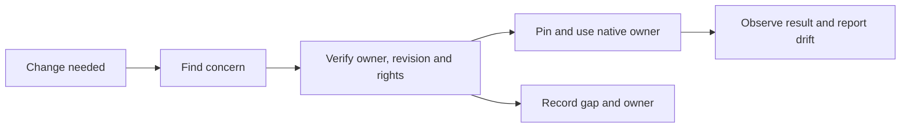
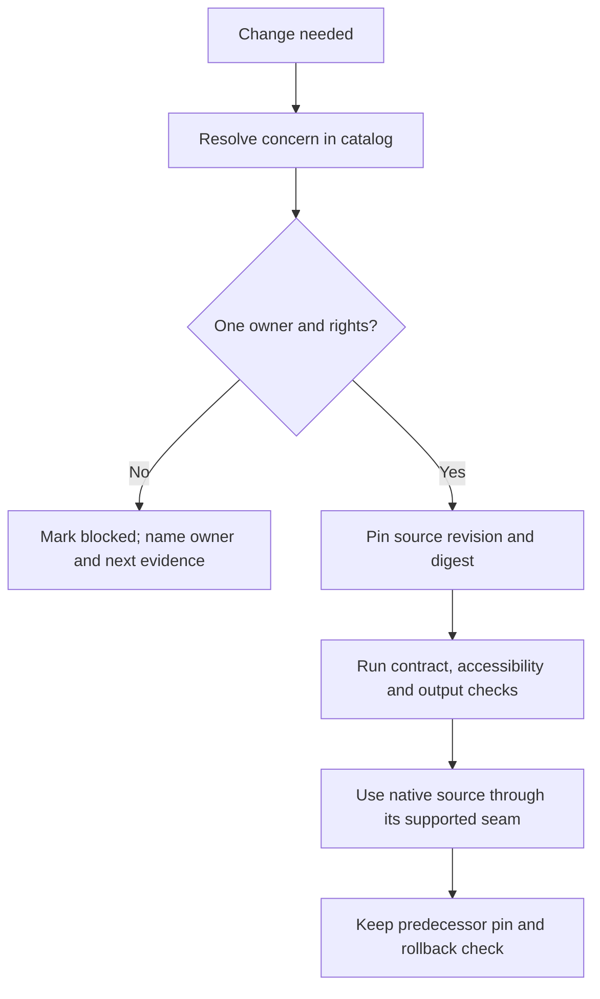
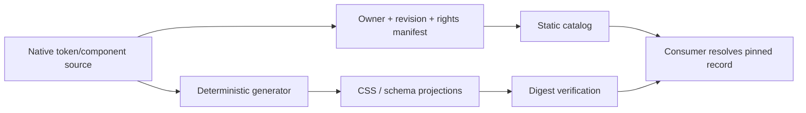
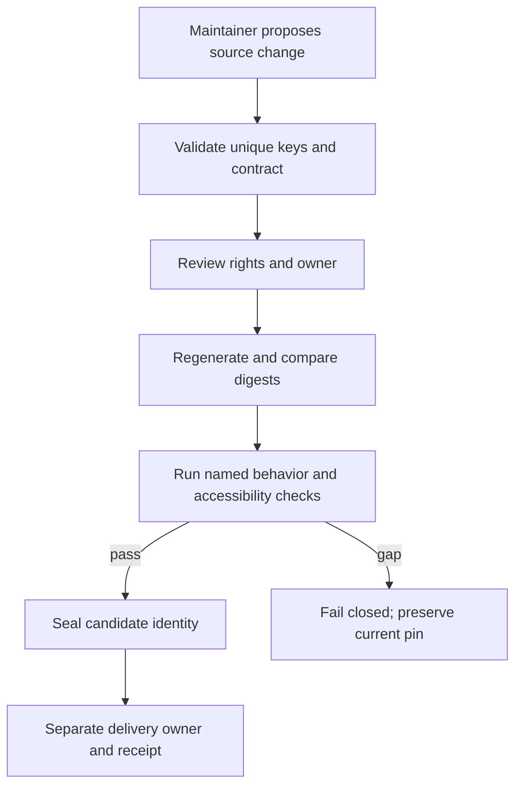
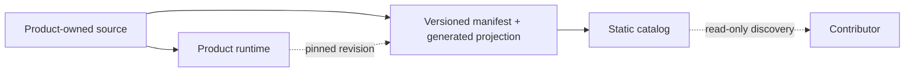

# Design Token and Component Adoption

**Join:** `DESIGN-TOKEN-ADOPTION-001@0.2.0`, continuing `0.1.0`. This revision keeps the product-neutral contract and adds one bounded Commerce profile with a generated static consumer projection. It does not impose one palette across unrelated products, copy private runtime components, or authorize deployment. The status is `spec-complete` because VCCs are defined; implementation evidence is still pending.

**Objective:** enable a contributor to identify the single authorized owner, exact revision, reuse rights and behavior contract for a design concern, then consume it without copied values or divergent variants. For Commerce, Shop, Vendor, Admin and the SME pack use one product profile, one shared shell and one generated CSS projection; role-specific content may vary, but theme-token values and shell implementations do not.

## Reference implementation — Agentic Design System

This labelled block contains repository-specific facts; the product contract below stays portable.

| Source / revision | Inspected owner and boundary | Consequence |
|---|---|---|
| `huijoohwee.github.io` / `148cb5ccd3bd9f1db69ca1b8b261939bcee5e582` | `guidelines/design-theme-contract.md` 1.1.0; PRD guideline 3.4.0. The Pages payload contains `index.html` and `guidelines/`; `docs/documents/` is outside deployment. | This joined spec belongs under `docs/documents/`; no site deploy follows from its authoring. |
| `agentic-os` / `3405dc1246a1b32cfb10c044602505c4cf169c48` | `guides/SYSTEM-PROMPT-RUNTIME.md`, `docs/START-WORKFLOW.md`, `docs/adlc-guidelines.md`, and `docs/RELEASE-WORKFLOW.md` establish free/FOSS bounds, owner checks, exact receipts and effect separation. `src/design.mjs` and `bin/agentic-os-design.mjs` validate declared ownership, cycles and source/output bindings. | Reuse those lifecycle and structural checks; they do not prove rendered UI or rights. |
| `agentic-graph` / `cd1da527e93b8657792292273731e6d1305a78bf` | `grph-shared/src/ui/kgTokens.ts` owns current graph token values and CSS generation; `canvas/src/features/panels/ui/mainPanelHelpIconLibrary.tsx` owns its icon mapping. `config/license-registry.json` classifies application source as private/no-reuse. | Keep source native and private; link exact revisions only. No copying or public transfer is authorized by this observation. |
| `agentic-base` / `a5d0f2d87d8c6871e9639f8224f5eaee056c5b6e` | Existing package metadata is private; no public distribution right is established here. | Record the native owner and pin; do not publish or replicate runtime components. |
| `agentic-commerce-os` / `88bd730c8f35da249fb23349c50820cc1932a95c` | `config/graph-data-view.json` and `public/local-first/graph-ui-tokens.css` show an exact consumer boundary; the consumer is not evidence of whole-product parity. | Preserve the source pin and local adapter; reconcile drift at the consuming owner. |
| `agentic-design-system` / `09dd76e52d03bcb1e6312bc9e326668e1b1c1861` | Public static catalog and schema; catalog is draft and empty. `LICENSE` covers `site/` only and grants no rights in referenced sources. | Add one rights-bound Commerce profile source; generated consumer files remain static and local. |
| `agentic-commerce-os` / `88bd730c8f35da249fb23349c50820cc1932a95c` | Shop, Vendor, Admin and SME share one local-first app; current shell and SME CSS contain divergent token owners. | Reuse the existing shared shell; remove role-specific token roots and keep one pinned generated profile projection. |

No single color palette is imposed across unrelated products. Shared semantics, naming, accessibility requirements, source identity and generated-output rules are the common contract. This increment owns one `commerce` profile at `agentic-design-system/site/tokens/commerce-profile.json`; its color, type, spacing, radius, focus, touch-target and semantic icon-role keys each have one value. Commerce consumes a deterministic, committed CSS projection pinned to the exact profile revision and digest. No page fetches the source at runtime. Graph and other product values remain native to their owners.

### Native design adoption record

This inventory records exact owners where identified; every check is pending. The user's request authorizes the Commerce profile change described here. It grants no Graph/Base source or asset transfer; those owners remain private or unverified.

| Concern | Native owner at exact revision | Reused surface or utility | Acceptance check and result | Gap / next check |
|---|---|---|---|---|
| Identity and illustration | Product-owned assets; Graph example `canvas/public/favicon.svg` at `cd1da527e93b8657792292273731e6d1305a78bf` | Catalog link only; no asset copy | `design-license-boundary-check` — not run | Cross-product rights and owner inventory open. |
| Settings and preferences | Graph `canvas/src/hooks/store/designSystemSlice.ts` at `cd1da527e93b8657792292273731e6d1305a78bf` | Keep native editor state | `design-settings-owner-check` — not run | No shared preference store is proposed. |
| Tokens and render adapters | Graph `grph-shared/src/ui/themeTokens.ts` and `canvas/src/lib/ui/tokens-ssot.ts` remain native at that revision; Commerce profile source is planned at `agentic-design-system/site/tokens/commerce-profile.json` | Exact source pin, digest and deterministic static CSS projection | `design-generated-output-check` — not run | Commerce profile rights and source/output digests must be recorded; no Graph values are copied. |
| Typography and ideograms | Graph `grph-shared/src/ui/typography.ts`, `fontStacks.js`, and `canvas/src/features/panels/ui/mainPanelHelpIconLibrary.tsx` at the Graph revision | Link native typography/icon contracts | `design-accessibility-evidence-check` — not run | No cross-product font or icon transfer established. |
| Editor surface | Private Base package at `a5d0f2d87d8c6871e9639f8224f5eaee056c5b6e`; Graph remains its consumer | Exact private pin only | `design-consumer-pin-check` — not run | No public package right or common editor owner. |
| Status and evidence | OS `src/design.mjs` and `bin/agentic-os-design.mjs` at `3405dc1246a1b32cfb10c044602505c4cf169c48` | Structural owner/digest/cycle validation | `design-release-receipt-check` — not run | Structural checks do not establish rendered behavior or accessibility. |

## PRD

### Customer, pain and evidence

**P1 — unvalidated:** product contributors and maintainers spend time locating current tokens, identity rules, component APIs and accessibility expectations across repositories. Duplicate or stale values can create rework, but lookup time, defect rate, buyer impact and willingness to pay have not been measured. Source inspection proves several distinct owners and one consumer pin; it does not prove customer demand or savings.

| Role | Job | Evidence state |
|---|---|---|
| Product contributor | Find the correct owner, profile and exact revision before changing a surface. | Intended user; not interviewed. |
| Source maintainer | Publish a compatible contract with rights, version and named checks. | Existing source ownership observed; complete inventory open. |
| Accessibility reviewer | Find behavior-level evidence and gaps for each adopted component. | Policy exists; cross-product evidence incomplete. |
| Buyer | Fund a repeated integration or governance outcome if it measurably reduces cost. | Buyer and WTP unknown. |

### Journey and scope

| Stage | User action | Desired outcome | Failure prevented |
|---|---|---|---|
| Need | Start a visual or interaction change. | Resolve the concern and its owner. | Guessing or copying a nearby value. |
| Discover | Search the local catalog. | One exact owner, profile, revision and license record. | Stale `latest` or conflicting records. |
| Verify | Inspect API, accessibility and compatibility evidence. | See pass, gap or blocked state. | Treating a screenshot as proof of behavior. |
| Adopt | Pin and consume the native owner. | One shared Commerce profile and shell across Shop, Vendor, Admin and SME. | Role-specific token overrides or a second editable implementation. |
| Maintain | Report drift in the current owner workflow. | Update the source and regenerate deterministic projections. | Parallel registries and silent drift. |

**Must:** catalog schema; one-owner manifest; exact revision and digest; profile/token key uniqueness; license status; accessibility evidence schema; compatible generated artifacts; pin and rollback record; static, narrow-screen and offline-readable docs. For Commerce, define one product-scoped semantic profile, generate one checked-in CSS projection, and have Shop, Vendor, Admin and SME consume the same profile and shared shell. Reject duplicate token declarations and per-role overrides. Keep runtime behavior, icon rendering and component code at their existing Commerce owner; expose semantic icon-role names without copying private or unlicensed assets.

**Should:** local search and consumer map. **Could:** preview automation or a public runtime package after rights, owner and economic gates. **Won't:** one global palette across unrelated products, copied private source, new settings/state store, remote telemetry, paid service, runtime network dependency, or model calls.

| VCC | Given / when / then | Named check | Constraint |
|---|---|---|---|
| DS-01 | A catalog record is evaluated; it resolves to exactly one owner, path, immutable revision, digest, profile and rights state. | `design-catalog-contract-check` | Missing owner/rights fails closed. |
| DS-02 | A consumer manifest is validated; every token/component reference has one pinned revision and a resolvable predecessor. | `design-consumer-pin-check` | No mutable identity or duplicate source key. |
| DS-03 | An approved source is projected; generated outputs are byte-stable and their source digest matches the manifest. | `design-generated-output-check` | Generated files are read-only projections. |
| DS-04 | An interactive contract is assessed; keyboard, focus, contrast, 200% zoom, reduced motion and narrow touch outcomes each have evidence or a named gap. | `design-accessibility-evidence-check` | A visual snapshot alone cannot pass behavior. |
| DS-05 | A clean narrow browser opens a primed static catalog offline; content and local navigation remain usable. | `design-site-browser-check` | No remote fonts, CDN, telemetry or runtime model call. |
| DS-06 | A public candidate is assembled; every included asset and source has explicit rights and attribution evidence. | `design-license-boundary-check` | Private/no-reuse inputs excluded. |
| DS-07 | A release candidate is evaluated; source, delivery and rollback evidence identify exact revisions and authority separately. | `design-release-receipt-check` | Source integration does not imply deployment. |
| DS-08 | Shop, Vendor, Admin and SME render the same Commerce profile and shared shell; CSS contains one owner per token and no role-specific theme override. | `design-singleton-enforcement-check` | Deterministic generated CSS, one exact source revision/digest, no runtime fetch; role content may still vary. |

Agentic OS-ready status, AI Agent-ready discovery/execution and MCP Gateway-ready federation are unchanged and unpromoted. The catalog MVP makes no agent invocation, approval, orchestration or model call.

### Outcomes and economics

| Metric | Baseline | Target / observation |
|---|---|---|
| Find owner + revision + contract | Unknown; time five contributor tasks before baseline. | ≤5 minutes median in a five-task pilot; record misses and task context. |
| Conflicting owner keys | Full inventory not completed. | Zero unresolved duplicate keys in each candidate. |
| Consumer pin coverage | One observed consumer boundary; universe unknown. | All declared pilot consumers have exact pins and rollback targets. |
| TTV / ROI | Unmeasured. | Report elapsed time and correction/review time; no savings claim before comparable baseline. |
| Incremental cash / tokens | Current spend not attributable to this proposal. | $0 incremental spend; 0 product model calls/tokens. Unknown quota or cost fails closed. |

### Market, offer and alternatives

Geography for any initial validation is Singapore; reachable buyer count is unverified. SingStat reports 371.0k enterprises and 369.5k SMEs for 2025, a broad population ceiling, not a design-system market. IMDA’s 2026 retail plan describes 2,095 interested/eligible retail enterprises for a sector-specific solution; this is not demand for this offer. The 2024 e-commerce-services revenue figure is not software TAM.

| Method | Formula and source | Current result / uncertainty |
|---|---|---|
| Population top-down | TAM = eligible teams × observed annual price. Use 371.0k enterprises only as a broad ceiling; use the narrower 2,095 retail population only if segment fit is later evidenced. | Price and fit are unknown, so monetary TAM is unknown. Do not multiply a broad population by an invented price. |
| Reachable bottom-up | SOM = reachable qualified teams × observed conversion × collected price, constrained by delivery capacity and sales cycle. | No qualified prospect list, conversion, price or capacity sample exists; SOM is unknown. |

The free/manual alternative is owner documentation plus repository search. The FOSS alternative is local schema validation and generated manifests. A paid package or hosted catalog is not justified until measured repeated pain and WTP exist. Initial offer hypothesis: a fixed-scope ownership and adoption review; price remains unpriced pending evidence. No outreach or payment is authorized in this documentation task.

## TAD

### Ownership and interfaces

| Concern | One owner rule | Consumer contract |
|---|---|---|
| Semantic token names and constraints | A single policy owner defines meaning, required states and validation. | Product owner maps each semantic name to one local profile value. |
| Profile values | Each product owns its profile. This increment's single Commerce profile has one editable source in `agentic-design-system/site/tokens/commerce-profile.json`. | Consumers pin profile ID, revision and digest. Profiles are not merged by visual similarity. |
| Runtime components and behavior | Commerce keeps one shared shell and existing state in `agentic-commerce-os`; role views supply data only. | Shop, Vendor, Admin and SME import the same shell owner; no copied or role-specific shell variants. |
| Icons and identity assets | Native licensed source owner; Commerce retains one shared icon renderer and semantic role map. | Reuse exact path/revision and rights; exclude unlicensed material and duplicate renderers. |
| Generated CSS/manifests | Deterministic generator from the Commerce profile source. | Read-only consumer projection, exact source pin, reproducibility and digest check; no runtime network request. |
| Catalog and static docs | Catalog owner curates links, contracts and status. | Static output; runtime does not fetch it to render product UI. |

Manifest fields: stable concern ID; owner; repository/path; immutable revision; source/output digest; token/profile key or API version; license/attribution; supported surface; accessibility contract; named evidence; consumers and pins; deprecation/rollback target. Unknown required fields block use. No second token registry may own the same key.

### Five flows

**Journey:** need → discover owner → verify rights and checks → pin native source → report drift.

**D1 — Contributor adoption journey:** resolve the exact owner and pin or exit with a named blocker.

**D2 — Source release workflow:** validate exact source before separating delivery authority.

**D3 — Catalog data flow:** transform native values into digest-bound outputs.

**D4 — Validation orchestration:** fail closed before candidate release.

**D5 — Adoption topology:** products consume exact pins without a central runtime dependency.

| Diagram | Class | Notation | Surface | Projects | Nodes / edges / clusters | Version |
|---|---|---|---|---|---|---|
| D1 | conceptual | Mermaid flowchart LR | This specification | no | 0 / 0 / 0 | 1.0 |
| D2 | conceptual | Mermaid flowchart TD | This specification | no | 0 / 0 / 0 | 1.0 |
| D3 | conceptual | Mermaid flowchart LR | This specification | no | 0 / 0 / 0 | 1.0 |
| D4 | conceptual | Mermaid flowchart TD | This specification | no | 0 / 0 / 0 | 1.0 |
| D5 | conceptual | Mermaid flowchart LR | This specification | no | 0 / 0 / 0 | 1.0 |

### Quality, security and operation

Static artifacts are readable on mobile browsers and after cache priming; layout reflows without horizontal page overflow at 320, 360, 768 and 1280 CSS px. Interactive controls target ≥44 CSS px; text contrast ≥4.5:1 (large text ≥3:1), control/focus contrast ≥3:1; keyboard, visible focus, reduced motion, 200% zoom, offline and fallback fonts are named checks. These are acceptance targets, not current pass claims.

Threats: poisoned manifest, stale source digest, duplicate key, incompatible adapter, unsafe public asset, generator drift, compromised release authority. Validate schema and digest, escape catalog data, fail closed on rights, preserve a known-good pin and avoid credentials/customer data. Recovery changes the consumer pin to the verified predecessor and reruns consumer checks. No persistent service, telemetry or AI is in the MVP.

**Budgets:** one catalog/schema validator, one generator integration, one consumer adapter per actual consumer; ≤3 new runtime modules, ≤25 changed paths, ≤80 active minutes per adoption, ≤100 kB incremental shipped bytes, 0 model tokens, $0 external spend. Lazy-load optional previews. Stop at cap; external waits get a blocker and recheck, not an ETA.

## ADR-01 — Shared semantics, native profile values

**Status:** proposed. **Decision:** standardize semantic contracts, owner identity, manifest shape, accessibility obligations and deterministic projections. This increment owns one Commerce-specific profile and one generated projection; it does not impose that palette on other products. Preserve native runtime owners and use the existing Commerce shell/icon renderer as the singleton across Shop, Vendor, Admin and SME.

| Alternative | Benefit | Cost / reason not selected |
|---|---|---|
| One global palette and copied components | Superficial uniformity. | Breaks product identity, duplicates implementation and lacks transfer rights; reject. |
| Keep all guidance unindexed | No migration. | Contributors cannot resolve exact owner/pin consistently; insufficient for the stated job. |
| Contract/catalog plus exact native pins | Small, reversible, rights-aware. | Requires owner inventory and adapter work; selected for proposal. |
| FOSS-only new shared runtime package | Public reuse path. | Adds a distribution owner and migration cost before rights, two consumers and demand are proved; defer. |

Recovery: remove the catalog entry or revert a consumer pin to its predecessor; leave native source unchanged. Revisit only after exact owner approval, rights evidence, two real consumers, equivalent behavior checks and measured integration cost. Managed hosting is excluded; self-hosted/static and local-only are both $0 external spend targets, with labor and hosting actuals unmeasured.

| TCO dimension | Chosen: static/local FOSS | Best alternative: local-only FOSS | Evidence state |
|---|---|---|---|
| External infrastructure / egress | $0 incremental target; shared-host allocation unknown | $0 incremental target | No additional service selected. |
| Model/token cost | $0; no model calls | $0 | Fixed by scope. |
| Labor / support | Unknown; measure pilot minutes | Unknown; measure manual lookup minutes | No savings claim. |
| 12-month total | Unknown until hosting allocation and labor are measured | Unknown until labor is measured | Reconcile monthly; cap cash spend at $0. |

## MVP

**MVP slice:** add one rights-bound Commerce profile source with unique semantic keys; generate a deterministic Commerce CSS projection pinned to its exact revision and digest; remove conflicting per-role token roots; reuse the existing shared Commerce shell and icon renderer across Shop, Vendor, Admin and SME; add a regression check for duplicate/overriding declarations; verify the rendered local-first app at narrow and desktop widths, including offline-safe local assets. No private Graph/Base code, runtime package, external fetch or production deployment.

| VCC | Evidence Reference | Local rung | Delivered rung |
|---|---|---|---|
| DS-01–DS-08 | None; checks are specified, not run or satisfied. | spec-complete | undocumented |

**Demo Skeleton:** Hook (find conflicting-looking value) → Probe (resolve owner/pin) → Reveal=DS-01 (one exact owner and rights state) → inspect contract → Close (select native owner or record blocker); ≤3 minutes, timed pilot not run. Domain-object rubric: unassessed; blocker for next level is owner inventory plus rights evidence.

### Roadmap

**Owner and join:** product function · `DESIGN-TOKEN-ADOPTION-001@0.2.0`; this continues the same roadmap and document.

| Phase | Pain rank / reuse | Exit VCC and bounds | Stop / recovery |
|---|---|---|---|
| A: source and rights | P1 unvalidated; reuse existing Commerce profile values and shell behavior. | One editable profile, verified source license/permission, exact digest; ≤25 paths, ≤100 kB. | Stop if any source or rights owner is unclear; publish no catalog record. |
| B: generated consumer | Reuse static CSS and local-first shell; remove role overrides. | DS-03/08; all four roles use the same profile and shell; no new dependency. | Revert the generated projection and pin together. |
| C: visual/accessibility proof | Reuse existing browser and accessibility checks. | DS-04/05 with device, browser, viewport and offline evidence. | Fix owner source; do not add page-specific overrides. |
| D: delivery decision | Reuse the static site route only if its owner confirms. | DS-06/07 with exact source, delivery and rollback receipts. | No deployment without explicit owner instruction. |

## GTM

| Stream | Segment / first-dollar rank | Mechanism | Demand | Collected cash |
|---|---|---|---|---|
| Fixed-scope ownership/adoption review | Rank 1 hypothesis; reachable product teams unknown. | Unproven; no offer or price tested. | Unvalidated. | None evidenced. |
| Ongoing catalog maintenance | Rank 2, only after recurring use. | Unproven. | Unvalidated. | None evidenced. |
| Hosted catalog subscription | Out of current MVP. | No service. | None. | None. |

**Acquisition/retention experiment:** register five internal contributor tasks before timing; record first correct owner, correction loops and task completion; use existing learning owner. External buyer research requires separate outreach authority. Do not fabricate a conversion, price or collected dollar.

**Financial assumptions:** A1 qualified audience = unknown; A2 price = unknown; A3 conversion/retention = unknown; A4 support capacity = one maintainer time-boxed to pilot; A5 external spend = $0. Revenue = qualified buyers × paid conversion × collected price; contribution = collected price − attributable delivery/support/serving cost. No numeric unit economics are supportable yet.

| Model statement | Current status |
|---|---|
| Income | Revenue, COGS, operating expense and tax are unmeasured; record as unknown, not zero. |
| Cash flow | Opening cash, collections, payment timing and funding unknown; no runway claim. |
| Balance sheet | Assets, liabilities and equity unavailable; no pro forma claim. |
| Scenarios / capitalization | Base/downside/upside and capital ask deferred until sourced inputs exist; no ask authorized. |

| Scenario | Driver treatment | Revenue / ending cash / runway |
|---|---|---|
| Base | Qualified audience, paid conversion and price unknown. | Unknown; no forecast. |
| Downside | Zero paid conversion; include measured labor if collected. | No revenue assumed; opening cash and timing unknown. |
| Upside | Constrain to observed reachable audience and service capacity. | Unknown until there is evidence; no market-share extrapolation. |

Cash on the balance sheet must equal ending cash from the cash-flow statement; net income reconciles through working capital, tax and noncash adjustments before cash is reported. Sensitivity order is qualified audience, paid conversion, price, then delivery/support time; all remain unmeasured. No numeric scenario or runway is fabricated. Acquisition channel, sales cycle and repeat-use cohort are unknown; the pilot measures activation/task completion only.

## C01–C16 coverage

**Join:** `DESIGN-TOKEN-ADOPTION-001@0.2.0` · **As of:** 2026-10-28 · **Owner:** Design-system product function. **0:** source ownership and duplicate risk are observed; pain, market and WTP are unknown. **1:** resolve one concern to one owner/pin in ≤5 minutes during five tasks; no observation yet.

| Domain | Decision | Source section@revision | Evidence / gap | Owner | Next check / trigger |
|---|---|---|---|---|---|
| C01 Purpose, customer, pain | covered | PRD@0.2.0 | P1 hypothesis; no interviews | Product | Five tasks before baseline sign-off |
| C02 Market, timing | covered | GTM@0.2.0 | Broad populations cited; price/fit unknown | Product | Segment and price evidence before sizing claim |
| C03 Offer, alternatives | covered | GTM + ADR@0.2.0 | Manual/FOSS alternatives; offer unpriced | Product | Compare after observed repeated pain |
| C04 Product, experience | covered | PRD@0.2.0 | Journey, mobile/offline/accessibility VCCs; no behavior pass | UX | Run DS-04/05/08 after pilot |
| C05 Architecture, data | covered | TAD@0.2.0 | Owners, interfaces and five flows specified | Architecture | Recheck exact pins before source work |
| C06 Quality, security, AI | covered | TAD@0.2.0 | Threats/fallback/rights/cost stated; no implementation proof | Security | Validate manifest and rights before candidate |
| C07 Decisions, tradeoffs | covered | ADR@0.2.0 | One Commerce profile and existing native runtime owner selected | Architecture | Revisit only on two-consumer evidence |
| C08 Smallest validated slice | covered | MVP@0.2.0 | Slice and checks defined; no passing evidence | Product | Execute DS-01/02/05/08 |
| C09 Acquisition, retention | covered | GTM@0.2.0 | Experiment defined; no buyer channel evidence | GTM | Review task outcomes before external test |
| C10 Operations | covered | TAD/GTM@0.2.0 | Single maintainer, recovery and caps specified | Operations | Time actual pilot and review incidents |
| C11 Organization, obligations | covered | TAD/ADR@0.2.0 | Rights/privacy gates named; legal owner/review open | Product counsel | Resolve before any public source inclusion |
| C12 Financial viability | covered | GTM@0.2.0 | Formulae given; numeric inputs/statements unknown | Finance | Populate only from cost/payment receipts |
| C13 Capital, milestones | covered | Roadmap@0.2.0 | Bootstrap/$0 plan; no ask or funding evidence | Product | Revisit if $0 cap cannot be maintained |
| C14 ADLC execution | covered | Roadmap@0.2.0 | Planning and code lanes, delivery distinct | ADLC owner | Record source and exact no-deploy disposition |
| C15 Audience projections | deferred | Venture@0.1.0 | Depends on validated pain/WTP and sourced financial inputs; audience claims are not yet evidenced | Product | Revisit after those inputs exist |
| C16 Learning, next increment | covered | MVP/GTM@0.2.0 | Five-task threshold and successor trigger defined | Product | Update existing learning record after pilot |

**Coverage:** 16/16 dispositioned; 15/15 applicable covered; 1 deferred; 0 not applicable. Revisit at baseline, MVP acceptance and audience handoff. Learning belongs in the existing learning owner; no second registry is introduced.

## ADLC and release boundary

This lane revises the existing planning document only. Local authoring checks are named in the handoff; no product code, consumer pin, package, site payload or runtime is changed here. The Pages deployment workflow excludes `docs/documents/`; disposition this exact path as no-deploy after source integration. Source merge, delivery and deployment are separate states. No operator promotion instruction exists here, so delivered readiness remains `undocumented`.

## Evidence and references

- PRD/TAD/ADR/MVP/GTM guideline 3.4.0, SHA256 above; templates 1.5.0, SHA256 above.
- Native theme contract `guidelines/design-theme-contract.md` 1.1.0, SHA256 `01330f070e23a6cbd651b8d21127f8036cb4a42a4dd32f5c020164ecb2c7d8df`.
- Singapore enterprise landscape: [SingStat](https://www.singstat.gov.sg/find-data/explore-data-themes/industry/enterprises-and-corporate-sector).
- Retail population context: [IMDA refreshed Retail Industry Digital Plan](https://www.imda.gov.sg/resources/press-releases-factsheets-and-speeches/factsheets/2026/refreshed-industry-digital-plan-to-support-retailers).
- E-commerce revenue is explicitly not treated as design-system TAM: [SingStat 2024 e-commerce in services](https://www.singstat.gov.sg/news/e-commerce-in-the-services-sector-2024).
