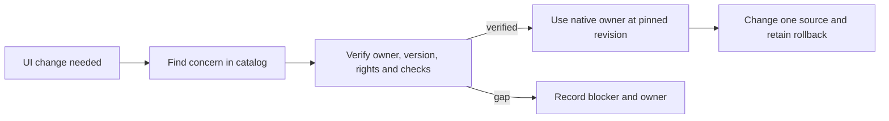
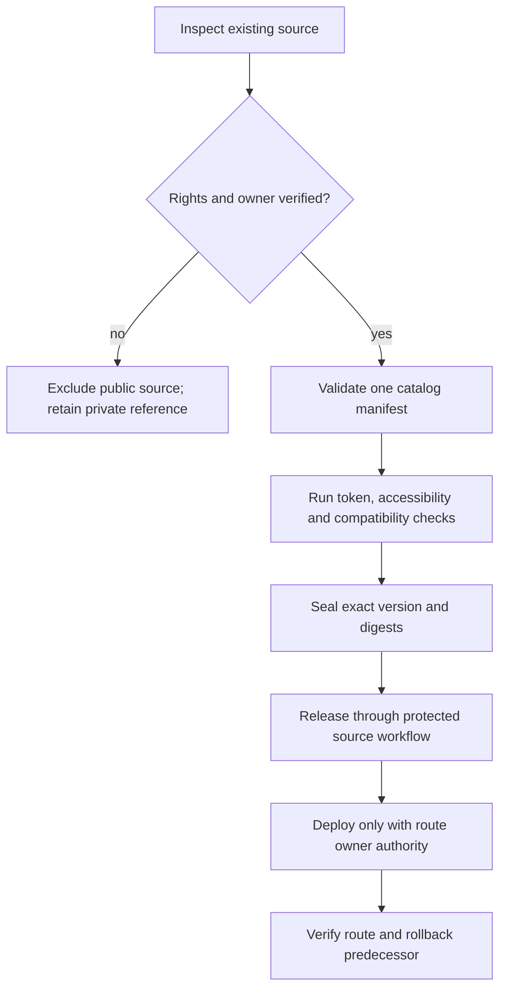
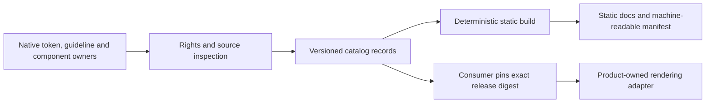
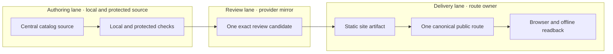

# Central Design System

**DESIGN-SYSTEM-01@0.1.0** is one joined PRD, TAD, ADR, MVP and GTM proposal. It scopes a central
design-system source of truth, catalog and documentation surface across existing products. It does
not claim that a repository, public route, package, release or runtime adoption already exists.

**Objective:** let a product contributor find the one authorized owner and exact version for a token,
brand profile, guideline, accessibility contract or reusable component, then apply it without
copying an implementation or creating an unregistered variant.

**Scope state:** proposed; source rights, one component-library ownership model and the production
route remain blockers. Market pain and willingness to pay are hypotheses. Local source inspection
below grounds current ownership only; it does not prove adoption, runtime behavior or deployment.

## Reference implementation: Agentic Design System

This block names the concrete reference implementation. The scope and contracts remain replaceable
for another product with equivalent owners and evidence.

| Repository or surface | Exact inspected revision | Inspected source and observed contract | Consequence |
|---|---|---|---|
| huijoohwee.github.io | 254ad7c28ded94f0169c29c63db589a72bd5e8ef | guidelines/design-theme-contract.md 1.1.0 assigns one owner per concern; says application state and interactive components stay with their product owner, and cross-repo adoption links exact source revisions rather than copying runtime components. docs/DEPLOY-WORKFLOW.md publishes index.html and guidelines/ only. | Use the existing design contract; keep this proposal in docs/documents, outside that Pages payload. |
| agentic-os | 8a16da19effb9cfb0dab750558454816153229c2 | guides/SYSTEM-PROMPT-RUNTIME.md and docs/START-WORKFLOW.md require free/FOSS, bounded work and source/deploy evidence separation. | Keep policy and lifecycle contracts owned here; design-system consumers reference them. |
| agentic-canvas-os | b4eafdb737fa0d91e549878aba5fa6661caf4536 | wrangler.jsonc currently sets CANVAS_BASE_URL to https://airvio.co/agentic-os. | This does not establish ownership of the requested design-system route. |
| agentic-graph | 60333d43486537df7b89f46293c58f282b0394f0 | canvas/src/lib/ui/tokens-ssot.ts re-exports grph-shared/ui/kgTokens; source is grph-shared/src/ui/kgTokens.ts. DesignSystemHub.tsx states those tokens are authored once and generated CSS is read-only. config/surface-registry.json declares https://airvio.co as publicOrigin and registers /agentic-graph/; the design-system route is not in the inspected route entries. config/license-registry.json classifies application source as NONE-private and built output as no-reuse. | Treat this token source as the current owner until an authorized atomic transfer. Route and source publication need separate owner evidence. |
| agentic-base | 529f1d866974453327977595a457d5065a8dbc45, the revision pinned by agentic-graph/canvas/package.json | package.json names @agentic-base/views-react, version 0.1.0, private=true. | The package is an existing component source, not a publicly reusable library under the inspected metadata. Do not publish or copy its source without verified rights. |

The requested site path is the exact literal https://airvio.co/gentic-design-system. This proposal
keeps that single path. Its spelling is unusual relative to the repository name; changing it requires
a successor decision, and no second alias is planned.

## PRD

### Problem statement and evidence

**Pain hypothesis P1 — unvalidated:** maintainers and product contributors spend time locating
current design values, brand rules, accessibility requirements and reusable component contracts
across repositories. Unclear ownership can produce copied values, divergent implementations and
unverified accessibility claims.

The current evidence proves that at least one product has a token source and a design-system hub,
and that cross-repository ownership rules already exist. It does not measure lookup time, duplication
rate, user impact, external demand or willingness to pay. Keep P1 labelled unvalidated until a
maintainer quote, issue or measured workflow establishes the pain. Paid-customer evidence alone
earns the demand-proven label.

### Users, buyer and jobs

| Role | Job to be done | Present evidence |
|---|---|---|
| Product contributor | Find the correct token, brand profile, guideline and component contract before changing a user-facing surface. | Internal target role; usage not yet observed. |
| Component maintainer | Publish one source revision and its compatibility, accessibility and license evidence. | Existing owner behavior varies by repository; inventory incomplete. |
| Accessibility reviewer | Verify that a component contract has named checks and evidence for keyboard, focus, contrast, zoom, motion and narrow touch surfaces. | Contract exists in the inspected design guidelines; cross-product results are unknown. |
| Buyer | Fund lower integration and maintenance effort if evidence shows the system removes a costly repeated problem. | Unknown; no validated buyer or WTP evidence. |

### Journey

| Stage | User action | Touchpoint | Friction hypothesis | Desired result |
|---|---|---|---|---|
| Trigger | Needs a component or visual change. | Product repository or browser. | The source owner and allowed reuse status are unclear. | Open one canonical catalog. |
| Discover | Searches by token, brand profile, component or concern. | Static catalog and local search. | Results may be stale or duplicated. | See one exact owner, revision and status. |
| Verify | Reads the contract, accessibility evidence and license class. | Versioned catalog entry. | A code example may conceal a private or stale source. | Understand allowed reuse and known gaps. |
| Apply | Uses the native owner at its pinned revision. | Product-owned adapter. | Copying creates a competing source. | Change one owner and preserve its contract. |
| Return | Reports drift or a new consumer. | Existing issue/review workflow. | Feedback can be lost between repositories. | Open a successor revision with exact evidence. |

### User stories and priorities

| ID | User story | Priority | Trace |
|---|---|---|---|
| PRD-01 | As a product contributor, I want one searchable catalog with exact source and release identity so that I can reuse the right contract without copying implementation code. | Must | VCC-01, VCC-02 |
| PRD-02 | As a maintainer, I want each design concern to have one named owner and license status so that a release cannot publish an unapproved source. | Must | VCC-01, VCC-03 |
| PRD-03 | As an accessibility reviewer, I want behavior-specific checks and evidence linked to each interactive component so that the catalog does not imply compliance from appearance alone. | Must | VCC-04 |
| PRD-04 | As a multi-repository consumer, I want to pin a version and digest and roll back to its predecessor so that adoption is repeatable and reversible. | Must | VCC-02, VCC-05 |
| PRD-05 | As a site visitor, I want the catalog to load on a narrow viewport and remain readable offline after caching so that the documentation remains useful across devices and connectivity states. | Must | VCC-06 |

### Pain-point-to-feature mapping

| Pain point | Hook | Break | Fix | Close | Min-time/resource/max-value and reuse/build split |
|---|---|---|---|---|---|
| P1, unvalidated: contributors cannot quickly resolve canonical design ownership. | A contributor starts a UI change. | They inspect multiple repositories or rely on stale copied guidance. | One versioned catalog resolves concern → owner → source revision → license → checks. | Contributor chooses the native owner or records a blocker. | Reuse the current token, guideline, release and component owners; build only the catalog, manifest validator and static presentation. Measure lookup time before claiming savings. |

### Acceptance criteria and success metrics

Each criterion is a VCC: one outcome, a named check and explicit constraints. These are planned
checks; no implementation or check result is claimed in this proposal.

| VCC | Given / when / then | Named acceptance check | Constraint |
|---|---|---|---|
| VCC-01 | Given a catalog entry, when its manifest is validated, then it resolves to exactly one accountable source owner, immutable revision, path, license class and status. | design-catalog-contract-check | Missing or ambiguous source and rights fail closed. |
| VCC-02 | Given a released catalog, when its consumer manifest is read, then every entry binds one release version and source digest, and the previous release remains resolvable. | design-release-manifest-check | No mutable latest pointer as identity. |
| VCC-03 | Given a proposed public release, when the publication manifest is evaluated, then every included source has a verified reuse grant and its allowed attribution. | design-license-boundary-check | Private or no-reuse material is excluded. |
| VCC-04 | Given an interactive component contract, when its evidence set is evaluated, then keyboard use, visible focus, measured contrast, 200% zoom, reduced motion and a narrow touch viewport each have a named result or explicit gap. | design-accessibility-evidence-check | A screenshot or static scan alone is insufficient. |
| VCC-05 | Given a consumer update, when the consumer pins a release, then one version/digest is recorded and rollback identifies the previous pin. | design-consumer-pin-check | No second editable token or component source. |
| VCC-06 | Given a clean narrow viewport and a primed offline cache, when the catalog is opened and reloaded without connectivity, then its static index and local content remain usable. | design-site-browser-check | No remote fonts, CDN, telemetry or runtime model call. |
| VCC-07 | Given any MVP build, when its dependency and cost manifest is evaluated, then all software is FOSS/free and incremental paid spend, provider add-ons, overages and model tokens are zero. | design-zero-cost-check | Unknown spend headroom blocks deployment. |
| VCC-08 | Given a candidate release and deployment instruction, when each owner workflow completes, then source, route, runtime and rollback evidence have distinct exact receipts. | design-release-receipt-check | Source merge never implies deployment authority. |

| Metric | Baseline | Proposed target | Window |
|---|---|---|---|
| Time to first useful answer | Unknown; measure with a timed baseline task. | At most 5 minutes from a clean browser open to resolving one component's owner, version and accessibility contract. | Five internal pilot tasks before baseline sign-off. |
| Duplicate or ambiguous owners in the catalog | Unknown; inventory required. | Zero unresolved duplicate-owner findings at each release. | Every candidate release. |
| Consumer adoption | No central release exists. | One consumer pins a verified release after rights and owner gates pass. | First MVP increment. |
| Incremental cash cost | Unknown until hosting and quota evidence is current. | $0/month; deny effects when a verified hard $0 cap is unavailable. | Every deployment month. |
| Model/token use | No AI is in the MVP. | 0 product model calls and 0 product tokens/month. | Every release. |
| TTV | Proposed target above; baseline unknown. | At most 5 minutes for the first-use task. | Pilot. |
| ROI and monthly TCO | Unknown; no observed time, WTP or provider cost. | Do not claim ROI or savings until comparable observations and actual cost receipts exist. | Revisit after pilot. |

### Scope boundaries

**Must:** one canonical catalog; source-owner and license manifest; brand-profile inventory; semantic
token contract references; accessibility contracts; component API/behavior contracts; examples that
link to or derive from an authorized owner; immutable release records; one static documentation
surface; version/digest pin and rollback guidance.

**Should:** consumer adoption map, migration guides, search over the local catalog, and read-only
machine-readable exports if existing zero-cost routes can serve them.

**Could:** a shared runtime component package, automated browser previews and agent-facing routes.
Each requires an owner-policy decision, source rights, an economic check and a separate VCC.

**Won't in this increment:** copy private component source or generated bundles; create parallel
token definitions; add paid plans, add-ons, overages, a hosted database, telemetry, an AI harness,
remote assets, a new settings panel or an unauthenticated write endpoint.

## TAD

### Overview and ownership

The product turns rights-cleared source metadata and approved design contracts into a versioned
catalog, static site and consumer manifest. The new repository is intended to become the authored
owner only after each concern has a reviewed transfer plan. Until then, its records are references;
existing source owners remain authoritative.

| Concern | Current single owner | Planned central role | Transfer rule |
|---|---|---|---|
| Numeric token values | Current product token source recorded in the reference block. | One authored profile per profile ID after an atomic transfer. | Do not maintain a second editable palette. Generate outputs and compare digests. |
| Product identity and brand profile | Each product's existing identity owner; exact inventory remains open. | Registry of profile identity, allowed use and source owner. | A new profile requires its identity owner and permitted-asset evidence. |
| General design and accessibility policy | Existing design guideline and native design contract. | Versioned policy index and source-linked checks. | Reuse the source document; no copied policy body without rights and owner approval. |
| Interactive runtime components | Existing product component owner; current package status is recorded in the reference block. | One catalog entry per component, with exact source and contract. | Runtime ownership stays native under the current design contract. A shared package requires a successor ADR and explicit contract change. |
| Examples | Existing product-owned demonstrations. | Link or generate from exact authorized source revisions. | No copied executable component implementation in the MVP. |
| Catalog site and release manifest | Not yet created. | New repository owns these authored artifacts. | Static build from one immutable repository revision. |

No new runtime dependency is introduced merely by adopting the design contract. The central catalog
must not become a second source of token values or interactive behavior during the transition.
Multiple brand profiles are permitted only with unique IDs, owners and documented intended surfaces;
an unregistered fork or two values for the same profile/token/mode is a release blocker.

### Interfaces and data contract

Each catalog record contains: stable ID; concern type; profile ID when applicable; accountable owner;
repository and exact source revision; source path and digest; license and attribution; API or token
contract version; accessibility requirements and evidence references; example locator; known gaps;
consumer pins; and deprecation or rollback target. Unknown required fields block release. A record
links to private evidence without copying its contents into the public catalog.

The release manifest binds the catalog version, source commit, generated-file digests, source-owner
revisions, license dispositions, named checks, consumer compatibility and predecessor version. A
release tag is immutable. A consumer reads or vendors only the version it pins; runtime operation
does not depend on fetching the central site.

### Five canonical flows

#### User journey flow

#### Workflow flow

#### Data flow

#### Orchestration and harness flow

No AI pipeline or model call is required in the MVP. Catalog search is local/static and deterministic.
If later work adds a model, it must use a separately accepted typed harness with a token ceiling,
cost log, fallback and circuit breaker; this proposal authorizes none.

#### Topology

No application database or user data store exists. Catalog content is public only after source
rights and publication classification pass. Build output contains only allowlisted files. The
authoring, provider mirror and delivery boundaries remain distinct and closed by default.

### Invocation register

| Surface | MVP status | Contract |
|---|---|---|
| /gentic-design-system | Planned | One static GET route at the exact path in the reference block. Route registration and live owner are not yet proven. |
| #section | Planned | Native fragment links for tokens, profiles, guidelines, accessibility, components and releases. |
| @component-id | Planned | Stable local catalog identity resolved by the pinned release manifest; no mutable alias. |
| MCP | Deferred | No new server in the MVP. An existing local/read-only adapter may consume the static manifest only after its owner and zero-cost route are verified. |
| WebMCP | Deferred | No browser-specific API assumption. Add only after the supported browser contract and offline behavior are verified. |
| Write or mutation tools | Excluded | Catalog edits remain source-controlled review changes; no public write endpoint. |

### Component inventory

| Component | Responsibility (SVO) | Owner | Origin decision |
|---|---|---|---|
| Catalog manifest | Manifest validator rejects ambiguous owners and unapproved sources. | New repository after creation. | New authored contract. |
| Token profile record | Profile record resolves one token source, mode and revision. | Current native token owner until transfer. | Reuse and link; no copied numeric source in MVP. |
| Brand profile record | Profile record identifies identity assets and permitted use. | Existing product identity owner. | Inventory; do not invent a palette or asset. |
| Accessibility contract | Contract lists checks and exact evidence for a component. | Existing native design-policy owner; product test owner supplies results. | Link policy, add no second rule set. |
| Component catalog entry | Entry resolves API, behavior, source owner, rights and evidence. | New catalog owns the index; product owns runtime implementation. | Central discovery, no implementation copy. |
| Static catalog renderer | Renderer presents authorized records and local examples. | New repository after creation. | New, dependency-free static presentation. |
| Consumer adapter | Adapter maps semantic contract to its product rendering surface. | Each adopting product. | Reuse the native adapter; no cross-repo runtime copy. |

Every interactive example must document semantic structure, keyboard behavior, focus, loading/error/
empty states when relevant, localized labels, color-independent meaning and touch behavior. The
existing native contract requires at least 4.5:1 text contrast (3:1 for large text), 3:1 meaningful
control/focus boundaries, keyboard operation, visible focus, 200% zoom, reduced motion, a narrow
touch viewport and usable 44 CSS-pixel targets. These are acceptance thresholds, not current results.

### Security, privacy, reliability and economics

| Concern | Requirement | Failure response |
|---|---|---|
| License and provenance | Check source and asset rights before including them. Bind each public file to its permitted license class and digest. | Exclude the source and block release. |
| Supply chain | Pin dependencies and source revisions; prefer no runtime dependencies. Verify generated bytes against the manifest. | Fail closed on drift. |
| Privacy | Collect no visitor account data, telemetry or personal content. | Remove any unapproved collection and re-review the surface. |
| Availability and offline | Keep the catalog as static files with locally available fonts and assets. | Preserve the previous verified static artifact. |
| Cost | Add no paid service, model call, add-on or overage. Require a verified hard $0 cap or deny provider effects. | Stop before effect; unknown headroom is not a pass. |
| Accessibility | Require named computed-color, keyboard, focus, zoom, motion, narrow viewport and offline checks. | Report gaps; do not claim runtime readiness. |
| Compatibility | Bind every consumer to one exact release and native adapter. | Revert to the exact prior consumer pin. |

### Lane topology and deploy boundaries

| Boundary | Owner and candidate | Required proof | State |
|---|---|---|---|
| Authoring → protected source | New repository owner; one exact reviewed commit. | START scope, affected checks, review and required CI. | Closed. |
| Protected source → static artifact | Repository release owner; same exact source digest. | Build manifest, license check, artifact digest. | Closed. |
| Static artifact → requested route | Public-origin route owner; exact route and target. | Explicit operator instruction, route registration, free-tier proof and deploy receipt. | Closed; authority not inspected. |
| Route → runtime accepted | Product owner and independent evaluator. | Browser/mobile/offline readback, live identity and rollback predecessor. | Closed; no runtime evidence. |

The proposal is a source specification only. No route, DNS, Worker, Pages workflow or production
state is changed by this document.

### Rollback and recovery

1. Stop further promotion if the candidate digest, source rights or route readback differs.
2. Restore the exact previous catalog release and consumer pin; do not edit an immutable tag.
3. Restore the exact prior route artifact through its owner controller and obtain a new rollback receipt.
4. Re-read the live route and offline/browser behavior. Keep source-release, deployment, runtime and
   rollback evidence separate.
5. If the live state is ambiguous or rights are uncertain, preserve it and block retries until the
   owning repository supplies current evidence.

No schema or user-data migration is in scope; source rollback and route rollback are separate effects.

### Sprint bounds and execution handoff

The first implementation increment is one documentation/catalog slice: at most 45 active minutes,
8 changed files, 40 KiB of added source, 2 authored modules, 0 runtime dependencies, 0 product model
tokens and $0 incremental spend. Reforecast on measured scope growth or any source, rights, route or
provider drift. An external rights or route wait has no ETA; record the dependency, unblock condition
and next owner-triggered recheck.

ADLC handoff is blocked until the joined spec has zero open blocker findings, current grounding,
bounded RAO steps and owner-approved rights boundaries. START records the admitted lane and base;
RELEASE records the exact integrated source receipt; DEPLOY and rollback each need their own authority,
candidate and receipt. A source merge alone does not raise the delivered rung.

## ADR

### ADR-01 — One catalog owner without a second runtime implementation

**Status:** proposed for product-owner review.

**Context:** token values, policy and interactive components currently have different owners.
The native design contract says to bind existing owners, keep numeric values in their native source,
and keep interactive components with their product. The current component package and application
source lack a public reuse grant.

**Constraints:** FOSS/free and $0 incremental spend; no external runtime dependency; one source owner
per concern; no copied private or no-reuse source; mobile/browser/offline reach; no conflicting
profile or component variants.

| Option | Constraint result | Consequence |
|---|---|---|
| A. Central catalog and source-linked contracts; native repositories keep runtime ownership. | Passes current ownership and source-rights constraints when only cleared metadata is public. | Selected for MVP. Gives one discovery and governance owner without a second runtime implementation. |
| B. Copy current tokens and interactive components into a new runtime package now. | Fails current source-rights and native component-ownership constraints. | Rejected. Would create a competing owner and cannot be publicly released from inspected evidence. |
| C. Let every consumer maintain its own catalog and component copy. | Fails one-owner and no-conflicting-variants constraints. | Rejected. Preserves drift and makes source identity ambiguous. |

**Decision:** the central repository owns the catalog, profile registry, policy index, accessibility
contracts, examples index and immutable release manifest. Existing native owners retain executable
token values and interactive implementations until explicit rights and an owner-approved successor
ADR authorize an atomic transfer. Each component/profile ID has one source owner. The catalog may
show more than one brand profile only when each has a distinct ID, owner and intended scope.

**Consequences:** the MVP centralizes discovery, contracts and release identity; it does not yet
publish a shared runtime component package. This is a deliberate compatibility boundary, not evidence
that all requested components are already reusable. A successor ADR must revisit runtime ownership
after licensing is verified and the native design contract is revised through its owner.

**Recovery and revisit trigger:** if a source cannot be licensed or the owner contract rejects
transfer, keep it linked as a private reference and exclude it from public releases. Revisit when
written rights, a compatible FOSS license, a transfer plan and consumer migration checks are present.

### ADR-02 — Keep one requested public path and defer deployment

**Status:** proposed; deployment remains closed.

**Options:** use the exact user-specified path on the existing origin; select a separate host/domain;
or expose multiple aliases. The first is the only option that uses the requested address without
adding a new domain or host. The separate-host option has no current zero-cost, route-owner or
rollback evidence. Multiple aliases violate the one-route requirement.

**Decision:** keep /gentic-design-system as the sole planned path. The current origin registry shows
an existing public origin but does not register this route. The route owner must register the exact
path, prove the no-cost deployment boundary and name a rollback predecessor before any deploy.
Do not add a corrected-spelling alias. A deliberate spelling change is a successor ADR.

**Recovery:** remove the route through its owner controller and restore the exact previous route map
if live verification fails.

### ADR-03 — License and public release boundary

**Status:** proposed; rights gate is a blocker.

**Decision:** publish only files whose exact owner, source revision, license, attribution and
publication policy allow reuse. Existing public guidelines and specifications may be reused only
within their declared terms and attribution rules. Private application source, private packages and
no-reuse generated output are excluded until a rights grant and registry change explicitly allow
their release. A user request to reuse source does not replace repository license evidence.

**Alternatives:** public release of all current code fails the observed license registry; private-only
catalogation can support owner review but does not satisfy the public FOSS launch; source-by-source
rights clearance is selected because it preserves user intent without claiming unproven rights.

**Revisit:** record owner approval, grant, license text, provenance, registry updates and generated
artifact policy for each transferred source. If any item is missing, the public release remains
blocked.

## MVP

### Smallest useful slice

The MVP is a static, source-linked catalog that answers one task: “Which authorized owner and exact
revision do I use for this design concern?” It includes a minimal repository, profile and concern
manifest, accessible static documentation, one release manifest, component contracts and examples
that resolve to authorized native sources. It introduces no shared runtime UI package.

**Demo skeleton — maximum 180 seconds**

| Beat | Bound | Action | VCC |
|---|---:|---|---|
| Hook | 15 sec | Show one contributor question about the owner of a reusable component. | — |
| Probe | 30 sec | Search the catalog by component concern. | VCC-01 |
| Reveal | 45 sec | Inspect the source revision, license class, contract and accessibility evidence. | VCC-03, VCC-04 |
| Domain action | 60 sec | Resolve the native owner and pin its exact release without copying implementation code. | VCC-02, VCC-05 |
| Close | 20 sec | Show the predecessor pin and the unresolved route/license gates. | VCC-05, VCC-08 |

The Reveal is evidence of a catalog lookup only; it does not prove buyer demand, deployment or
cross-product adoption.

### MVP exit

The MVP can be accepted locally only when VCC-01 through VCC-07 pass on the exact source candidate,
every catalog record has one owner, rights are explicit, no duplicate profile/token/component source
exists, and independent evaluation emits Evidence References. Public runtime delivery additionally
requires the route owner, exact production authority and VCC-08 receipts. No rung is inferred from
this proposal.

**Current evidence state:** source inspection only. The requested site, central repository, catalog,
consumer pins, accessibility runtime checks, release, route and production receipts are unverified.
Local and delivered readiness remain undocumented.

## GTM

### Offer, market and first-dollar path

**Initial offer:** free, FOSS design documentation and source-linked component contracts for
maintainers of multi-product web/agent software. Public release waits for source-level rights
clearance. No paid plan, add-on, overage or proprietary dependency is in the MVP.

**Alternatives:** search each product repository manually; use the existing native design-system
pages; maintain per-product copies; or defer a central catalog. The catalog's differentiation is
one source-bound owner and release record, not a claim of visual superiority.

**Demand:** unvalidated. Internal maintainers are the first pilot cohort; internal use is not a
paying customer and does not prove external WTP. The nearest first-dollar path is intentionally
deferred until interviews establish a buyer, repeated pain and willingness to pay without requiring
paid product features that violate the current zero-cost scope.

**Market sizing:** no defensible numeric TAM/SAM/SOM exists in current evidence. Use both methods
before making a market claim:

1. Top-down: eligible organizations in a named geography × observed annual spend on the problem;
   both inputs currently unknown.
2. Bottom-up: reachable teams with validated repeated pain × observed conversion × accepted annual
   value; all three inputs currently unknown.

Record sources, date, uncertainty and disjoint segment definitions before publishing a number.

### Acquisition, activation and retention

| Stage | Proposed measure | Current state |
|---|---|---|
| Acquisition | Qualified maintainers who open the catalog from an existing product workflow. | No audience count or channel evidence. |
| Activation | User resolves one authorized component owner and contract within 5 minutes. | Target proposed; baseline unknown. |
| Adoption | Product consumer pins an exact version/digest and names its adapter. | No central release exists. |
| Sales cycle | Time from identified buyer problem to accepted purchase decision. | No buyer or paid offer; no sales cycle can yet be measured. |
| Retention | Repeat catalog use and lower measured lookup/rework across a comparable period. | Unknown; do not infer from page views. |
| Monetization | Collected payment and repeat demand from an identified buyer. | No offer, payment or WTP evidence; deferred. |

Use existing documentation and product links only after publication authority is recorded. No paid
ads, telemetry, hosted account system or outbound contact is authorized by this specification.

### Operations and financial viability

| Driver | Planning value | Evidence required |
|---|---|---|
| Hosting and delivery | Target $0 incremental cash using an existing static route. | Current provider plan, hard cap/deny behavior, route-owner proof and receipt. |
| Build and checks | Existing repository check path, no new paid runner or add-on. | Exact selected checks and current free quota headroom. |
| Product model usage | 0 calls and 0 tokens. | Build/dependency manifest confirms no model dependency. |
| Maintenance | Unknown active hours per release. | Record actual work and rework per source receipt. |
| Revenue | $0 recognized and $0 collected in this proposal. | Payment evidence required before any first-dollar claim. |
| Cash and runway | Not modeled; no financing ask. | Revisit only after real recurring costs or a validated revenue model exist. |

If $0 headroom cannot be verified, defer the external effect. No numeric savings, ROI, market size,
revenue, retention or production claim is authorized until its source evidence is recorded.

### C01–C16 coverage

All 16 domains are dispositioned below. “Covered” means a decision or evidence gap is recorded; it
does not mean the domain is validated or the feature is built. Coverage: 10/16 covered applicable;
6 deferred; 0 not applicable.

| ID | Disposition | Owner and evidence/gap | Next check |
|---|---|---|---|
| C01 Purpose and pain | Covered as hypothesis | Product owner; current design sources establish context, not user pain. | Obtain a quote, issue or timed observation. |
| C02 Market and timing | Deferred | GTM owner; segment, geography, timing and both sizing inputs unknown. | Interview target maintainers and source both sizing methods. |
| C03 Offer and alternatives | Covered as $0 offer | Product owner; manual search and existing product pages are alternatives. WTP unknown. | Compare observed task outcomes; validate offer separately. |
| C04 Product and experience | Covered as proposed contract | Product design owner; VCCs define mobile, browser and offline checks. | Run clean-browser and narrow-viewport pilot. |
| C05 Architecture and data | Covered | System owner; static catalog and owner-linked data flow are specified. | Ground all manifest fields and source revisions. |
| C06 Quality, security and AI | Covered | Maintainer; source rights, privacy, cost, accessibility and recovery gates are specified; no AI in MVP. | Run named checks and independent evaluation. |
| C07 Decisions and tradeoffs | Covered as proposed ADRs | Product owner; central index selected over code copies; rights unresolved. | Accept or revise ADR-01 through ADR-03. |
| C08 Smallest validated slice | Covered as proposed MVP | Evaluator; VCCs and demo beats are defined; no implementation evidence. | Build and independently verify one catalog slice. |
| C09 Acquisition and retention | Deferred | GTM owner; no audience, channel or repeat-use data. | Run a bounded internal pilot; no outbound action. |
| C10 Business operations | Covered | Catalog maintainer curates records; source owners verify provenance; release owner verifies checks; route owner handles deploy, incident response and rollback. Named people, support capacity and on-call coverage remain unassigned. | Confirm exact route/release controllers and one support contact before a public pilot. |
| C11 Organization and obligations | Deferred | Product/legal owner; source and contributor rights, asset provenance, contracts and applicable jurisdiction need review. No jurisdiction or legal review is inferred. | Resolve rights and name the applicable review owner before public release. |
| C12 Financial viability | Deferred | Finance owner; cash headroom, labor and recurring TCO are unmeasured. | Verify hard $0 provider boundaries and log actual resource cost. |
| C13 Capital and milestones | Deferred | Product owner; no funding decision or ask is evidenced. | Revisit only if validated need or nonzero cost requires capital. |
| C14 ADLC execution | Covered | Execution owner; exact START, RELEASE, DEPLOY and rollback evidence are required. | Admit the implementation lane with a committed plan and zero blockers. |
| C15 Audience projections | Deferred | Product owner; no pitch, business plan, financial model or audience action is authorized. | Build projections only after evidence and before an audience action. |
| C16 Learning and next increment | Covered | Product owner; pilot threshold, gaps and successor trigger are specified below. | Open successor after a measured signal or blocker change. |

### Roadmap and learning loop

| Increment | Outcome and priority | Reuse / new delta | Prerequisite and exit VCC | Bounds and wait | Stop, recovery and next check |
|---|---|---|---|---|---|
| 0. Ground owners and rights | Must; one exact source record per concern. | Reuse existing native sources; create no duplicate values. | Rights and owner manifest; VCC-01, VCC-03. | First implementation cap: 45 active minutes, 8 files, 40 KiB, 2 modules, $0. External waits have no ETA. | Exclude unclear sources; recheck on written owner/license evidence. |
| 1. Build static catalog | Must; contributor resolves one concern. | New manifest and static docs; no runtime component package. | VCC-01, VCC-02, VCC-06, VCC-07. | Reforecast on scope drift; no new dependency. | Restore predecessor static artifact; evaluate timed pilot. |
| 2. Adopt one consumer | Should; one consumer pins exact release. | Native adapter and owner source remain authoritative. | Rights and owner acceptance; VCC-05. | One consumer at a time; no parallel migrations. | Revert exact previous pin; revisit ADR if consumer cannot adopt. |
| 3. Public route and runtime | Must for public delivery, outside this draft's authority. | Reuse one registered route and controller. | Exact route owner, hard $0 proof, deployment authority; VCC-08. | External owner wait; recheck on route registration or instruction. | Exact route rollback and runtime readback. |

**Continue:** the internal pilot resolves the owner/version/accessibility task within the proposed
5-minute target and produces zero unresolved duplicate-owner findings, while all rights and $0
constraints pass. **Rework:** the catalog misses the target but source provenance remains sound; revise
only the measured bottleneck. **Stop:** rights cannot be cleared, source owners reject the catalog
contract, or deployment needs an unapproved paid service. Record actual-vs-target results and open a
successor Context; do not rewrite this accepted revision after baseline.

## Evidence references and open questions

### Reference implementation: grounding references

The following are source observations at exact repository revisions, not runtime proofs:

| Evidence ID | Exact source | Observed result |
|---|---|---|
| G01 | Reference implementation block: site revision 254ad7c28ded94f0169c29c63db589a72bd5e8ef, guidelines/design-theme-contract.md and docs/DEPLOY-WORKFLOW.md. | One-owner and no-copy adoption contract; docs/documents is outside the Pages payload. |
| G02 | Reference implementation block: graph revision 60333d43486537df7b89f46293c58f282b0394f0, canvas/src/lib/ui/tokens-ssot.ts and grph-shared/src/ui/kgTokens.ts. | Existing token export resolves to one native source. |
| G03 | Reference implementation block: graph revision 60333d43486537df7b89f46293c58f282b0394f0, canvas/src/features/design-system/pages/DesignSystemHub.tsx and TokensExplorer.tsx. | Existing product hub and token explorer are application source, not proof of public component reuse. |
| G04 | Reference implementation block: graph revision 60333d43486537df7b89f46293c58f282b0394f0, config/license-registry.json and config/surface-registry.json. | Current publication classes restrict application source and generated bundles. |
| G05 | Reference implementation block: agentic-base pin 529f1d866974453327977595a457d5065a8dbc45, package.json; graph canvas/package.json. | Component package is private and pinned by exact Git revision. |
| G06 | Reference implementation block: agentic-os revision 8a16da19effb9cfb0dab750558454816153229c2; ACOS revision b4eafdb737fa0d91e549878aba5fa6661caf4536. | Lifecycle and current URL configuration are known; requested route ownership is not. |

### Open questions

1. Which owners can grant FOSS reuse and publication rights for each current token, component,
   generated artifact, brand asset and example?
2. Does the product owner accept the MVP boundary of one catalog with native runtime owners, or
   authorize a successor change to the native component-ownership contract?
3. Which existing route controller owns the literal requested path, its free-tier hard cap and its
   verified rollback predecessor?
4. Which product identity source owns each brand profile and its assets?
5. Which maintainers experience the stated pain, how often, and what measurable effort does it cause?
6. Is an existing zero-cost MCP or WebMCP route available and authorized, or should those remain
   deferred while local static manifests meet the need?

Unresolved rights and route questions block public release and deployment. They do not block
source-grounded catalog design or disjoint local discovery work.

## Planning Record — 2026-10-23

| PRD-TAD-ADR-MVP-GTM | CID | RAO | Updated Date |
|---|---|---|---|
| **DESIGN-SYSTEM-01@0.1.0** | C: Current cross-repo design ownership and rights are evidenced by the pinned source records above · I: Specify one reusable design-system catalog without conflicting or unlicensed variants · D: Author the joined 0.1.0 PRD/TAD/ADR/MVP/GTM, preserve native owners, and keep route and rights gates closed | R: Product spec author · A: Authors one source-grounded joined design-system proposal · O: Reviewable 0.1.0 proposal with owners, VCCs and release blockers · check: independent-prd-compliance-review | 2026-10-23 |

This is the planning row for this authored revision. The repository PRD policy check is a source
guideline check; it does not evaluate this docs/documents artifact. Protected source integration,
deployment and runtime acceptance remain separate evidence stages.

## Authoring handoff — 2026-10-23

- **Completed:** joined 0.1.0 proposal, source grounding, eight VCCs, proposed ADRs, MVP, GTM and C01–C16 dispositions are present in this file.
- **Artifact state:** docs/documents/prd-tad-adr-mvp-gtm-agentic-design-systems.md is an uncommitted working-tree draft based on site revision 254ad7c28ded94f0169c29c63db589a72bd5e8ef; no PR or source receipt exists.
- **Checks:** npm run doctor returned 0 with tracked-identity and retained-ref warnings; npm run status showed an unrelated active git-guideline-path-resolution lane; native START returned blocked-admission-capacity for workflow-be3c8b29179fbfed80c6386f885745d3 at 1/1. npm run prd-tad-adr-mvp-gtm:policy:check returned 0 for the 19 guideline files; output says semantic venture evidence was not evaluated and does not include this docs/documents artifact.
- **Not proven:** catalog implementation, rights, route ownership, consumer adoption, accessibility runtime behavior, deployment, rollback, market demand and cost headroom remain unknown; VCC-01 through VCC-08 are not yet satisfied.
- **Resources:** no model calls or provider effects were made; active authoring time and external free-tier headroom are unmeasured; the intended incremental spend cap is $0.
- **Next action / owner:** repository workflow owner admits a separate authoring lane for this draft after a committed plan covering the change is available; do not reuse the unrelated active lane without its owner's acceptance.
- **Prerequisite and recheck:** provide a committed plan at protected main and resolve/reconcile the existing allocation; retry native START when either condition changes.
- **Completion check:** START returns an admitted lane, exact base revision and exact write paths; otherwise preserve this draft and the returned blocker without claiming admission.
