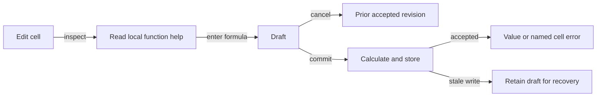
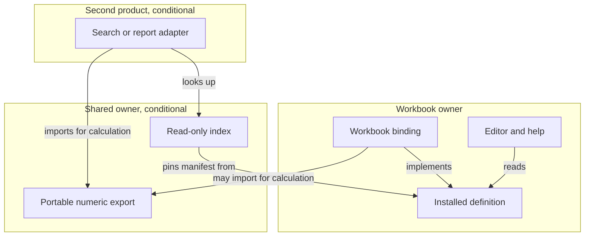

# Reference implementation — Agentic Functions

A workbook author wants to know **which functions this installed version can actually run**. The first increment lets them find a supported function, read its signature, try it, and get the documented result offline. It starts with one function, `SUM`. A second product searching for functions and a second product executing them are different reasons to share. Each has its own acceptance test below.

All five roles join at `AGENTIC-FUNCTIONS-001@0.1.1`. Local readiness is `dev-proven` for the Sheets binding. G6–G8 cover the installed example, offline discovery, calculation compatibility and persisted-workbook rollback. Delivered readiness is `undocumented`. A live screen-reader check, the three-author trial and a production receipt are outstanding. [Authoring guideline](../../guidelines/prd-tad-adr-mvp-gtm-guidelines.md) · [Workbook decision](prd-tad-adr-mvp-gtm-agentic-sheets.md#reference-implementation--adr-choices-and-tradeoffs)

## PRD — find a function that works here

A workbook author and the colleague reopening their file need a reproducible total. The prospective payer is a maintainer responsible for onboarding or integration. Discovery time, demand and willingness to pay are unknown.

| Rank and pain | Hook → break → fix → close | Reuse, scope and evidence |
|---|---|---|
| P1. An author must guess a supported function or find help elsewhere. Pain **unvalidated**. | Open the editor → the supported list is unclear → show the installed function, signature and a working example → calculate the expected total. | **Must, S1.** Reuse the existing evaluator, editor and offline build. Extend the function owner once. G1 shows the same function named in calculation, draft inspection and UI help; no inconsistent result or measured user loss was observed. |
| P2. A second product wants to tell its users which functions are available. Pain **unvalidated**. | Search a second surface → its list can go stale → resolve an owner-published capability list at an exact revision → show availability for the selected producer version. | **Could, S2.** Require a named consumer and a concrete search task. Read-only discovery is sufficient. |
| P3. Two products maintain the same numerical operation. Pain **unvalidated**. | Compare two caller fixtures → an arithmetic change would need two implementations → import one bounded calculation → both callers pass their own integration checks. | **Could, S3.** Require two independently invocable callers and compatible numerical contracts. A document, UI list, or two controls in the same workbook supplies no second execution use case. |

**Priority.** P1 fits a running product with one supported function. P2 and P3 need consumer evidence. **Should** support keyboard, touch and assistive use. **Won’t this increment** cover remote execution, plugins, financial-function parity, billing or a new repository.

| Journey stage | Workbook author | Observable outcome |
|---|---|---|
| Trigger / discover | With local values 2 and 3, open function help and find the installed sum. | One supported entry, with a readable name and signature. |
| Engage / complete | Enter `=SUM(A1:A2)` using the guidance. Commit once. | The accepted result is `5`. Reading help never changes the workbook revision. |
| Return / recover | Reopen offline. Inspect the committed formula, then cancel an edit. | The same function, result and accepted revision are available. |

**Success measures.** Target ≤2 minutes from a prepared blank workbook to the first correct result using help. Time cold setup separately. G6–G8 record machine checks. Human setup and completion times remain unknown. For S2 measure lookup time and stale results. For S3 measure integration time, failed calls and support minutes before and after adoption.

## TAD — reference implementation and ownership

| Capability | Current or proposed owner | Interface, decision and smallest change |
|---|---|---|
| T1. Workbook calculation and help | `agentic-sheets/sheets/formula.mjs`, exposed through `sheets/core.mjs`. G1 | **Extend owner.** Define a workbook function once with stable ID, display name, workbook signature, argument convention, summary and tested example. Its parser, draft inspector and editor consume that definition. Public export `listFunctions()` on `agentic-sheets` returns the release’s read-only descriptors. Keep coordinate resolution, cycle detection, blank handling, snapshot identity and calculation budgets in Sheets. |
| T2. Picker and in-cell interaction | Sheets browser adapter with the pinned `agentic-design-system` controls. G1/G2 | **Reuse.** Present the local definition with existing controls and focus behavior. Product owns the text and callbacks. Share UI styling through the existing pin. Opening, navigating or dismissing help preserves the draft and its caret. |
| T3. Cross-product discovery | Proposed `agentic-os/catalog/functions.json`. G3/G4 | **Defer until S2.** Generate a public, data-only manifest from T1. The index holds one owner reference per discoverable identity: ID, producer, contract version, immutable source revision, manifest path and digest. Group references to the same manifest on load. Verify pinned bytes at build time and serve a local snapshot. A missing or incompatible pin returns an explicit unavailable status. |
| T4. Shared calculation | Proposed `agentic-os/runtime/functions/sum.mjs` and public import `agentic-os/functions/sum`. G3 | **Defer until S3.** Implement just the pure numeric operation if the two-caller gate passes. Consumers use the public export at an exact pin. A spreadsheet supplies resolved numbers; a reporting caller could supply an array directly. Each retains its own presentation, errors at its boundary and persistence. |
| T5. Knowledge and operating guidance | `huijoohwee.github.io/schema/agentic-rag/` and `guidelines/lean-startup-guidelines.md`. G5 | **Retain local.** Use the guideline for learning decisions. A real graph query may later justify vocabulary linking a function to its owner. Financial-model assumptions and operating formulas remain with the model owner. Neither a schema entry nor a worked example establishes runtime availability. |

### Contract and failure behavior

**First owner descriptor.** Installed capability `math.sum` supplies `SUM(start:end)` under `sheets/workbook/v1`. Its first example supplies `2` and `3` and returns `5`. The stored formula stays `=SUM(A1:A2)`. The host reads the definition from its installed code. Listing returns immutable data with names, arguments, supported binding, summary and example. Labels can be localized without changing identity. Catalogs admit only entries with an implementation and passing fixtures in that release.

**Workbook policy today.** One valid rectangular range is traversed in row-major order. A blank contributes zero. A text value produces `#VALUE!`, a reversed rectangle produces `#REF!`, and referenced formula errors propagate. The existing per-workbook limits apply, including 32 × 16 cells, 256 formula bytes and a calculation step budget. A listing reads no user cells. Opening help performs no write. Accepting an edit uses the existing revision check. [G1](#reference-implementation--grounding-and-evidence)

**Proposed portable call, gated by S3.** A versioned operation takes an ordered list of 0–512 finite binary64 numbers, sums left to right starting at zero, and returns a number or a typed failure. Proposed cases include `[] → 0`, `[2,3] → 5`, non-numeric input → `INVALID_ARGUMENT`, oversize input → `LIMIT`, and non-finite output → `NON_FINITE_RESULT`. No coercion, I/O, model call, callback execution or mutable global state. The workbook adapter preserves evaluation order, error precedence and step accounting. Prove those behaviors on the old and candidate revisions before cutover. The limit and error names are contract proposals.

**Version and authority.** The catalog points from a trusted build to immutable owner data. The calculator never reads the catalog to decide which code to run. Duplicate IDs, unknown versions, digest mismatches and unexpected fields fail validation. Load optional modules only when the consumer enables them. A signature or error change requires a new contract version and explicit consumer adoption. Runtime data stays on the device. Discovery grants no execution or write authority.

### Invocation register

| Invocation surface | Status, identity and evidence gate |
|---|---|
| Browser and headless workbook core | The public `listFunctions()` export, formula editor and native Functions disclosure use the installed `math.sum` definition. V1–V3, G6–G7. |
| Per-function import | Conditional typed, effect-free call. V5. |
| HTTP / MCP / WebMCP | Unsupported for Functions. Future read-only discovery requires an admitted consumer and V4. |
| `/` commands / `@` bindings / `#` semantic routes | Existing OS grammar. No Functions route. `=` stays workbook syntax. |
| Skill / CLI / model tool | No Functions entrypoint. A skill may use an admitted capability. Model-tool dispatch retains its existing owner. |

### Flows and boundaries

D1–D4 are revision 0.1.1 Markdown/canvas projections. S1 uses all four. S2 reuses D1 discovery and D4 topology. S3 uses D3 evaluation and D4 topology. Bind S2/S3 workflows to named callers at admission. Harness flow is inapplicable throughout because calculation is synchronous with no agent loop.

**D1 · Journey.** An author moves from uncertainty to a total they can reopen.

**D2 · Workflow.** Help and preview are read operations. Commit is explicit.

**D3 · Data flow.** During the engage stage, only the workbook owner interprets addresses.

**D4 · Component topology.** Arrows show dependency on versioned inputs. The S1 build includes only the workbook boundary and its existing UI.

## Reference implementation — ADR decisions and reversal conditions

| ID / decision | Alternatives and tradeoff | Consequence, reversal and owner |
|---|---|---|
| ADR-01 · Start with the workbook owner | Retaining the existing hard-coded help costs least today but requires independent edits to help and grammar. A product-owned descriptor can cover both with one small change. An immediate shared package adds a release boundary before another caller is known. | Choose T1/T2 for S1. Preserve v1 snapshots and permit rollback by reverting the descriptor/adapter change together. Workbook engineering owns the compatibility fixtures. |
| ADR-02 · Separate discovery from execution | A shared directory of immutable references meets a second product’s search need. Copying a hand-maintained roster into each product creates independent claims of support. A remote lookup adds latency and prevents first use offline. | Prefer T3 when S2 has a consumer. Pin at build time. Keep the previous verified manifest for rollback. Discovery owner tests stale and missing pins. |
| ADR-03 · Extract by compatible operation | Direct reuse of T1 works for workbook-aware callers. A contract-only adapter can normalize an input owned by another host. Keep domain-specific range and error policies local. Extract T4 only if two real execution callers use compatible numeric values, order and failure behavior. | Require two independently invocable fixtures, owner approval of the contract, and parity under V5. If either diverges, retain the local operation or version the difference explicitly. Remove the superseded calculation on verified cutover. |
| ADR-04 · Keep package and repository decisions independent | A subpath export provides modular invocation. A separately versioned package can still share its owner’s repository. A dedicated `agentic-functions` repository adds release, maintenance and compatibility obligations. | Keep the existing repositories. Reopen the repository decision when named maintainers need independent ownership or a release schedule an in-repository package cannot meet. Record migration cost, rollback pin and responsible maintainer first. |
| ADR-05 · Use the reference as an observation | The observed workbook panel suggests the job of finding a supported function. A vendor catalog, screenshots, names selected as a bulk inventory, examples, assets, code and dependencies are outside the reuse grant. | Author signatures, help, fixtures and UI independently from the owned contract. Select future families from observed tasks. Revert any unqualified content or dependency before distribution. Product owns the provenance review. |

Offline use, deterministic results, one owner and free/FOSS execution are hard constraints. ADR-01 wins for P1 on the fewest changed boundaries. P2 and P3 solve different jobs; their commercial value remains unknown.

## MVP — one supported function end to end

S1 ends when one local definition drives discovery and help without changing workbook calculation or recovery. One entry needs neither category browsing nor a search box. S2 and S3 have separate admission criteria.

| Criterion | Observable pass condition and check | State / trace |
|---|---|---|
| V1 · Definition and availability | A headless fixture lists exactly the supported `math.sum` binding and its signature. Each advertised example runs against the same installed version. An unknown function or duplicate ID cannot appear as supported. Check the descriptor, compiler and rendered help for drift. | Passed at source. G6 checks the public export, example, immutable data and unsupported name. G7 checks rendered help. S1 → T1/T2 → ADR-01. |
| V2 · Calculation compatibility | Run old and new versions over identical fixtures. Compare source strings, numeric results, named errors and limit behavior for empty cells, text, reversed/out-of-bounds ranges, cycles, overflows and excess steps. Accepted snapshots round-trip byte-for-byte under the existing canonical encoder. | Passed against G1. G6 compares results and errors, canonical snapshot bytes and the calculation step limit. S1 → T1 → ADR-01/03. |
| V3 · Reach and time to value | From a primed offline browser at a 360 px viewport, use touch and keyboard to discover the signature and calculate `5`. A screen reader exposes the function name and arguments. During help/cancel, draft and revision stay intact. On a clean device, record setup time separately. In the first usability trial, ≥2 of 3 authors finish the task within 2 minutes unaided. | Partially verified. G7 covers a 360 px emulated touch viewport, keyboard, accessibility-tree text, draft preservation and offline result. Live assistive use and the unaided 2-of-3 trial remain open. S1 → T1/T2 → ADR-01. |
| V4 · Discovery without execution | A named second application lists the same installed ID/version from a pinned manifest with network blocked. Replace one byte, introduce a duplicate ID, and use an unsupported version; each candidate is rejected before listing. No workbook reads, mutations, remote calls or model tokens per lookup. | Conditional. S2 → T3 → ADR-02. No second search consumer admitted. |
| V5 · Pure execution reuse | In two independent caller entrypoints, run the T4 fixtures on the same exact import. Preserve each host’s old accepted/rejected inputs, limits and error mapping. Include no-DOM, no-storage and disconnected runs. A completed call is effect-free and repeatable; a host cancellation before dispatch leaves state intact. | Conditional. S3 → T4 → ADR-03. No second execution caller admitted. |
| V6 · Size and rollback | Record cold and warm bytes and time. The S1 sealed workbook grows ≤8 KiB over the G2 payload, adds ≤1 browser module and makes zero external requests. Reopen an old snapshot on the candidate, then on the predecessor, and recover the same accepted formula and revision. | Passed on loopback. G7 records cold and warm loads. G8 records size, external requests and a same-origin rollback across the two releases. S1 → T1/T2 → ADR-01/05. |

**Demo skeleton.** Use a clean local profile and the owned fixture. The Hook (15 s) asks which function totals two entries. Probe (20 s) opens help. Reveal (35 s) uses the displayed signature to obtain `5` under V1–V3. Domain action (25 s) changes a number and checks the recalculated total. Close (25 s) reopens offline and verifies accepted data. The two-minute script is a target; timing a presenter does not qualify a customer trial. Domain object: a supported function binding in an installed product. A maturity score requires witnessed task completion and recovery.

### Roadmap and ADLC handoff

These are proposed ceilings per increment, not observed costs. Each adds zero baseline model calls, paid dependencies or provider spend. Count authoring tokens, active time, CI time, payload bytes, module count and any provider effect separately in the task receipt. Stop on a cap or after two non-improving iterations. Refresh the estimate after material drift.

| Phase / priority | Action and precondition | Active estimate / ceilings | Exit or stop |
|---|---|---|---|
| P0 · Learn | Product observes the existing task, records the workaround and attempts S1’s cheapest demo using current help. | 30 active min; cap 45 min, 2 iterations, 2k authoring tokens, zero added modules/bytes. | If the existing help already meets the task and maintenance burden is negligible, keep it. Otherwise propose S1 with evidence. |
| S1 · Owner definition | Workbook engineer extends T1, then binds T2. QA runs V1–V3/V6 against G1/G2. Product records trial timing. | 90 active min; cap 2 h, 2 iterations, 8k tokens, 1 browser module and 8 KiB. | Independent checks pass and Product evaluates the trial. On regression, restore the previous artifact and saved snapshot. |
| S2 · Optional discovery | A named consumer supplies a search task. Producer generates metadata; catalog maintainer pins it; consumer exercises V4. | 60 active min; cap 90 min, 2 iterations, 6k tokens, 1 data file per owner, 8 KiB each, zero new always-loaded S1 bytes. | Ship source only after V4. Keep the prior pin on failure. Recheck on consumer request. |
| S3 · Optional execution | Two named callers provide runnable fixtures. Architect accepts ADR-03. Runtime owner publishes a compatible export; each caller pins and verifies it before removing duplicate code. | 2 active h; cap 3 h, 2 iterations, 10k tokens, 1 calculation module ≤4 KiB, no always-loaded cost for non-callers. | V2/V5/V6 and exact pin/rollback receipts for both consumers. If a contract differs, retain local behavior. |

**S1 source receipt, 2026-11-18.** Sheets PR 6 merged at `e7b69467fc56a51d6f6a9abd9e4f6c24d162648c` after its required source check passed in 7 seconds. The native release workflow synchronized the canonical checkout and closed the implementation worktree. The artifact grew by 3,293 bytes within the 8 KiB ceiling and reused the existing modules and dependency pins. The automated discovery run made zero external calls. Authoring tokens and active labor were unmetered. G6–G8 identify the checked candidate and predecessor. [Integrated source](https://github.com/huijoohwee/agentic-sheets/commit/e7b69467fc56a51d6f6a9abd9e4f6c24d162648c)

**Lane boundaries.** Authoring → mirror requires a protected source SHA, independent checks and a known predecessor. Mirror is a private rehearsal of the exact sealed candidate. Mirror → delivery stays closed until the named consumer’s controller has operator authorization for that SHA, current provider hard-$0/deny-at-quota proof, an identity check and a rehearsed rollback. Keep the predecessor on failure. The implementation instruction covers the S1 source change and its verification. Production remains pending under the existing operator decision. Recheck external gates when evidence, review or authorization arrives.

## GTM — test the job before packaging it

**Buyer hypothesis.** Offer a scoped onboarding or integration session to an existing workbook maintainer. Compare existing help, manual documentation and a self-maintained list. Start with an opt-in walkthrough. Reachable accounts, geography, acquisition cost, price and buying authority are unknown.

| Experiment | Method and decision | Evidence and economics |
|---|---|---|
| H1 · An installed capability list saves time | Within a proposed seven-day window, recruit three consenting authors through an already-authorized channel. Observe the same two-value task with current help and the candidate, alternating order. Record success, time, assistance, repeat attempt and qualitative friction. Continue if V3 holds and at least two prefer the candidate for a stated task reason. If recruitment fails, record an inconclusive result; if the baseline suffices, stop or simplify. | Unstarted. Product owns anonymized task timings with consent. Keep contact and workbook contents out of catalog and telemetry. |
| H2 · Maintainers will pay for integration help | After H1, ask one qualified maintainer for a scoped problem, budget and pilot decision. Quote only after support time and channel terms are known. Rank support for an existing user first, a second host integration second, and a separate paid package last. | WTP and repeat demand unvalidated; payment mechanism untested. Only a receipt for collected consideration qualifies first dollar. Record acceptance, service delivery, recognized revenue, collected cash and repeat use separately. |
| H3 · Reuse pays its integration cost | For an identified second product, measure one comparable task before/after: engineering minutes to integrate a version, stale/failed calls, support minutes and return usage at the next upgrade. Discovery alone admits S2. Compatible numerical fixtures admit review for S3. | Product and engineering compare saved support and integration time with maintenance, pin updates and release effort. End the trial if local metadata solves the job more cheaply. |

**Economics as of 2026-11-18.** Finance owns A1 reachable accounts, A2 conversion, A3 price and A4 support hours/rate. All are unknown. Local calculations target zero model tokens and network calls; measure labor and device cost. Packaged reuse adds build, distribution and upgrade costs. Hosting awaits demand, pricing and hard-$0 evidence. Cash contribution per engagement = cash collected less delivery labor and variable fees. Record recognized revenue separately. Downside is positive labor cost with no sale. Base/upside forecasts and runway need measured drivers and cash balances. Size the market from eligible maintainers and an independent estimate before any audience claim. [Lean Startup](../../guidelines/lean-startup-guidelines.md#scope--ownership) · [Financial model](../../guidelines/pd-bp-fm-guidelines.md)

## Reference implementation — grounding and evidence

G1–G5 establish the predecessor and the ownership decision. G6–G8 record the S1 implementation and local acceptance results on 2026-11-18. Recheck both producer and consumer revisions when admitting another product.

| Ref | Exact source, observed result and limit |
|---|---|
| G1 · Workbook calculation | In `agentic-sheets@7e36c32d3ea2820dc34fa1671aea5025b4723784`, `node --test test/public-core.test.mjs test/sheets.test.mjs test/formula-draft.test.mjs` passed 12/12. A headless `executeWorkbook`/`calculate` fixture with A1=2 and A2=3 returned `5` for `=SUM(A1:A3)` including blank A3, `#REF!` for a reversed range, `#VALUE!` for numeric-looking text and `#PARSE!` for an unsupported name. A source read found `SUM` independently named in lexer/inspector/compiler and browser help. [Evaluator](https://github.com/huijoohwee/agentic-sheets/blob/7e36c32d3ea2820dc34fa1671aea5025b4723784/sheets/formula.mjs) · [Help](https://github.com/huijoohwee/agentic-sheets/blob/7e36c32d3ea2820dc34fa1671aea5025b4723784/sheets/index.html) |
| G2 · Existing artifact and visual owner | G1’s sealed payload reports 79,183 raw bytes and digest `a59f3a39b79becfd7736e9a081327ef8d28917cf7213b8b4a5f79214c031c709`. It pins Design System `e08289ef1d16aecf95e3cabd696624b37e0e3844` for the native inline editor. This is a source baseline, not a deployed Functions artifact. [Sealed manifest](https://github.com/huijoohwee/agentic-sheets/blob/7e36c32d3ea2820dc34fa1671aea5025b4723784/sheets/dist/artifact-manifest.json) · [Component pin](https://github.com/huijoohwee/agentic-sheets/blob/7e36c32d3ea2820dc34fa1671aea5025b4723784/design/shared-ui-profile.pin.json) |
| G3 · Shared locations | `git ls-tree -r HEAD -- catalog/functions.json runtime/functions` returned no objects at `agentic-os@d3430c8da71b0128b644040bfd1ef32d9f36c50e`. The package already exports invocation metadata and optional planning modules. The current Sheets pin uses this revision as a development dependency. A runtime import would need explicit adoption and offline packaging. [Package exports](https://github.com/huijoohwee/agentic-os/blob/d3430c8da71b0128b644040bfd1ef32d9f36c50e/package.json) · [Owner-reference precedent](https://github.com/huijoohwee/agentic-os/blob/d3430c8da71b0128b644040bfd1ef32d9f36c50e/catalog/composition-source-lock.json) |
| G4 · Discovery consumers | Canvas `d3e0310d3f6abaff05abf791384b43648ab58a25` projects pinned invocation dictionaries. Graph `43b04699af08260c2abdd546c499bb35eb302eb2` points its catalog UI to their owner. Both reference the OS package at `73bf77869d75c60eff687a7e7dbec72ae39be2b2` in the inspected package manifests. These are precedents for discovery. Neither inspection establishes a second numerical caller. [Canvas projection](https://github.com/huijoohwee/agentic-canvas-os/blob/d3e0310d3f6abaff05abf791384b43648ab58a25/scripts/dictionary-projections.mjs) · [Graph catalog source](https://github.com/huijoohwee/agentic-graph/blob/43b04699af08260c2abdd546c499bb35eb302eb2/canvas/src/features/agentic-os/agenticOsDocInvocations.ts) |
| G5 · Scope and learning | At documentation source `cba42ee7f2d89bad1eec217ec03a482b1e71b5c9`, the workbook PRD assigns calculation to the workbook owner, requires two concrete consumers for generic extraction and treats the showcase as conceptual inspiration only. The schema index owns knowledge-graph vocabulary. The venture guideline assigns product contracts/execution to their respective owners. [Workbook architecture](prd-tad-adr-mvp-gtm-agentic-sheets.md#reference-implementation--tad-owners-contracts-and-delivery) · [Schema index](../../schema/agentic-rag/README.md) · [Lean Startup scope](../../guidelines/lean-startup-guidelines.md#scope--ownership) |
| G6 · Installed contract and differential | At Sheets `def0ac0d64f5c3f200d8f0ad69c9d25fc79c0860`, `npm test` passed 17/17 and verified the sealed artifact. With `SHEETS_PREDECESSOR_CORE` pointing to G1’s `sheets/core.mjs`, `node --test test/functions.test.mjs` passed 2/2. Nine workbook fixtures compared complete result maps, source and serialized snapshots. The order-sensitive fixture returned 1. Both versions rejected the excess-steps fixture with the same limit error. The example in the immutable descriptor ran through the public workbook API. [Fixtures](https://github.com/huijoohwee/agentic-sheets/blob/def0ac0d64f5c3f200d8f0ad69c9d25fc79c0860/test/functions.test.mjs) · [Source review](https://github.com/huijoohwee/agentic-sheets/pull/6) |
| G7 · Discovery and offline readback | In a fresh 360 × 800 Chromium touch context on loopback, G1 had static syntax and caret help. Its public core and editor exposed no installed list. A scripted known-formula workaround returned 5 via Enter. On the S1 candidate, one cold page load took 79 ms and reported 86,555 transfer bytes across page navigation and resources. The service worker controlled the page after 134 ms. A disconnected reload took 19 ms and reported 0 transfer bytes. The automated task from a prepared blank workbook took 289 ms. Keyboard and touch dismissal restored the draft and selection, help appeared in the accessibility tree, and offline B1 reopened as 5. The editor regressions also passed desktop, emulated touch and forced-colors modes. Browser timings depend on machine and cache state. Human task time and live screen-reader use await observation. [Browser procedure](https://github.com/huijoohwee/agentic-sheets/blob/def0ac0d64f5c3f200d8f0ad69c9d25fc79c0860/test-browser/function-discovery.mjs) |
| G8 · Size and reversal | Sealed payload 82,476 bytes, up 3,293 from G2. The build retained 13 files and added zero browser modules or dependencies. Digest `808b7a3fd32a96106f5ca9de6939708905a9596a9523d97514c6b31fbccfcdb7`. The offline discovery run observed zero external requests. A second fresh browser context switched static releases at one origin, reopening the same IndexedDB workbook on G1 → S1 → G1. At each step revision 4 retained `=SUM(A1:A2)`, value 5 and byte-identical accepted data (run-specific SHA-256 `178c4796e4c1aa424126728330d0fe12188078e1cec766e5c2fe54a2beb9dce1`). This local rehearsal used a controlled same-origin file switch. [Manifest](https://github.com/huijoohwee/agentic-sheets/blob/def0ac0d64f5c3f200d8f0ad69c9d25fc79c0860/sheets/dist/artifact-manifest.json) · [Protected source check](https://github.com/huijoohwee/agentic-sheets/actions/runs/44225534983/job/134537668089) |

## Coverage and next decision

All section references below resolve at `AGENTIC-FUNCTIONS-001@0.1.1`. A covered domain has a planning disposition. Readiness and delivery are tracked separately.

| Domain | Disposition / exact section | Owner, evidence or gap, and next check |
|---|---|---|
| C01 Purpose and pain | covered · PRD/P1 | Product observes H1; G1 establishes only technical facts. |
| C02 Market and timing | deferred · GTM/A1 | Product collects geography and two sizing inputs after qualifying a segment. |
| C03 Offer and alternatives | covered · GTM/H2 | Product tests the offer and price in a qualified pilot. |
| C04 Product and experience | covered · PRD/S1 | G6–G7 cover the public contract and editor. UX owns the remaining V3 observations. |
| C05 Architecture and data | covered · TAD/T1–T5 | Architect refreshes G1–G5 and pins before admission. |
| C06 Quality, security, AI | covered · TAD/contract | QA runs V2/V4/V6 on applicable components. |
| C07 Decisions | covered · ADR-01–05 | Architect revisits on a second caller or independent release need. |
| C08 Smallest slice | covered · MVP/S1 | G6–G8 cover V1, V2, the technical portion of V3 and V6. Product owns the trial. |
| C09 Acquisition/retention | deferred · GTM/H1–H3 | Product measures the opt-in cohort and its next upgrade. |
| C10 Operations | covered · MVP/lane boundaries | G8 proves local rollback. The release owner must identify the exact candidate and predecessor again before delivery. |
| C11 Organization/obligations | deferred · ADR-05 | Product checks maintainers, license notices, consent and terms before redistribution or pilot. |
| C12 Financial viability | deferred · GTM/A1–A4 | Finance obtains actual price, labor, cash and cost receipts. |
| C13 Capital | not-applicable · GTM/economics | Product reviewer revisits bootstrap funding on a financing decision. |
| C14 Execution | covered · MVP/roadmap | G6/G8 identify the protected Sheets change and local artifact. Production awaits its separate release receipt. |
| C15 Audience projections | not-applicable · GTM/economics | Product reviewer joins deck, plan and model to this revision when an audience decision needs them. |
| C16 Learning | covered · GTM/H1 | Product records the trial outcome and successor at close. |

**16/16 dispositioned; 10/14 applicable covered**, four deferred and two not applicable. Human time to value and independent alignment remain open. Each software VCC requires its own evidence.

### Planning record · 2026-11-18

| PRD-TAD-ADR-MVP-GTM | CID | RAO | Updated Date |
|---|---|---|---|
| `AGENTIC-FUNCTIONS-001@0.1.0` | C: G1–G5 establish one workbook evaluator · I: make supported functions discoverable offline · D: observe P0 before admitting S1 | R: Product · A: Product records the baseline task outcomes · O: evidence to accept, simplify or stop S1 · check: V3 and the H1 decision record | 2026-11-18 |
| `AGENTIC-FUNCTIONS-001@0.1.1` | C: the owner requested implementation · I: discover one installed binding in the offline workbook · D: retain the Sheets owner until another product meets S2 or S3 | R: Sheets engineering and Product · A: G6–G8 verify the headless API, browser interaction and rollback · O: local dev-proven, delivered undocumented · next: observe V3/H1 with consenting authors | 2026-11-18 |
