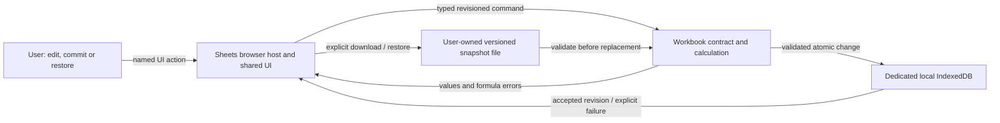

# Reference implementation: Agentic Sheets

## Reference implementation — authority, scope and readiness

This is the single joined `SHEETS-WORKBOOK-001@0.5.1` specification under [PRD, TAD & ADR Guidelines v3.5.1](../../guidelines/prd-tad-adr-mvp-gtm-guidelines.md). PRD defines the product outcome, TAD its owners/contracts, ADR the choices, and MVP/GTM consume those exact criteria. The related [Base artifact `SHARED-VIEW-RUNTIME-001@0.4.0`](prd-tad-adr-mvp-gtm-agentic-base.md) remains the owner of Base record views and the Base/Sheets separation decision. This artifact owns the bounded workbook product; it does not redefine Base.

**Owner-selected topology.** The public Dev repository is [huijoohwee/agentic-sheets](https://github.com/huijoohwee/agentic-sheets). The intended public route is `https://airvio.co/agentic-sheets`. Its generated archive belongs at `huijoohwee/huijoohwee:content/agentic-sheets/` after approved promotion and live verification.

**Verified implementation.** The protected Sheets revision in E-16 owns the headless core, browser editor, storage adapter and sealed static files. E-17 identifies the Graph release adapter that qualifies that revision. E-08/10 preserve the earlier Base producer and controller for recovery.

**Readiness.** Local `dev-proven` covers workbook edits, calculation and recovery in the headless and browser fixtures (E-08/09/16/17). Physical touch, screen-reader use and timed user TTV remain open under VCC-05. Hosted preview, current cost and predecessor evidence, and production authorization remain open under VCC-06/07. Delivered remains `undocumented` on owner hold.

**Product scope.** People use the same workbook to organize values, calculate from cells, inspect an edit and recover accepted work offline. Authors choose their labels, values, units and formulas. A simple text checklist is a complete workbook. The document names a specific product and delivery route, so its frontmatter retains `universal_scope: false`. The workbook contract applies across tasks and hosts. The portable requirements are the observable behaviors below.

| Principle | How to verify it |
|---|---|
| Universality | Start with an empty workbook. Use typed cells and the same edit and snapshot operations for stock counts, a schedule and a text checklist. The scenario supplies the meaning of each column. |
| Neutrality | Describe each capability by what the user can do and the result they can inspect. A comparison site can suggest a behavior. Product priority comes from an observed workbook task. |
| Runtime and provider agnosticism | Express an edit as typed input, expected revision and observable outcome. Run the calculation headlessly and through an admitted host. Read workbook identity and version from the validated content. Renaming the snapshot file or changing the host route must preserve them. |
| Headlessness | Call the public workbook core from a process without a DOM, browser storage, UI or network access. Create a workbook, apply a revisioned edit, recalculate, and encode, decode and restore its snapshot. The browser adapter invokes those same commands. VCC-16 specifies the check. |
| Modularity | Qualify the core with optional features absent. Qualify each added feature against its declared inputs, errors, limits and recovery behavior. Scope a failed check to the capabilities that depend on it. |

See the [workbook scenarios](#workbook-scenarios) and [feature comparison](#reference-implementation--sheets-feature-comparison). The [cash-flow example](#cash-flow-acceptance-cases) illustrates one optional calculation family.

**Reference-use restriction (applies to the repository and hosted showcase).** Univer may be considered conceptually under Base ADR-04. Copying, vendoring, porting or closely reproducing its source, documentation, schema/API structures, assets or fixtures is forbidden. Direct/transitive package, build/test, Git/tarball, submodule, CDN, hosted-service, preset/plugin or commercial dependencies on Univer and its sibling packages are forbidden. The same restriction covers screenshots, UI layouts, example data and golden outputs. Tests must run with both reference domains blocked. Generic workbook terminology and independently authored behavior are allowed. No external engine is selected or installed by this document.

## Reference implementation — PRD: need, experience and criteria

### Users, job and ranked pain

**Target job hypothesis.** A workbook author organizes local data, edits a value, inspects any dependent result and reopens the accepted work offline. An author can keep a list without formulas. The owner has selected this product and its delivery topology. Interviews, usage frequency, measured losses and willingness to pay remain unknown.

| Rank / pain evidence | Hook → break → fix → close | Reuse/build and minimum-value rationale |
|---|---|---|
| P1. Workbook versus record-model mismatch; owner request + E-02, commercial demand unvalidated | Enter a calculation → a typed-record projection lacks cell dependencies → add an independently owned bounded workbook core → inspect changed totals while Base remains intact | Reuse browser platform and Design System; new Sheets semantics only; S1/VCC-01/02/09 |
| P2. Data lost or unclear after offline/reload/edit conflicts; hypothesis | Edit locally → reload/quota/stale revision can hide loss → atomic local save, explicit errors and snapshot download/restore → read back the same accepted workbook | Reuse platform storage and source rollback practices; no cloud sync; S2/VCC-03/04 |
| P3. Unclear source-to-public artifact identity; observed missing route/mirror E-03–05 | Open the named route → 404 or unknown candidate → source-owned exact-artifact preview/promotion/readback → identify delivered revision and predecessor | Extend existing release owner E-04, never hand-edit mirror; S3/VCC-06/07 |
| P4. Repeating or checking an edit by hand may cause an error. Frequency and cost are unknown. | Change a value used elsewhere → inspect the affected cells → confirm or correct the result → reopen the accepted workbook | Reuse C1–C4. Record which operation costs the user time before selecting a new editing or calculation feature. S6/S7, VCC-13–15. |

Prioritize the smallest calculation/persistence proof over broad Office features. The delivery path is owner-selected; server infrastructure and broad Office compatibility each require separate demand evidence. Human assignees remain unassigned; accountable functions are named for each outcome before implementation admission.

### Stories and scope of the first workbook release

- **S1:** As a local workbook user, I can enter bounded scalar cells and supported formulas and observe deterministic recalculation or a named error.
- **S2:** As a returning user, I can reload the accepted workbook offline and download/restore its versioned snapshot without silently overwriting another workbook.
- **S3:** As a release operator, I can verify the same source/artifact through Dev rehearsal and the selected Prod route, then restore the exact prior site state without deleting workbook data.
- **S4:** As a keyboard/touch user, I can select, edit, commit/cancel and inspect cells on a narrow browser viewport with semantic labels, visible focus and readable errors.
- **S5:** As an integrator, I can use Sheets without changing Base's record store, schema, exports or view ownership; a later transfer is an explicit consumer-owned snapshot operation.
- **S6:** As a workbook author, I can see how a change to one input affects dependent cells, inspect a result or named error, and reopen the accepted work in its original types.
- **S7:** As a workbook author, I can navigate, format and reuse a scenario across ranges and worksheets as each editing capability passes its acceptance check.

The priority table describes the first workbook release. S6 and S7 belong to the successor comparison below.

| Priority | Outcome / pain | Boundary |
|---|---|---|
| Must | One workbook, one worksheet, editable scalar cells and a small declared formula subset; P1 | Independently authored Sheets contract; no arbitrary JavaScript or record-engine substitution |
| Must | Atomic revisioned local persistence, conflict/quota errors and versioned snapshot download/restore; P2 | Browser-local only; no account, cloud store, telemetry or implicit sync |
| Must | Keyboard/touch/narrow-screen editing and error visibility; P1/P2 | Existing Design System primitive owner; no competing panel or toolbar implementation |
| Must before delivery | Exact source/artifact identity, preview checks, route/CSP/SW isolation, cost proof and rollback; P3 | VCC-06/07; promotion boundaries stay closed without effect-specific authority |
| Should | Measure clean-checkout and returning-user time-to-value; test multiple device engines | Targets below, not measured results |
| Could | Independently bounded undo history, another worksheet or read-only Base snapshot transfer | Separate acceptance increment after core proof |
| Won't this increment | XLS/XLSX or full CSV fidelity, Excel formula/format parity, charts/pivots/macros, collaboration, remote functions, live Base writeback, AI/agent execution, payments, new database/server or registry publication | No silent feature expansion; a later owner/artifact revision must admit each capability |

### Reference implementation — Sheets feature comparison

E-11 provides a comparison inventory. Each row defines a workbook capability in user terms, its native baseline at E-08/09, and the check for a claim of support. **Planned** means specified for possible implementation. **Deferred** requires a separate scope decision. Product chooses the order using observed need, reuse and cost. The comparison covers each named behavior individually.

| User capability | Agentic Sheets today | Target and independent acceptance check |
|---|---|---|
| Inspect and edit a cell | One sheet, sparse scalar cells, selected address display and formula editor. Keyboard and narrow-screen checks pass locally. | **Baseline / VCC-01/05.** Commit, cancel, inspect raw source and result, then retain focus after an error. Physical touch and screen-reader proof remain open. |
| Reuse a range | Individual cell edits and rectangular `SUM` references. | **Planned / S7.** Select a rectangle with keyboard or touch, paste a 2×3 plain-text block, fill a relative formula and preserve absolute and mixed anchors. Undo the entire edit once and redo it once. Reject an out-of-bounds paste atomically. |
| Work across sheets and change structure | One fixed worksheet. | **Planned / S7.** Create, rename, reorder and switch sheets. Insert/delete a row or column and update dependent references. A rename preserves identity, a removed target yields an explicit reference error, and undo restores the original result. |
| Read and navigate a dense workbook | Bounded scrolling grid and shared UI profile. Cells have no persisted display format. | **Planned / S7.** Display a number at two decimal places or as a percent, set alignment and emphasis, then verify the stored value and format after restore. Freeze a heading, resize a column, and reach an off-screen cell by address. Defer merge/wrap, rich text and images behind separate fixtures. |
| Calculate from cells and ranges | Same-sheet arithmetic and rectangular `SUM`, with typed errors and cycle detection. | **Planned / S6.** Evaluate a requested aggregate, logical, lookup, text or date function against its declared arguments and independent expected results. Exercise invalid inputs and dependency updates. A specialized family can use the same calculation contract once selected. |
| Find, sort and filter a range | No workbook commands for these operations. | **Planned / S7.** Find and replace a literal within the selected range, sort with ties while keeping rows intact, then filter and clear the filter. Verify row membership, formula destinations and that hidden rows retain their values. |
| Validate inputs and highlight exceptions | Type/size checks protect the workbook contract. | **Planned / S7.** Reject a disallowed value or show its configured warning, highlight a threshold crossing with an accessible text cue, and re-evaluate after an edit. A rule survives save/restore without altering the underlying number. |
| Annotate and protect a local workbook | No notes, links, threaded comments or protected ranges. | **Planned / S7.** Preserve a cell note and a user-approved link on restore. **Deferred.** Local protection requires an explicit edit-denial check. Threaded comments and identity-based permissions require separate authority and storage design. |
| Summarize or exchange a workbook | Versioned local JSON round-trip only. | **Deferred.** Admit charts, structured tables, pivots, printing and CSV/XLSX per feature. Check a chart's source/range after an edit, a pivot's grouped totals, a print boundary or a declared file subset with a loss report. Reject unsupported imports before replacing accepted data. |
| Share or automate | Revision conflict detection on this device and a headless module. | **Deferred.** Simultaneous multi-user editing, version history, remote sync and agent transports each need a separate principal, conflict/recovery fixture and cost decision. Macros and remote formula execution are outside this product contract. |

The scope for a parity claim is the named workflow, source revision, feature list and device. Open checks stay visible. The comparable behavior can be demonstrated from a local fixture with both reference domains unavailable.

### Metrics and economic bounds

Numbers below are acceptance targets/caps unless an evidence reference records a measured result. E-08/09 record local checks and a desktop Chromium 100-edit p95 of 1.3 ms; this is not mobile hardware performance. A timed clean-environment TTV run, physical-device load result and business/economic sign-off remain pending.

| Metric / feature | Baseline | Target / method |
|---|---|---|
| First workbook calculation, S1 | Implemented E-08; timed run pending | Open local fixture → create workbook → edit cell → inspect result; ≤4 user actions / 2 minutes in a timed clean-browser rehearsal |
| Developer first view, S1/S4 | Unknown | Exact checkout → install permitted locked build dependencies → run documented local command → render fixture; ≤5 manual steps / 30 minutes |
| Returning/offline save and restore, S2 | Unknown | Accepted edits survive offline reload; downloading/restoring a fixture ≤5 actions / 2 minutes; no network after assets are primed |
| Calculation, S1 | Unknown | Within caps, stable results and error classification; target p95 edit-to-result ≤100 ms across 100 fixture edits, report device/browser |
| Initial browser reach, S4 | Unknown | 360 CSS px viewport, keyboard/touch, visible focus, 200% zoom, reduced motion; text ≥4.5:1 (large text ≥3:1), control/focus ≥3:1; primary touch controls ≥44 CSS px |
| Local load, S1/S2 | Unknown | Fixture interactive in ≤2 seconds on the recorded mobile-class device after assets are local; disclose hardware/cache state |
| Artifact identity, S3 | Missing product route/mirror | 100% manifest files/digests match exact preview and public release; route normalization and negative routes pass |
| Runtime model calls / spend | No AI component selected | 0 model calls by design; $0 incremental spend cap, unknown provider fees/headroom blocks dependent effects |

ROI `(impact × monthly reach) / (build hours + monthly TCO + monthly token cost)` is not calculable from absent impact/reach/effort inputs. Serving-model tokens are designed to be zero, while authoring tokens and labor remain real, unmeasured costs. No first-dollar, savings or commercial-demand claim is made.

| Deployment model | Selected status | 12-month TCO / limits / exit |
|---|---|---|
| Browser/device-local | Selected MVP architecture | New hosted-resource spend cap $0; device storage, support, build effort and actual TCO unknown; snapshot export is the portability exit |
| Existing shared static site | Owner-selected target, gated | Current account/plan, hard-$0 or deny-at-quota proof, project capacity and controller authority must be read back; no quota/alert alone proves safe spend |
| Edge/server/managed workbook service | Deferred | Cost/license/data-residency unknown; no deployment, paid addon, upgrade or overage fallback |

### Acceptance VCCs and traceability

VCC-01–09 cover the bounded workbook and its delivery. VCC-16 qualifies the headless core independently of the host. VCC-13–15 apply when extending calculation, editing or host support. VCC-10–12 keep their original identifiers in the [optional finance example](#cash-flow-acceptance-cases) and apply only when the corresponding financial behavior is selected. Each result is scoped to the exact feature, source and device tested.

| ID / story / TAD / ADR | Measurable end state | Stated check / bound | Evidence |
|---|---|---|---|
| VCC-01 / S1 / C1 / ADR-01/02 | Stable workbook/sheet identity; typed scalar edits commit once at expected revision, rejected/out-of-bound inputs leave prior bytes intact | Independently authored headless contract tests; valid/invalid payload, duplicate/replayed operation ID, stale/concurrent writes and limits fixtures | Satisfied locally: E-08 typed commands/replay/stale/limits; E-09 real transaction race and cancellation. |
| VCC-02 / S1 / C2 / ADR-02 | Supported arithmetic/SUM references recalculate deterministically; cycles, bad refs/types, divide-by-zero and limits produce explicit errors without arbitrary code/network | Formula grammar/dependency tests and 100-edit benchmark; fixture totals and invalid-case assertions; no inferred Excel parity | Satisfied locally: E-08 deterministic/error/budget fixtures; E-09 100 edits, p95 1.3 ms on desktop Chromium. |
| VCC-03 / S2 / C3 / ADR-03 | Acknowledged state reloads after disconnect/restart; two stale writers yield at most one commit; failed quota/save preserves committed snapshot and unsaved editor state | Real-browser IndexedDB transaction, second-tab and offline-reload tests; inspect error/readback and request capture | Satisfied locally: E-09 real IndexedDB race/reopen/quota/replay, stale-tab draft retention and primed offline reload. |
| VCC-04 / S2 / C1/C3 / ADR-03 | Download→validate→restore preserves supported workbook values/formulas/revision metadata; incompatible/malformed/oversize snapshots do not overwrite source | Disposable-origin snapshot round-trip and corrupt/version/ID-collision fixtures; explicit restore-versus-clone decision | Satisfied locally: E-08 strict snapshot/identity/revision cases; E-09 download/upload/restore/clone and corrupt import. |
| VCC-05 / S4 / C4 / ADR-01 | Selection/edit/commit/cancel/focus/error/readback work on keyboard and touch at the stated narrow/zoom/contrast targets | Per-device browser walkthrough and measured final colors/geometry; timed TTV run, not static markup proof | Partial E-09: keyboard, 360px, 200% text zoom, light/dark contrast and 44px controls pass. Physical touch, screen-reader and timed TTV pending. |
| VCC-06 / S3 / C5 / ADR-04 | Exact protected Dev source creates one sealed artifact; non-public preview passes identity, limits, routes, enforced-prod CSP and scoped SW checks; same candidate staged for Prod | Reproducible build/digest inventory, existing owner controller extension tests, preview HTTP/browser readback; no rebuild between stages | Partial E-16/17. The protected producer, pinned controller and local HTTP/browser rehearsal passed. Hosted preview, current cost proof and same-candidate staging receipt pending. |
| VCC-07 / S3 / C5 / ADR-04 | Authorized Prod public/immutable identity matches VCC-06; generated mirror matches files after smoke; predecessor restore readback passes and data survives | Owner-operated live route/artifact/SW/returning-browser checks plus rollback rehearsal/receipt; bootstrap baseline may be verified absent route | Pending: no production activation, mirror publication, public artifact smoke or retained live predecessor proof. |
| VCC-08 / S5 / C1–C5 / ADR-01/05 | Base remains independently usable; Sheets has no copied or direct/transitive Univer dependency; shared UI comes from its native owner | Exact dependency/import/generated-output marker scan plus independent provenance/compatibility review; marker absence alone is insufficient | Satisfied locally E-08: independent Sheets exports/store; no record-engine changes or new packages; exact central profile and license notices. No Univer source/dependency. |
| VCC-09 / S1–S3 / C1–C5 / ADR-05 | Product caps and $0 effect policy hold, noncritical capabilities remain lazy, no unexpected runtime network/model calls | Artifact/raw-byte inspection, browser request capture, typed limit fixtures and current provider proof for each external effect | Partial E-08/09: bounds and <500000-byte chunks pass; 64191 output bytes excluding manifest. Mobile-device load/TTV and hosted checks pending. |
| VCC-13 / S6 / C1–C4 / ADR-03/05/06 | An accepted edit has the same typed inputs, formula source, result or error after recovery | Run a task fixture headlessly and in the browser, reopen offline and restore a disposable copy. Compare accepted revisions according to restore/clone rules. | Required for the selected extension. E-09 covers the v1 browser slice. |
| VCC-14 / S7 / C1–C4 / ADR-01/03/06 | Every claimed editor behavior passes its own feature-comparison row | Replay a new keyboard/touch fixture including undo or rejection, restore and formula readback. Record per-behavior results and outstanding cases | Planned per feature. A toolbar control earns no credit by itself. |
| VCC-15 / S5/S6 / C1–C5 / ADR-05/06 | Core workbooks open and edit with a proposed optional module omitted. A workbook that requires the module preserves its input on an unsupported operation. | Run the core fixtures without the module, enable it for its own fixture, then reopen without it. Compare core results, preserved source, error and artifact bytes. | Proposed integration check for each admitted extension. E-14 covers v1 headless examples only. |
| VCC-16 / S1/S2/S5 / C1/C2 / ADR-01/02/03 | The public core supports create, edit, calculate and snapshot recovery in a non-UI host | Import only the core entry with browser globals, browser storage and networking unavailable. Check typed inputs, dependent values, revision and restored formula source. Keep durable persistence and UI checks at C3/C4. | Satisfied locally at E-16. The public package read a Base v1 snapshot, calculated the edit, replayed it, rejected a stale writer and restored the original at revision 3. |

The core joins P1/S1 to C1/C2, ADR-01/02 and VCC-01/02. Persistence joins P2/S2 to C3, ADR-03 and VCC-03/04. Device access joins S4/C4 to VCC-05. Delivery joins P3/S3 to C5, ADR-04 and VCC-06/07. VCC-08/09 apply across slices. P4/S6/S7 use the existing owners and ADR-06 for VCC-13–15.

### Workbook scenarios

These original examples exercise the same v1 commands with different data. The expected values below are reproducible through the headless entry point at E-14. Browser storage, accessibility and timed user trials have their own evidence.

| Task | Initial workbook and edit | Expected observation |
|---|---|---|
| Stock count | A1 has 18 on hand, B1 has 7 received and C1 has 4 issued. D1 contains `=A1+B1-C1`. Change C1 to 9. | Available stock changes from 21 to 16. The formula survives a snapshot round-trip. |
| Session schedule | A1:A3 contain durations 12, 18 and 10. B1 contains `=SUM(A1:A3)`. Change the middle duration to 23. | Total scheduled minutes change from 40 to 45. The workbook supplies the unit. |
| Inspection checklist | A1 contains the text “Inspect latch” and B1 a boolean false. Set B1 to true. | The label and boolean type survive export and decode. The workbook requires no formula. |

## Reference implementation — TAD: owners, contracts and delivery

### Native grounding and division of work

C1–C4 and the artifact builder belong to the dedicated Sheets repository at E-16. Graph owns the release adapter at E-17. E-08–10 retain the original integration evidence.

| Component / responsibility | Native source or proposed location | Reuse decision / smallest delta | Ownership, readiness and check join |
|---|---|---|---|
| C1 workbook schema/commands validates cell changes | `agentic-sheets:sheets/{schema,core}.mjs` at E-16 | New workbook contract; retain Base `src/{schema,engine,projectors}.mjs` unchanged, not a store/parser to rename | Sheets domain owner; local dev-proven / delivered undocumented; VCC-01/04/08 |
| C2 calculation derives cell results | `agentic-sheets:sheets/formula.mjs` at E-16 | New bounded grammar/dependency owner; no JS eval, imported engine, copied schema or external functions | Sheets domain owner; dev-proven / undocumented; VCC-02/09 |
| C3 storage persists accepted workbook snapshots | `agentic-sheets:sheets/storage.mjs`; `agentic-sheets-v1` database | Reuse IndexedDB platform/optimistic-revision patterns; Base adapter has a different record schema and is not copied or silently repurposed | Sheets storage owner; dev-proven / undocumented; VCC-03/04 |
| C4 browser shell projects workbook commands/results | `agentic-sheets:sheets/{app.mjs,index.html,styles.css,sw.js}` | Direct reuse of cleared Design System primitives; new workbook grid/selection belongs to Sheets, not a Base record-grid replacement | Sheets view owner; dev-proven / undocumented; VCC-05/08 |
| C5 build/release/route integration seals and promotes static output | Sheets `scripts/build-sheets.mjs` and Graph `scripts/production-sheets.mjs` at E-16/17 | Extend existing artifact/controller owner, never duplicate its deploy machinery or manually author generated mirror assets | Release owner with Sheets producer; dev-proven / undocumented for Sheets; VCC-06/07 |
| Shared panel, toolbar, typography/icons and lifecycle | Sheets pins `agentic-design-system@54229ceed5106c5a44a2cb3731c0deb0f74a1904`; `design/` holds the exact profile, pin and notice at E-16 | Reuse native public exports and generated profiles with digests; no local visual/lifecycle fork or Base forwarding shim | Design System owns primitives; direct central CSS profile consumed, standalone host has no duplicated panel lifecycle; VCC-05/08 |
| Base record views / optional data bridge | `SHARED-VIEW-RUNTIME-001@0.4.0`, Base E-02 | Retain local semantics; defer consumer-owned snapshot bridge and all writeback | No Base↔Sheets runtime/build dependency; no second record store; VCC-08 |

**Source ownership.** Sheets owns the workbook contract, tests and artifact. Base owns records, fields and views. Existing v1 snapshots open through the public Sheets entry. Graph verifies repository, revision and source bytes. E-08/10 identify the previous producer and release adapter for a reviewed source revert.

**Acyclic build order:** cleared Design System contracts → independent Sheets core/adapters/view → sealed Sheets artifact → approved shared-site controller → verified Prod → generated Prod mirror publication. Base record packages are independent of the Sheets build. Runtime edit/recalculation/readback can return to the workbook owner; that is not a build cycle. Extract a generic utility only after an existing owner and two concrete consumers justify it; no new shared-kernel/SDK/registry is selected.

### Headless contract, storage and limits

The implemented versioned contract is `sheets/workbook/v1`, independently authored and distinct from Base's record contract. A workbook has stable `workbookId`, `sheetId`, `schemaVersion`, `revision`, bounded dimensions and sparse typed cells. Cell identity is sheet ID plus coordinate within this fixed-dimension MVP. Inserting/deleting/reordering rows/columns, cross-sheet references and reference-rewrite behavior are deferred; they require their own specification before being enabled.

Commands carry an operation ID, expected workbook revision and typed payload; results distinguish proposed edits, accepted persisted revision, calculation errors and storage/permission/conflict/limit failures. Storage acceptance is the acknowledgment point. Local reads/descriptions do not write or invoke a model. A host policy check runs before a storage effect, but same-origin policy callbacks are not authentication or isolation from other scripts. Any future external transport needs a trusted principal and effect authority of its own.

The storage owner uses one IndexedDB transaction to compare revision and persist the next snapshot plus a bounded deduplication log. At most 64 retained operation IDs per workbook; exact retry within that window returns the same accepted outcome, mismatched payload reuse rejects, and an expired ID with stale revision rejects. Cancellation before commit leaves state unchanged; an uncertain post-commit outcome is reconciled by ID/revision readback rather than blind resubmission. Tests must prove these properties; Base memory tests do not prove this adapter.

**Enforced v1 product caps (E-08).** one workbook/worksheet; 32 rows × 16 columns, at most 512 addressed cells and 64 formula cells; 1,024 UTF-8 bytes per scalar text and 256 per formula; snapshot/command each ≤262,144 bytes; formula ≤128 tokens / 16 nested expression levels; total dependency edges ≤512 and evaluated expression operations ≤4,096 per edit. Reject before committing an oversized input. Browser storage quotas may be lower; these caps are not measured capacity. Any limit change requires new fixture/performance evidence.

**Formula subset:** finite numbers, explicit same-sheet A1 references, parentheses, `+ - * /`, unary sign and `SUM` over bounded rectangular ranges. This is ordinary independently specified spreadsheet behavior, not a mirrored external API. Empty cells contribute zero; text/booleans used numerically yield a value-type error; missing/out-of-grid references, division by zero, malformed grammar, non-finite arithmetic and cycles have stable named error values. Errors propagate deterministically. Use the finite-number model explicitly; no financial decimal-precision, locale-coercion, date-serial or Excel compatibility claim. Formulas store source and calculated outcome separately; do not serialize executable objects or call network/remote functions. General functions, volatility, macros, external links and cross-workbook calculations are excluded.

Download/restore uses a versioned JSON snapshot with a deterministic serialization for checks. Restore validates the entire payload before an atomic replacement; an existing workbook ID/revision collision requires an explicit restore or clone choice. Restoring over an existing workbook requires its current expected revision and advances that revision; retain the imported revision as provenance, never reset the live concurrency fence. A clone starts with new identity/revision 1 and recorded provenance. Download captures accepted state; unsaved editor changes must be committed or explicitly excluded. Failed imports retain both current committed state and source file; no destructive schema migration. Browser eviction remains possible, so download/restore is a separate user-controlled recovery path, not a promise of durable backup. No user workbook, private file, credential or browser record belongs in a Git or Prod asset artifact.

### Portable contracts and optional features

| Owner | Portable behavior | Reference binding and extension boundary |
|---|---|---|
| C1 workbook | Validate workbook identity, typed edits and expected revision. Preserve accepted state on rejection. | Headless commands own edits. A template supplies ordinary cells. Its labels, units and sample data belong to the workbook. |
| C2 calculation | Calculate deterministic results or named errors from typed cells and bounded references. | Extend the existing evaluator for an admitted function. Document arguments, missing values, error propagation, bounds and independent examples. The evaluator and C1 run without a browser view or persistence adapter. |
| C3 persistence | Commit atomically, detect stale edits and recover a versioned snapshot. | The browser binding uses IndexedDB. Another adapter qualifies through the same conflict, replay and recovery checks before a portability claim. |
| C4 view and input | Translate a user action into the same workbook command and display accepted values, drafts and errors. | Keyboard and touch use the browser shell. Localization and display formats belong here. A display change must preserve the stored value and formula. |
| C5 packaging and delivery | Bind an exact capability set and static artifact to its source. | The selected release owner supplies the route, headers and scoped worker. A different host needs its own delivery evidence. |

Optional calculation families consume the core value and error conventions. The host selects admitted capabilities. Keep optional code and example data outside the base load. A missing function must expose an unsupported-formula error and preserve its source. An unrecognized snapshot version must fail before replacement. Reopen a v1 snapshot with the feature disabled, check the raw artifact size and verify core behavior under VCC-15. A specialized function may state its own units, locale handling and numerical tolerance. Ordinary cells acquire such meaning only when the user or the called function specifies it.

C1 owns proposed range edits, reference rewrites and undo transactions. C3 owns their persistence and migration. A schema change requires a versioned reader, migration on a copy and round-trip proof before modifying stored bytes. Prime admitted optional assets for offline use and measure cold/base bytes, each chunk and recalculation time. No plugin loader or second command registry is required by this design.

### Device, offline and native design adoption

| Native concern / owner | Planned adoption | Required evidence / gap |
|---|---|---|
| Settings, panel tabs/close/lifecycle / Design System | Import exact public panel/semantic-control APIs directly; host supplies workbook content/state/actions | Exact pin/export/notice and per-mode interaction check; not a Base facade |
| Typography, tokens, icons and focus / Design System | Reuse one approved profile and generated projections; no downloaded font or copied reference assets | Final composited contrast, scaling and touch metrics; source defaults do not prove accessibility |
| Workbook cells, selection and formula editor / Sheets | Semantic named grid/editor, stable keyboard focus, explicit commit/cancel and non-color errors | Native independently authored fixture and device walkthrough; no replacement Base table renderer |
| Status/recovery / Sheets host | Show accepted/unsaved revision, offline state, save failures, download/restore | Quota, crash, reload, stale writer and corrupt snapshot results; no silent success |

The app must fit 360 CSS px with internal grid scrolling rather than document overflow. Page only the necessary visible cell window if measured DOM cost requires it; no second grid or speculative canvas engine. Use lazy loading for calculation/editor features beyond the shell where it improves measured load; max raw JS/CSS chunk <500,000 bytes and initial app payload target ≤400,000 raw bytes excluding immutable notice/manifests. E-08 verifies these byte limits; E-09 does not substitute desktop results for mobile hardware load measurements. No model SDK, telemetry, remote font or CDN fetch is needed at runtime.

Offline storage is device/browser-local. Paths under `airvio.co` share an origin; `/agentic-sheets/` does not create a security boundary. Use a dedicated database/cache namespace and a service worker scoped only to `/agentic-sheets/`; never intercept another product or delete its storage/caches. Cache only the selected static artifact, not uploaded/private workbooks. Enforce source-owned production CSP and MIME/security headers; Dev may be Report-Only, but preview checks must validate the production-enforced policy before promotion. No `eval` or executable formula/plugin input is admitted.

### Journey, workflow, data, harness and topology coverage

| Feature | User journey / workflow | Data flow / topology | Orchestration/harness |
|---|---|---|---|
| S1 edit/calculate | Create fixture → select/edit → validate/preview → commit/readback; D1 | Typed commands → pure core → accepted results; D1 | N/A: no agent/model or autonomous loop |
| S2 persist/recover | Save → disconnect/reload → download/restore; D1 | Dedicated local store and explicit file boundary; D1 | N/A: ordinary storage transactions, not agent orchestration |
| S4 browser access | Keyboard/touch edit → commit/cancel → named result; D1 | Host projects core state through shared primitives; D1 | N/A: no model/UI decision agent |
| S3 release | Exact Dev source → sealed preview/readback → authorized same-candidate promotion → public smoke → generated mirror; D2 | Source/artifact/route identities and separate receipts; D2 | Existing ADLC/release workflow, bounded phase checks; no new orchestrator |
| S6/S7 calculate and edit | Edit a value or range → inspect dependents and errors → reopen offline, VCC-13/14 | C4 → C1/C2 → C3 through D1. The same operation accepts user-defined labels and units. | Headless and browser fixtures, with optional features omitted for VCC-15 |
| S5 Base transfer | Deferred, outside first slice | Base artifact's proposed consumer-owned snapshot bridge; no runtime edge now | N/A: live sync/agent routes excluded |

**D1** · Class: User workflow/data flow · Notation: Mermaid `flowchart LR` · Surface: Markdown/canvas projection · Version: 0.1.0. Caption: local workbook journey at E-08/09. Optional features use the same revision and recovery boundaries.

| D1 node / owner | Input → output / residency |
|---|---|
| `user`, `view` / user and Sheets view owner | UI actions → commands and accepted/unsaved state; local browser |
| `core` / Sheets domain owner | Typed cells/commands → deterministic calculation/change set; pure local code |
| `store` / Sheets storage owner | Revisioned accepted snapshot/log → readback; origin-local device database |
| `snapshot` / user | Explicit bounded JSON file → validated restore; user-controlled local file, never Prod assets |

**D2** · Class: Build/release workflow and topology · Notation: Mermaid `flowchart LR` · Surface: Markdown/canvas projection · Version: 0.1.0. Caption: requested Dev→Prod topology, with a non-public preview before delivery and generated mirror publication after successful live smoke. Arrows are proposed admissions, not delivery evidence.

```mermaid
flowchart LR
  subgraph authoring["Authoring lane: Dev source"]
    source["GitHub agentic-sheets: protected Dev source"]
    checks["Owner contract and source checks"]
    source -->|"exact protected source"| checks
  end
  subgraph rehearsal["Mirror lane: non-public immutable candidate"]
    artifact["Sealed Sheets artifact and manifest"]
    preview["Exact-artifact preview readback"]
    artifact -->|"serve without rebuilding"| preview
  end
  subgraph delivery["Delivery lane: shared Prod site and generated archive"]
    controller["Existing site release owner: admitted Sheets extension"]
    route["airvio.co/agentic-sheets"]
    mirror["GitHub huijoohwee/content/agentic-sheets"]
    controller -->|"authorized same-candidate activation"| route
    route -->|"successful exact live smoke before publication"| mirror
  end
  checks -->|"deterministic build and digest"| artifact
  preview -->|"green readback plus effect authority"| controller
```

| D2 node / owner | Role / data residency and boundary |
|---|---|
| `source`, `checks` / Dev producer | Protected Sheets repository and checks at E-16. Original Base receipts are retained at E-08. |
| `artifact`, `preview` / build/verification owner | Static files, notices, manifest and temporary non-public rehearsal; no user workbook copied |
| `controller` / existing shared-site release owner | E-17 binds the dedicated producer to the shared site controller. Hosted qualification remains pending. |
| `route` / production site operator | Browser static runtime at owner-selected public URL; local user data remains on device |
| `mirror` / generated Prod archive owner | Exact generated files only at requested repository prefix, after live verification; no hand-authored product source |

**Diagram register:** D1: 5 nodes/7 edges/0 clusters; D2: 7 nodes/6 edges/3 clusters. Counts are source-structure expectations, checked by the target diagram projection at authoring handoff; they do not establish runtime or deployment readiness.

### Invocation register and developer lifecycle

C1 owns the local command schema. The invocation register distinguishes existing local surfaces from future external transports.

| Capability / surface | Mode and schema owner | Principal/effect boundary / current support |
|---|---|---|
| Workbook calculation and typed edits / local module | C1/C2 export `calculate` and `executeWorkbook` from `sheets/core.mjs` | E-16 qualifies the public headless entry. C3 gates persistent writes by policy and expected revision. |
| Browser edit/download/restore | C4 → C1/C3 using the local toolbar and cell editor | E-09 covers explicit snapshot actions, conflict recovery and primed offline reload. |
| HTTP data API / MCP / WebMCP / `/` commands / `@` bindings / `#` semantic routes | Unsupported in MVP | No handler/schema registry/gateway exists; do not manufacture route names or claim agent readiness from a static page |
| Static public URL | Selected delivery address, not an API command | Asset read only, no mutation authority; observed 404, promotion gated |

In the dedicated checkout, run `npm test` to check the core and sealed artifact, `npm run build:sheets` to reproduce the static files, and `npm run dev` to open the editor at `http://127.0.0.1:4177/agentic-sheets/`. A Node consumer imports `agentic-sheets` for the headless core and can select `agentic-sheets/storage` for the browser adapter. See E-16.

### Artifact, routes, promotion and rollback contract

**Artifact identity:** an exact protected Dev commit, source-tree digest, dependency-lock/pin digest, build recipe/version, notices, and a sorted file inventory of relative path/raw byte length/SHA-256. Compute aggregate payload digest from payload entries excluding the manifest's own digest to avoid self-reference. No mutable branch alias or mixed-version generated asset. Validate safe relative paths, known ownership, MIME, raw-byte caps, and absence of user data. The same sealed candidate moves from preview to Prod; changing bytes requires a new candidate and preview evidence.

**Requested routes, proposed rules:** `/agentic-sheets` normalizes to `/agentic-sheets/`; index/assets/SW/manifest resolve only to the owned generated prefix. Use relative assets compatible with both preview and public base paths. Missing asset/unknown product paths return an explicit 404 rather than unrelated application HTML. Avoid a broad catch-all or another product's service worker. The exact redirect/status/cache/CSP rules must be owned and emitted by the existing release source extension and verified on immutable and public origins; no current `_redirects`/`_headers` mutation is authorized.

**Current controller.** Graph resolves its dedicated Sheets pin, checks out the public repository at that revision and validates the immutable input and output bytes. The route receipt includes the producing repository, source revision and artifact digest. Base demo releases use a separate pin. E-17 covers the local rehearsal.

| Boundary | From → to / current state | Required evidence | Operator instruction / recovery |
|---|---|---|---|
| B1 source integration | Dev source lane → exact protected Dev commit; dedicated v1 producer and site source integration at E-16/17 | Bound VCC slice, source/rights/budget checks, reviewed exact changes and integration receipt | Separate source admission; recover by reviewed source revert preserving workbook files/data |
| B2 preview qualification | Protected Dev source → non-public sealed artifact/preview; closed | VCC-01–06 results, exact source/output identity, enforced-prod headers and scope checks | Exact preview/build authorization under owner controller; retain prior artifact and record failed build without promotion |
| B3 production activation | Qualified preview → selected Prod route; closed | Current hard-$0/deny-at-quota and rights proof, exact preview result, preserved live baseline/rollback identity, target permissions | Exact product/environment/candidate promotion instruction absent; restore prior whole-site artifact/route via native controller and read back |
| B4 generated publication | Verified live candidate → Prod archive prefix; closed | VCC-07 public smoke, exact inventory identity, current mirror base and disjoint path ownership | Native source-owned mirror publication authority absent; CAS/serialized update prevents overwriting another product; source receipt does not grant this effect |

Authoring source is local/Git; preview holds non-public static build bytes; delivery exposes public static assets and the generated repository projection. **The mirror lane is the sealed preview**, not permission to publish the Prod repository before smoke. This distinction preserves both the guideline's three-lane sequence and the Prod repository's current generated-after-verification policy (E-03).

**Bootstrap rollback:** there is no observed previous Sheets release. Capture the actual current shared-site deployment/artifact identity and the absence of this prefix/route before first activation; a 404 alone is not a complete rollback baseline. First rollback restores that exact prior site/route state, including removal only of newly owned Sheets artifact entries through the owning controller. Later rollback restores a retained compatible predecessor source/artifact/headers/SW/mirror identity; never clear IndexedDB, downgrade incompatible schemas blindly, or delete other products. Keep snapshot restore separate from source/route rollback. If rollback compatibility or mutation outcome is uncertain, stop promotion and reconcile native provider identity rather than retrying blindly.

## Reference implementation — ADR: choices and tradeoffs

### ADR-01. Dedicated Sheets Dev repository and independent workbook domain

**Decision.** The owner selected `huijoohwee/agentic-sheets` for development. Its public headless entry owns workbook commands, calculation and portable snapshots. The browser view and persistence adapter consume that contract. Base retains its record schema, store and view exports.

Co-location in Base supplied the verified v1 baseline at E-08/09. E-16/17 establish the dedicated repository’s source identity and the exact pin consumed by Graph. Retain compatible v1 snapshots, the central design profile and its notices. Recover a failed cutover using the previous verified producer and artifact.

### ADR-02: bounded independent formula core, no Office parity claim

**Status:** implemented locally, E-08/09. Choose the declared grammar/caps with pure deterministic calculation and named errors; no arbitrary executable expressions. A general external workbook engine is unselected because compatibility, size, source rights and local-only cost are unproved; Univer copying/dependency fails the owner restriction regardless of license. A scalar-only browser form is the cheapest FOSS alternative, but cannot pass the admitted formula job; retain it only as a bounded discovery spike if Product drops calculation scope explicitly. Do not recreate a full Office engine. Revisit the subset after a concrete unsupported-user-formula fixture; recovery preserves formula source and explicit unsupported errors rather than silently changing results.

### ADR-03: local persistence and user-controlled portable snapshots

**Status:** implemented locally, E-08/09. Use a dedicated revisioned browser store and explicit versioned JSON download/restore. Memory-only state passes a deterministic test adapter role but fails returning-user/offline recovery; a remote managed database fails current scope/cost/privacy evidence; repurposing Base record storage fails ownership. Prefer platform APIs and compatible native export points; no copied adapter or general storage layer. Costs are device capacity and implementation/support effort, presently unmeasured. Revisit if measured offline requirements cannot be met; require backup/forward-recovery and owner-approved migration before any storage change.

### ADR-04: exact-artifact promotion through the existing site release owner

**Decision.** Promote one sealed artifact from the selected `huijoohwee/agentic-sheets` Dev repository to `airvio.co/agentic-sheets` through the existing site controller. Publish the verified files to `huijoohwee/huijoohwee:content/agentic-sheets/` after live smoke checks. E-17 rehearsed the dedicated artifact locally. Hosted preview and production promotion remain pending. Rollback uses the site owner’s retained predecessor.

### ADR-05: reference-use, free/FOSS and lazy-load constraints

**Status:** inherited mandatory constraints; local source/dependency/profile checks E-08, provider cost proof pending. Independently author workbook behavior; keep Univer solely a conceptual reference under Base ADR-04. Use FOSS/browser-local tools, exact cleared dependency pins, existing ADLC and source-owned release machinery. A paid/commercial/freemium engine, remote formula service or CDN shortcut fails current authorization/cost boundaries; an unrelated FOSS engine remains unselected until its complete capability/license/bundle/offline comparison is admitted. No new model provider, database, SDK, orchestrator or runtime agent route. All external effects need current hard-$0 or deny-at-quota proof; scale down/stop instead of paying. Local/static/shared-site TCO variants remain separate and unknown; 0 serving-model calls do not imply free authoring or operator time. Recovery is an exact reviewed offending-source/pin/artifact revert with data retained.

There is no contested vendor/platform winner requiring an invented argument verdict: owner constraints reject infeasible choices first; the feasible independent local slice outranks broader unproved scope on minimum change. Unknown market impact, performance and 12-month TCO remain incomparable rather than assigned invented scores.

### ADR-06. Establish parity through independent user outcomes

**Decision for future increments.** Keep workbook identity, commands, formula evaluation and snapshot semantics independent of use case and presentation. Choose the smallest useful extension to an existing owner for an observed job. A specialized requirement may define a function, sample or display adapter that users select. Hard-coding one example would make unrelated workbooks inherit its conventions. A second workbook engine would duplicate revision and recovery behavior. Qualify the selected feature independently and run the core with that feature absent (VCC-15). If the extension changes an accepted result, preserve the snapshot and revert that extension before expanding its scope.

## Reference implementation — MVP: bounded calculation and recovery slice

At `SHEETS-WORKBOOK-001@0.5.1` the local MVP covers S1/S2/S4/S5, C1–C4, ADR-01/02/03/05 and VCC-01–05/08/09/16. S3/C5/ADR-04/VCC-06/07 cover public delivery. S6/S7, ADR-06 and VCC-13–15 describe how to qualify a successor. Optional example criteria apply only to a separately selected feature.

| Slice | Proof fixture and expected result | Local / delivered readiness |
|---|---|---|
| Create/edit/calculate | Quantities × prices; two rows total 80; change quantity 2→4 in the 25-unit-price row and read total 130; malformed/cyclic/bad-reference formulas expose errors | dev-proven / undocumented, VCC-01/02 pass locally at E-08/09/16 |
| Persist/download/restore | Commit fixture, disconnect, reload, download, clone/restore in disposable origin; values/formulas and errors reconcile | dev-proven / undocumented, VCC-03/04 pass locally at E-08/09/16 |
| Keyboard/touch and domain boundary | Edit/commit/cancel on narrow viewport; Base contracts unaffected; no forbidden source/dependencies | local checks partial / undocumented, VCC-08 passes locally and VCC-05/09 retain device and load gaps |
| Source-to-Prod delivery | Exact preview candidate becomes selected public route and generated archive; rollback restores prior identity | local rehearsal only / undocumented, VCC-06 partial and VCC-07 pending |
| General workbook extensions | Independently qualify a selected editing or calculation need and rerun its core fixtures with optional features disabled | Proposed / undocumented, VCC-13–15 pending for each successor |

### Demo skeleton and maturity

| Beat | Cap | Observable result / criterion |
|---|---:|---|
| Hook | 15 s | Identify local workbook, revision, offline status and supported limits |
| Probe | 30 s | Open two independently authored line items and inspect formula source/result |
| Reveal | 30 s | Change quantity, commit and read total 130; VCC-01/02 |
| Save/recover | 45 s | Offline reload, then download/restore snapshot; VCC-03/04 |
| Close | 15 s | Show exact source/artifact identity and whether public delivery is verified or still gated |
| Total | ≤135 s | Narrative/screenshot alone satisfies none of these checks |

Actual domain object is the workbook. No experience maturity level 1–5 is claimed: no independent four-criterion assessment or contiguous passing level exists. C1/C2 calculation and C3 recovery have local evidence. Remaining v1 checks include C4 device/TTV proof; cross-artifact reuse is Design System and the existing release owner, not a replacement implementation.

### Product-owned roadmap and per-task caps

All future implementation units use one scoped lane, ≤60 active minutes before re-estimation, ≤6 changed source modules/≤25 KiB new source, files <600 lines, chunks <500,000 raw bytes, ≤20,000 planning tokens, ≤3 refinement cycles with stop after two cycles without blocker reduction, and $0 incremental spend. These are per-task bounds; one task cap is not an estimate for building all phases. The initial payload target is ≤400,000 raw bytes. E-08/09 measure the v1 artifact and bounded desktop fixture. Future increments require fresh measurements. This document adds no always-load material. External waits name a dependency/unblock condition/recheck event, never a completion ETA.

| Phase / outcome | Pain/reuse/owner | Prerequisite / observable exit | Bound, stop, recovery and recheck |
|---|---|---|---|
| 0. Validate one workbook job | P1 unvalidated; Product uses this fixture and owner interview | One confirmed calculation/persistence job; TTV rehearsal plan and independently authored fixture | ≤30 active minutes, ≤2 available maintainers; no outreach without authority; stop if existing Base meets the job; revisit on owner response |
| 1. Core proof | P1; Sheets Dev owner reuses native platform/Design System contracts | C1/C2 with VCC-01/02/16, independent errors/limits and headless checks | Shared per-task caps; no general engine; revert exact source on regression |
| 2. Returning local user | P2; Sheets storage/view owners | VCC-03–05/08/09, measured TTV/device/bytes, source notices and snapshot recovery | Shared caps; stop on unsafe persistence or inaccessible actions; preserve committed state; recheck repaired fixture |
| 3. Source release and preview integration | P3; selected Sheets producer + existing Graph/site release owner | Exact source/pins/manifest; admitted Sheets route/controller extension; VCC-06 | Shared caps, no second controller; rollback prior source/artifact; blocked on owner-admitted contract and cost proof |
| 4. Controlled public release | P3; site operator and generated-mirror owner | Exact same candidate, B3/B4 effect authority, VCC-07 receipts/readback | No deploy ETA during review/provider wait; stop ambiguous identity/cost; native exact predecessor rollback |
| 5. Learning and successor | Product measures the same fixture/recovery journey | GTM experiment actuals, failure/support time and continue/stop decision | ≤45 active minutes analysis after observation window; open successor Context on threshold breach |

**How Product selects the next increment.** Observe a recurring workbook task and record the manual work or failure, its frequency and the smallest change that would address it. Check whether the existing workbook already suffices. Compare candidate changes by user impact, reuse of an existing owner, effort and offline cost. An atomic paste could address repeated entry across rows. A function family could address a repeated manual calculation. Pick the change the observation supports, apply the per-task caps and verify it independently. All optional examples can be skipped without blocking the core roadmap or its release checks.

For an eventual release, the site owner verifies the sealed candidate in preview, obtains effect-specific authority, reads the same candidate back in production and then publishes the generated mirror. The local feature roadmap grants no delivery authority.

## Reference implementation — GTM: offer, viability and learning

### Segment, alternatives and first dollar

Initial user hypothesis: people who repeatedly organize or calculate with a small workbook and want to retain control of their data. The selected shared site is the first distribution channel. Developer distribution is global/browser-based; geography, reachable population, acquisition channel conversion and market timing are unmeasured. The owner's request is product direction, not validated buyer pain, payment or repeat demand.

Offer: a free, bounded local workbook with explicit limits, no paid plan/addon/overage and no uptime/support SLA. Alternatives are an existing local spreadsheet, a native form/manual calculation, an existing Base view when the job is record-centric, or no build. Another FOSS engine requires a separate comparison and does not override the explicit Univer restriction. No architectural or import count proves time saved.

TAM/SAM/SOM are unknown. Bottom-up sizing would use dated qualified teams × verified need × reachable conversion; an independent top-down population would narrow a dated browser/local-workbook user population by capability/offline fit. Neither source nor conversion evidence exists, so do not provide a market amount. Such research is deferred until a market/offer decision needs it. Capital ask, entity/jurisdiction advice, deck, business plan and full financial statements are not requested; a decision-scoped discovery record is sufficient here.

| Stream | Segment now / distance to first dollar | Mechanism / demand / collected payment |
|---|---|---|
| Free local workbook | Owner-requested hypothesis; first-dollar target not applicable under free-only mandate | No payment mechanism; unvalidated demand; no revenue/payment evidence |
| Paid hosting/support/license/agent feature | Not authorized; cannot rank as viable monetization | Deferred/inapplicable to this increment; no paid plan or implementation |

Monetization is explicitly deferred. `mechanism-proven`, `demand-validated`, recognized revenue and collected cash remain unproven. Review a commercial path only on a separate owner instruction; do not introduce a payment flow to make this feature look viable.

### Smallest learning loop and operations

**H1.** A user has a recurring task that the bounded workbook can support. Product asks the user to choose a familiar sheet and identify the input, action and expected outcome. Use synthetic data for the rehearsal. Record which step requires re-entry or manual checking. Stop expansion if the current workbook or an existing form already meets the need. Active window ≤30 minutes. A user statement informs discovery and carries no payment evidence.

**EXP-S1, proposed:** after VCC-01–05 pass, up to two available maintainers complete the clean-browser calculation, offline return and snapshot restore; observe a second use within 14 days. Record eligible/participating denominators, steps/minutes, incorrect/failed/repeated actions, support minutes and data recovery failures. Continue only if every participant completes admitted criteria, median first calculation ≤2 minutes, no accepted-data loss, no forbidden dependency and $0 incremental spend. A small internal trial does not prove public demand or retention. Stop/pivot on any reproducible silent data loss or contract mismatch; capture source/fixture/result and open successor Context rather than rewriting the accepted result. Recheck on owner availability or a repaired exact candidate; this spec authorizes no invitations/messages.

**H2.** A selected extension reduces the effort of a recurring workbook task. In an authorized internal session, let a participant choose the task and define the expected result before trying it. Record correct completions/attempts, elapsed time, repeated actions and recovery failures with the existing workflow and the candidate. Continue discovery if the user reaches the expected result unaided, can recover the edit and identifies a recurring benefit. Record the sample size and task. One successful scenario supports only that use case.

Support uses existing source/consumer issue owners, with no response SLA. Sheets Dev owns workbook incidents; shared site owner owns deployment/route incidents; user data recovery uses snapshots and compatible storage policy, not Git cleanup. Third-party notices and provider limits must be verified at exact release. Team/hiring obligations are unknown; assign one named accountable person per function before implementation/delivery.

| Scenario | Adoption hypothesis | Price/revenue | Cost uncertainty / decision |
|---|---|---|---|
| Downside | No confirmed workbook job | $0 offer; no sale | Avoid implementation beyond discovery |
| Base | One owner completes local fixture | $0 offer; no recognized or collected revenue | Measure build/support/device recovery time before expansion |
| Upside | Two internal participants repeat the job | $0 offer; not two customers | Need broader observed demand before more capabilities |

No CAC/LTV, runway, break-even, profit or 12-month total can be calculated without reach/effort/serving/support inputs. Keep local-device versus shared-host versus edge costs distinct as in PRD. Record authoring/CI/model/operator costs from actual receipts when exposed; absence of a receipt is unknown, not zero. No funding, equity or capital use is proposed.

### C01–C16 coverage and readiness

Each disposition joins this artifact `SHEETS-WORKBOOK-001@0.5.1`; coverage is not product proof or full rule conformance.

| Domain | Disposition / exact join | Accountable function | Evidence/gap and next check |
|---|---|---|---|
| C01 Purpose/user/pain | covered / PRD P1–P4, H1/H2 | Product | Owner request and native model gap E-01/02; buyer pain unvalidated; confirm one job |
| C02 Market/timing | deferred / GTM segment | Product | No independent dated population/conversion sources; revisit when market/offer decision depends on them |
| C03 Offer/alternatives | covered / GTM offer, ADR-01–05 | Product | Free bounded offer; manual/Base/FOSS alternatives and disqualifiers explicit; revisit validated need |
| C04 Product/experience | covered / S1–S7/VCCs, workbook scenarios and demo | Product/quality | Core/browser results E-08/09; physical-device and timed TTV checks pending |
| C05 Architecture/data | covered / C1–C5, D1/D2 | Architect | Concrete C1–C5 owners E-08/10; hosted delivery pending |
| C06 Quality/security/AI | covered / applicable VCC-01–16, local storage/CSP | Quality/security | Core/storage/recovery checks E-08/09; device/hosted proof pending |
| C07 Decisions/tradeoffs | covered / ADR-01–06 | Architect | Physical source/domain split, bounded core, local state and native release owner; revisit concrete incompatibility |
| C08 Smallest slice | covered / MVP fixture/readiness | Engineering | Implemented calculation+recovery slice E-08/09; VCC-05–07/09 retain gaps |
| C09 Acquisition/retention | deferred / H1/EXP-S1 | Product | No qualified-user/cohort/support data; prerequisite implemented fixture and owner availability |
| C10 Operations/continuity | covered / GTM operations, B1–B4 | Dev/release operator | Existing support/controller owners, clear gaps, snapshot/predecessor recovery; next actual incident/release receipt |
| C11 Organization/obligations | deferred / ADR-05, E-02/03/04 | Product/rights | Exact licenses/notices, named assignees, provider/account effect proof incomplete; revisit source/distribution admission |
| C12 Financial viability | deferred / PRD TCO, GTM scenarios | Product/finance | Cost/reach/labor unknown, paid offer excluded; revisit measured receipts and dependent business decision |
| C13 Capital/milestones | not-applicable / GTM finance | Product reviewer | No capital decision/funding ask; review if business model changes |
| C14 ADLC execution | covered / B1–B4, authoring handoff | ADLC operator | Protected Base source E-08, site source E-10; preview/Prod/runtime receipts remain separate |
| C15 Audience projections | not-applicable / GTM scope | Product reviewer | No deck/model/external audience deliverable requested; revisit an audience-dependent decision |
| C16 Learning/successor | covered / H1/EXP-S1 and H2, roadmap | Product | Explicit continue/stop thresholds and next owner; revisit observed fixture/recovery outcome |

**Counts:** 16/16 dispositioned; 10/14 applicable domains covered; four deferred (C02/C09/C11/C12); two not applicable (C13/C15). The bounded v1 workbook is locally `dev-proven`. S6/S7 are proposed and all hosted delivery remains `undocumented`. No full artifact-bearing-rule coverage ratio, formal typed alignment scan, zero-blocker verdict or maturity rating is claimed. Missing clean-environment TTV, current grounding at implementation admission and satisfying VCC evidence prevent baseline/runtime sign-off.

## Reference implementation — evidence, risks and handoff

### Grounding and check register

| ID | Exact source / method | Observation and limit |
|---|---|---|
| E-01 | User request, 2026-11-17; documentation source `huijoohwee.github.io@d71aa52033ed1e64e426b10e7563051f05f29364`; authoring guideline v3.5.1 and Base artifact v0.4.0 | Selects the original Dev repository, public route and generated Prod path; authorizes this document, not runtime/deployment effects |
| E-02 | `agentic-base@81e4608280be4ec515c5dd28df7b97d1438a0fc0`: package exports, `src/{index,schema,engine,projectors}.mjs`, PRODUCT/DEPLOY/ROLLBACK | Existing headless records/views and direct Design System seam; no inspected workbook/sheet/range/formula engine; two untracked planning drafts excluded; Base code unchanged |
| E-03 | `huijoohwee/huijoohwee@ba3f6a710ad5a1acba6382ba97a10d1903a1859c`: AGENTS, package, `_redirects`, workflow inventory, path existence | Generated Prod mirror, native source-owned controller, `runtime:check`/`check` contracts; Sheets prefix/redirect absent; no mirror changes or production proof |
| E-04 | `agentic-graph@929045ada77d98e533f4d811c253ee4242faefc6`: `.github/workflows/release.yml`, `scripts/{build-agentic-base-demo,sync-agentic-base-demo,verify-agentic-base-route}.mjs`, `scripts/agentic-base-demo-source.json` | Existing exact-Base-demo integration and generated-after-smoke release owner. Current Base-demo pin is `ce6d913453bf3f3d8d8db32e611ae38e5bc183b2`, distinct from E-02; source inspected, no build/deploy run; not a Sheets producer or accepted candidate |
| E-05 | `curl -I --max-time 15 --silent --show-error https://airvio.co/agentic-sheets`, 2026-11-17 23:45 Asia/Singapore | Exit 0, HTTP/2 404. This route read establishes neither current whole-site deployment identity nor cost, rollback, body/artifact or browser readiness; browser tool fetch was unavailable |
| E-06 | `agentic-os@d3430c8da71b0128b644040bfd1ef32d9f36c50e`: runtime SSOT, START/ADLC/RELEASE/DEPLOY; documentation `docs/DEPLOY-WORKFLOW.md` at E-01 | Source lifecycle and effect receipts remain separate; `docs/documents/` is outside the documentation site's current deployed payload |
| E-07 | This document candidate: frontmatter/revision/local-link/budget, target diagram projection, repository and affected authoring checks | Repository check and PRD policy check exit 0; target diagram projection validates two diagrams with 12 nodes/13 edges/3 clusters and no projection findings; joined frontmatter/local-link/budget checks and final affected validation are bound at handoff. No Sheets implementation/deployment result |

E-01–07 document the original authoring baseline. E-08–10 supply local implementation evidence, E-11/12 ground the comparison and its optional example. E-13 closes the prior source-check gap. E-14 records three headless scenarios. E-15 records the pre-cutover observation. E-16/17 qualify the dedicated source and its site adapter. S6 and S7 require independent native results.

### Implementation evidence — 2026-11-18

| ID | Exact source / reproducible check | Result and practical limit |
|---|---|---|
| E-08 | [Base PR #87](https://github.com/huijoohwee/agentic-base/pull/87); protected `agentic-base@5b28d4b46505de115dcef1eaa60937a0db4eb5f4`; `npm run check`, `npm run check:sheets`; provider `check` [run 44138222096](https://github.com/huijoohwee/agentic-base/actions/runs/44138222096) on candidate `64ede94100012d36475008aafa57d857bd5aa50d` | Full check passes 45 tests plus type/artifact/runtime checks. Eight Sheets core tests cover typed input, formula errors/budgets, capture-before-hash, exact replay, monotonic restore/clone and rejection without mutation. Artifact `e8ad70aa8b5e76183143224a67d1715b9b20a0039958f2630e2adeebd2243f76`; 64191 bytes across 12 inventory files plus manifest; exact source/profile/license inputs sealed. No new dependencies; MIT source and central Design System notice retained; no forbidden engine/package. |
| E-09 | E-08 `npm run dev:sheets`; browser `import('/test-browser/sheets-check.mjs').then(m => m.runSheetsBrowserChecks())`; disposable isolated Chromium context, macOS desktop, browser 157 | 11 real IndexedDB checks pass, 100-edit p95 1.3 ms. UI sample 80→130, Escape cancel, stale second-tab conflict with draft retained, snapshot download/upload/restore (revision advances), rejected malformed import and clone rev1 pass. Primed offline reload makes zero failed network requests. 360px and 200% text zoom have no document overflow; primary controls ≥44px. Light text/focus contrast 17.28/6.83; dark 15.18/6.86. Physical phone/touch/screen-reader and timed TTV not measured. |
| E-10 | Site source candidate `agentic-graph@631d1d87d84327472d95e45523838f29ef3d2489`, [PR #1986](https://github.com/huijoohwee/agentic-graph/pull/1986); `node --test scripts/__tests__/production-sheets.test.mjs`; `npm run ci:integration`; local sealed-artifact HTTP/browser rehearsal | Local full integration gate passes (11/11 selected owner checks; bounded, no parity claim); remote Integration Gate is pending at this checkpoint. Separate protected Base source pin; immutable Git blob inputs, digest inventory, generated route/headers, artifact whitelist and existing release owner extended. Rehearsal verifies 15 exact file/HTML responses, canonical redirect, MIME, enforced CSP, SW scope, three negative 404s and a 360px 80→130/offline browser result. This is localhost evidence; hosted preview/Prod, current hard-$0 proof, exact predecessor and production environment authorization are pending. |

### Reference implementation — sources for the parity comparison

| ID | Source and observation boundary | Use in this revision |
|---|---|---|
| E-11 | [Univer public repository](https://github.com/dream-num/univer), [README at inspected commit](https://github.com/dream-num/univer/blob/47468eaa654573cd608a954ac8e1774884461576/README.md) and [package inventory](https://github.com/dream-num/univer/tree/47468eaa654573cd608a954ac8e1774884461576/packages), inspected 2026-11-18 | The public project describes spreadsheet editing, formatting, calculation and data operations. Its broader offering includes separately distributed capabilities. The inventory informs the comparison only. It proves neither native Sheets implementation nor commercial availability in the free core. |
| E-12 | [Financial cash-flow showcase](https://office.univer.ai/showcase/sheets/financial-cash-flow-formulas), rendered preview and expanded comparison notes observed 2026-11-18 | The four visible worksheets and notes distinguish loan timing and components, periodic receipts, dated cash flows and guess-sensitive roots. The notes also cover blanks, zero rates and recovery from input errors. This mutable page has no verified source pin. Its description informs the optional F1–F5 example only. No reference workbook, source, screen image, numeric example or layout is a product or test input. |
| E-13 | [Protected site integration check](https://github.com/huijoohwee/agentic-graph/actions/runs/44142072396) at `agentic-graph@e13df11bad6001a0454ac79e04f18563b7b1dd53`, plus the site owner's local review receipt `9f0909b191c72e40d784b338bef6f201caaaa02b5dc6107e675a5d9afbc82b50` | Supersedes the pending source-check observation in E-10. Source integrated and local native review completed. The owner kept production pending. These receipts apply only to the existing slice. |
| E-14 | At the E-08 source, pass the three [workbook scenarios](#workbook-scenarios) through `executeWorkbook` (create then setCells), `calculate`, `encodeSnapshot` and `decodeSnapshot`. Each workbook starts at revision 1. | All three edits reached revision 2. Stock read back 16, duration 45, and the checklist retained its label and boolean true. Typed cells matched after serialization. This run covered the existing headless entry only. |
| E-15 | 2026-11-18. Authenticated repository lookup for `huijoohwee/agentic-sheets`, site `scripts/agentic-sheets-source.json`, and the E-08 package’s public `./sheets` export in Node 22.22.3 with fetch disabled and no window, document or IndexedDB | Before repository creation the lookup returned HTTP 404 and the site pin named Base at E-08. On that Base revision the headless check created A1=4 and B1 containing `=A1*3`, edited A1 to 7, read 12 then 21, round-tripped the snapshot at revision 2 and restored it at revision 3 with result 21. All eight existing Sheets core tests also passed with OS networking denied. |
| E-16 | [Sheets PR #1](https://github.com/huijoohwee/agentic-sheets/pull/1), protected `ac15ac55ee9c43dce51c4e07747db5780f6d1966`, [main check](https://github.com/huijoohwee/agentic-sheets/actions/runs/44207258906). Run `npm test` and import the package root in Node with networking denied. | Nine core tests pass. A Base v1 snapshot calculated 12, an edit produced 21 and restoring the original produced 12 at revision 3. Eleven real IndexedDB checks passed, including concurrent writes and 100 edits at 3.1 ms p95. The browser retained 130 after offline reload at 360 px. The 12 payload files total 64,191 bytes (69,047 with manifest), digest `a85b9bf3728fc73eca39582f0395ed0149754f7bbf50b5de1c3ed044257759ef`. The runtime uses platform APIs and retains both MIT notices. |
| E-17 | [Graph PR #1987](https://github.com/huijoohwee/agentic-graph/pull/1987), candidate `ee55d213503b4a028b3f38b6618f5fd4cd89a074`, [protected integration check](https://github.com/huijoohwee/agentic-graph/actions/runs/44207735933). Graph read E-16 from immutable Git blobs. Run its Sheets release tests and rehearse the sealed files in a disposable local mirror. | Fourteen files synchronized, a repeat plan had zero changes, 15 HTTP responses matched and three missing paths returned 404. Chromium at 360 px recalculated 80→130 and retained 130 offline. The receipt identifies the repository, revision and digest. Hosted delivery remains pending. |

### Risks, gates and next bounded action

| Risk | Owner | Unblock/stop/recovery and recheck |
|---|---|---|
| R1 Product job and economics unvalidated | Product | Confirm H1 for the first user trial; stop expansion if current Base/form suffices; recheck owner response |
| R2 Bounded workbook does not establish broad spreadsheet compatibility | Sheets Dev owner | E-08/09 close the core/storage fixture; preserve explicit grammar/caps and Base independence; no Office or complete-runtime claim |
| R3 Requested public route/archive not activated or read back | Release operator | Source-owned route/producer/manifest/controller extension plus same-artifact preview and current authority; never hand-edit generated mirror |
| R4 Hosted cost/authorization/predecessor evidence incomplete | Site owner/rights | Exact source/build/account hard-$0 proof and clear ownership; E-10 uses a separate Sheets pin in the same owner; source success grants no provider effect |
| R5 Device/accessibility and real user recovery evidence incomplete | Quality | Independent typed fixtures and real-device/browser/storage/recovery checks; preserve source snapshots and accepted state |
| R6 No captured prior Sheets/site rollback identity | Site operator | Capture exact current site deployment/artifact/route absence before activation; test restoration and local data compatibility |
| R7 Copied reference material or forbidden dependency could enter later code | Dev/rights reviewer | VCC-08 provenance/dependency review at exact source; stop and reviewed-revert offending material with data preserved |

**Next outcome.** Product identifies one recurring workbook job and compares the existing steps with the smallest change that would help. Quality owns the outstanding physical-device, screen-reader and timed TTV checks. E-08/10/13 close the earlier Base-sourced work. E-16/17 close the dedicated source cutover and local release rehearsal. Production remains on owner hold pending a new delivery decision, current hard-$0 proof, retained rollback identity and protected exact-candidate approval.

## Optional domain example

### Cash-flow acceptance cases

Finance is one optional application of the workbook. F1–F5 are original, synthetic examples. Use a case only if its function is selected for implementation. A workbook using another capability can qualify without any of these cases. E-12 identifies the external inspiration. The calculations below are independent of the showcase.

| Optional criterion | Selected behavior | Independent check | Status |
|---|---|---|---|
| VCC-10 / S6 / C1/C2 / ADR-06 | Compare equal-period receipts, initial outlay, numeric zero, missing entry and periodic return | F1 against an independent finite-sum calculation and known root | Optional, unimplemented at E-08. |
| VCC-11 / S6 / C2 / ADR-06 | Change payment timing, split interest/principal, and invert the loan inputs consistently | F2 checks beginning/end, zero rate, balances, signs and inverse functions | Optional, unimplemented. |
| VCC-12 / S6 / C1/C2 / ADR-06 | Value irregular dates and distinguish valid rate roots by initial guess | F3/F4 check actual-day residuals, multiple solutions and failure modes | Optional, unimplemented. |

Negative amounts represent cash paid by the workbook user. Use full-precision finite values for calculation and an absolute tolerance of 0.000001 for the expected amounts and rates below. Formatting rounds only the displayed result.

| Case | User action and inputs | Expected result |
|---|---|---|
| F1. Compare receipt timing | Start at −60 today. At a periodic rate of 0.25 compare future receipts [75, 15] and [15, 75]. Calculate `NPV` of the future receipts and add the initial amount separately. Also try rate zero and `IRR` on [−80, 96]. | Net values 9.60 and 0.00, both 30.00 at zero discount. Periodic return is 0.20. At 0.25, a range containing [numeric zero, 125] discounts to 80, while [empty cell, 125] discounts to 100 under the proposed NPV range policy. A referenced error propagates and clears after repair. |
| F2. Compare loan terms | Borrow 210 at 0.10 per period, repay over two periods to a zero ending balance. Compare `PMT` with end and beginning payments. For end payments inspect `IPMT` and `PPMT`, then apply `PV`, `FV`, `NPER` and `RATE` to recover the omitted input. | End payment −121, beginning payment −110. Interest/principal are −21/−100 then −11/−110. End balances are 110 then 0. Inverses recover 210, 0, 2 and 0.10 respectively. At zero interest both timing choices give −105. |
| F3. Compare dated receipts | Use [−160, 44, 159.72] on 2032-03-01, 2033-03-01 and 2035-03-01. Compute `XNPV` at 0.10 and solve `XIRR`. Move the middle receipt one day later. | Day offsets [0, 365, 1095] make the initial present value zero and annual return 0.10. Moving the receipt lowers its present value. Check the new value against the dated sum and substitute the solved rate back into that sum. Reject unequal ranges and impossible dates explicitly. |
| F4. Explain multiple rates | For dated annual flows [−80, 220, −150] starting 2030-01-01 and recurring on the next two January firsts, solve once from guess 0.23 and once from 0.53. Also use all-positive flows and stop a solve at its iteration limit before convergence. | The nearby roots are 0.25 and 0.50. Each must independently zero the present-value sum to the stated residual tolerance. Report an explicit numeric error for same-sign flows or failure to converge. Never substitute a default return or imply uniqueness. |
| F5. Return to an edited scenario | If this family is selected, edit one input, inspect formula and result by keyboard and touch, commit, reopen offline, export and restore a disposable copy. Supply an invalid input, repair it, and retry from a stale second tab. | Headless and browser results agree before and after restore. Accepted formula text, type and timing inputs survive. Stale writes preserve the user's draft. Named errors clear after correction. Record device, artifact and requests under VCC-05/08/09/13. |

Finance calculations are explicitly scoped to the above conventions. Independently compute equal-period present value as the sum of future amounts discounted from period one. For dated flows use the first date as time zero and discount each amount by `(1 + rate)^((day − firstDay) / 365)`. The solver check is the absolute value of the independently evaluated cash-flow residual ≤0.000001 in fixture currency units. A display rounded to zero cannot qualify a rate.

If selected, this family uses C2 for evaluation and C1 for typed argument and range validation. Periodic rates are per payment interval, dated rates are annual, and payment timing uses 0 for period end and 1 for period start. In NPV ranges an empty cell consumes no period and a numeric zero consumes one. The v1 arithmetic rule for an empty cell remains zero. Reject nonnumeric nonempty cash-flow entries. Propagate a referenced error before solving.

Use unambiguous Gregorian date-only inputs for dated functions, explicitly validated ISO YYYY-MM-DD text in the first dated slice. Derive integer UTC day differences independent of time zone, require paired ranges of equal length and dates on or after the first, and require rates greater than −1 for discounting. For IRR/XIRR require both signs, define a deterministic starting guess (default 0.10), and report a numeric error for an invalid guess, nonconvergence or out-of-domain root. Bound each solve to 64 iterations and charge each cash-flow evaluation to the existing per-edit calculation budget. Exhausting the 64 iterations yields a numeric error. Exceeding the workbook-wide budget rejects the edit under the existing limit contract. F4 exercises nonconvergence separately from a workbook-wide limit rejection.

## Reference implementation — revision history

### 2026-11-18 dedicated source qualification

| PRD-TAD-ADR-MVP-GTM | CID | RAO | Updated Date |
|---|---|---|---|
| `SHEETS-WORKBOOK-001@0.5.1` | C — implement the dedicated workbook. I — retain editable v1 data across the source move. D — qualify the public core and the site source pin together. | R — Sheets and site owners. A — verify the sealed artifact and offline editor. O — E-16/17 establish source and local rehearsal. Production remains pending. | 2026-11-18 |

### 2026-11-18 Dev source and headless contract

| PRD-TAD-ADR-MVP-GTM | CID | RAO | Updated Date |
|---|---|---|---|
| `SHEETS-WORKBOOK-001@0.5.0` | C — owner selects the dedicated Dev repository and requires headlessness. I — let consumers operate a workbook independently of its UI. D — verify the public core at its source revision. | R — Sheets Engineering. A — bind VCC-16 and the producer to exact source. O — existing Base proof retained, dedicated-source qualification pending. | 2026-11-18 |

### 2026-11-18 general-purpose workbook scope

| PRD-TAD-ADR-MVP-GTM | CID | RAO | Updated Date |
|---|---|---|---|
| `SHEETS-WORKBOOK-001@0.4.0` | C — the owner identified the cash-flow showcase as one sample. I — support user-defined workbook jobs with independent capabilities. D — qualify the core, optional features and release separately. | R — Product and Sheets Engineering. A — ground the common behavior in three local fixtures, then select extensions from observed need. O — one portable workbook contract, conditional example criteria and a task-led roadmap. | 2026-11-18 |

The v0.3.0 checkpoint below preserves the earlier proposal. The task-based selection rule in v0.4.0 supersedes that sequence.

### 2026-11-18 feature-parity planning checkpoint

| PRD-TAD-ADR-MVP-GTM | CID | RAO | Updated Date |
|---|---|---|---|
| `SHEETS-WORKBOOK-001@0.3.0` | C — P4 and E-11/12 identify cash-flow and editor gaps. I — compare independent user outcomes. D — bind S6/S7 to C1–C4, ADR-06 and VCC-10–14. | R — Product and Sheets Engineering. A — validate the periodic receipt job with F1, then implement by admitted increment. O — a testable parity target with separate local and delivered evidence. | 2026-11-18 |

This revision changes the specification only. Scope is one document under 600 lines and 90 KiB, approximately 20 active minutes, zero runtime modules and zero always-load bytes. Source checks cover the document. Device, feature and hosted delivery checks retain their own evidence requirements.

### 2026-11-18 implementation checkpoint

| PRD-TAD-ADR-MVP-GTM | CID | RAO | Updated Date |
|---|---|---|---|
| `SHEETS-WORKBOOK-001@0.2.0` | C: owner instruction implements the bounded workbook and selected delivery topology · I: preserve domain separation and prove local calculation/recovery · D: publish only exact checked source; retain pending device/hosted/production gates | R: Sheets Dev and site release owners · A: implement C1–C5, run E-08–10 and update this joined evidence · O: local `dev-proven`, delivered `undocumented`; source and production receipts remain separate | 2026-11-18 |

Source lanes: `agent/device-0232231d4a19/sheets-mvp` and `agent/device-0232231d4a19/sheets-release`; evidence lane: `agent/device-0232231d4a19/sheets-implementation-evidence`. Base source merge/sync/recoverable cleanup completed with refs/objects retained. Source implementation and release integration add no dependencies or always-load instructions. Each runtime sprint is capped at 60 active minutes, six new modules and 25 KiB new authored runtime code; generated artifacts/notices remain separately inventoried. Actual authoring time/tokens/provider cost are unavailable as measured receipts, not zero. Unrelated drafts/recovery lanes remain intact. Full delivery remains open until hosted preview, same-candidate activation/readback, generated mirror publication and rollback identity are proved.

### 2026-11-17 authoring checkpoint

| PRD-TAD-ADR-MVP-GTM | CID | RAO | Updated Date |
|---|---|---|---|
| `SHEETS-WORKBOOK-001@0.2.0` | C: E-01 selects a workbook product and Dev/Prod topology; E-02–05 expose capability/route gaps · I: create one evidence-bounded product contract · D: author the joined specification with separate Base/Sheets owners, pending VCCs and closed delivery effects | R: Technical Writer · A: Technical Writer authors this Sheets specification · O: one coherent proposed document · check: affected authoring validation and target diagram projection | 2026-11-17 |

START used an untracked bounded Markdown planning draft, then admitted lane `agent/device-0232231d4a19/agentic-sheets-prd` at documentation base `d71aa52033ed1e64e426b10e7563051f05f29364`; only `docs/documents/prd-tad-adr-mvp-gtm-agentic-sheets.md` is writable. Current task caps: 20 active minutes estimated, one document, <600 lines/<90 KiB, ≤18,000 planning tokens, ≤2 authoring refinement cycles, no new dependencies or always-load bytes, $0 incremental spend. Actual active minutes, model tokens/charges and provider CI costs are not exposed as measured receipts; unknown is not zero. Unrelated recovery-lane bytes and all runtime repositories remain outside scope.

Source release/sync/recoverable cleanup and check receipts are supplied at handoff. This exact documentation path is outside the documentation Pages payload; no-deploy is the source-only disposition for this task. Future Dev, preview, Prod, generated archive, rollback and data recovery each require their own authority/evidence/receipt. Documentation completion earns neither product delivery nor a first dollar.
