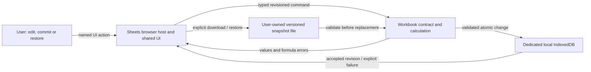

# Reference implementation: Agentic Sheets

## Reference implementation — authority, scope and readiness

This is the single joined `SHEETS-WORKBOOK-001@0.2.0` specification under [PRD, TAD & ADR Guidelines v3.5.1](../../guidelines/prd-tad-adr-mvp-gtm-guidelines.md). PRD defines the product outcome, TAD its owners/contracts, ADR the choices, and MVP/GTM consume those exact criteria. The related [Base artifact `SHARED-VIEW-RUNTIME-001@0.4.0`](prd-tad-adr-mvp-gtm-agentic-base.md) remains the owner of Base record views and the Base/Sheets separation decision. This artifact owns the bounded workbook product; it does not redefine Base.

**Owner-selected topology:** Dev source is `GitHub/agentic-base` (`https://github.com/huijoohwee/agentic-base`). The intended public Prod route is `https://airvio.co/agentic-sheets`; generated Prod artifacts belong at `GitHub/huijoohwee/content/agentic-sheets` (`huijoohwee/huijoohwee`, repository-relative `content/agentic-sheets/`). These names bind intended ownership and destinations, not proof of an existing application or permission to deploy it.

**Implementation:** protected Base revision `5b28d4b46505de115dcef1eaa60937a0db4eb5f4` implements `sheets/` with a separate headless contract, formula engine, IndexedDB adapter, native browser shell and deterministic `sheets/dist/` producer (E-08). Base record source remains independent. The site source extension binds a separate Sheets pin and consumes that sealed artifact through the existing release owner (E-10); it preserves the legacy Base demo pin. E-02–05 remain historical baseline observations, not current absence claims.

**Readiness:** local `dev-proven` follows from reproducible core/storage/browser checks satisfying VCC-01–04 (E-08/09). VCC-05 remains partial because physical touch devices, screen-reader use and a timed clean-environment TTV run are unverified; VCC-06/07 lack hosted preview/public receipts and current cost/predecessor/authorization proof. Delivered remains `undocumented`. The subsequent owner instruction `IMPLEMENT` authorizes this runtime/source work; it does not bypass the site owner's protected exact-candidate production environment approval or the hard-$0 provider gate. Source closure and local rehearsal do not establish product delivery.

**Inherited reference restriction:** Univer may be considered conceptually under Base ADR-04. Copying, vendoring, porting or closely reproducing its source, documentation, schema/API structures, assets or fixtures is forbidden. Direct/transitive package, build/test, Git/tarball, submodule, CDN, hosted-service, preset/plugin or commercial dependencies on Univer and its sibling packages are forbidden. Generic workbook terminology and independently authored behavior are allowed. No external engine is selected or installed by this document.

## Reference implementation — PRD: need, experience and criteria

### Users, job and ranked pain

**Target job hypothesis:** a browser user creates a small local workbook, edits quantities/prices, sees a deterministic total, reloads offline, and retains an exportable copy. This makes the workbook the domain object, rather than a Base record view or agent conversation. The owner has requested a Sheets product and delivery topology; interviews, frequency, willingness to pay, market size and measured workflow losses remain unknown. All buyer pain is `unvalidated`, never `demand-proven`.

| Rank / pain evidence | Hook → break → fix → close | Reuse/build and minimum-value rationale |
|---|---|---|
| P1. Workbook versus record-model mismatch; owner request + E-02, commercial demand unvalidated | Enter a calculation → a typed-record projection lacks cell dependencies → add an independently owned bounded workbook core → inspect changed totals while Base remains intact | Reuse browser platform and Design System; new Sheets semantics only; S1/VCC-01/02/09 |
| P2. Data lost or unclear after offline/reload/edit conflicts; hypothesis | Edit locally → reload/quota/stale revision can hide loss → atomic local save, explicit errors and snapshot download/restore → read back the same accepted workbook | Reuse platform storage and source rollback practices; no cloud sync; S2/VCC-03/04 |
| P3. Unclear source-to-public artifact identity; observed missing route/mirror E-03–05 | Open the named route → 404 or unknown candidate → source-owned exact-artifact preview/promotion/readback → identify delivered revision and predecessor | Extend existing release owner E-04, never hand-edit mirror; S3/VCC-06/07 |

Prioritize the smallest calculation/persistence proof over broad Office features. The delivery path is owner-selected; adding server infrastructure, Excel parity or a separate repository would add scope without demand evidence. Human assignees remain unassigned; accountable functions are named for each outcome before implementation admission.

### Stories, Must slice and exclusions

- **S1:** As a local workbook user, I can enter bounded scalar cells and supported formulas and observe deterministic recalculation or a named error.
- **S2:** As a returning user, I can reload the accepted workbook offline and download/restore its versioned snapshot without silently overwriting another workbook.
- **S3:** As a release operator, I can verify the same source/artifact through Dev rehearsal and the selected Prod route, then restore the exact prior site state without deleting workbook data.
- **S4:** As a keyboard/touch user, I can select, edit, commit/cancel and inspect cells on a narrow browser viewport with semantic labels, visible focus and readable errors.
- **S5:** As an integrator, I can use Sheets without changing Base's record store, schema, exports or view ownership; a later transfer is an explicit consumer-owned snapshot operation.

| Priority | Outcome / pain | Boundary |
|---|---|---|
| Must | One workbook, one worksheet, editable scalar cells and a small declared formula subset; P1 | Independently authored Sheets contract; no arbitrary JavaScript or record-engine substitution |
| Must | Atomic revisioned local persistence, conflict/quota errors and versioned snapshot download/restore; P2 | Browser-local only; no account, cloud store, telemetry or implicit sync |
| Must | Keyboard/touch/narrow-screen editing and error visibility; P1/P2 | Existing Design System primitive owner; no competing panel or toolbar implementation |
| Must before delivery | Exact source/artifact identity, preview checks, route/CSP/SW isolation, cost proof and rollback; P3 | VCC-06/07; promotion boundaries stay closed without effect-specific authority |
| Should | Measure clean-checkout and returning-user time-to-value; test multiple device engines | Targets below, not measured results |
| Could | Independently bounded undo history, another worksheet or read-only Base snapshot transfer | Separate acceptance increment after core proof |
| Won't this increment | XLS/XLSX or full CSV fidelity, Excel formula/format parity, charts/pivots/macros, collaboration, remote functions, live Base writeback, AI/agent execution, payments, new database/server, registry publication or separate Sheets repository | No silent feature expansion; a later owner/artifact revision must admit each capability |

### Metrics and economic bounds

Numbers below are acceptance targets/caps unless an evidence reference records a measured result. E-08/09 record local checks and a desktop Chromium 100-edit p95 of 1.3 ms; this is not mobile hardware performance. A timed clean-environment TTV run, physical-device load result and business/economic sign-off remain pending.

| Metric / feature | Baseline | Target / method |
|---|---|---|
| First workbook calculation, S1 | Implemented E-08; timed run pending | Open local fixture → create workbook → edit cell → inspect result; ≤4 user actions / 2 minutes in a timed clean-browser rehearsal |
| Developer first view, S1/S4 | Unknown | Exact checkout → install permitted locked build dependencies → run documented local command → render fixture; ≤5 manual steps / 30 minutes |
| Returning/offline save and restore, S2 | Unknown | Accepted edits survive offline reload; downloading/restoring a fixture ≤5 actions / 2 minutes; no network after assets are primed |
| Calculation, S1 | Unknown | Within caps, stable results and error classification; target p95 edit-to-result ≤100 ms across 100 fixture edits, report device/browser |
| Initial browser reach, S4 | Unknown | 360 CSS px viewport, keyboard/touch, visible focus, 200% zoom, reduced motion; text ≥4.5:1 (large text ≥3:1), control/focus ≥3:1; primary touch controls ≥44 CSS px |
| Local load, S1/S2 | Unknown | Fixture interactive in ≤2 seconds on the recorded mobile-class device after assets are local; disclose hardware/cache state |
| Artifact identity, S3 | Missing product route/mirror | 100% manifest files/digests match exact preview and public release; route normalization and negative routes pass |
| Runtime model calls / spend | No AI component selected | 0 model calls by design; $0 incremental spend cap, unknown provider fees/headroom blocks dependent effects |

ROI `(impact × monthly reach) / (build hours + monthly TCO + monthly token cost)` is not calculable from absent impact/reach/effort inputs. Serving-model tokens are designed to be zero, while authoring tokens and labor remain real, unmeasured costs. No first-dollar, savings or commercial-demand claim is made.

| Deployment model | Selected status | 12-month TCO / limits / exit |
|---|---|---|
| Browser/device-local | Selected MVP architecture | New hosted-resource spend cap $0; device storage, support, build effort and actual TCO unknown; snapshot export is the portability exit |
| Existing shared static site | Owner-selected target, gated | Current account/plan, hard-$0 or deny-at-quota proof, project capacity and controller authority must be read back; no quota/alert alone proves safe spend |
| Edge/server/managed workbook service | Deferred | Cost/license/data-residency unknown; no deployment, paid addon, upgrade or overage fallback |

### Acceptance VCCs and traceability

The following checks bind actual Sheets suites in E-08–10. A local satisfying result advances only its stated scope; pending device, hosted preview, provider or public-delivery evidence prevents `runtime-ready` and `production-verified`.

| ID / story / TAD / ADR | Measurable end state | Stated check / bound | Evidence |
|---|---|---|---|
| VCC-01 / S1 / C1 / ADR-01/02 | Stable workbook/sheet identity; typed scalar edits commit once at expected revision, rejected/out-of-bound inputs leave prior bytes intact | Independently authored headless contract tests; valid/invalid payload, duplicate/replayed operation ID, stale/concurrent writes and limits fixtures | Satisfied locally: E-08 typed commands/replay/stale/limits; E-09 real transaction race and cancellation. |
| VCC-02 / S1 / C2 / ADR-02 | Supported arithmetic/SUM references recalculate deterministically; cycles, bad refs/types, divide-by-zero and limits produce explicit errors without arbitrary code/network | Formula grammar/dependency tests and 100-edit benchmark; fixture totals and invalid-case assertions; no inferred Excel parity | Satisfied locally: E-08 deterministic/error/budget fixtures; E-09 100 edits, p95 1.3 ms on desktop Chromium. |
| VCC-03 / S2 / C3 / ADR-03 | Acknowledged state reloads after disconnect/restart; two stale writers yield at most one commit; failed quota/save preserves committed snapshot and unsaved editor state | Real-browser IndexedDB transaction, second-tab and offline-reload tests; inspect error/readback and request capture | Satisfied locally: E-09 real IndexedDB race/reopen/quota/replay, stale-tab draft retention and primed offline reload. |
| VCC-04 / S2 / C1/C3 / ADR-03 | Download→validate→restore preserves supported workbook values/formulas/revision metadata; incompatible/malformed/oversize snapshots do not overwrite source | Disposable-origin snapshot round-trip and corrupt/version/ID-collision fixtures; explicit restore-versus-clone decision | Satisfied locally: E-08 strict snapshot/identity/revision cases; E-09 download/upload/restore/clone and corrupt import. |
| VCC-05 / S4 / C4 / ADR-01 | Selection/edit/commit/cancel/focus/error/readback work on keyboard and touch at the stated narrow/zoom/contrast targets | Per-device browser walkthrough and measured final colors/geometry; timed TTV run, not static markup proof | Partial E-09: keyboard, 360px, 200% text zoom, light/dark contrast and 44px controls pass. Physical touch, screen-reader and timed TTV pending. |
| VCC-06 / S3 / C5 / ADR-04 | Exact protected Dev source creates one sealed artifact; non-public preview passes identity, limits, routes, enforced-prod CSP and scoped SW checks; same candidate staged for Prod | Reproducible build/digest inventory, existing owner controller extension tests, preview HTTP/browser readback; no rebuild between stages | Partial E-08/10: sealed producer, pinned source, controller/HTTP/browser rehearsal pass. Hosted preview, current cost proof and same-candidate staging receipt pending. |
| VCC-07 / S3 / C5 / ADR-04 | Authorized Prod public/immutable identity matches VCC-06; generated mirror matches files after smoke; predecessor restore readback passes and data survives | Owner-operated live route/artifact/SW/returning-browser checks plus rollback rehearsal/receipt; bootstrap baseline may be verified absent route | Pending: no production activation, mirror publication, public artifact smoke or retained live predecessor proof. |
| VCC-08 / S5 / C1–C5 / ADR-01/05 | Base remains independently usable; Sheets has no copied or direct/transitive Univer dependency; shared UI comes from its native owner | Exact dependency/import/generated-output marker scan plus independent provenance/compatibility review; marker absence alone is insufficient | Satisfied locally E-08: independent Sheets exports/store; no record-engine changes or new packages; exact central profile and license notices. No Univer source/dependency. |
| VCC-09 / S1–S3 / C1–C5 / ADR-05 | Product caps and $0 effect policy hold, noncritical capabilities remain lazy, no unexpected runtime network/model calls | Artifact/raw-byte inspection, browser request capture, typed limit fixtures and current provider proof for each external effect | Partial E-08/09: bounds and <500000-byte chunks pass; 64191 output bytes excluding manifest. Mobile-device load/TTV and hosted checks pending. |

The primary chain is `P1 → S1 → C1/C2 → ADR-01/02 → VCC-01/02`; persistence adds `P2/S2/C3/ADR-03/VCC-03/04`; device reach adds `S4/C4/VCC-05`; delivery adds `P3/S3/C5/ADR-04/VCC-06/07`. S5, VCC-08/09 and ADR-05 constrain every slice. No criterion is satisfied by this document's existence.

## Reference implementation — TAD: owners, contracts and delivery

### Native grounding and division of work

Exact source records E-01–06 below distinguish native implementations from proposals. Proposed module names are planning locators, not existing exports. No source, package lock or build/release controller is changed here.

| Component / responsibility | Native source or proposed location | Reuse decision / smallest delta | Ownership, readiness and check join |
|---|---|---|---|
| C1 workbook schema/commands validates cell changes | `agentic-base:sheets/{schema,core}.mjs` at E-08 | New workbook contract; retain Base `src/{schema,engine,projectors}.mjs` unchanged, not a store/parser to rename | Sheets domain owner; local dev-proven / delivered undocumented; VCC-01/04/08 |
| C2 calculation derives cell results | `agentic-base:sheets/formula.mjs` at E-08 | New bounded grammar/dependency owner; no JS eval, imported engine, copied schema or external functions | Sheets domain owner; dev-proven / undocumented; VCC-02/09 |
| C3 storage persists accepted workbook snapshots | `agentic-base:sheets/storage.mjs`; `agentic-sheets-v1` database | Reuse IndexedDB platform/optimistic-revision patterns; Base adapter has a different record schema and is not copied or silently repurposed | Sheets storage owner; dev-proven / undocumented; VCC-03/04 |
| C4 browser shell projects workbook commands/results | `agentic-base:sheets/{app.mjs,index.html,styles.css,sw.js}` | Direct reuse of cleared Design System primitives; new workbook grid/selection belongs to Sheets, not a Base record-grid replacement | Sheets view owner; dev-proven / undocumented; VCC-05/08 |
| C5 build/release/route integration seals and promotes static output | Base `scripts/build-sheets.mjs`; existing Graph release owner extended at E-10 | Extend existing artifact/controller owner, never duplicate its deploy machinery or manually author generated mirror assets | Release owner with Sheets producer; dev-proven / undocumented for Sheets; VCC-06/07 |
| Shared panel, toolbar, typography/icons and lifecycle | Base currently pins `agentic-design-system@54229ceed5106c5a44a2cb3731c0deb0f74a1904`; Sheets consumes the exact profile bytes/digest and both license notices at E-08 | Reuse native public exports and generated profiles with digests; no local visual/lifecycle fork or Base forwarding shim | Design System owns primitives; direct central CSS profile consumed, standalone host has no duplicated panel lifecycle; VCC-05/08 |
| Base record views / optional data bridge | `SHARED-VIEW-RUNTIME-001@0.4.0`, Base E-02 | Retain local semantics; defer consumer-owned snapshot bridge and all writeback | No Base↔Sheets runtime/build dependency; no second record store; VCC-08 |

**Physical source versus logical domain:** the user selected `agentic-base` as the Dev repository. That advances the prior Base ADR-05 physical-location decision while keeping independently implemented domains. A Sheets package/module can share the repository and ADLC while retaining its own schema, tests, browser entry, storage namespace and release artifact. No separate `agentic-sheets` repository is requested or created.

**Acyclic build order:** cleared Design System contracts → independent Sheets core/adapters/view → sealed Sheets artifact → approved shared-site controller → verified Prod → generated Prod mirror publication. Base record packages remain independent siblings. Runtime edit/recalculation/readback can return to the workbook owner; that is not a build cycle. Extract a generic utility only after an existing owner and two concrete consumers justify it; no new shared-kernel/SDK/registry is selected.

### Headless contract, storage and limits

The implemented versioned contract is `sheets/workbook/v1`, independently authored and distinct from Base's record contract. A workbook has stable `workbookId`, `sheetId`, `schemaVersion`, `revision`, bounded dimensions and sparse typed cells. Cell identity is sheet ID plus coordinate within this fixed-dimension MVP. Inserting/deleting/reordering rows/columns, cross-sheet references and reference-rewrite behavior are deferred; they require their own specification before being enabled.

Commands carry an operation ID, expected workbook revision and typed payload; results distinguish proposed edits, accepted persisted revision, calculation errors and storage/permission/conflict/limit failures. Storage acceptance is the acknowledgment point. Local reads/descriptions do not write or invoke a model. A host policy check runs before a storage effect, but same-origin policy callbacks are not authentication or isolation from other scripts. Any future external transport needs a trusted principal and effect authority of its own.

The storage owner uses one IndexedDB transaction to compare revision and persist the next snapshot plus a bounded deduplication log. At most 64 retained operation IDs per workbook; exact retry within that window returns the same accepted outcome, mismatched payload reuse rejects, and an expired ID with stale revision rejects. Cancellation before commit leaves state unchanged; an uncertain post-commit outcome is reconciled by ID/revision readback rather than blind resubmission. Tests must prove these properties; Base memory tests do not prove this adapter.

**Initial product caps, proposed:** one workbook/worksheet; 32 rows × 16 columns, at most 512 addressed cells and 64 formula cells; 1,024 UTF-8 bytes per scalar text and 256 per formula; snapshot/command each ≤262,144 bytes; formula ≤128 tokens / 16 nested expression levels; total dependency edges ≤512 and evaluated expression operations ≤4,096 per edit. Reject before committing an oversized input. Browser storage quotas may be lower; these caps are not measured capacity. Any limit change requires new fixture/performance evidence.

**Formula subset:** finite numbers, explicit same-sheet A1 references, parentheses, `+ - * /`, unary sign and `SUM` over bounded rectangular ranges. This is ordinary independently specified spreadsheet behavior, not a mirrored external API. Empty cells contribute zero; text/booleans used numerically yield a value-type error; missing/out-of-grid references, division by zero, malformed grammar, non-finite arithmetic and cycles have stable named error values. Errors propagate deterministically. Use the finite-number model explicitly; no financial decimal-precision, locale-coercion, date-serial or Excel compatibility claim. Formulas store source and calculated outcome separately; do not serialize executable objects or call network/remote functions. General functions, volatility, macros, external links and cross-workbook calculations are excluded.

Download/restore uses a versioned JSON snapshot with a deterministic serialization for checks. Restore validates the entire payload before an atomic replacement; an existing workbook ID/revision collision requires an explicit restore or clone choice. Restoring over an existing workbook requires its current expected revision and advances that revision; retain the imported revision as provenance, never reset the live concurrency fence. A clone starts with new identity/revision 1 and recorded provenance. Download captures accepted state; unsaved editor changes must be committed or explicitly excluded. Failed imports retain both current committed state and source file; no destructive schema migration. Browser eviction remains possible, so download/restore is a separate user-controlled recovery path, not a promise of durable backup. No user workbook, private file, credential or browser record belongs in a Git or Prod asset artifact.

### Device, offline and native design adoption

| Native concern / owner | Planned adoption | Required evidence / gap |
|---|---|---|
| Settings, panel tabs/close/lifecycle / Design System | Import exact public panel/semantic-control APIs directly; host supplies workbook content/state/actions | Exact pin/export/notice and per-mode interaction check; not a Base facade |
| Typography, tokens, icons and focus / Design System | Reuse one approved profile and generated projections; no downloaded font or copied reference assets | Final composited contrast, scaling and touch metrics; source defaults do not prove accessibility |
| Workbook cells, selection and formula editor / Sheets | Semantic named grid/editor, stable keyboard focus, explicit commit/cancel and non-color errors | Native independently authored fixture and device walkthrough; no replacement Base table renderer |
| Status/recovery / Sheets host | Show accepted/unsaved revision, offline state, save failures, download/restore | Quota, crash, reload, stale writer and corrupt snapshot results; no silent success |

The app must fit 360 CSS px with internal grid scrolling rather than document overflow. Page only the necessary visible cell window if measured DOM cost requires it; no second grid or speculative canvas engine. Use lazy loading for calculation/editor features beyond the shell where it improves measured load; max raw JS/CSS chunk <500,000 bytes and initial app payload target ≤400,000 raw bytes excluding immutable notice/manifests. E-08 verifies these byte limits; E-09 does not substitute desktop results for mobile hardware load measurements. No model SDK, telemetry, remote font or CDN fetch is needed at runtime.

Offline storage is device/browser-local. Paths under `airvio.co` share an origin; `/agentic-sheets/` does not create a security boundary. Use a dedicated database/cache namespace and a service worker scoped only to `/agentic-sheets/`; never intercept another product or delete its storage/caches. Cache only the selected static artifact, not uploaded/private workbooks. Enforce source-owned production CSP and MIME/security headers; Dev may be Report-Only, but preview checks must validate the production-enforced policy before promotion. No `eval` or executable formula/plugin input is admitted.

### Journey, workflow, data, harness and topology coverage

| Feature | User journey / workflow | Data flow / topology | Orchestration/harness |
|---|---|---|---|
| S1 edit/calculate | Create fixture → select/edit → validate/preview → commit/readback; D1 | Typed commands → pure core → accepted results; D1 | N/A: no agent/model or autonomous loop |
| S2 persist/recover | Save → disconnect/reload → download/restore; D1 | Dedicated local store and explicit file boundary; D1 | N/A: ordinary storage transactions, not agent orchestration |
| S4 browser access | Keyboard/touch edit → commit/cancel → named result; D1 | Host projects core state through shared primitives; D1 | N/A: no model/UI decision agent |
| S3 release | Exact Dev source → sealed preview/readback → authorized same-candidate promotion → public smoke → generated mirror; D2 | Source/artifact/route identities and separate receipts; D2 | Existing ADLC/release workflow, bounded phase checks; no new orchestrator |
| S5 Base transfer | Deferred, outside first slice | Base artifact's proposed consumer-owned snapshot bridge; no runtime edge now | N/A: live sync/agent routes excluded |

**D1** · Class: User workflow/data flow · Notation: Mermaid `flowchart LR` · Surface: Markdown/canvas projection · Version: 0.1.0. Caption: proposed local-only workbook journey; all runtime nodes require implementation proof.

| D1 node / owner | Input → output / residency |
|---|---|
| `user`, `view` / user and Sheets view owner | UI actions → commands and accepted/unsaved state; local browser |
| `core` / Sheets domain owner | Typed cells/commands → deterministic calculation/change set; pure local code |
| `store` / Sheets storage owner | Revisioned accepted snapshot/log → readback; origin-local device database |
| `snapshot` / user | Explicit bounded JSON file → validated restore; user-controlled local file, never Prod assets |

**D2** · Class: Build/release workflow and topology · Notation: Mermaid `flowchart LR` · Surface: Markdown/canvas projection · Version: 0.1.0. Caption: requested Dev→Prod topology, with a non-public preview before delivery and generated mirror publication after successful live smoke. Arrows are proposed admissions, not delivery evidence.

```mermaid
flowchart LR
  subgraph authoring["Authoring lane: Dev source"]
    source["GitHub agentic-base: separate Sheets modules"]
    checks["Owner contract and source checks"]
    source -->|"exact protected source"| checks
  end
  subgraph rehearsal["Mirror lane: non-public immutable candidate"]
    artifact["Sealed Sheets artifact and manifest"]
    preview["Exact-artifact preview readback"]
    artifact -->|"serve without rebuilding"| preview
  end
  subgraph delivery["Delivery lane: shared Prod site and generated archive"]
    controller["Existing site release owner: admitted Sheets extension"]
    route["airvio.co/agentic-sheets"]
    mirror["GitHub huijoohwee/content/agentic-sheets"]
    controller -->|"authorized same-candidate activation"| route
    route -->|"successful exact live smoke before publication"| mirror
  end
  checks -->|"deterministic build and digest"| artifact
  preview -->|"green readback plus effect authority"| controller
```

| D2 node / owner | Role / data residency and boundary |
|---|---|
| `source`, `checks` / Dev producer | Product-authored code and exact source receipts in Base repository; no production credentials in browser code |
| `artifact`, `preview` / build/verification owner | Static files, notices, manifest and temporary non-public rehearsal; no user workbook copied |
| `controller` / existing shared-site release owner | Current native source workflow E-04 must admit Sheets artifact/route; precise extension/check binding is pending |
| `route` / production site operator | Browser static runtime at owner-selected public URL; local user data remains on device |
| `mirror` / generated Prod archive owner | Exact generated files only at requested repository prefix, after live verification; no hand-authored product source |

**Diagram register:** D1: 5 nodes/7 edges/0 clusters; D2: 7 nodes/6 edges/3 clusters. Counts are source-structure expectations, checked by the target diagram projection at authoring handoff; they do not establish runtime or deployment readiness.

### Invocation register and developer lifecycle

One capability identity belongs to each native schema owner. Names below are proposed capability labels, not currently discoverable transport routes or package exports.

| Capability / surface | Mode and schema owner | Principal/effect boundary / current support |
|---|---|---|
| Workbook read/describe and typed edits / local module | Proposed read and mutation modes on C1 contract | Local host policy + expected revision; no implementation yet; discovery/read uses zero model calls |
| Browser edit/download/restore | Proposed bounded C4→C1/C3 actions | Local user intent; download/restore explicit; primed offline support must pass VCC-03/04/05 |
| HTTP data API / MCP / WebMCP / `/` commands / `@` bindings / `#` semantic routes | Unsupported in MVP | No handler/schema registry/gateway exists; do not manufacture route names or claim agent readiness from a static page |
| Static public URL | Selected delivery address, not an API command | Asset read only, no mutation authority; observed 404, promotion gated |

Developer path: discover this versioned specification → admit an exact Dev source slice → use the existing repo local runner/build contracts → rehearse typed fixture/actions and record failed/accepted outcomes → source release → exact preview → effect-authorized delivery/readback → consumer support and prior-version retirement only after rollback proof. The current Base local demo command is not a Sheets runner; the Dev owner must publish the actual module exports/runner before TTV acceptance. No new portal, SDK, custom harness or tool registry is justified.

### Artifact, routes, promotion and rollback contract

**Artifact identity:** an exact protected Dev commit, source-tree digest, dependency-lock/pin digest, build recipe/version, notices, and a sorted file inventory of relative path/raw byte length/SHA-256. Compute aggregate payload digest from payload entries excluding the manifest's own digest to avoid self-reference. No mutable branch alias or mixed-version generated asset. Validate safe relative paths, known ownership, MIME, raw-byte caps, and absence of user data. The same sealed candidate moves from preview to Prod; changing bytes requires a new candidate and preview evidence.

**Requested routes, proposed rules:** `/agentic-sheets` normalizes to `/agentic-sheets/`; index/assets/SW/manifest resolve only to the owned generated prefix. Use relative assets compatible with both preview and public base paths. Missing asset/unknown product paths return an explicit 404 rather than unrelated application HTML. Avoid a broad catch-all or another product's service worker. The exact redirect/status/cache/CSP rules must be owned and emitted by the existing release source extension and verified on immutable and public origins; no current `_redirects`/`_headers` mutation is authorized.

**Current controller fit:** E-04's native release workflow already pins/checks out Base demo source, seals a site artifact, validates the existing Base route, deploys, smoke-checks and publishes the generated mirror. Its builder/sync code is Base-demo-specific, including `content/agentic-base`; it does not support Sheets by changing a label. Extend that owner with an explicit Sheets producer/path/manifest/readback contract while retaining the existing site lock/concurrency and preserving unrelated products. No duplicate deploy workflow in the Prod mirror, raw sibling-source import, manual mirror repair or second release controller. Controller/route-owner approval is an implementation prerequisite, not an approval request created by this document.

| Boundary | From → to / current state | Required evidence | Operator instruction / recovery |
|---|---|---|---|
| B1 source integration | Dev source lane → exact protected Dev commit; closed for implementation | Bound VCC slice, source/rights/budget checks, reviewed exact changes and integration receipt | Separate source admission; recover by reviewed source revert preserving workbook files/data |
| B2 preview qualification | Protected Dev source → non-public sealed artifact/preview; closed | VCC-01–06 results, exact source/output identity, enforced-prod headers and scope checks | Exact preview/build authorization under owner controller; retain prior artifact and record failed build without promotion |
| B3 production activation | Qualified preview → selected Prod route; closed | Current hard-$0/deny-at-quota and rights proof, exact preview result, preserved live baseline/rollback identity, target permissions | Exact product/environment/candidate promotion instruction absent; restore prior whole-site artifact/route via native controller and read back |
| B4 generated publication | Verified live candidate → Prod archive prefix; closed | VCC-07 public smoke, exact inventory identity, current mirror base and disjoint path ownership | Native source-owned mirror publication authority absent; CAS/serialized update prevents overwriting another product; source receipt does not grant this effect |

Authoring source is local/Git; preview holds non-public static build bytes; delivery exposes public static assets and the generated repository projection. **The mirror lane is the sealed preview**, not permission to publish the Prod repository before smoke. This distinction preserves both the guideline's three-lane sequence and the Prod repository's current generated-after-verification policy (E-03).

**Bootstrap rollback:** there is no observed previous Sheets release. Capture the actual current shared-site deployment/artifact identity and the absence of this prefix/route before first activation; a 404 alone is not a complete rollback baseline. First rollback restores that exact prior site/route state, including removal only of newly owned Sheets artifact entries through the owning controller. Later rollback restores a retained compatible predecessor source/artifact/headers/SW/mirror identity; never clear IndexedDB, downgrade incompatible schemas blindly, or delete other products. Keep snapshot restore separate from source/route rollback. If rollback compatibility or mutation outcome is uncertain, stop promotion and reconcile native provider identity rather than retrying blindly.

## Reference implementation — ADR: choices and tradeoffs

### ADR-01: separate workbook domain inside the selected Dev repository

**Status:** implemented locally, E-08/09. **Decision:** host independently owned Sheets modules in `agentic-base` while preserving Base schema/store/view exports. Directly reuse Design System primitives. One workbook grid belongs to Sheets; Base's one-record-grid rule does not force a workbook onto the record engine.

Alternatives: merge workbook semantics into Base (fails contract separation); create a separate repository now (additional ownership/release work outside the selected topology); use native HTML inputs without a workbook model (FOSS/local and useful as a UI spike, but fails formula/persistence criteria); author an independent bounded core with native browser UI (chosen contract-first path). Reuse/adapt existing primitive owners and retain record semantics locally; do not extract a generic grid/storage kernel without two demonstrated consumers. Tradeoff: one Dev repo needs clear paths/tests/artifact ownership; benefit is shared Git/ADLC without domain coupling. Revisit if independent release rights require another source repository; recover through exact module/pin reverts, never a record migration.

### ADR-02: bounded independent formula core, no Office parity claim

**Status:** implemented locally, E-08/09. Choose the declared grammar/caps with pure deterministic calculation and named errors; no arbitrary executable expressions. A general external workbook engine is unselected because compatibility, size, source rights and local-only cost are unproved; Univer copying/dependency fails the owner restriction regardless of license. A scalar-only browser form is the cheapest FOSS alternative, but cannot pass the admitted formula job; retain it only as a bounded discovery spike if Product drops calculation scope explicitly. Do not recreate a full Office engine. Revisit the subset after a concrete unsupported-user-formula fixture; recovery preserves formula source and explicit unsupported errors rather than silently changing results.

### ADR-03: local persistence and user-controlled portable snapshots

**Status:** implemented locally, E-08/09. Use a dedicated revisioned browser store and explicit versioned JSON download/restore. Memory-only state passes a deterministic test adapter role but fails returning-user/offline recovery; a remote managed database fails current scope/cost/privacy evidence; repurposing Base record storage fails ownership. Prefer platform APIs and compatible native export points; no copied adapter or general storage layer. Costs are device capacity and implementation/support effort, presently unmeasured. Revisit if measured offline requirements cannot be met; require backup/forward-recovery and owner-approved migration before any storage change.

### ADR-04: exact-artifact promotion through the existing site release owner

**Status:** source extension and local rehearsal E-10; hosted preview/production pending. Preserve `GitHub/agentic-base` Dev → `airvio.co/agentic-sheets` public Prod and `GitHub/huijoohwee/content/agentic-sheets` generated Prod archive. Reuse the existing site controller's source pin, seal, preview/activation, rollback, smoke and mirror-CAS owners. A new mirror deploy workflow or manual asset copy fails single-owner and generated-source rules; a direct Dev→Prod shortcut fails required preview proof; redirecting the Base record demo to Sheets fails semantic fit. The source extension exists at E-10; hosted promotion remains a separately gated effect. Revisit only on an owner-reviewed controller incompatibility; rollback remains an exact native-site effect with its own receipt.

### ADR-05: reference-use, free/FOSS and lazy-load constraints

**Status:** inherited mandatory constraints; local source/dependency/profile checks E-08, provider cost proof pending. Independently author workbook behavior; keep Univer solely a conceptual reference under Base ADR-04. Use FOSS/browser-local tools, exact cleared dependency pins, existing ADLC and source-owned release machinery. A paid/commercial/freemium engine, remote formula service or CDN shortcut fails current authorization/cost boundaries; an unrelated FOSS engine remains unselected until its complete capability/license/bundle/offline comparison is admitted. No new model provider, database, SDK, orchestrator or runtime agent route. All external effects need current hard-$0 or deny-at-quota proof; scale down/stop instead of paying. Local/static/shared-site TCO variants remain separate and unknown; 0 serving-model calls do not imply free authoring or operator time. Recovery is an exact reviewed offending-source/pin/artifact revert with data retained.

There is no contested vendor/platform winner requiring an invented argument verdict: owner constraints reject infeasible choices first; the feasible independent local slice outranks broader unproved scope on minimum change. Unknown market impact, performance and 12-month TCO remain incomparable rather than assigned invented scores.

## Reference implementation — MVP: bounded calculation and recovery slice

MVP projects S1/S2/S4/S5, C1–C4, ADR-01/02/03/05 and VCC-01–05/08/09 at `SHEETS-WORKBOOK-001@0.2.0`. S3/C5/ADR-04/VCC-06/07 are required for the owner-selected public release but are a separately gated delivery phase. No local workbook capability is implemented or accepted by this planning task.

| Slice | Proof fixture and expected result | Local / delivered readiness |
|---|---|---|
| Create/edit/calculate | Quantities × prices; two rows total 80; change quantity 2→4 in the 25-unit-price row and read total 130; malformed/cyclic/bad-reference formulas expose errors | spec-complete / undocumented; VCC-01/02 pending |
| Persist/download/restore | Commit fixture, disconnect, reload, download, clone/restore in disposable origin; values/formulas and errors reconcile | spec-complete / undocumented; VCC-03/04 pending |
| Keyboard/touch and domain boundary | Edit/commit/cancel on narrow viewport; Base contracts unaffected; no forbidden source/dependencies | spec-complete / undocumented; VCC-05/08/09 pending |
| Source-to-Prod delivery | Exact preview candidate becomes selected public route and generated archive; rollback restores prior identity | spec-complete / undocumented; VCC-06/07 pending |

### Demo skeleton and maturity

| Beat | Cap | Observable result / criterion |
|---|---:|---|
| Hook | 15 s | Identify local workbook, revision, offline status and supported limits |
| Probe | 30 s | Open two independently authored line items and inspect formula source/result |
| Reveal | 30 s | Change quantity, commit and read total 130; VCC-01/02 |
| Save/recover | 45 s | Offline reload, then download/restore snapshot; VCC-03/04 |
| Close | 15 s | Show exact source/artifact identity and whether public delivery is verified or still gated |
| Total | ≤135 s | Narrative/screenshot alone satisfies none of these checks |

Actual domain object is the workbook. No experience maturity level 1–5 is claimed: no independent four-criterion assessment or contiguous passing level exists. Next blockers are C1/C2 accepted results, C3 recovery and C4 device/TTV proof; cross-artifact reuse is Design System and the existing release owner, not a replacement implementation.

### Product-owned roadmap and per-task caps

All future implementation units use one scoped lane, ≤60 active minutes before re-estimation, ≤6 changed source modules/≤25 KiB new source, files <600 lines, chunks <500,000 raw bytes, ≤20,000 planning tokens, ≤3 refinement cycles with stop after two cycles without blocker reduction, and $0 incremental spend. These are per-task bounds; one task cap is not an estimate for building all phases. Initial app payload target ≤400,000 bytes and all runtime limits are unmeasured. This document adds no always-load material. External waits name a dependency/unblock condition/recheck event, never a completion ETA.

| Phase / outcome | Pain/reuse/owner | Prerequisite / observable exit | Bound, stop, recovery and recheck |
|---|---|---|---|
| 0. Validate one workbook job | P1 unvalidated; Product uses this fixture and owner interview | One confirmed calculation/persistence job; TTV rehearsal plan and independently authored fixture | ≤30 active minutes, ≤2 available maintainers; no outreach without authority; stop if existing Base meets the job; revisit on owner response |
| 1. Core proof | P1; Sheets Dev owner reuses native platform/Design System contracts | C1/C2 with VCC-01/02, independent errors/limits tests | Shared per-task caps; no general engine; revert exact source on regression |
| 2. Returning local user | P2; Sheets storage/view owners | VCC-03–05/08/09, measured TTV/device/bytes, source notices and snapshot recovery | Shared caps; stop on unsafe persistence or inaccessible actions; preserve committed state; recheck repaired fixture |
| 3. Source release and preview integration | P3; Base producer + existing Graph/site release owner | Exact source/pins/manifest; admitted Sheets route/controller extension; VCC-06 | Shared caps, no second controller; rollback prior source/artifact; blocked on owner-admitted contract and cost proof |
| 4. Controlled public release | P3; site operator and generated-mirror owner | Exact same candidate, B3/B4 effect authority, VCC-07 receipts/readback | No deploy ETA during review/provider wait; stop ambiguous identity/cost; native exact predecessor rollback |
| 5. Learning and successor | Product measures the same fixture/recovery journey | GTM experiment actuals, failure/support time and continue/stop decision | ≤45 active minutes analysis after observation window; open successor Context on threshold breach |

Rollout order is owner contracts/checks → compatible exports → exact build/pin/lock → sealed preview → admitted route/readback → authorized same-candidate Prod → generated mirror → measured learning. No old Sheets implementation exists to retire; do not delete Base code. Deferred worksheet expansion, undo/history, Base snapshot bridge, CSV/XLSX, collaboration and MCP/WebMCP remain Won't until separately admitted by the appropriate owner.

## Reference implementation — GTM: offer, viability and learning

### Segment, alternatives and first dollar

Initial user hypothesis: maintainers/operators who need a small local calculation workbook inside the shared site and retain control of files/data. Developer distribution is global/browser-based; geography, reachable population, acquisition channel conversion and market timing are unmeasured. The owner's request is product direction, not validated buyer pain, payment or repeat demand.

Offer: a free, bounded local workbook with explicit limits, no paid plan/addon/overage and no uptime/support SLA. Alternatives are an existing local spreadsheet, a native form/manual calculation, an existing Base view when the job is record-centric, or no build. Another FOSS engine requires a separate comparison and does not override the explicit Univer restriction. No architectural or import count proves time saved.

TAM/SAM/SOM are unknown. Bottom-up sizing would use dated qualified teams × verified need × reachable conversion; an independent top-down population would narrow a dated browser/local-workbook user population by capability/offline fit. Neither source nor conversion evidence exists, so do not provide a market amount. Such research is deferred until a market/offer decision needs it. Capital ask, entity/jurisdiction advice, deck, business plan and full financial statements are not requested; a decision-scoped discovery record is sufficient here.

| Stream | Segment now / distance to first dollar | Mechanism / demand / collected payment |
|---|---|---|
| Free local workbook | Owner-requested hypothesis; first-dollar target not applicable under free-only mandate | No payment mechanism; unvalidated demand; no revenue/payment evidence |
| Paid hosting/support/license/agent feature | Not authorized; cannot rank as viable monetization | Deferred/inapplicable to this increment; no paid plan or implementation |

Monetization is explicitly deferred. `mechanism-proven`, `demand-validated`, recognized revenue and collected cash remain unproven. Review a commercial path only on a separate owner instruction; do not introduce a payment flow to make this feature look viable.

### Smallest learning loop and operations

**H1:** a named user needs the bounded workbook job rather than a Base record view or existing form. **Cheapest next outcome:** Product confirms one independently authored line-item calculation/recovery fixture with the requesting owner before coding. Pass if the owner identifies a recurring calculation need and the proposed subset resolves it; stop/re-scope if a current Base/form workflow suffices or required functions exceed the cap. Active window ≤30 minutes, source E-01/E-02 and user statement retained; no customer/WTP validation is inferred.

**EXP-S1, proposed:** after VCC-01–05 pass, up to two available maintainers complete the clean-browser calculation, offline return and snapshot restore; observe a second use within 14 days. Record eligible/participating denominators, steps/minutes, incorrect/failed/repeated actions, support minutes and data recovery failures. Continue only if every participant completes admitted criteria, median first calculation ≤2 minutes, no accepted-data loss, no forbidden dependency and $0 incremental spend. A small internal trial does not prove public demand or retention. Stop/pivot on any reproducible silent data loss or contract mismatch; capture source/fixture/result and open successor Context rather than rewriting the accepted result. Recheck on owner availability or a repaired exact candidate; this spec authorizes no invitations/messages.

Support uses existing source/consumer issue owners, with no response SLA. Sheets Dev owns workbook incidents; shared site owner owns deployment/route incidents; user data recovery uses snapshots and compatible storage policy, not Git cleanup. Third-party notices and provider limits must be verified at exact release. Team/hiring obligations are unknown; assign one named accountable person per function before implementation/delivery.

| Scenario | Adoption hypothesis | Price/revenue | Cost uncertainty / decision |
|---|---|---|---|
| Downside | No confirmed workbook job | $0 offer; no sale | Avoid implementation beyond discovery |
| Base | One owner completes local fixture | $0 offer; no recognized or collected revenue | Measure build/support/device recovery time before expansion |
| Upside | Two internal participants repeat the job | $0 offer; not two customers | Need broader observed demand before more capabilities |

No CAC/LTV, runway, break-even, profit or 12-month total can be calculated without reach/effort/serving/support inputs. Keep local-device versus shared-host versus edge costs distinct as in PRD. Record authoring/CI/model/operator costs from actual receipts when exposed; absence of a receipt is unknown, not zero. No funding, equity or capital use is proposed.

### C01–C16 coverage and readiness

Each disposition joins this artifact `SHEETS-WORKBOOK-001@0.2.0`; coverage is not product proof or full rule conformance.

| Domain | Disposition / exact join | Accountable function | Evidence/gap and next check |
|---|---|---|---|
| C01 Purpose/user/pain | covered / PRD P1–P3, H1 | Product | Owner request and native model gap E-01/02; buyer pain unvalidated; confirm one job |
| C02 Market/timing | deferred / GTM segment | Product | No independent dated population/conversion sources; revisit when market/offer decision depends on them |
| C03 Offer/alternatives | covered / GTM offer, ADR-01–05 | Product | Free bounded offer; manual/Base/FOSS alternatives and disqualifiers explicit; revisit validated need |
| C04 Product/experience | covered / S1–S5/VCCs, demo | Product/quality | Core/browser results E-08/09; physical-device and timed TTV checks pending |
| C05 Architecture/data | covered / C1–C5, D1/D2 | Architect | Concrete C1–C5 owners E-08/10; hosted delivery pending |
| C06 Quality/security/AI | covered / VCC-01–09, local storage/CSP | Quality/security | Core/storage/recovery checks E-08/09; device/hosted proof pending |
| C07 Decisions/tradeoffs | covered / ADR-01–05 | Architect | Physical source/domain split, bounded core, local state and native release owner; revisit concrete incompatibility |
| C08 Smallest slice | covered / MVP fixture/readiness | Engineering | Implemented calculation+recovery slice E-08/09; VCC-05–07/09 retain gaps |
| C09 Acquisition/retention | deferred / H1/EXP-S1 | Product | No qualified-user/cohort/support data; prerequisite implemented fixture and owner availability |
| C10 Operations/continuity | covered / GTM operations, B1–B4 | Dev/release operator | Existing support/controller owners, clear gaps, snapshot/predecessor recovery; next actual incident/release receipt |
| C11 Organization/obligations | deferred / ADR-05, E-02/03/04 | Product/rights | Exact licenses/notices, named assignees, provider/account effect proof incomplete; revisit source/distribution admission |
| C12 Financial viability | deferred / PRD TCO, GTM scenarios | Product/finance | Cost/reach/labor unknown, paid offer excluded; revisit measured receipts and dependent business decision |
| C13 Capital/milestones | not-applicable / GTM finance | Product reviewer | No capital decision/funding ask; review if business model changes |
| C14 ADLC execution | covered / B1–B4, authoring handoff | ADLC operator | Protected Base source E-08, site source E-10; preview/Prod/runtime receipts remain separate |
| C15 Audience projections | not-applicable / GTM scope | Product reviewer | No deck/model/external audience deliverable requested; revisit an audience-dependent decision |
| C16 Learning/successor | covered / H1/EXP-S1, roadmap | Product | Explicit continue/stop thresholds and next owner; revisit observed fixture/recovery outcome |

**Counts:** 16/16 dispositioned; 10/14 applicable domains covered; four deferred (C02/C09/C11/C12); two not applicable (C13/C15). The user-facing feature remains local `spec-complete` / delivered `undocumented`. No full artifact-bearing-rule coverage ratio, formal typed alignment scan, zero-blocker verdict or maturity rating is claimed. Missing clean-environment TTV, current grounding at implementation admission and satisfying VCC evidence prevent baseline/runtime sign-off.

## Reference implementation — evidence, risks and handoff

### Grounding and check register

| ID | Exact source / method | Observation and limit |
|---|---|---|
| E-01 | User request, 2026-11-17; documentation source `huijoohwee.github.io@d71aa52033ed1e64e426b10e7563051f05f29364`; authoring guideline v3.5.1 and Base artifact v0.4.0 | Selects Dev repository, public route and generated Prod path; authorizes this document, not runtime/deployment effects |
| E-02 | `agentic-base@81e4608280be4ec515c5dd28df7b97d1438a0fc0`: package exports, `src/{index,schema,engine,projectors}.mjs`, PRODUCT/DEPLOY/ROLLBACK | Existing headless records/views and direct Design System seam; no inspected workbook/sheet/range/formula engine; two untracked planning drafts excluded; Base code unchanged |
| E-03 | `huijoohwee/huijoohwee@ba3f6a710ad5a1acba6382ba97a10d1903a1859c`: AGENTS, package, `_redirects`, workflow inventory, path existence | Generated Prod mirror, native source-owned controller, `runtime:check`/`check` contracts; Sheets prefix/redirect absent; no mirror changes or production proof |
| E-04 | `agentic-graph@929045ada77d98e533f4d811c253ee4242faefc6`: `.github/workflows/release.yml`, `scripts/{build-agentic-base-demo,sync-agentic-base-demo,verify-agentic-base-route}.mjs`, `scripts/agentic-base-demo-source.json` | Existing exact-Base-demo integration and generated-after-smoke release owner. Current Base-demo pin is `ce6d913453bf3f3d8d8db32e611ae38e5bc183b2`, distinct from E-02; source inspected, no build/deploy run; not a Sheets producer or accepted candidate |
| E-05 | `curl -I --max-time 15 --silent --show-error https://airvio.co/agentic-sheets`, 2026-11-17 23:45 Asia/Singapore | Exit 0, HTTP/2 404. This route read establishes neither current whole-site deployment identity nor cost, rollback, body/artifact or browser readiness; browser tool fetch was unavailable |
| E-06 | `agentic-os@d3430c8da71b0128b644040bfd1ef32d9f36c50e`: runtime SSOT, START/ADLC/RELEASE/DEPLOY; documentation `docs/DEPLOY-WORKFLOW.md` at E-01 | Source lifecycle and effect receipts remain separate; `docs/documents/` is outside the documentation site's current deployed payload |
| E-07 | This document candidate: frontmatter/revision/local-link/budget, target diagram projection, repository and affected authoring checks | Repository check and PRD policy check exit 0; target diagram projection validates two diagrams with 12 nodes/13 edges/3 clusters and no projection findings; joined frontmatter/local-link/budget checks and final affected validation are bound at handoff. No Sheets implementation/deployment result |

No product VCC has a satisfying Evidence Reference. The prior Base artifact's tests prove only their named Base source/surface and are not inherited as Sheets evidence. Proposed source locations/commands are not native capability claims. Immutable external-reference provenance is in the Base artifact; this spec imports no external code/prose/assets and adds no dependency.

### Implementation evidence — 2026-11-18

| ID | Exact source / reproducible check | Result and practical limit |
|---|---|---|
| E-08 | [Base PR #87](https://github.com/huijoohwee/agentic-base/pull/87); protected `agentic-base@5b28d4b46505de115dcef1eaa60937a0db4eb5f4`; `npm run check`, `npm run check:sheets`; provider `check` [run 44138222096](https://github.com/huijoohwee/agentic-base/actions/runs/44138222096) on candidate `64ede94100012d36475008aafa57d857bd5aa50d` | Full check passes 45 tests plus type/artifact/runtime checks. Eight Sheets core tests cover typed input, formula errors/budgets, capture-before-hash, exact replay, monotonic restore/clone and rejection without mutation. Artifact `e8ad70aa8b5e76183143224a67d1715b9b20a0039958f2630e2adeebd2243f76`; 64191 bytes across 12 inventory files plus manifest; exact source/profile/license inputs sealed. No new dependencies; MIT source and central Design System notice retained; no forbidden engine/package. |
| E-09 | E-08 `npm run dev:sheets`; browser `import('/test-browser/sheets-check.mjs').then(m => m.runSheetsBrowserChecks())`; disposable isolated Chromium context, macOS desktop, browser 157 | 11 real IndexedDB checks pass, 100-edit p95 1.3 ms. UI sample 80→130, Escape cancel, stale second-tab conflict with draft retained, snapshot download/upload/restore (revision advances), rejected malformed import and clone rev1 pass. Primed offline reload makes zero failed network requests. 360px and 200% text zoom have no document overflow; primary controls ≥44px. Light text/focus contrast 17.28/6.83; dark 15.18/6.86. Physical phone/touch/screen-reader and timed TTV not measured. |
| E-10 | Site source candidate `agentic-graph@631d1d87d84327472d95e45523838f29ef3d2489`, [PR #1986](https://github.com/huijoohwee/agentic-graph/pull/1986); `node --test scripts/__tests__/production-sheets.test.mjs`; `npm run ci:integration`; local sealed-artifact HTTP/browser rehearsal | Local full integration gate passes (11/11 selected owner checks; bounded, no parity claim); remote Integration Gate is pending at this checkpoint. Separate protected Base source pin; immutable Git blob inputs, digest inventory, generated route/headers, artifact whitelist and existing release owner extended. Rehearsal verifies 15 exact file/HTML responses, canonical redirect, MIME, enforced CSP, SW scope, three negative 404s and a 360px 80→130/offline browser result. This is localhost evidence; hosted preview/Prod, current hard-$0 proof, exact predecessor and production environment authorization are pending. |

### Risks, gates and next bounded action

| Risk | Owner | Unblock/stop/recovery and recheck |
|---|---|---|
| R1 Product job and economics unvalidated | Product | Confirm H1 for the first user trial; stop expansion if current Base/form suffices; recheck owner response |
| R2 Bounded workbook does not establish broad spreadsheet compatibility | Sheets Dev owner | E-08/09 close the core/storage fixture; preserve explicit grammar/caps and Base independence; no Office or complete-runtime claim |
| R3 Requested public route/archive not activated or read back | Release operator | Source-owned route/producer/manifest/controller extension plus same-artifact preview and current authority; never hand-edit generated mirror |
| R4 Hosted cost/authorization/predecessor evidence incomplete | Site owner/rights | Exact source/build/account hard-$0 proof and clear ownership; E-10 uses a separate Sheets pin in the same owner; source success grants no provider effect |
| R5 Device/accessibility and real user recovery evidence incomplete | Quality | Independent typed fixtures and real-device/browser/storage/recovery checks; preserve source snapshots and accepted state |
| R6 No captured prior Sheets/site rollback identity | Site operator | Capture exact current site deployment/artifact/route absence before activation; test restoration and local data compatibility |
| R7 Copied reference material or forbidden dependency could enter later code | Dev/rights reviewer | VCC-08 provenance/dependency review at exact source; stop and reviewed-revert offending material with data preserved |

**Ranked next outcome:** retain the protected source and sealed artifact; complete native site `turn:end` review and read-only candidate/predecessor/cost preflight. Prepare only an exact green candidate. The site's protected `production` environment requires explicit human authorization for that candidate before its controller performs hosted preview and any Production mutation. Unknown hard-$0 proof blocks those effects even with approval. Recheck on the missing proof/authorization or a source drift event; do not rebuild or relabel a different candidate. Complete physical-device/screen-reader/TTV evidence before claiming every local criterion, then run the smallest H1 trial without unsolicited outreach.

### 2026-11-18 implementation checkpoint

| PRD-TAD-ADR-MVP-GTM | CID | RAO | Updated Date |
|---|---|---|---|
| `SHEETS-WORKBOOK-001@0.2.0` | C: owner instruction implements the bounded workbook and selected delivery topology · I: preserve domain separation and prove local calculation/recovery · D: publish only exact checked source; retain pending device/hosted/production gates | R: Sheets Dev and site release owners · A: implement C1–C5, run E-08–10 and update this joined evidence · O: local `dev-proven`, delivered `undocumented`; source and production receipts remain separate | 2026-11-18 |

Source lanes: `agent/device-0232231d4a19/sheets-mvp` and `agent/device-0232231d4a19/sheets-release`; evidence lane: `agent/device-0232231d4a19/sheets-implementation-evidence`. Base source merge/sync/recoverable cleanup completed with refs/objects retained. Source implementation and release integration add no dependencies or always-load instructions. Each runtime sprint is capped at 60 active minutes, six new modules and 25 KiB new authored runtime code; generated artifacts/notices remain separately inventoried. Actual authoring time/tokens/provider cost are unavailable as measured receipts, not zero. Unrelated drafts/recovery lanes remain intact. Full delivery remains open until hosted preview, same-candidate activation/readback, generated mirror publication and rollback identity are proved.

### 2026-11-17 authoring checkpoint

| PRD-TAD-ADR-MVP-GTM | CID | RAO | Updated Date |
|---|---|---|---|
| `SHEETS-WORKBOOK-001@0.2.0` | C: E-01 selects a workbook product and Dev/Prod topology; E-02–05 expose capability/route gaps · I: create one evidence-bounded product contract · D: author the joined specification with separate Base/Sheets owners, pending VCCs and closed delivery effects | R: Technical Writer · A: Technical Writer authors this Sheets specification · O: one coherent proposed document · check: affected authoring validation and target diagram projection | 2026-11-17 |

START used an untracked bounded Markdown planning draft, then admitted lane `agent/device-0232231d4a19/agentic-sheets-prd` at documentation base `d71aa52033ed1e64e426b10e7563051f05f29364`; only `docs/documents/prd-tad-adr-mvp-gtm-agentic-sheets.md` is writable. Current task caps: 20 active minutes estimated, one document, <600 lines/<90 KiB, ≤18,000 planning tokens, ≤2 authoring refinement cycles, no new dependencies or always-load bytes, $0 incremental spend. Actual active minutes, model tokens/charges and provider CI costs are not exposed as measured receipts; unknown is not zero. Unrelated recovery-lane bytes and all runtime repositories remain outside scope.

Source release/sync/recoverable cleanup and check receipts are supplied at handoff. This exact documentation path is outside the documentation Pages payload; no-deploy is the source-only disposition for this task. Future Dev, preview, Prod, generated archive, rollback and data recovery each require their own authority/evidence/receipt. Documentation completion earns neither product delivery nor a first dollar.
