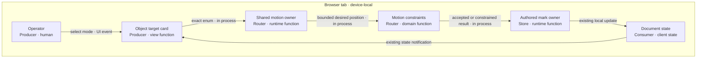

# Motion Control — Selected-Object Precision

This joined artifact proposes an explicit movement-speed choice for a selected authored object. It retains the current gesture-driven behavior as the default, adds Fine and Standard choices, and keeps the preference in page memory. It does not add capture, inference, persistence, network, command, or deployment authority.

The user request establishes scope, not validated pain or demand. The reference implementation below grounds the current code behavior. The proposed selector has no implementation or acceptance evidence yet.

## PRD: Selected-object precision

### Problem statement

The selected-object controller currently chooses between its existing standard and fine movement speeds from an input modifier. The fine step is available through a gesture, but the panel does not name that movement-speed behavior as a selectable mode. This creates a usability hypothesis: operators may find object movement difficult to tune or the fine gesture difficult to discover.

Pain status is **unvalidated**. No user observation, support record, task-frequency measurement, or willingness-to-pay evidence is attached.

### Personas and job

**P-01 — XR scene author (hypothesis):** selects an authored object or prop and uses browser-local pose or another normalized controller input to rehearse its motion. The job is to make a deliberate bounded position change without overshooting or changing the authored movement system.

### Journey stage

The story belongs to **Engage → control the selected object** in the existing local XR authoring journey.

| Stage | Action | Touchpoint | Hypothesized emotion / friction | Pain point | Opportunity |
|---|---|---|---|---|---|
| Trigger | Opens the existing motion-control surface | Floating panel | Unobserved; may be uncertain which control changes object pace | Current movement pace is not named in the object controls | Keep camera start explicit and separate |
| Discover | Selects an authored object and reads its current movement mode | Object target card | Unobserved; modifier-dependent Fine behavior may be hard to discover | Fine behavior depends on an input modifier | Expose Gesture, Fine, and Standard |
| Engage | Chooses a mode and supplies normalized movement input | Existing selected-object controller | Unobserved; a move may feel too fast before it can be corrected | A gesture can move farther than intended | Apply the chosen bounded speed |
| Complete | Reviews the moved mark and any constraint result | Existing stage and motion plan | Unobserved; a blocked or shortened move may be confusing | Movement can be blocked by physics or an obstruction | Report the existing result without claiming the full requested distance |
| Return | Selects another object or reopens the panel in the same page | Existing object selector | Unobserved; repeating mode setup may interrupt work | Repeated setup may be required | Keep the mode in page memory for this page session |

### User story

As an XR scene author, I want to choose Gesture, Fine, or Standard movement for the selected object, so I can deliberately trade movement speed for precision while retaining the existing motion and collision rules.

### Pain-point-to-feature mapping

| Pain ID and evidence | Hook | Break | Fix | Close | Min-time / resource / max-value note |
|---|---|---|---|---|---|
| P-01 · unvalidated hypothesis; the user asked to fine-tune object control, but no user study is attached | Operator selects an authored object for motion | Current fine movement depends on an input modifier whose speed meaning is not exposed beside the object selector | Add one page-session selector with three named modes; reuse the shared movement owner | Show the active mode and speed; verify first-use selection and bounded movement | Reuse the existing target card, speed constants, constraints, and persistence owner; add no model, service, module, or dependency; maximize operator choice without creating a second movement path |

### Acceptance criteria and VCCs

All five acceptance criteria operationalize the Must response to pain hypothesis P-01. Each check below is planned for the implementation task; none has been run for this proposal.

| ID | Given / When / Then | VCC and planned check | Constraint |
|---|---|---|---|
| PRD-MC-01 | Given a selected object, when the target card is rendered, then an accessible control offers exactly Gesture, Fine, and Standard, defaults to Gesture, and shows the active mode and its movement speed. | Verify the named options, accessible label, selected value, and Gesture default with npm -C canvas run test:ci:unit -- motionControl.objectPrecision.selectorChoicesAndDefault. | Use the existing panel form-control and design-token owners; no new visual token or dependency. |
| PRD-MC-02 | Given normalized movement input for an active selected object, when each mode is applied, then Gesture preserves the current modifier mapping, Fine applies 0.4 m/s, and Standard applies 2.0 m/s. | Verify all three mappings and normalized-input bounds with npm -C canvas run test:ci:unit -- xr.sharedObjectMotion.precisionMode.mapsBoundedSpeeds. | Keep frame-delta bounds, obstruction handling, physics ownership, and the existing mark-update owner. |
| PRD-MC-03 | Given a chosen mode, when the panel remounts or the selected object changes in the same page, then the page-session choice remains; after a page reload, the mode returns to Gesture. | Verify remount, selection change, reload initialization, and no document-metadata write with npm -C canvas run test:ci:unit -- motionControl.objectPrecision.pageSessionBoundary. | Do not store the preference in document metadata, browser storage, export, recording, or a new state store. |
| PRD-MC-04 | Given no explicit camera Start action, when the operator changes the speed mode, then no camera permission request, capture, inference, or network request occurs. | Verify zero capture starts and zero non-local requests while changing modes with npm -C canvas run test:ci:unit -- motionControl.objectPrecision.noCaptureSideEffect. | Preserve the existing explicit Start and Stop lifecycle. |
| PRD-MC-05 | Given an invalid programmatic mode or a blocked movement, when the control is applied, then the invalid mode is rejected without changing the previous mode and the existing constraint outcome remains authoritative. | Verify invalid-value rejection and blocked/unchanged movement results with npm -C canvas run test:ci:unit -- xr.sharedObjectMotion.precisionMode.failClosed. | Do not bypass the existing collision or physics resolver. |

**Evidence References:** none yet. The test names above are planned checks, not results. Local readiness remains spec-complete; delivered readiness remains undocumented.

### Success metrics

Targets are proposed learning thresholds, not observed outcomes.

| Metric | Baseline | Target | Timeline / observation |
|---|---|---|---|
| Correct first-use speed-mode choice | Unknown; no usability study | At least 4 of 5 first-time evaluators choose their intended mode within 10 seconds without coaching | One local, consented evaluation round; record choices and elapsed time only |
| Time-to-value steps | Unknown; measure on a clean browser | At most 3 deliberate actions from opening the panel to first bounded object movement | Timed clean-environment walk-through; camera permission is separately explicit |
| Time-to-value elapsed | Unknown; measure on a clean browser | At most 2 minutes from opening the panel to first bounded object movement | Same walk-through; report interruptions and setup separately |
| Token cost / month | No new model call is planned | $0 incremental | Confirm from the exact dependency and request deltas before release |
| Monthly TCO | No new service is planned; engineering and maintenance cost unknown | $0 incremental runtime TCO; measure maintenance after one release cycle | Reconcile actual service, dependency, CI, and support receipts before any TCO claim |
| ROI Score | Not calculable: User Impact and Reach are unobserved; source-based Build Hours estimate is 0.75–1.0 active hour | No numeric score until impact, reach, and the applicable threshold are evidenced | Before implementation, calculate (User Impact × Reach) / (Build Hours + Monthly TCO + Token Cost / Month) using the economics module's scales; owner: Product Engineering |

**Engineering estimate (read-only source inspection at `fb00925bf74183e54003ffe15b11c018de47ab21`, 2026-11-25):** 45–60 active minutes for the two existing production owners, one existing test file with focused VCC coverage, and this plan update; four paths maximum across the work. This is a provisional estimate, not measured effort. It assumes the inspected interfaces remain current, no new module or dependency, and the PRD limits of 12 KiB authored diff and 2 KiB built-chunk delta. The five-person first-use observation is still outstanding.

**ROI inputs and decision:** User Impact uses the economics module's 1–5 scale for pain severity × frequency; Reach is monthly active users or sessions. Both remain unknown, so no numeric ROI score or threshold verdict is claimed. The implementation estimate is not yet a receipt and does not validate user pain. The ROI gate remains open pending the first-use observation and a measured effort record. The planned runtime TCO and token increment remains $0, pending dependency and request receipts.

The user-facing TTV row follows the [Time-to-Value contract](./prd-tad-adr-mvp-gtm-economics.md#time-to-value). The TTV targets are estimates and require a clean-environment walk-through before alignment sign-off.

### Agent experience assessment

The domain object is an authored XR object or its selected motion mark. No evaluator-observed user experience is attached to this revision; every rating is unassessed.

| Criterion | Rating | Evidence | Rationale | Gap owner and next check |
|---|---|---|---|---|
| Core Requirements & Functionality | unassessed | none | The proposed selector is not implemented or observed | Evaluator · run the local VCC suite and timed walkthrough |
| Innovation & Theme Alignment | unassessed | none | No comparative user observation is attached | Evaluator · assess only if a user study supports it |
| Technical Execution & Integration | unassessed | none | Source grounding is not implementation evidence | Evaluator · inspect the exact candidate and run named checks |
| Usefulness & Agentic Experience | unassessed | none | Pain and usefulness remain hypotheses | Evaluator · observe the bounded five-person evaluation |

Ratings follow the [Agent Experience Maturity Rubric](./prd-tad-adr-mvp-gtm-maturity.md); they do not raise readiness or establish demand.

### MoSCoW priority

| Priority | Scope | ROI status and rationale |
|---|---|---|
| Must | Explicit three-mode speed choice, Gesture default, deterministic mapping, page-session lifecycle, accessible label, and no capture side effect | ROI unmeasured; smallest change reuses existing controls and movement owner |
| Should | A short inline explanation of the chosen mode and speed | Include only if it fits the existing panel without adding another help surface |
| Could | User-defined numeric sensitivity, calibration per object, saved preferences, and additional modes | Deferred: no bounds or user evidence justify added state and calibration |
| Won't (this increment) | Camera-derived object identity, new inference, remote pose processing, new MCP/command operations, new physics editor, or production deployment | Outside the bounded interaction change |

### Minimum viable scope

Extend the existing object target card with one enum-based speed selector. Gesture remains the default and retains present modifier behavior. Fine and Standard select the existing 0.4 m/s and 2.0 m/s speeds. Store the choice only in current-page memory and route motion through the existing selected-object constraints and mark-update owner.

### Out of scope

The selector does not set physics parameters, change animation presets, control the native physics player, infer object identities from camera frames, alter camera permission, add a command or browser-agent operation, persist preferences, add remote collaboration behavior, or publish a production build.

### Dependencies

Only existing panel controls, normalized controller input, speed constants, selected-object motion, collision/physics constraints, and authored-mark persistence are required. No new runtime dependency, hosted service, paid quota, model, token call, or separate datastore is proposed.

### Ecosystem outcome and evidence

| Participant / job | Value exchange / payer | Native owner / revision | Interface / authority | Current evidence / gap | Cost, privacy and exit |
|---|---|---|---|---|---|
| Operator · select and move one authored object at a deliberate pace | Hypothesized usability improvement; no price or payer claim | Existing target-card and shared object-motion owners; see the reference implementation record | Local panel and normalized controller input; camera capture remains explicit | Source behavior inspected; new selector and user outcome unverified | No new service cost or data collection; mode is page memory; revert to Gesture |
| Developer · maintain one control path | Reuse reduces branching and avoids a second motion store; savings unmeasured | Existing motion and UI owners at the exact revision in the reference record | Existing runtime boundary; no new invocation schema | Exact source revision is recorded below; compatibility checks remain planned | No new dependency; revert the small owner extension |
| Assurance evaluator · judge acceptance independently | Evidence quality, not a commercial exchange | Existing check runner and release gate | Named VCC checks; no self-graded experience score | No satisfying Evidence Reference yet | No copied frame, pose, or evaluator record to external service |

### Reuse outcome

| Capability / pain-VCC | Existing owner and consumers | Decision / smallest delta | Runtime boundary / differences | Acceptance and rollback |
|---|---|---|---|---|
| P-01 / PRD-MC-02 object speed selection | Shared object-motion owner; Motion Control target card; existing keyboard, gamepad, and pose inputs | Extend the owner with gesture, fine, and standard; do not extract a package | Mode selects the existing movement speed for the selected-object controller; it does not change avatar animation or native physics-controller mapping | Run the owner checks and browser walkthrough; revert the mode mapping and preserve Gesture as the default |

No before/after integration time, support-cost reduction, payment, or demand result has been measured.

### Open questions

1. Does the three-way label make movement intent clear to first-time operators without coaching?
2. Should the mode apply uniformly to normalized inputs that share the selected-object controller? This proposal says yes; change only after observed input-specific confusion.
3. Does the existing panel have enough room for the control and unit labels at narrow browser widths? The local browser walkthrough must answer this before alignment.

## TAD: Shared selected-object speed policy

### Overview

**From normalized movement input to authored mark:** target-card choice → page-session mode in the existing runtime owner → bounded speed selection → existing subject-motion constraints → existing authored mark and document state.

The preference is a small enum held in the existing runtime module. It is not a new store. The UI can change that enum without selecting an object, starting a camera, changing an authored mark, or invoking an external surface.

### Journey → system mapping

| Journey stage | Workflow | Data flow | Orchestration / harness flow | Topology node(s) | Component |
|---|---|---|---|---|---|
| Discover mode | Operator reads the object card and chooses one exact enum | UI enum enters page memory | Not applicable: no model or agent call is added | Target card → shared runtime | Existing target-card projection |
| Engage object | Operator supplies normalized input for the selected object | Mode and normalized axes select an existing bounded speed | Not applicable: no dispatch or LLM loop is introduced | Shared runtime → constraints | Existing selected-object controller |
| Complete motion | Operator reads the accepted, blocked, or unchanged result | Accepted mark follows existing authored-state path | Not applicable: no execution harness is introduced | Constraints → motion plan → document state | Existing constraint and persistence owners |

### Five flow-type disposition

| Flow type | Disposition | Reason and artifact |
|---|---|---|
| User journey | Applicable | The PRD journey table covers trigger, discover, engage, complete, and return for P-01. |
| Workflow | Applicable | One operator selects a mode, supplies input, and reads the constrained result; alternate and error paths are specified below. |
| Data flow | Applicable | The mode enum and normalized input feed the existing speed and constraint owners; persistence boundaries are explicit below. |
| Orchestration / harness | Not applicable | This increment adds no agent dispatch, model call, or iterative harness. Existing local pose inference is unchanged. |
| Topology | Applicable | Diagram D-TAD-01 records the browser-local components and state path. |

### Workflow: selected-object motion

**Trigger:** an authored object is selected and a movement input arrives.

**Actors:** operator, target-card view, shared object-motion owner, existing motion constraints, authored-state owner.

**Happy path:**

1. The operator chooses Gesture, Fine, or Standard in the object card; the existing runtime retains the enum in page memory.
2. Normalized input for the selected target reaches the existing controller. Gesture reads the existing modifier; Fine chooses 0.4 m/s; Standard chooses 2.0 m/s.
3. The controller uses the existing bounded frame delta to request a position. The motion-constraint owner accepts or limits the move; the authored-mark owner applies an accepted position.
4. The operator reads the existing updated stage and status.

**Alternate paths:**

- No selected object or no valid movement input: no position is applied; the current mode remains available.
- The operator changes object or remounts the panel: the current page-session mode remains; selected-target ownership remains with its existing owner.

**Error paths:**

- Invalid mode value: reject it and keep the last valid mode; do not fall back to a faster mode.
- Physics-owned, obstructed, or unchanged movement: preserve the existing result and constraints; do not report the requested full distance as applied.

**Postconditions:** an accepted mark uses the selected speed policy and existing authored-state path; a rejected or absent movement input creates no mark update. Mode changes alone produce no document write.

### Data flow and lifecycle

| Stage | Component | Input | Output | Persistence and retention | Error handling |
|---|---|---|---|---|---|
| Mode selection | Existing target-card view | One of gesture, fine, standard | Exact enum to the existing runtime owner | Page memory only; cleared on page reload | Reject unknown values; retain previous valid mode |
| Input | Existing normalized controller adapter | moveX, moveZ, modifier, source | Bounded movement vector | Transient input; no frame or pose history is added | Invalid or absent input yields no movement |
| Speed mapping | Existing shared object-motion owner | Mode, modifier, vector, bounded frame delta | Existing standard or fine displacement | No separate persisted preference | Gesture preserves modifier; Fine and Standard deterministically override speed |
| Constraint | Existing motion and physics resolver | Desired position and current scene state | Accepted, limited, obstructed, physics-owned, or unchanged result | Existing authored mark and document write only for accepted movement | Existing owner decides; selector cannot bypass |
| Readback | Existing stage and status | Updated mark or constraint result | Visible scene and current status | Existing document semantics | No success claim for blocked or unchanged movement |

Camera frames, model tensors, landmarks, and live pose are not inputs to the new preference itself. Existing Motion Control capture remains local and explicit. No raw capture, mode value, or new telemetry is uploaded, exported, or persisted.

### Codebase Grounding Record — Reference Implementation

This record grounds only the existing behavior and owner locations. It does not prove the proposed selector, user pain, VCC satisfaction, release, or production behavior.

| Claim | Exact source revision and symbol | Observed fact | Use in this proposal | Gap |
|---|---|---|---|---|
| Object selection and physics tuning already live in one target card | [MotionControlTargetCards.tsx at revision fb00925bf74183e54003ffe15b11c018de47ab21](https://github.com/huijoohwee/agentic-graph/blob/fb00925bf74183e54003ffe15b11c018de47ab21/canvas/src/features/three/MotionControlTargetCards.tsx) · MotionControlTargetCards | The card selects an authored object and its Fine-tune physics action opens the existing Simulation workbench | Place a named movement-speed selector in this existing card and retain Fine-tune physics | No selector exists at this revision |
| Shared movement already supports two speeds | [xrSharedAssetControlRuntime.ts at revision fb00925bf74183e54003ffe15b11c018de47ab21](https://github.com/huijoohwee/agentic-graph/blob/fb00925bf74183e54003ffe15b11c018de47ab21/canvas/src/features/three/xrSharedAssetControlRuntime.ts) · resolveXrSharedObjectControllerMotionTarget | The shared object owner selects THREE_OBJECT_KEYBOARD_FINE_SPEED_METERS_PER_SECOND or THREE_OBJECT_KEYBOARD_SPEED_METERS_PER_SECOND using the normalized input modifier | Add a validated mode that selects the same existing speeds without adding a movement path | The exact selector-to-speed mapping is proposed and untested |
| Fine mode is already reachable through the pose modifier | [motionControlPose.ts at revision fb00925bf74183e54003ffe15b11c018de47ab21](https://github.com/huijoohwee/agentic-graph/blob/fb00925bf74183e54003ffe15b11c018de47ab21/canvas/src/features/three/motionControlPose.ts) · motionControlPoseToControllerInput | The pose adapter sets its modifier when both hands are wide | Preserve this behavior in Gesture mode | No observation proves users know or prefer this gesture |
| Existing feature and privacy boundary | [Motion Control plan at revision fb00925bf74183e54003ffe15b11c018de47ab21](https://github.com/huijoohwee/agentic-graph/blob/fb00925bf74183e54003ffe15b11c018de47ab21/docs/documents/agentic-graph-motion-control-prd-tad-adr-mvp-gtm.md) | The source plan assigns capture, target selection, physics, privacy, and invocation to existing owners | Keep all those owners and boundaries; add no capture or command operation | The proposal has no implementation evidence |
| Governing authoring rules | [PRD-TAD-ADR-MVP-GTM Guidelines at revision f07f1a3c27d6936f86233d750d8db7b7690d5fb4](https://github.com/huijoohwee/huijoohwee.github.io/blob/f07f1a3c27d6936f86233d750d8db7b7690d5fb4/guidelines/prd-tad-adr-mvp-gtm-guidelines.md) | Version 3.5.1 defines the joined roles, coverage, flows, and evidence-derived status | Apply one continuity join and explicitly record gaps | A static document does not establish runtime or commercial evidence |

### Topology

**Version:** 0.1.1

**Boundaries:** one browser tab, device-local control state, existing authored document state. The selector adds no network boundary or service.

| Node | Role | Type | Lane | Connects to | Connection type | Data residency |
|---|---|---|---|---|---|---|
| Operator | Producer | Human | Authoring | Target card | Synchronous UI event | Local device |
| Target card | Producer | View function | Authoring | Shared motion owner | Synchronous enum update | Local device |
| Shared motion owner | Router | Runtime function | Authoring | Constraint owner | In-process function call | Local device |
| Constraint owner | Router | Domain function | Authoring | Authored mark owner | In-process result | Local device |
| Authored mark owner | Store | Runtime function | Authoring | Document state | Existing local document update | Existing document residency |
| Document state | Consumer | Client state | Authoring | Stage renderer | Existing state notification | Existing document residency |

**Diagram D-TAD-01** · Class: Component topology · Notation: flowchart TB · Version: 0.1.1 — selected-object speed policy

**Caption:** The page-session mode selects a speed in the existing object-motion owner before the existing constraint and authored-state owners apply the result.

**D-TAD-01 inventory:**

| Node ID | Diagram label | Role and type | Boundary / residency |
|---|---|---|---|
| Operator | Operator | Producer · human | Browser tab / device-local |
| TargetCard | Object target card | Producer · view function | Browser tab / device-local |
| MotionOwner | Shared motion owner | Router · runtime function | Browser tab / device-local |
| ConstraintOwner | Motion constraints | Router · domain function | Browser tab / device-local |
| MarkOwner | Authored mark owner | Store · runtime function | Browser tab / device-local |
| DocumentState | Document state | Consumer · client state | Existing document residency |

**Diagram Register:**

| Diagram | Class | Notation | Surface | Projects | Nodes | Edges | Clusters | Version |
|---|---|---|---|---|---:|---:|---:|---|
| D-TAD-01 | Component topology | flowchart TB | Markdown architecture record | no | 6 | 6 | 1 | 0.1.1 |

### Component specifications and integration contract

| Component | Responsibility (SVO) | Interface and dependency | Configuration and fallback | FOSS / vendor | VCC conditions | Evidence References | Readiness rung |
|---|---|---|---|---|---|---|---|
| Existing object target card | The target card presents the exact movement mode for the selected object | One enum selection; existing shared motion owner | Default Gesture; if invalid, retain prior valid mode | Existing browser-native control adapter; no new vendor or package | PRD-MC-01 exact choices and accessible default; PRD-MC-03 page-session lifecycle; PRD-MC-04 no capture side effect | None; named checks are planned, no result recorded | Local: spec-complete / Delivered: undocumented |
| Existing shared object-motion owner | The shared owner maps mode and normalized input to an existing bounded speed | Gesture, Fine, or Standard; existing motion constraints | Gesture reads modifier; Fine chooses 0.4 m/s; Standard chooses 2.0 m/s | Existing application code; no new vendor or package | PRD-MC-02 deterministic bounded mapping; PRD-MC-05 invalid mode fails closed | None; named checks are planned, no result recorded | Local: spec-complete / Delivered: undocumented |
| Existing constraint and authored-state owners | The constraint owner limits movement and the authored-state owner applies accepted marks | Existing typed movement result and existing document update | Preserve obstructed, physics-owned, and unchanged results | Existing application code; no new vendor or package | PRD-MC-02 movement remains bounded; PRD-MC-05 existing constraint outcome remains authoritative | None; named checks are planned, no result recorded | Local: spec-complete / Delivered: undocumented |

**Integration contracts:** no new network, HTTP, MCP, browser-agent, or persisted schema. The target card calls the existing runtime owner; movement calls the existing constraint and mark owners. A future selection operation accepts only the three exact enum values. No arbitrary numeric gain is accepted.

### Ecosystem contract

| Participant / job | Value exchange / payer | Native owner / revision | Interface / authority | Evidence / gap | Cost, privacy and exit |
|---|---|---|---|---|---|
| Operator | Faster selection of intended movement pace is a hypothesis; no payer identified | Existing target-card and motion owners at the exact reference revision above | Local UI; no added camera or external authority | No observed result | No new personal data; revert to Gesture |
| Developer | One reused control path | Existing UI, runtime, constraints, and document owners | Existing module boundary | Source inspected; new mode unverified | No added dependency; revert the small owner extension |
| Assurance evaluator | Reproducible VCC judgment | Existing test and release mechanisms | Independent named checks | No results yet | No copied frame, pose, or evaluator record to external service |

**Developer path:** inspect the exact source revision → implement in an admitted development lane → run focused owner checks → rehearse the panel locally → submit the exact candidate through the existing protected release gate → retain rollback to Gesture behavior. Support, version retirement, and deployed runtime proof remain deferred to existing product owners.

**Invocation join:** the current panel and selected-object controller are the applicable surfaces. Existing command and browser-agent contracts remain unchanged; the proposed speed mode is panel-only. No new command, binding, semantic token, tool, skill, or endpoint is introduced. Programmatic speed-mode selection is unsupported in this increment.

**Dependency order:** existing normalized input → existing shared object-motion owner → existing constraint owner → existing authored mark and document state. The target-card enum is consumed by the shared owner; no cycle or sibling-source import is proposed.

### Shared utility and invocation reuse

| Capability / VCC | Exact source owner and consumers | Decision / delta | Runtime boundary | Check, retention, rollback |
|---|---|---|---|---|
| PRD-MC-02 speed selection | Shared object-motion owner; object card; normalized keyboard, gamepad, pose, and device input | Extend the owner; do not extract or create a second speed policy | Page-local enum only; no change to avatar animation or native physics controller | Planned speed mapping check; revert mode override and retain current Gesture behavior |
| PRD-MC-04 panel selection | Existing shared panel form control and token adapter | Reuse | Browser view only | Planned accessible-selector check; remove the added selector if layout or accessibility fails |
| Existing command/browser-agent control | Existing strict invocation and local browser-tool owners | Retain unchanged; no new operation | Existing operation set | Current schema checks remain the owner; speed selection stays unsupported through those routes |

**Compatibility cases:** valid values are the three enum members. Unknown values fail without replacing the prior valid mode. Gesture preserves current input-modifier semantics. Fine and Standard affect only selected-object movement through the shared object controller. Speed remains frame-bounded and constraint-checked. The mode never enters canonical serialized bytes, exports, recordings, invocation results, or network payloads.

**Migration and recovery:** no persisted data migration. Revert the UI and shared owner extension together; existing Gesture behavior is the fallback. No compatibility shim or new dependency is required.

**Budgets:** 0 new runtime modules; 0 new runtime dependencies; 0 new AI/model calls; 0 incremental service/token spend. Implementation cap: at most 4 existing source/test/documentation paths, at most 12 KiB authored diff, and 60 active minutes. Measure built chunk delta before acceptance and keep it at or below 2 KiB; if the existing lazy chunk exceeds this, stop and re-scope rather than adding a new chunk. No CI or external-service spend is authorized by this proposal.

### Value-moving flow

Not applicable. The selector neither quotes nor collects payment, transfers an asset, authorizes a transaction, fulfills an order, nor reverses a value transfer. No commercial or legal-compliance claim follows from this disposition.

### Quality attributes

| Attribute | Scenario | Pattern | Validation |
|---|---|---|---|
| Performance | Mode selection must not add pose inference work or delay the existing movement frame | Enum lookup in the existing owner | Focused runtime check plus local browser walkthrough |
| Reliability | An invalid preference or blocked move must not create a faster or unconstrained move | Validate exact enum; retain existing delta and constraint checks | PRD-MC-02 and PRD-MC-05 checks |
| Security and privacy | Choosing a speed must not request capture or expose camera-derived data | Keep mode as local page memory; reuse explicit capture lifecycle | PRD-MC-03 and PRD-MC-04 checks |
| Observability | Operator needs to recognize active mode and actual movement outcome | Accessible mode label plus existing result surface | PRD-MC-01 and browser walkthrough |
| Token and service cost | The new control must not add inference, network, or paid calls | Zero new model or service path | Inspect dependency and request deltas |
| Offline behavior | With local UI loaded, changing mode needs no network; pose input still depends on its existing local assets and permission | Keep preference in the tab | Offline UI rehearsal; do not claim camera/model readiness without evidence |
| TCO | One local-browser deployment model only | Reuse existing runtime; no hosted service | Compare actual dependency, chunk, and CI receipts |
| Device reach | Narrow browser panels and keyboard access must retain a usable selector | Existing responsive panel layout and native form adapter | Browser widths and keyboard walkthrough; not yet tested |

### Deployment strategy and boundary register

| Lane | Current state | Scope |
|---|---|---|
| Authoring | Active for this document | This specification exists in its isolated authoring lane; source implementation has not started |
| Mirror | Closed | No mirror artifact or promotion receipt exists |
| Delivery | Closed | No deployment, operator instruction, or runtime receipt exists |

The source-code change is a separate future work item in its owning repository. This document does not start or promote that work.

| Boundary | From lane | To lane | Evidence Reference | Operator instruction | Rollback | State |
|---|---|---|---|---|---|---|
| Authoring artifact to mirror | Authoring | Mirror | None; no promotion receipt | None | Keep the artifact in its authoring lane | closed |
| Mirror artifact to delivery | Mirror | Delivery | None; no release or runtime evidence | None; no production promotion is authorized | Revert the exact candidate under its existing owner if a later authorized promotion occurs | closed |

The source change, protected integration, mirror update, and deployment are distinct outcomes. This document authorizes none of those effects.

### Component inventory

Rungs describe this proposed capability, not the readiness of the existing application.

| Layer | Component | Planned file / module | Local rung | Delivered rung |
|---|---|---|---|---|
| View | Three-mode selector | Existing object target card | spec-complete | undocumented |
| Domain | Page-session mode and speed mapping | Existing shared object-motion owner | spec-complete | undocumented |
| Verification | Mapping, state, and no-capture checks | Existing owner test suite; planned additions | spec-complete | undocumented |
| Documentation | Joined five-role plan | This artifact at PLAN-MOTION-CONTROL-OBJECT-PRECISION-001@0.1.1 | spec-complete | undocumented |

## ADR-01: expose bounded movement modes in the existing owner

**Status:** Proposed

**Date:** 2026-11-25

### Context

The current selected-object owner already has two movement speeds and the current input modifier selects between them. The object card already owns target selection and links to the physics workbench. The material choice is whether to make the existing speed distinction explicit in that card while preserving the current gesture path.

### Decision

Add a three-value selector to the existing object target card:

- **Gesture** — default; preserve the current modifier-to-speed behavior.
- **Fine** — choose the existing 0.4 m/s movement speed regardless of modifier.
- **Standard** — choose the existing 2.0 m/s movement speed regardless of modifier.

Keep the chosen value in page memory inside the existing shared object-motion owner. Use it only for the selected-object movement path. Keep the existing physics workbench action, constraints, input normalization, and mark persistence unchanged.

### Alternatives considered

1. **Keep the gesture-only behavior.** No code or state delta, and it preserves the current path. It does not make speed meaning visible or directly selectable, so it fails PRD-MC-01.
2. **Add a numeric sensitivity slider.** It offers more values but needs a bounded mapping, calibration model, persistence decision, and broader evidence. Those are unsupported by current user evidence and exceed this increment.
3. **Add an explicit three-mode selector using the existing speeds.** It makes behavior legible, remains reversible, and adds no new movement formula. Chosen.
4. **Use a newly sourced control package or hosted preference service.** No capability gap requires either; both add a dependency or authority boundary without measured need. Rejected.

The FOSS alternative is the browser's native select rendered through the existing shared form-control adapter. It has no new package or service cost and preserves keyboard operation.

### Rationale and reuse compatibility

This is an extension of the existing owner, not an extraction or a duplicate controller. The exact baseline Gesture behavior stays available and is the default. Fine and Standard choose the same speeds already consumed by the shared motion path. The setting does not change camera, pose, native physics-player, or animation semantics.

The selection follows the stated constraints directly; no platform/vendor/provider/channel/funder comparison is in scope, so no outranking score or argument graph is fabricated.

### TCO impact

Incremental costs are estimates; implementation and maintenance time remain unmeasured. Only the existing local-browser model is in scope, so no deployment-model variants are blended.

| Dimension | Chosen option · existing local browser | Best FOSS alternative · existing local browser | Delta / 12 months |
|---|---|---|---|
| Infrastructure | $0 incremental planned | $0 incremental | $0 planned |
| Egress | $0 incremental planned | $0 incremental | $0 planned |
| Token cost | $0 incremental planned | $0 incremental | $0 planned |
| Operations | Low; one enum in an existing owner | Low; retain current gesture only | No added service operation |
| Vendor risk | No new vendor or package | No new vendor or package | No change |
| Engineering and support time | Unknown until receipts and pilot | Unknown; existing confusion baseline also unmeasured | Not calculated |

### Consequences and recovery

- **Positive:** movement pace is named and directly selectable; the current gesture remains the default; one owner applies all modes.
- **Negative:** two fixed speeds may not suit every user or object; numeric tuning and calibration remain deferred.
- **Neutral:** the new preference is not available through command or browser-agent operations.
- **Recovery:** revert the enum mapping and selector; the default returns to current Gesture behavior. No data migration or user preference cleanup is needed.

## MVP: three-mode selected-object control

**Projects:** PRD-MC-01–PRD-MC-05 · TAD view, mode mapping, constraint, and authored-state owners · ADR-01 at PLAN-MOTION-CONTROL-OBJECT-PRECISION-001@0.1.1.

| Feature | VCC | Evidence Reference | Local rung | Delivered rung |
|---|---|---|---|---|
| PRD-MC-01 | Exact accessible modes, active speed, Gesture default | None; planned motionControl.objectPrecision.selectorChoicesAndDefault | spec-complete | undocumented |
| PRD-MC-02 | Gesture/Fine/Standard map to current modifier behavior, 0.4 m/s, and 2.0 m/s through bounded constraints | None; planned xr.sharedObjectMotion.precisionMode.mapsBoundedSpeeds | spec-complete | undocumented |
| PRD-MC-03 | Preference persists only in page memory and never enters serialized state | None; planned motionControl.objectPrecision.pageSessionBoundary | spec-complete | undocumented |
| PRD-MC-04 | Changing the mode starts no camera, inference, or network request | None; planned motionControl.objectPrecision.noCaptureSideEffect | spec-complete | undocumented |
| PRD-MC-05 | Invalid mode and blocked movement fail closed through existing owners | None; planned xr.sharedObjectMotion.precisionMode.failClosed | spec-complete | undocumented |

All five criteria remain unsatisfied until their Evidence References record a named check, result, and surface. No protected integration, deployment, or user outcome is claimed.

**Demo Skeleton — 45 seconds total:**

| Beat | Bound | Action and proof |
|---|---:|---|
| Hook | 5 s | Show one authored object and its existing control card. |
| Probe | 10 s | Select the object and read Gesture as the default; no camera permission prompt appears. |
| Reveal | 10 s | Choose Fine, then Standard; reveal PRD-MC-01 by reading the selected mode and displayed speed. |
| Domain action | 15 s | Feed a deterministic normalized input fixture through the existing selected-object owner; reveal PRD-MC-02 by comparing bounded mark displacement and constraint result. |
| Close | 5 s | Reload the local page; reveal PRD-MC-03 by observing Gesture default and no preference in serialized document state. |

The fixture demonstrates a mechanism only. It does not prove live-pose quality, user usefulness, or market demand. A separate local browser walkthrough will check the real panel layout and keyboard access.

**Domain-object rubric:** actual object is an authored XR subject or selected motion mark. All four experience ratings are unassessed; blocker for the next rung is the absence of implementation evidence and an evaluator-observed walkthrough.

**Minimum viable scope:** one selector, one exact enum, existing speed constants, current page-memory lifetime, existing constraints and persistence.

**Won't (this increment):** numeric sensitivity, per-object saved calibration, new camera or inference work, remote controls, new invocation operations, and deployment.

### Roadmap

**Owner and join:** one product-owned roadmap at PLAN-MOTION-CONTROL-OBJECT-PRECISION-001@0.1.1.

| Phase / outcome | Pain evidence / rank | Reuse / new delta / owner | Prerequisite / exit VCC | Bounds / wait condition | Stop, recovery / next check |
|---|---|---|---|---|---|
| Specify · bounded mode contract | P-01 unvalidated; rank is provisional because WTP is unknown | Existing object card and motion owner / enum selector / Product Engineering | This joined artifact; zero blocker review and exact source grounding | 60 active minutes for this authoring slice; zero runtime tokens/spend | Reopen only on a material requirement or source drift |
| Local implementation · mode visibly controls one selected object | User value remains a hypothesis | Extend two existing owners and their existing checks / Product Engineering | PRD-MC-01–05 named checks pass; local browser walkthrough records layout and no capture side effect | At most 4 paths, 12 KiB diff, 0 modules, 0 dependencies, 60 active minutes; wait for an admitted source lane and recheck registered source-lane capacity | If a VCC fails, stop before release; revert to Gesture; record the failure and successor decision |
| Usability learning · determine whether the choice helps | No current WTP evidence; do not rank as a paid feature | Existing local demo / no new runtime system / Product Research function | Five first-time evaluators; target at least 4/5 choose intended mode within 10 seconds without coaching | One local round; no video or pose recording; no paid recruitment or service | If threshold misses, retain Gesture and revise labels/scope in a successor; record actuals |
| Protected release and delivery | No delivery evidence | Existing protected release and deployment owners | Exact candidate checks and separate operator instruction | No deployment spend or promotion authorized by this plan | Keep boundary closed until the required receipt and instruction exist |
| Commercial decision | Buyer and offer unknown | Existing product GTM owner / no new commercial mechanism | Discover one payer/job and run a separate price/WTP experiment | No price, channel, or capital claim until evidence exists | No viable stream means keep monetization deferred |

The source-repository task lane was previously unable to start because its five registered checkouts were occupied. Recheck capacity before any implementation attempt; this is a wait condition, not permission to borrow a lane or change its limit.

**Reuse rollout:** owner test and source → local panel rehearsal → exact protected candidate → required integration gate. No mirror or delivery copy is created by this plan.

**Deferred ideas:** persistent per-object preference, user calibration, continuous sensitivity, command/browser-agent control, paid packaging, and remote motion processing. Revisit only on measured usability or integration pain, with an owner and successor revision.

**Milestones:** this document is authored; local implementation, reproducible VCC results, protected source integration, deployment, first payment, and repeat demand each remain separate and unproven.

## GTM: no admitted paid stream

**Projects:** MVP scope · pain P-01 · willingness to pay remains unvalidated at PLAN-MOTION-CONTROL-OBJECT-PRECISION-001@0.1.1.

| Stream | Segment exists now | Distance to first dollar | Mechanism | Demand | Collected revenue |
|---|---|---|---|---|---|
| No stream admitted for this increment | Unknown | Not ranked; no payer evidence | No paid offer or transaction tested | Unvalidated | None evidenced |

The selector is a proposed usability improvement inside an existing workflow, not a priced offer. Do not infer a buyer, channel, price, revenue, or repeat demand from the feature request or existing source code.

**Learn loop:** complete the local usability outcome and capture actual support/time cost → create a successor Context at the same continuity ID with a new revision. A separate buyer/WTP decision is required before adding a paid stream.

**Learning records:** H-01 (hypothesis that explicit speed choice improves first-use control) and E-01 (bounded local usability observation) are proposed for registration in the existing Lean Startup owner; neither record nor result exists yet.

**Execution-integrity VCCs:** no product implementation task has started. Future tasks consume PRD-MC-01–05 through the existing specification-to-task bridge; the authoring check result is not runtime evidence.

**Ecosystem dependency:** operator value is hypothesized in the PRD; payer, price, delivery cost, and repeat-use evidence remain unknown.

**Reuse measurement:** baseline and target failed/repeated actions, completion time, and support minutes are not yet observed. Record those in E-01 before making a savings claim.

**Roadmap join:** the local usability outcome is the next measurable user result. Continue only if the proposed threshold is met or a successor records a justified change; keep commercial expansion deferred.

## From-0-to-1 coverage record

**Join:** PLAN-MOTION-CONTROL-OBJECT-PRECISION-001@0.1.1 · **As of:** 2026-11-25 · **Owner:** Product Engineering function

**0:** The opportunity hypothesis is that operators need a visible way to choose the pace of selected-object motion. Its user value, frequency, segment, and WTP are unknown.

**1:** For a selected authored object, expose three bounded modes and determine whether at least 4 of 5 first-time evaluators choose their intended pace within 10 seconds without coaching; observe one local round and record time, correction, and support measures without recording camera or pose data.

| Domain ID | Decision | Source section@revision | Evidence / gap | Owner | Next check / trigger |
|---|---|---|---|---|---|
| C01 | covered | PRD@0.1.1 | P-01 is an explicitly unvalidated hypothesis grounded in the user request and exact existing-code sources | Product Research function | Run the first-use observation; do not relabel pain as validated without results |
| C02 | deferred | GTM@0.1.1 | Segment, geography, timing, TAM/SAM/SOM, and two sizing methods are unknown; commercial scope is not admitted | Product Strategy function | Revisit only if a payer segment is identified |
| C03 | deferred | PRD/GTM@0.1.1 | Manual gesture is the current alternative; no offer, package, price, differentiation evidence, or WTP result exists | Product Strategy function | Revisit after user and payer evidence |
| C04 | covered | PRD/MVP@0.1.1 | One journey, user story, five VCCs, accessibility, browser-reach checks, and TTV thresholds are specified; outcomes are unverified | Product Engineering function | Complete clean-environment and keyboard walkthrough |
| C05 | covered | TAD@0.1.1 | Existing owners, interfaces, data lifecycle, flow dispositions, and no-new-dependency boundary are specified | System Architecture function | Reconcile against the exact implementation candidate |
| C06 | covered | TAD/ADR@0.1.1 | Privacy, permission, failure, collision, offline, dependency, and zero-incremental-spend constraints are stated; no new external seam is proposed | Security and Privacy function | Review exact candidate and local request evidence |
| C07 | covered | ADR-01@0.1.1 | Alternatives, hard constraints, chosen reuse, TCO assumption, consequences, and recovery are stated | Product Engineering function | Reopen if the source contract or measured use contradicts the choice |
| C08 | covered | MVP@0.1.1 | Smallest slice, VCCs, named planned checks, demo beats, gaps, and unearned rungs are explicit | Evaluator function | Attach exact check results before raising local readiness |
| C09 | deferred | GTM@0.1.1 | Acquisition, activation, paid conversion, repeat use, support, and retention data are absent | Product Growth function | Revisit after a buyer/job and offer hypothesis are registered |
| C10 | deferred | TAD/Roadmap@0.1.1 | Existing operator/support process and capacity are not independently grounded in this artifact | Product Operations function | Confirm support owner and incident path before a public pilot |
| C11 | deferred | TAD@0.1.1 | No organization, jurisdiction, contract, or external study obligation is established; camera permission remains explicit and local | Product and Legal functions | Review before external recruitment, commercialization, or remote processing |
| C12 | deferred | ADR/GTM@0.1.1 | Incremental runtime spend is planned at $0; engineering, maintenance, cash timing, and scenario assumptions are not measured | Finance function | Build a model only when a financial decision needs it |
| C13 | not-applicable | ADR@0.1.1 | No capital raise or funding instrument is required for this bounded existing-owner change; applicability reviewer: Product Strategy function | Product Strategy function | Revisit if a funded commercialization phase is proposed |
| C14 | deferred | Roadmap@0.1.1 | This artifact is specified in an authoring lane; no source implementation, protected integration, deployment, or rollback receipt exists | ADLC owner | Recheck source-repository lane capacity, then follow its exact START → RELEASE → DEPLOY gates |
| C15 | not-applicable | GTM@0.1.1 | No deck, business-plan, or financial-model audience decision is requested; applicability reviewer: Product Strategy function | Product Strategy function | Revisit only when an audience action needs a projection |
| C16 | covered | GTM/Roadmap@0.1.1 | User-outcome threshold, stop condition, successor trigger, and separate commercial learning need are recorded | Product Research function | Feed E-01 actuals into a successor revision |

**Coverage:** 16/16 dispositioned; 7/14 applicable domains covered; 7 deferred; 2 not applicable.

**Local / delivered readiness:** spec-complete / undocumented. These are evidence-derived from the existence of five VCCs and the absence of satisfying implementation or delivery Evidence References; coverage is not readiness.

## Planning Record — 2026-11-25

| PRD-TAD-ADR-MVP-GTM | CID | RAO | Updated Date |
|---|---|---|---|
| PLAN-MOTION-CONTROL-OBJECT-PRECISION-001@0.1.1 | C: At source revision fb00925bf74183e54003ffe15b11c018de47ab21, the target card selects authored objects and the shared controller selects 2.0 or 0.4 m/s by modifier · I: Operators need an explicit selected-object movement pace · D: Add Gesture, Fine, and Standard modes in the existing card and speed owner; keep the preference in page memory | R: Product Engineering · A: The shared object-motion owner applies the selected bounded speed mode · O: The selected object's authored mark follows the mode through existing constraints · check: xr.sharedObjectMotion.precisionMode.mapsBoundedSpeeds | 2026-11-25 |

## Alignment checklist

- [x] One stable continuity ID and exact revision join all five roles.
- [x] One accountable function is named in frontmatter.
- [x] Pain is labelled unvalidated; no user, market, payment, or repeat-demand evidence is invented.
- [x] Five flow types are dispositioned; applicable topology has a named diagram and inventory.
- [x] Every Must criterion has a VCC and a named planned check; no result is claimed.
- [x] Local and delivered readiness are separate and not promoted without Evidence References.
- [x] C01–C16 each have one disposition, owner, evidence/gap, and next check.
- [x] GTM identifies no admitted paid stream and keeps payment evidence absent.
- [x] Deployment boundaries remain closed and no operator instruction is implied.
- [x] The existing feature owners are reused; no new controller, store, dependency, or invocation surface is proposed.
