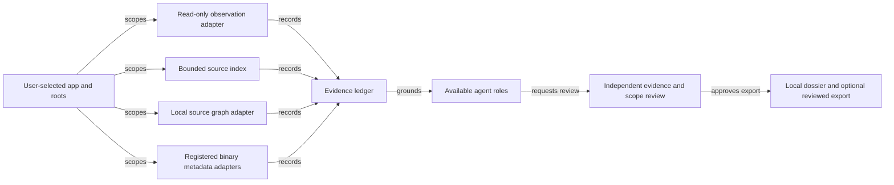

# Agentic Reverse Engineering — PRD-TAD-ADR-MVP-GTM

**Join**: `AGENTIC-RE-001@0.1.0` · **As of**: 2026-10-09 · **Owner**: Product owner

This joined proposal defines a general capability for understanding an explicitly selected
application and codebase with available agents. PRD states the outcome; TAD names owners and data
flows; ADR records the material design choice; MVP bounds the first useful loop; GTM defines how
buyer and user value will be tested. It is framework-, repository-, language-, and vendor-neutral.
Named products and repositories appear only in the reference-implementation evidence section.

### Joined identity and role record

| Join | Value | Bound meaning |
|---|---|---|
| Continuity | `AGENTIC-RE-001@0.1.0` | Stable lineage for the one joined artifact; each of PRD, TAD, ADR, MVP, and GTM carries this same revision. |
| Context | `CTX-01` | One explicitly selected application, repository root, current revision, data policy, and available capabilities. |
| Intent | `INT-01` | Produce a reviewable explanation whose claims remain traceable to observed or indexed evidence. |
| Directives | `DIR-01`–`DIR-04` | Scope explicitly; preserve evidence provenance; expose unsupported layers; keep target effects closed absent authority. |
| Criteria | `PRD-01`–`PRD-09` | Product requirements and VCCs below; TAD elements and any future RAO work must cite the exact criterion IDs. |
| Five section roles | PRD `0.1.0`; TAD `0.1.0`; ADR `0.1.0`; MVP `0.1.0`; GTM `0.1.0` | Five addressable sections of one joined artifact, not five separate product identities. |

The shared CID/RAO/SVO meanings remain owned by the authoring contract. This document records one
joined action as `role=Source-indexing function`, `action=Map selected repository files and return
revision-bound paths and hashes`, `outcome=Reviewer can re-read each cited hash or sees a stale-byte
refusal`; its SVO is `Source-indexing function maps selected repository files`. Outcome evidence is
the emitted map plus exact-hash read result, not the SVO sentence or an agent assertion. Future
execution steps must use the same field meanings and cite `DIR`, `PRD`, and TAD design IDs.

## Scope and status

The capability joins four distinct evidence types: observed application behavior, exact-byte source
facts, registered parser output, and reasoned inference. It may span an interface, source files,
configuration, runtime traces, and native binary metadata when each selected layer has a declared
reader. It must show which layers were inspected and which were unavailable.

This record is a proposal, not proof that the end-to-end workflow is integrated, released, or
commercially validated. The source repositories contain relevant indexing, graph, observability,
and parser owners; the current worktrees include uncommitted changes. User pain, willingness to pay,
market size, adoption, savings, and production readiness remain unvalidated or unknown.

## PRD — WHAT and WHY

### User, buyer, and job

| Role | Initial segment and job | Evidence state |
|---|---|---|
| User | Engineer, operator, reviewer, or analyst inheriting an unfamiliar application and needing to explain its behavior from evidence | Hypothesis; no interview or usage study attached |
| Beneficiary | Maintainer or team making a change based on the dossier | Product intent; benefit not measured |
| Buyer | Engineering or security leader paying for reduced investigation time and review risk | Candidate only; no validated budget or purchase path |
| Operator | Person who defines allowed application and repository scope, local retention, and any separately authorized side effect | Role identified; policy owner and service capacity are unknown |
| Evaluator | Independent mechanism that checks VCC evidence and readiness | Required as a distinct function; integrated evaluation evidence is absent |

**Job to be done**: Given a selected application surface and one authorized codebase root, help me
trace observed behavior to source and parser evidence so I can make or review a bounded change
without confusing a screenshot, declaration, static parse, or inference for runtime proof.

### Pain hypothesis and current alternatives

**P-01 — unvalidated pain hypothesis**: Teams reconstruct unfamiliar systems by switching between
screenshots, browser observations, source search, logs, agents, and binary utilities. Evidence is
often copied without its revision, digest, parser limits, or observation context, making it costly
to review and easy to overstate. No user research currently validates the frequency, severity, or
budget attached to this pain.

| Pain | Hook | Break | Fix hypothesis | Close |
|---|---|---|---|---|
| P-01: disconnected evidence loses provenance and confidence boundaries | A reviewer asks why the application shows or does a behavior | Observed UI, source, traces, parser results, and agent summaries use separate tools and identities | Build one bounded dossier with typed evidence, exact identities, and linked relationships | Reviewer can reproduce each material claim or see the missing evidence before a change is proposed |

| Alternative | Existing value | Gap to validate |
|---|---|---|
| Manual browser and editor workflow | Flexible and already available | Time and provenance loss are not measured |
| One-purpose source search or static scanner | Fast within its supported corpus | May not connect live behavior, source ownership, traces, and native formats |
| General-purpose agent prompt | Flexible synthesis | May blend observations and assumptions or omit exact source identity |
| Proposed offer | Bounded, local-first, multi-layer evidence dossier | Must prove lower investigation effort without increasing false claims or review burden |

### Product boundary

The user explicitly chooses the application and repository roots. Read-only observation and source
inspection are the default. The workflow may call an available local index, source graph, parser, or
agent only when its interface, limits, and result identity are declared. Agent availability does not
imply authority to fetch, execute, persist, publish, or deploy.

**In scope**: UI and accessibility observations; repository metadata and exact-byte source reads;
source and configuration indexing; digest-bound source relationships; retained agent or runtime
observations when explicitly selected; bounded metadata extraction for registered native formats;
evidence-linked reporting; unknown and diagnostic reporting; human-readable, local-first export.

**Out of scope for the MVP**: arbitrary code execution; target binary loading or emulation; automatic
decompilation or instruction-level analysis without a separately admitted adapter; exploit
development; credential extraction; implicit repository acquisition; unrestricted network crawling;
production mutation; source publication; automatic patch application; claims of complete coverage
from a partial corpus.

### User journeys

**J-01 — investigate a behavior**: Select an application and route → inspect a visible state without
changing it → select one repository root → map and search bounded source → read exact bytes by
returned hash → query one local source graph if available → inspect native metadata only through a
registered parser → review the evidence ledger → export or hand off a bounded dossier.

**J-02 — review a proposed change**: Open a dossier → follow a claim to its observation or source
hash → inspect parser version and limits → identify inference and unknowns → accept, narrow, or
reject the proposed change based on the evidence. Approval of a dossier does not authorize an
execution or release effect.

### Requirements and verifiable completion conditions

| ID | Requirement | Verification condition (VCC) |
|---|---|---|
| PRD-01 | The user selects one application surface and one or more explicit repository roots. | **VCC-01**: A session record names every selected root and refuses traversal outside it; omitted roots remain uninspected. |
| PRD-02 | The observer records route, time, visible state, inspection action, and observation method. | **VCC-02**: A reviewer can distinguish a rendered control from a successfully completed action in every dossier example. |
| PRD-03 | Source results retain repository-relative path, current-byte hash, Git revision, and dirty state. | **VCC-03**: Re-reading a returned source hash succeeds only for matching bytes and stale bytes produce a visible refusal. |
| PRD-04 | Graph relationships bind to one exact graph identity, snapshot digest, parser identity, and completeness result. | **VCC-04**: Query and edge explanation refuse a missing or mismatched graph/digest pair and retain parser diagnostics. |
| PRD-05 | Binary parsing is limited to formats and record types declared by a registered adapter. | **VCC-05**: A supported sample reports declared metadata and byte provenance; malformed, unknown, oversized, or unsupported input returns a diagnostic or inventory-only result. No target is executed. |
| PRD-06 | The dossier keeps observed behavior, source facts, parser output, inference, and unknowns separate. | **VCC-06**: Each material claim links to one or more evidence IDs; each inference identifies its inputs and unresolved gap. |
| PRD-07 | Agents use existing host capabilities and cannot promote target content to instructions or authority. | **VCC-07**: A hostile instruction embedded in a selected source is quoted or summarized only as data and causes no tool, network, persistence, or deployment effect. |
| PRD-08 | Scope, processing time, output size, and cost telemetry are visible and bounded. | **VCC-08**: Every limit refusal identifies the exhausted bound; unmeasured tokens, money, or end-to-end savings remain `unknown`. |
| PRD-09 | Selecting or opening the static Demo creates no model call, remote fetch, or target execution. | **VCC-09**: The demo trace records zero provider calls and zero remote acquisition; any future live run uses the normal explicit execution boundary. |

### Success measures and economics

Measure time from explicit scope selection to the first reviewer-usable evidence link (TTV),
percentage of material claims with reproducible evidence, unresolved/unsupported layers, reviewer
corrections, false runtime claims, agent iterations, source bytes, wall time, CPU, provider tokens,
and attributed cost separately. Establish a baseline before setting a savings target. The initial
pilot hypothesis is that a reviewer can find and validate one source-backed explanation within
five minutes on a previously selected corpus; this is a target for measurement, not an observed
result.

| Metric | Baseline | Initial target | Observation window / owner |
|---|---|---|---|
| Time to first reviewer-usable evidence link | Unknown; no integrated run | ≤5 minutes on a previously selected corpus | Five initial pilot investigations; Product owner |
| Material claims reproducible from linked evidence | Unknown | 100% of material claims carry evidence IDs; unsupported runtime claims = 0 | Every pilot dossier; Evaluator |
| Selected-layer coverage and explicit gaps | Unknown | Every selected layer has a result or typed unsupported/unknown record | Every pilot dossier; Technical owner |
| Resource/cost record | No paid run measured | Capture actual wall time, source bytes, agent rounds, tokens, and cost; no fabricated savings target | Per run; Operator |
| Readiness | Local `spec-complete`; delivered `undocumented` | Recompute from evidence after MVP; no rung is pre-awarded | MVP acceptance; Evaluator |

The ROI calculation is `(user impact × reach) / (build hours + monthly TCO + monthly token cost)`.
All inputs are currently unknown, so no tier receives a numeric ROI score. The scores below remain
unassessed until pilot evidence supplies comparable inputs.

| Priority | Scope | ROI score | Rationale |
|---|---|---|---|
| Must | Explicit scope; timestamped read-only observation; exact-hash source map/search/read; graph digest fence; registered metadata-only binary parsing; evidence tiers; visible gaps; bounded local dossier; no implicit execution or egress. | Unassessed | Minimum complete workflow needed to test P-01; pain, reach, impact, and build hours are unmeasured. |
| Should | Agent-role fan-out through configured host agents; retained trace import; source-graph expansion; redaction preview; resumable review of long corpora. | Unassessed | Could improve review effort but has no demonstrated demand or cost benefit. |
| Could | Additional language, runtime, package, firmware, and binary-format adapters after capability and limit registration. | Unassessed | Expand only when a sourced pilot gap warrants the adapter cost. |
| Won't | Treat generated agent prose as proof; execute a target from a prompt; silently fetch missing sources; claim universal parser coverage. | Not scored | These behaviors violate the scope and evidence boundary. |

**Agent experience assessment**: Core Requirements & Functionality, Innovation & Theme Alignment,
Technical Execution & Integration, and Usefulness & Agentic Experience are all **unassessed**.
Environment: local dirty source worktrees, with no integrated pilot. Evidence: the source now
contains the bounded source-context route and local reference-first dossier export, and Agentic OS
map/search/exact-hash reads verified current implementation bytes. Browser activation, parser
acceptance samples, no-call demo behavior, user study, and independent VCC evaluation remain
unverified. Gap owner: Product owner. Next check: capture one integrated browser dossier, then record
a timed pilot and criterion-specific evaluator observations before rating.

## TAD — HOW

### Architecture and ownership



| Component | Accountable function | Reuse or new decision |
|---|---|---|
| Application observer | Browser or device adapter | Reuse the current authorized browser/accessibility surface; add an adapter only for an unsupported host. |
| Bounded source index | Codebase reader | Reuse exact-byte map/search/read, repository visibility checks, and source identity; do not add a duplicate repository crawler. |
| Source graph | Local graph owner | Reuse parser registry, deterministic ingestion, exact snapshot query, and edge explanation; no second graph store. |
| Binary metadata parser | Registered parser adapter | Reuse parser dispatch and declared limits. Add one adapter per justified format family; never accept an executable parser payload from the target. |
| Agent coordinator | Host agent runtime | Reuse available roles and orchestration contracts; if no independent reviewer exists, proceed serially and disclose the gap. |
| Evidence ledger | Dossier composition | Add the minimal joined record that points to observation, source, graph, parser, and inference evidence without copying source bodies by default. |
| Dossier renderer/exporter | Existing document or Canvas surface | Reuse the current editor, local document, and export path; remote publication remains a separate authorized effect. |

### Five flows

| Flow | Sequence and invariant |
|---|---|
| Request | User selects target and roots → capability discovery → scoped plan. Discovery is read-only and does not fetch code or call a provider. |
| Evidence | Observe UI → map/search/read selected source → ingest/query/edge-explain when available → parse recognized binary metadata → record provenance. Each layer keeps its own identity and coverage. |
| Control | Coordinator assigns bounded observation, indexing, parser, and review roles from available agents. Agent output is untrusted until linked to an evidence record. |
| Failure and recovery | Timeout, stale hash, parser rejection, inaccessible target, or missing adapter returns a typed partial dossier with the exact gap. Retry only the failed bounded stage after its input identity is rechecked. |
| Learning and cost | Record measured wall time, CPU, bytes, provider usage, and human review separately. Compare against the manual baseline; do not infer savings from fewer calls or passing a source check. |

### Evidence record and lifecycle

```yaml
evidence_id: "<stable local identifier>"
kind: "observation | source | graph | binary-metadata | inference"
scope_ref: "<selected target or repository-relative path>"
source_revision: "<Git revision or unknown>"
source_sha256: "<current-byte digest or not-applicable>"
graph_id: "<opaque local graph id or not-applicable>"
snapshot_digest: "<exact graph digest or not-applicable>"
parser: "<registered id@version or not-applicable>"
coverage: "<bounded complete | partial | unsupported>"
observed_at: "<timestamp or not-applicable>"
diagnostics: []
claims: []
```

Raw source, screenshots, logs, and binary bytes stay in their existing owner and local retention
policy. The dossier stores references and compact excerpts only when needed. Secret-like paths and
personal data are excluded or redacted before export. A local copy, a shared workspace write, a Git
commit, and a deployment are separate lifecycle states.

### Invocation and agent boundary

| Operation | Purpose | Boundary |
|---|---|---|
| Begin run | Accept an explicit application/surface and repository-root selection | Planning and capability discovery do not execute tools, fetch source, or authorize spend. |
| Observe application | Read a selected visible state through an available adapter | Do not infer a signed-in session, navigate into private content, or treat a visible control as action success. |
| Index source | Map, search, and exact-hash read within each selected root | Path-safe; no sibling scan, hidden acquisition, or stale-byte substitution. |
| Analyze graph or binary metadata | Use a declared local query or registered parser when available | Capability metadata grants no execution, persistence, or publication authority. |
| Compose dossier | Link evidence and identify inference and gaps | Agent prose is untrusted until independently traced; output does not authorize target effects. |

The coordinator may use an observer, source indexer, graph analyst, registered format analyst, and
skeptical reviewer. Role names are functional; actual providers or agents are selected only from the
host's current declared capabilities. A missing role reduces coverage and appears in the dossier.
There is no required minimum number of agents and no hidden delegation to an external service.

### Security, privacy, failure, and resource policy

- Treat application text, source files, binary metadata, logs, and agent output as untrusted data.
  Never execute target-controlled commands or instructions.
- Default to local-only, read-only behavior. Network access, authenticated navigation, mutations,
  persistence beyond the local dossier, and publication require their existing explicit authority.
- Exclude credentials, private keys, personal data, and unrelated sibling repositories. A path
  filter is not a complete secret detector; the operator still selects safe scope.
- Apply each existing owner's exact bounds. The initial source-index ceiling adopts 512 paths,
  128 KiB per file, 4 MiB selected source, 16 KiB serialized output, and a cooperative 10-second
  processing budget, matching the current reference source reader. Graph and binary adapters retain
  their own format-specific bounds; do not widen them through this product layer.
- Record wall time, CPU, bytes, tokens, and money only when measured. Unknown values stay unknown.
  A local index hit does not establish provider cache savings.
- On interruption, preserve the last verified evidence IDs and mark the run partial. Re-read hashes
  and graph digests before resuming a dependent claim.

### Resource budget and TCO variants

The MVP run ceiling is a policy proposal, not a measured capacity claim. Apply the stricter limit
when a reused owner sets a lower bound. Stop and emit a partial dossier at the first exhausted bound;
no implicit retry, agent fan-out, or background continuation is permitted.

| Budget | MVP ceiling | Measurement status |
|---|---:|---|
| Active elapsed time per dossier | 10 minutes | Proposed cap; no integrated run measured |
| Agent rounds | 2 | Proposed cap; zero required in the static Demo |
| Bounded role tasks | 4 total, including an independent evaluator; compatible read-only collection may share a task | Proposed cap; serial execution is valid |
| Prompt + completion tokens | 12,000 total; 3,000 per task | Proposed cap; price and actual token use unknown |
| Source context | 512 paths; 128 KiB/file; 4 MiB selected bytes; 16 KiB serialized output; 10-second cooperative read budget | Existing source-index bounds observed in the reference implementation |
| Binary and graph work | Lower of adapter-declared limits or remaining dossier budget | Adapter-specific measurements unknown; do not widen locally |
| Provider cost | $0 in static Demo; no fixed paid-run ceiling until model and price are selected | Static Demo is specified no-call; paid-run price unknown |

| Deployment model | Cost drivers to record | Current estimate / decision |
|---|---|---|
| Local | Operator compute, storage, maintenance, and local model use if enabled | Unknown; default rehearsal; no recurring spend authorized |
| Managed | Compute, storage/retention, network, model tokens, support, and compliance | Unknown; defer until buyer need and data policy are validated |
| Hybrid | Local source processing plus separately costed managed coordination/model services | Unknown; compare only after concrete pilot measurements |

Record actual provider, model, token quantities, rates, runtime, compute, storage, and operator
review separately. Estimates remain assumptions; no TCO, ROI, time saved, or serving-token COGS is
claimed without receipts and a measured baseline.

### Data ownership and lifecycle

| Data class | Source of truth | Default handling | Export / retention boundary |
|---|---|---|---|
| UI observation | Selected browser/device surface | Read-only, scoped to visible state and action | Local reference or redacted excerpt; capture retention remains operator-defined |
| Source bytes and repository identity | Explicit checkout or authorized source provider | Read within declared root and existing limits; retain path, revision, digest | Dossier points to bytes; it does not copy full source by default |
| Agent/runtime traces | Existing trace owner | Import only when explicitly selected; preserve run identity and redaction | No new trace store; retention follows the existing owner |
| Graph and parser output | Existing graph/parser owners | Bind to graph digest and parser ID/version; retain diagnostics | Metadata excerpt only; original corpus stays with its owner |
| Dossier and cost record | Local document surface | Local-first; references, evidence IDs, and bounded excerpts | Sharing, commit, publication, and retention changes are separate effects |

Personal data, credentials, source licensing, jurisdiction, and customer contract obligations are
not resolved by this proposal. The operator must select a lawful corpus and retention policy before
using customer data; a redaction filter does not establish compliance.

### ADLC handoff boundary

| Transition | Required record | State in this proposal |
|---|---|---|
| START | Accepted continuity revision, current grounding records, explicit write scope, VCC-derived bounded RAO steps, dependencies, budget, and named evaluator | Not authorized; this is a specification and catalog/demo change only |
| RELEASE | Exact source candidate and revision, declared checks and results, independent review, unresolved findings, rollback reference | Not produced; no release claim |
| DEPLOY | Exact release identity, operator instruction, target boundary, deployment receipt, post-deploy evidence, and rollback path | Closed; no deployment or production mutation is authorized |

Any future execution handoff updates implemented versus remaining criteria, exact source identities,
named checks and results, limitations, blockers, and measured or unknown cost under the same
continuity ID. A written plan or demo cannot open a release/deploy boundary.

### Production runtime remediation

The browser build does not assume that a deployed host can read a local checkout. A release first
creates an immutable, clean-Git source-evidence bundle through `agentic-os source-evidence bundle`.
The bundle contains a reviewed catalog, one revision-and-tree-bound manifest, and content-addressed
text objects. The edge route reads only objects named by that manifest from its R2 binding. It cannot
walk a filesystem, execute a parser, acquire a repository, invoke an agent, or upload source.

The published observability page loads its repository list and bounded `map`, literal `search`, and
exact-hash `read` results from `/agentic-os/api/observability-workspace`. Local Vite keeps its
loopback-only source and graph actions for development. The Graph-owned Pages Functions release path
publishes the same endpoint together with the `agentic-graph/observability/` static namespace. A
production promotion still requires an operator to create and bind the named R2 bucket to that Pages
project, upload the reviewed bundle, release the exact protected source candidate, and retain the
post-deploy receipt; none of those actions are authorized by this document.

## ADR — DECISION

### ADR-01: Compose local evidence owners behind one evidence ledger

**Status**: Proposed for the MVP. **Context**: Application behavior, source, graph relationships,
and native metadata have different evidence semantics and different freshness boundaries.

**Decision**: Reuse explicit read-only observation, bounded exact-hash source indexing, an available
local source graph, and registered metadata parsers. Join their identities in one small evidence
ledger and render a dossier through an existing document surface. Keep agents as bounded evidence
analysts; they cannot redefine source authority or trigger target effects through generated text.

| Alternative | Reason not selected for the MVP |
|---|---|
| One hosted scanner that acquires and analyzes every target | Adds implicit egress and a new trust, retention, and cost boundary before demand or threat model is validated. |
| One autonomous agent executes the application and its binaries | Conflates target behavior with analysis behavior, risks state changes, and does not establish evidence provenance. |
| New indexing daemon and persistent universal database | Duplicates existing local source and graph owners and creates another stale-data lifecycle. |

**Consequences**: Positive—each claim has a source owner, exact identity, and visible gap; existing
adapters can grow independently. Negative—formats without a registered adapter remain unknown, and
cross-layer identity reconciliation requires careful review. Neutral—this choice does not prove
market demand or authorize an external runtime. **Recovery trigger**: Revisit if measured pilot
workflows cannot join identities or if a required format cannot be represented by a bounded local
adapter without executing target code.

## MVP — smallest complete loop

The MVP accepts one selected application state and one explicit repository root. It produces a
local dossier with at least one timestamped observation, one exact-hash source record, one
digest-bound graph relationship when the graph adapter is available, and one registered binary
metadata record when the selected corpus contains a supported file. Missing layers produce explicit
unknowns. The static demo remains no-call and no-execution.

**MVP exit conditions**:

1. VCC-01 through VCC-09 have linked results or an explicit unresolved evidence gap.
2. One reviewer can trace each example claim to its observation or exact source/parser record.
3. The output declares selected scope, local/delivered readiness separately, measured cost fields,
   and unsupported surfaces.
4. No open `blocker` finding remains in the joined requirements and architecture.

Local readiness is `spec-complete` for this proposal. Delivered readiness remains `undocumented`
until the integrated path and its criteria are observed at an exact accepted revision.

## GTM — payer path and learning loop

### Segment and offer hypotheses

Initial segment hypothesis: software teams, consultants, and operators who inherit unfamiliar
applications and need auditable explanations before maintenance, security review, migration, or
incident response. This is a research hypothesis, not a validated market boundary.

Offer hypothesis: a local-first investigation workflow that reduces time to reviewer-usable
evidence and preserves uncertainty. Test a free, bounded pilot first. Candidate paid packaging is
per-seat or per-investigation access for teams that require collaboration and audit retention;
buyer, price, packaging, and paid demand are unknown. Do not forecast revenue from source or
runtime capability alone.

### Acquisition, conversion, and retention experiment

| Step | Test | Measure and decision |
|---|---|---|
| Acquisition | Invite five practitioners who recently inherited a codebase or investigated an application behavior. | Record the recruiting source, role, and whether the participant has a real investigation to bring. No paid channel spend until a segment responds. |
| Activation | Give each participant one explicit local corpus and ask them to produce one evidence-linked explanation. | Measure time to first usable evidence, manual steps, failed layers, and whether scope can be selected without help. |
| Value | Have a second reviewer trace the explanation to its evidence. | Count claims reproduced, claims corrected, unsupported layers, and review time. |
| WTP | After a useful result, ask whether the team would pay for repeated use, collaboration, or retained evidence; present a concrete pilot offer only after the first value test. | Record stated interest separately from accepted offer, invoice, recognized revenue, and collected payment. |
| Retention | Observe whether a participant returns for a second investigation within 30 days. | Report actual repeat use and reason for non-return; do not infer retention from a completed demo. |

**Continue** only if reviewers can reproduce material claims and participants complete a second
useful investigation without an increase in unsupported runtime claims. **Pivot** if users value a
single layer (for example, source indexing or runtime evidence) but do not use the joined dossier.
**Stop** if the workflow cannot keep private target data local or if evidence review costs exceed
the value users report. This experiment has no result yet.

### Monetization and operating economics

Nearest first-dollar path to test: a paid team pilot after evidence quality and repeat use are
observed. A paid mechanism, real customer, price, conversion rate, support burden, and unit economics
are not established. Defer a revenue forecast and capital ask until pilot interviews, cost
receipts, and a validated buyer path exist.

## Joined coverage and learning record

| Domain | Disposition | Evidence or gap | Owner and next check |
|---|---|---|---|
| C01 Purpose, customer, and pain | covered | P-01 is an unvalidated hypothesis; no interview evidence | Product owner; recruit investigation users |
| C02 Market and timing | deferred | Target segment, geography, why-now evidence, TAM/SAM/SOM, and two sizing methods are unvalidated | GTM owner; record sourced discovery ranges and two sizing methods during Phase 0, then revise after interviews before audience handoff |
| C03 Offer and alternatives | covered | Local evidence workflow is proposed; alternatives not compared with users | Product owner; run manual comparison interviews |
| C04 Product and experience | covered | J-01/J-02 and VCC-01–09 define the workflow; keyboard, mobile, browser, and offline reach have no acceptance evidence yet | Design owner; include the chosen pilot device and access modes in first-use observation |
| C05 Architecture and data | covered | TAD components, joins, and lifecycle are defined; integration is unproven | Technical owner; reconcile at accepted source revisions |
| C06 Quality, security, and AI | covered | Read-only, untrusted-input, bounds, and unknown policies are specified; adapter licenses and paid-service quotas are unknown | Security owner; review threat, data-flow, license, and quota evidence |
| C07 Decisions and tradeoffs | covered | ADR-01 selects local owner composition | Architecture owner; revisit at recovery trigger |
| C08 Smallest validated slice | covered | MVP is bounded; no integrated VCC result yet | Product owner; execute one reviewer pilot |
| C09 Acquisition through retention | deferred | Channel, sales cycle, conversion, support, and repeat-use evidence absent | GTM owner; run five-user experiment and measure time from qualified problem to paid-pilot decision |
| C10 Business operations | covered | Proposed delivery, support, incident, and continuity ownership is described; service capacity and support volume remain unknown | Operations owner; measure pilot support time |
| C11 Organization and obligations | deferred | Entity, jurisdiction, IP, privacy, and customer-contract needs unknown | Legal reviewer; scope after buyer discovery |
| C12 Financial viability | deferred | Cost receipts, price, unit economics, three linked statements, cash timing, and scenario sensitivities are absent | Finance owner; collect measured pilot costs and build sourced scenarios |
| C13 Capital and milestones | not-applicable | This proposal makes no capital ask before demand validation; reviewer: Product owner (acceptance pending) | Product owner; reconsider after paid-pilot evidence |
| C14 ADLC execution | covered | START/RELEASE/DEPLOY handoff obligations are specified; receipts remain unproduced under this proposal | Delivery owner; authorize a separate exact source candidate |
| C15 Audience projections | deferred | No market or financial evidence supports an external deck or plan | GTM owner; revisit after demand and cost research |
| C16 Learning and next increment | covered | Continue/pivot/stop criteria and next experiment are stated | Product owner; record actual vs target after pilot |

**Coverage**: 16/16 domains have a disposition; 10/15 applicable domains are covered, 5 are
deferred, and 1 is not applicable. Covered hypotheses and plans do not mean market validation,
delivered readiness, or runtime proof.

## Reference implementation evidence

This section grounds reuse claims in one current reference implementation. It does not narrow the
product scope or imply that a particular repository, framework, or adapter is required. The source
worktrees were dirty and their changes were not integrated when observed.

| Capability evidence | Exact source identity | Observed result and limit |
|---|---|---|
| Bounded context map | Agentic OS working-tree base `8dbda651566e5da8e46d497c1105b3a685973c64`; `guides` scope; snapshot SHA-256 `d8da963c644bde1f76b6f6ba6f88e65a2dbcf8a124094c5c61e3d526be5879b8` | The CLI returned 50 text files and 829,319 source bytes; it declared lexical navigation only, `atomicSnapshot: false`, remote freshness not checked, and no authority. |
| Local source graph and binary adapter | Graph working-tree base `ca334aabfc85301e0f94b8b65e72273313d04ace`; scope `mcp/agent-graph`; latest bounded context snapshot SHA-256 `6efbd258f72a092aecec300c22a477db93326b7186195597016a4ef28fe623e6` | Agentic OS searched the 55-file, 559,258-byte text scope and returned current hashes for the parser and shared bounds contract. Navigation is lexical; the receipt reports `atomicSnapshot: false`, no remote freshness check, and no authority. |
| Native parser and capability contract | `mcp/agent-graph/native-binary-parser.mjs` SHA-256 `7f228877a74fdb27ddececf846ad6e2b70733b1778148f69c0e22935f03e9041`; `mcp/agent-graph/native-binary-contract.mjs` SHA-256 `5fdc3ca67490a1aebeace843de22834018c5bec8844faa06b7268f32d6595876` | Exact-hash reads succeeded. Declared formats: ELF, thin Mach-O, PE32/PE32+, WebAssembly v1, and System V/GNU `ar`. Limits: 8 MiB/source, 96 references, 256 sections, 4,096 Mach-O load commands, 4,096 WebAssembly vector entries, and 65,536 archive members. Target execution/loading/emulation/disassembly are explicitly false. This is source evidence only, not parser acceptance, release, or runtime evidence. |
| Graph observability and codebase graph surface | `canvas/src/features/observability-workspace/ObservabilityWorkspace.tsx` SHA-256 `612f0c66ca6d76fbfdb5fceaf4a8d057960f17927beec4ca32dc48c5257f96c6`; `canvas/src/features/observability-workspace/host.mjs` SHA-256 `f98ccd5fefd9605c6ab19a985c6dbee4b8b3580b5c6e762559d019cea62cf073` | Source wires the selected-root workspace to Agentic OS `context map/search/read`, verifies exact hashes, exposes bounds and resource fields, separates operator-entered UI evidence, and exports a local reference-first JSON dossier. Browser integration and action behavior remain unverified. |
| Home preset and demo source | Graph `canvas/src/features/chat/chatSkillRegistry.ts` SHA-256 `a11700c9dcb6962c4d24061ab86f585c80bbf856b8e565c4f821ccb00f357630`; `canvas/src/features/chat/promptPresetCatalog.ts` SHA-256 `7b757296643b51c6b3d151d5e6a4c16c74a222efabef25f5366d96ab8fc0cb90`; inventory `config/workspace-seed-inventory.json` SHA-256 `d8ecb8da01fe838f351a844a868a6dac00fe58e7a0142bd71497b3d8359c4220`; demo catalog `docs/workspace-seeds/demo.md` SHA-256 `6527095ab67d7a8a2cae8194bb01851b105ee388e45ded66913d82809962dcbe`; walkthrough `docs/workspace-seeds/agentic-reverse-engineering-demo.md` SHA-256 `5b24cd3cee6d6ba67f8435295d9c746aa039220b2ca3d45bcbbad2c383ed691e` | The preset route and static five-output example are source-authored. The existing lowercase `demo.md` catalog is preserved and extended; the lowercase walkthrough is allowlisted. Agentic OS returned the exact walkthrough bytes for the mapped hash. UI integration and browser Demo activation are not verified. |
| Shared preset source | Canvas OS working-tree base `45c132b6c9297141dc3b63427427e83ea6df8b34`; latest context snapshot SHA-256 `4b069fd14b371ef299b7439086a4d12f97920fb77f027b5db931805a9e06f960`; `docs/PROMPT-PRESETS.md` SHA-256 `d9be1fbc312ece305d581caa8fa01a1dfb2cb2d7c4022174afcde39fd29ecece` | Agentic OS search found the lowercase `agentic-reverse-engineering-demo.md` link in the shared preset. Selection is specified as zero-spend; the catalog is not released or browser-activated. |
| Source-index skill and command contract | Agentic OS working-tree base `8dbda651566e5da8e46d497c1105b3a685973c64`; latest context snapshot for `skills/software-forensics` SHA-256 `0a4cbea680730e505f324c9b0d1480a5f54e95bb6a55992ee3ee9418d7c8d4a4`; skill SHA-256 `1af91cd0d538ab4f7f9882148c556a562b2a5ff4ef9dd8f14d9f7f5721887c62`; command dictionary SHA-256 `9b7df7d80decde1ae5b2e1cbb9f96827b46fb88b63bc71180a082fdc39928cad` | The `/software.forensics` skill specifies an evidence ledger, distinguishes operator notes from host observation and retained traces, and keeps exports reference-first. Existing dictionary validation returned no findings before this implementation addition; dictionary files were unchanged afterward. |
| Current public-page screenshot | User-supplied browser screenshot; source revision and capture time not shown | The selected Catalog row is Physics Playground and the visible description says Demo opens matching content without a provider call. The screenshot does not prove that the Demo button was activated. |

### Evidence references

The source identities above are working-tree observations, not immutable delivered claims. Recompute
hashes after edits and bind acceptance to the exact source revision, graph digest, parser version,
browser route, and resulting dossier. `docs/workspace-seeds/agentic-reverse-engineering-demo.md` in the identified graph
working tree shows the evidence tiers and explicitly retains unsupported-layer gaps; it is a static
walkthrough, not a live target investigation.
