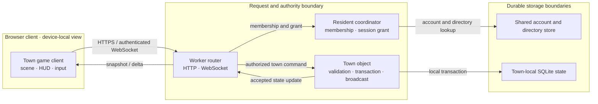

# Townies Town — PRD-TAD-ADR-MVP-GTM (reference implementation)

**Join**: `cooperative-town-first-loop@0.1.0` · **As of**: 2026-10-09 · **Owner**: Product owner

This is one proposed, joined artifact. PRD states the outcome; TAD records the existing architecture and bounded extensions; ADR records material choices; MVP selects one dependency-closed pilot slice; GTM defines the payer and learning path. All five roles consume this exact revision. This document proposes no source release or deployment.

## Scope and status

The product thesis is a browser-based town where friends can complete a small useful activity, see it change their shared world, and return later without losing progress. The available source and live experience show a substantial implementation. This plan is for validating one short cooperative loop using existing capabilities, not rebuilding the documented game catalog.

Pain, willingness to pay (WTP), retention, support demand, market share, production cost, and real-money revenue are **unvalidated or unknown**. The current specification is proposed; the product must not advance to a build or scale decision until the Phase 0 pain check and the listed safety and data checks close. `spec-complete` describes this proposed record's VCCs; `undocumented` is the delivered rung because no complete pilot has been observed against them at a known deployed revision.

The live browser review on 2026-10-09 showed an authenticated town view with a shared job checklist, per-job completed/remaining counts, an active shift receipt, and keyboard/touch control guidance. The page was left in its game view. No work action was started or finished as part of this review. The deployed source revision was not visible in the page, so this observation does not join to a specific release.

## PRD — WHAT and WHY

### Purpose, user, and opportunity

**Product promise**: Give a small friend group a low-friction place to do one satisfying thing together and leave a persistent improvement behind.

| Role | Initial segment and job | Evidence state |
|---|---|---|
| User | Adults in small friend groups who want a relaxed, short online activity that can continue across visits | Hypothesis; not interviewed |
| Organizer / acquisition actor | One friend who shares a town invite and gets the group to its first activity | Hypothesis; no invite funnel data |
| Beneficiary | Every resident who sees shared work and town progress accumulate | Product intent; the live checklist was observed, but multi-person use was not tested |
| Buyer / payer | Adult player choosing an optional cosmetic supporter item, if WTP is later demonstrated | Candidate only; no offer, checkout, or collected payment evidenced |
| Operator | Product maintainer who owns release, safety response, service cost, and recovery | Accountable function identified; named operator and capacity unknown |

**P-01 — `unvalidated` pain hypothesis**: Friend groups who want a relaxed game night may find that existing social calls or short-session games do not leave a shared, persistent result that makes the next visit feel familiar. The evidence currently supports the general value of social play, not this specific pain or this product's solution. A direct quote, observed workaround, or measured behavior is required before P-01 can back an executable `Must`.

| Pain | Hook | Break | Fix hypothesis | Close | Min-time-resource-max-value note |
|---|---|---|---|---|---|
| P-01: `unvalidated`; short online sessions may not create a durable group outcome | Town work board shows a visible need and its remaining work | A visitor may not know what to do first, whether help matters, or whether progress survives absence | Join a private town, choose one short shared job, and complete one task | Show the player's reward and the resulting shared progress; allow a later return to the same state | Reuse the existing town work board, task state, reward path, and persistence. Build only a measured onboarding or feedback gap; no new store, telemetry pipeline, or game system until observed. |

### Market and timing hypothesis

**Beachhead hypothesis**: English-speaking adult friend groups in the United States, acquired by a friend invite and served through a browser. Canada, the United Kingdom, Australia, and other markets are follow-on candidates after the product's language, hosting, support, and jurisdiction needs are reviewed. This is a research starting point, not validated demand or a geographic restriction in the current product.

**Why test now**: The 2026 U.S. player survey reports a broad weekly game-playing audience and adult motivations that include relaxation and social connection. Those findings support testing the promise; they do not establish demand for a browser town game. A 2025 global market estimate establishes that games are a large category, not this product's addressable market. Sources and limits are in the Evidence Register.

**Two sizing methods and reconciliation**:

| Method | Current input | Result and limitation |
|---|---|---|
| Top-down | 212.3 million U.S. weekly players and $60.7 billion U.S. consumer game spending for 2025 [MKT-01]; the broader 2025 global market estimate is $201.6 billion [MKT-02] | Category ceilings only. Neither source isolates browser-based cooperative life simulations, adult friend groups, accessible geography, nor spend available to this product. A defensible numerical TAM and SAM remain unknown. |
| Bottom-up | Three invite-only pilot towns capped at 50 resident slots each, using the documented per-town capacity [SRC-01] | 150 seats is a proposed learning-capacity ceiling, not an estimate of reachable players, conversion, or sales. Actual filled seats and invite completion are unknown. |

The methods do not yet reconcile: top-down counts category scale; bottom-up limits the first experiment. **C02 is deferred for a numerical TAM/SAM/SOM** until the segment filter and invite cohort are measured. No investment, paid acquisition, or revenue forecast may use the broad category values as a product market size.

### Alternatives and offer

| Alternative | What the user gets | Gap the product hypothesis addresses |
|---|---|---|
| Do nothing / stay in a call | Familiar conversation with no new game setup | No shared world state or activity outcome |
| Existing short-session multiplayer game | A focused session and immediate play | May not offer a persistent cooperative neighborhood; validate this with users rather than assume it |
| Existing large life-simulation or sandbox game | Deep progression, creativity, and social features | May require a larger time commitment, installation, or group coordination; test this claim |
| Proposed offer | Browser entry into a persistent town, one shared task, one visible result, and an invitation to return | Must prove that players value this combination and that invitees arrive and repeat |

The initial offer is **free access to a private pilot town**. A one-time optional cosmetic supporter set is the first paid-offer hypothesis; price, buyer response, fulfillment, payment mechanism, and demand are not established. No competitive or market-position claim is made.

### User journey and stories

**Primary journey J-01 — first useful shared action**: A new adult participant receives an invitation → opens the game in a browser → signs in or creates an account → joins the intended private town → sees current shared work → chooses one job → completes one task → sees one personal reward and one shared progress change → leaves and later returns to the same town.

**Follow-on journey J-02 — familiar return**: A resident returns after at least one day → recognizes the same home and town state → sees the work that remains → contributes one useful action without needing a scheduled group session.

| ID | User story | Acceptance criterion and VCC |
|---|---|---|
| PRD-01 | As a first-time player, I want one clear next activity so I can make a useful contribution quickly. | **VCC-01**: In 10 observed first-time sessions, at least 8 participants reach the first valid task completion within 5 minutes of the game becoming interactive, without moderator instructions. Record each elapsed time and abandonment. The threshold is a pilot hypothesis, not a measured baseline. |
| PRD-02 | As a resident, I want my contribution to change shared work so my action matters to the town. | **VCC-02**: In two authenticated clients in one isolated town, client B displays client A's accepted shared-work increment within 3 seconds in 20/20 sampled actions; no client may authoritatively set the count or reward. Record the test run and both client revisions. |
| PRD-03 | As a player, I want a reconnect or repeated completion request to preserve one result so I can trust my saved progress. | **VCC-03**: After duplicate completion, disconnect-before-ack, reconnect, and page reload cases, the persisted town task advances once and the resident reward ledger contains one corresponding reward. Verify in isolated local data. |
| PRD-04 | As an invited friend, I want to join the same private town as the organizer so the group does not split. | **VCC-04**: Two first-time accounts using the same valid invite resolve to one town and one expected membership; an invalid, expired, revoked, or full-town invite is rejected with a usable explanation and no unintended membership. |
| PRD-05 | As a player using keyboard or touch, I want to find and understand the task board and controls without relying on color or sound. | **VCC-05**: A keyboard-only and a touch-device rehearsal each complete the selected task path; focus order, accessible names, progress text, reduced-motion behavior, and error recovery are recorded. No result is available yet. |

### Success metrics and economics

All product baselines are unknown. Targets below are pilot decision thresholds, not forecasts.

| Metric | Baseline | Target | Observation window |
|---|---|---|---|
| First useful action / TTV elapsed | Not measured | At least 8/10 first-time participants complete a task within 5 minutes | First session; report median and each failure |
| TTV steps | Not measured | No more than 5 deliberate transitions from invitation open to first task completion | First session; distinguish account entry from gameplay |
| Shared result visibility | Not measured in two clients | 20/20 test actions visible to peer within 3 seconds | Isolated multiplayer rehearsal |
| Reward and persistence correctness | No evidence joined to this plan | 100% one reward per accepted action across duplicate/reconnect cases | Integration rehearsal |
| Return behavior | No cohort baseline | At least 4/10 pilot players voluntarily return within 7 days; report the numerator and denominator | 7 days after first session |
| Invite activation | No funnel baseline | At least 4/10 invited players reach the task board within 72 hours | Per invite cohort |
| WTP / paid conversion | No offer or payment evidence | First collect offer-choice evidence; only an actual settled payment can establish a first-dollar result | After safety, price, delivery, and payment review |
| Token cost / month | No model calls in the proposed loop | $0 model inference in the pilot; disclose any future agent-model cost separately | Per release |
| Monthly TCO / ROI | No account bill, workload, or support baseline | Record usage, support minutes, and deployment model before forecasting; ROI stays unscored | Monthly and per pilot |
| Readiness rung | Specified VCCs; no complete local run | Advance only from joined Evidence References | Recompute after every changed criterion |

### MoSCoW scope

- **Must**: Validate P-01 before an executable product baseline; rehearse one private town, two clients, one existing job, one accepted task, one shared progress update, one reward, and one reconnect/readback. Complete VCC-01 through VCC-05 before a broad pilot.
- **Should**: Include three existing jobs and a short group play session after the single-job loop passes; use the current interface and persistence owners.
- **Could**: Add a brief return recap or additional co-op tasks if observed confusion or demand justifies the smallest extension.
- **Won't (this increment)**: Real-money checkout, ads, paid power, premium currency, loot boxes, public creator tools, cross-town visits, new social channels, agent-driven task completion, or a new analytics service. Revisit payment only after a payer and repeat-use signal exist; revisit public creator scope only after safety, rollback, and moderation ownership are proven.

### Out of scope and open questions

Out of scope: redesigning the whole game, porting the source, changing persistence, adding jobs for catalog breadth, launching a public acquisition campaign, promising 50 simultaneous clients, and claiming that source code proves a live behavior.

Open questions: Does P-01 occur often enough to matter? Which group member organizes? Do invitees finish the first task without coaching? Does the town's shared change cause voluntary return? Which platform/browser/device is most important? What age and jurisdiction rules apply to the public service? Is an optional cosmetic offer wanted? What are the actual monthly account costs and support hours? The next check for each is recorded in GTM and the coverage record.

## TAD — reference implementation architecture and data

### Existing architecture and ownership

This section describes the inspected reference implementation at source revision `6338e1d0b9daa665319bf63954389d4625c20ec8`. It is not a claim about the live deployment revision. The source describes a browser client, a Worker request boundary, an account/resident coordinator, one SQLite-backed Durable Object per town, D1 for shared accounts and directory data, authenticated WebSockets, and an HTTP fallback. The server owns rewards, membership, permissions, inventory, and durable town state. Use the existing owners; do not replace the simulation or add a second gameplay store for this pilot.

| Journey stage | Workflow | Data flow | Orchestration / harness | Topology and owner |
|---|---|---|---|---|
| Invite and account | Open invite, authenticate, resolve membership | Invite key and session are checked at the server boundary | Existing account/session handlers | Browser → Worker → account/resident owner |
| Enter town | Load resident and town snapshot | Worker routes resident to current town; town returns a consistent state view | Existing HTTP bootstrap and authenticated socket | Worker → ResidentCoordinator → Town Durable Object |
| Choose work | Read checklist and select job | Read shared task totals; submit a bounded job choice | Existing HUD/menu handler | Browser `TownWorkMenu` → game request owner |
| Complete work | Interact with one nearby task | Server validates actor, target, claim, and result; commits state and one reward | Existing authoritative game handler and town transaction | Worker/socket → Town Durable Object → town SQLite |
| See and resume | Read peer update, disconnect, reconnect | Town snapshot and ordered state updates restore the durable result | Existing socket recovery and HTTP fallback | Town Durable Object → Worker → both clients |

### Five required flows

1. **Journey**: invite → sign-in → correct town → checklist → task → personal receipt + shared update → leave → return.
2. **Workflow**: authorize session → resolve resident/town → validate command and proximity → atomically commit task/reward → broadcast accepted state → reconcile client view.
3. **Data lifecycle**: account/session/passkey and shared directory data remain in the shared account store; membership/session grants are resolved by the resident coordinator; town work, home, economy, and local communications remain town-owned; client caches are projections and never payment/reward authority. Pilot observations are manual and anonymized; add no new analytics event store.
4. **Harness/orchestration**: the core game has no model call or AI agent loop. Browser tool discovery is an optional interface only. No background agent may perform a work action. Cap any one user-directed external-tool sequence to one read or one movement request, then return control to the player.
5. **Topology**: the diagram below records the current reference path. Actual deployed bindings and live revision remain to be joined before readiness can advance.

### Topology diagram

**Diagram Register**: `D-01` · topology · Mermaid flowchart LR · browser/edge/store boundaries · projects: yes · 6 nodes · 7 edges · 3 clusters · version 0.1.

### Component inventory and division of work

`Reuse` means retain the current owner and extend only for a measured gap. Source presence is not a readiness rung. For this proposal all pilot VCCs are `spec-complete` locally and `undocumented` as delivered until their exact Evidence References are recorded.

| Capability | Single owner | Existing source owner / reuse decision | Pilot contract and planned check |
|---|---|---|---|
| Account and account gate | Identity owner | `app/account/AccountGate.tsx`, `app/account/authClient.ts`, `db/auth.ts` · reuse | VCC-04; isolated account integration and invalid/revoked invite cases |
| Town snapshot and request routing | Game server owner | `worker.ts`, `server/towns/router.ts`, `server/towns/ResidentCoordinator.ts` · reuse | VCC-02 / VCC-04; correct membership and town isolation in integration rehearsal |
| 3D scene and input | Game client owner | `app/game/TownScene.tsx`, `app/page.tsx` · reuse | VCC-01 / VCC-05; browser and touch session observation |
| Shared work checklist | Game client owner | `app/game/TownWorkMenu.tsx` · reuse | VCC-01 / VCC-02; confirm labels, counts, and disabled states |
| Work interaction and reward receipt | Game server owner | `app/game/JobDock.tsx`, `server/game.ts` · reuse | VCC-02 / VCC-03; duplicate/reconnect reward cases |
| Durable town state and broadcast | Town state owner | `server/towns/Town.ts`, `server/towns/sqlite.ts` · reuse | VCC-02 / VCC-03; readback after reconnect and state isolation |
| Optional external-tool route | Product and safety owner | `app/page.tsx` declares `read_town_progress` and `navigate_to_town_activity` via `document.modelContext.registerTool` · keep out of pilot tasks; review data minimization before promoting | Static declaration is source evidence only; do not invoke in an unattended loop. Test exact output and authority only in a consented isolated session. |
| New pilot analytics service | None | No new store or package | Not added. Record anonymized manual observations; any instrumentation needs an ADR, privacy purpose, retention, deletion, and cost. |

No generic extraction is proposed: each existing capability has one owner, the pilot has one concrete consumer, and no second store is justified. Any needed UI correction remains with its current owner. Shared state mutation continues through server-validated game commands only.

### Invocation Register

The route inventory is scoped to the game. Unsupported paths are explicit; discovery does not grant action authority.

| Capability ID | Surface and actual route | Owner / input-output | Mode and authority | Evidence / gap |
|---|---|---|---|---|
| INV-01 | Browser page and game HUD | Browser UI / existing game request handlers | Supported; authenticated player; task effects remain server-authorized | Live authenticated view showed the checklist and shift UI; full task path not observed |
| INV-02 | HTTP `/api/game` and authenticated `/api/town-socket` | Worker and town router / JSON snapshot, commands, state updates | Supported by source; authentication, membership, and town boundary enforced server-side | Pinned code and architecture docs; deployed identity unknown |
| INV-03 | URL hash `#town=<invite-key>` | Onboarding / invite key selects join mode | Supported by source; joining is a persistent membership action and requires explicit player confirmation | Static source reads the invite key; invalid/revoked/full behavior must be rehearsed |
| INV-04 | WebMCP `read_town_progress` | Browser page / own resident, job, coins, education, town name, and project | Read; source currently includes personal/account-adjacent fields. Keep disabled from pilot evaluation until field minimization and consent expectations are reviewed. | Static source declaration; runtime tool discovery and payload were not exercised |
| INV-05 | WebMCP `navigate_to_town_activity` | Browser page / enum activity → movement request | Mutating navigation only; user-directed and visible. It does not complete work or spend coins, but can move the avatar. | Static source declaration; no invocation performed |
| INV-06 | Native MCP server, `/` command, `@` binding, `#` semantic command | None identified for this scope | Unsupported; do not infer an integration from a browser page or invite hash | No owner or contract in the inspected source |

### Data, privacy, security, and quality

| Concern | Requirement / failure case | Owner and Evidence Reference |
|---|---|---|
| State authority | Forged, duplicate, stale, or out-of-range client action cannot create task completion or coins. A retry returns the already-committed result. | Game server owner · VCC-03; isolated integration cases |
| Tenant isolation | One account cannot read or mutate another town; stale membership, revoked session grant, and transfer freeze fail closed. | Identity and town state owners · `tests/game-api.mjs`, WebSocket integration checks; results not run for this document |
| Reliability | Socket loss cannot lose an accepted task or duplicate a reward; reconnect returns a consistent snapshot and ordered updates. Offline mode is read-only/unavailable for server-owned actions. | Game server owner · VCC-02/VCC-03 |
| Account and social data | Do not expose passwords, session cookies, private messages, or unnecessary identifiers in pilot notes, analytics, broadcasts, or tool output. Review the current tool payload fields before any agent surface is promoted. | Identity and privacy reviewer · review and isolated output check required |
| Safety and moderation | Invite-only adults for the research cohort; provide a named report/response owner and escalation route before any open public acquisition. Chat is not required to finish the core task. Do not claim a rating or child-safety certification. | Trust and safety owner · public-pilot gate; current staffing and deployed moderation state unknown |
| Accessibility and device reach | Preserve keyboard and touch paths, readable labels, reduced-motion control, text progress, and low-graphics recovery; do not use color or sound as the only signal. WebGL 2 and target-device support are declared prerequisites to validate. | Experience owner · VCC-05 and cross-device rehearsal |
| Observability | Pilot records use participant codes, time-to-value, completion/abandonment, invite outcome, and free-text usability notes only with informed consent. No account names, chat content, exact location, or new persistent telemetry by default. Delete raw notes 30 days after the pilot decision; retain aggregate counts only if useful and approved. | Product/privacy owner · consent and deletion check before recruitment |
| Cost and capacity | Measure Worker/DO/D1 usage per pilot cohort and per active town; alert or pause before free limits cause an outage or paid usage exceeds the approved cap. Measure support minutes and backup/restore effort. | Operations owner · monthly usage export and recovery rehearsal |
| AI and model use | No model is required or budgeted for the core loop. Model calls, token costs, prompt data, and autonomous task execution are out of scope. | Product owner · no model harness needed |

### Deployment model and TCO

The public account's actual plan, usage, bill, backup objective, and operating labor are not available in this review. Current rate-card values below are inputs, not a bill estimate. Keep deployment variants separate.

| Cost dimension | Managed edge / current reference design | Self-managed open-source alternative | Local isolated rehearsal |
|---|---|---|---|
| Infra and storage | Free or paid usage depends on account and request, active connection, row, and storage volumes. The current paid plan has a $5/month minimum; overage and idle/non-hibernating Durable Object time can apply. | Host, SQL storage, backups, monitoring, network, TLS, and email/auth need an explicit region and quote. No price or service design is approved. | Machine and operator time; generated local state only. No production credentials or accounts. |
| Egress | Current Worker/D1 pricing pages report no egress charge for the listed services; confirm other assets and external services separately. | Provider-dependent and unknown. | Local only. |
| Token / model cost | $0 for the defined product loop; no AI inference. | $0 unless a model is later selected; no model in this ADR. | $0 model inference. |
| Operations | Lower infrastructure work does not remove schema, moderation, incident, quota, backup, recovery, and support duties. Measure active DO duration and hibernation. | More operator control, but the team owns uptime, upgrades, scaling, backups, monitoring, and incident response. | Reproducible local data and the existing local worker workflow; not production evidence. |
| Vendor / exit risk | Current source is provider-bound for runtime and storage. Keep interfaces and export/recovery plans documented; no migration is proposed without evidence. | Fewer hosted platform dependencies, higher ops and migration effort; requires a separate ADR and compatibility rehearsal. | Not a delivery alternative. |
| Monthly TCO / ROI | Unknown until a pilot's usage and actual account bill are joined. Use current official rates in `[COST-01]`; do not substitute example pricing for the production account. | Unknown; gather a like-for-like quote and operator-hour estimate before selection. | No production cost inference. |

**TCO-zero check**: a genuinely zero-spend pilot is not proven because the current live account's plan and marginal cost are unknown. No paid promotion or new paid service is authorized by this plan. Stop recruitment growth if the live service's approved usage/budget boundary is unknown or exceeded.

### Lanes, release, and recovery

| Lane / boundary | Current state | Required receipt before promotion | Rollback |
|---|---|---|---|
| Authoring | This Markdown artifact only | Joined revision, source references, accepted VCCs, and blocker disposition | Restore the previous document revision |
| Mirror | No code mirror or delivery artifact created by this task | Exact candidate SHA, review, named checks, migration plan where relevant | Preserve current state; use exact prior pin |
| Delivery | Existing public service; read-only review only | Maintainer/operator instruction, exact protected SHA, deployment receipt, live identity, and rollback predecessor | Restore exact prior release and verify account/town state |

All Deploy Boundaries are **closed**. Code checks to use for a later authorized implementation are the existing project checks (`npm run check`, build, browser, and integration lanes); none were run for this document. Never test against production accounts, towns, credentials, or migrations. Preserve the deployed Worker/DO identities and existing resident saves. The upstream contribution and production-release decisions remain separate.

## ADR — material decisions

### ADR-001: Reuse authoritative town state for the pilot

**Status**: Proposed · **Date**: 2026-10-09 · **Join**: `cooperative-town-first-loop@0.1.0`

**Context**: The product outcome depends on two clients seeing one durable result and one authoritative reward. The inspected implementation already routes residents to town-scoped state and broadcasts accepted updates.

**Constraints**: preserve account/town isolation; one reward per accepted task; survive reconnect; avoid copying state into a second store; no change to deployed town identity or save data for a research pilot.

| Candidate | Constraint disposition | Consequence |
|---|---|---|
| Reuse current server-authoritative town state and transaction | Pass, subject to VCC-02/VCC-03 | Smallest delta; remains tied to the current runtime provider and needs local concurrency/recovery proof |
| Make the browser authoritative and synchronize later | Fail: duplicate/replay and forged reward constraints | Rejected; correctness would depend on client trust |
| Move active gameplay into the shared account store | Fail: town isolation and single-owner constraints | Rejected; duplicates a state owner and widens contention |
| Rebuild on self-managed open-source SQL + WebSocket service | Passes open-source preference in principle; fails minimum-change and bounded-pilot constraints | Rejected for this increment; estimate migration, operations, backup, and compatibility only if an evidenced cost/exit need appears |

**Decision**: Reuse the existing authoritative route and town transaction. Add no new gameplay store, cross-town service, SDK, or provider. Treat source references as architecture evidence and require isolated local VCC results before a readiness claim.

**TCO**: managed and self-managed costs are separate in the TAD TCO table. Current provider rate-card sources are `[COST-01]`; production usage and account plan are unknown. The local self-managed cost has no quote and is not presented as cheaper.

**Consequences**: positive — preserves one state owner and existing saves; negative — the pilot inherits provider usage and existing operational dependencies; neutral — no design assumption about scaling to 50 concurrent players is validated by a two-client pilot. **Revisit** if measured usage exceeds the approved cap, current persistence cannot meet the VCCs, or recovery cannot be demonstrated.

### ADR-002: Defer real-money features through the first pilot

**Status**: Proposed · **Date**: 2026-10-09 · **Join**: `cooperative-town-first-loop@0.1.0`

**Context**: There is no observed payer, offer response, checkout mechanism, or collected-revenue evidence. The game has an in-game coin economy; virtual coins are not cash revenue.

| Candidate | Constraint disposition | Distance to a real first dollar |
|---|---|---|
| No real-money purchase in the pilot | Passes scope and privacy constraints | No dollar path during this experiment; enables demand learning without a payment promise |
| Optional one-time cosmetic supporter set | Candidate for later WTP and payment test; no pay-to-win power | Rank 1 after a real offer, safety/age/tax/refund review, fulfillment, and payment mechanism are approved |
| Recurring private-town hosting plan | Fails current evidence and operations constraints | Later; requires repeat usage, service-cost and capacity proof, customer support, cancellation, and recovery |
| Ads or sponsored objects | Fails current privacy/trust evidence and adds moderation/commercial dependency | Excluded until an explicit audience and trust case exists |
| FOSS / zero-payment alternative | Pass: keep the pilot free and use no checkout service | Selected for the pilot |

**Decision**: No checkout, real-money currency, ads, or paid advantage in this increment. The later candidate offer is a clearly optional cosmetic supporter item that does not change work speed, voting, housing access, or shared project outcomes. Price and demand remain unvalidated; interviews or stated preference alone do not establish demand-validated status. A real-dollar claim requires a settled payment record and a fulfillment receipt.

**Revisit trigger**: after the VCCs pass, at least one cohort returns voluntarily, a payer segment is named, the payer accepts an explicit offer, and legal/payment, refund, tax, privacy, fraud, and support owners approve the mechanism. Compare a no-payment option, one-time cosmetic purchase, and recurring hosting using the same costs and constraints; leave candidates incomparable if evidence does not decide them.

## MVP — smallest pilot slice

**Projects**: PRD PRD-01 through PRD-05 · TAD components INV-01 through INV-05 and the shared work/task owners · ADR-001 and ADR-002 · all at `cooperative-town-first-loop@0.1.0`.

| Feature | VCC | Evidence Reference | Local rung | Delivered rung |
|---|---|---|---|---|
| MVP-01: first useful task in one private town | VCC-01; target 8/10 first-timers and ≤5 minutes | Pending moderated pilot; public live page review proves only that the authenticated HUD renders | spec-complete | undocumented |
| MVP-02: two clients see one accepted shared increment | VCC-02; 20/20 sampled actions visible within 3 seconds | Pending isolated two-client run; code and test names do not prove result | spec-complete | undocumented |
| MVP-03: one reward and durable readback | VCC-03; one persisted completion/reward after duplicate/reconnect cases | Pending isolated integration run | spec-complete | undocumented |
| MVP-04: correct invite joins intended town | VCC-04; valid/invalid/revoked/full cases | Pending isolated account/membership rehearsal | spec-complete | undocumented |
| MVP-05: task path works for keyboard and touch | VCC-05; observations on both input paths | Pending manual browser/device rehearsal | spec-complete | undocumented |

**Min-viable scope**: one invite-only town, two to eight adult participants, the existing paper-carrier job for the initial task rehearsal, one peer-visible progress change, one personal reward, one reconnect/readback, and an observed keyboard/touch first-use path. The pilot cap of 50 slots per town is not a claim that 50 people can participate concurrently; the initial VCC requires two clients only.

**Demo Skeleton** — target cap 4 minutes:

| Beat | Time bound | Action / evidence |
|---|---:|---|
| Hook | 15 s | Show the shared work board and ask “What could we finish together?” |
| Probe | 30 s | Invitee identifies one job and its remaining work without coaching |
| Reveal | 120 s | Second client sees the accepted task increment and the worker sees one reward — VCC-02 and VCC-03 |
| Domain action | 45 s | Invitee completes one nearby paper-carrier action using the visible job controls |
| Close | 30 s | Show the shared result, leave, and name the next return opportunity |
| **Total** | **≤240 s** | VCC-01 remains ≤5 minutes from interactive load |

**Domain-object rubric**: actual domain object = persistent town state shared by residents. The separate agent-experience surface is not the product's core success condition. Using the linked four-criterion agent experience rubric, all four scores are `unassessed`: no external agent invoked the read or navigation route, and static declarations do not measure experience. Environment: live authenticated browser and pinned source snapshot; next check: consented isolated evaluation after tool-output minimization. Owner: product and safety owner. Do not infer agent maturity or readiness from these ratings.

**Won't (this increment)**: monetization, broad public matching acquisition, three-job expansion, major progression/election work, freeform construction, new telemetry services, AI task completion, and a 50-client load claim. The source design's staged product roadmap is reference context; the pilot uses the smallest current flow that can test the hypothesis.

### Roadmap and reuse rollout

One product-owned roadmap is joined to `cooperative-town-first-loop@0.1.0`; no portfolio roadmap is created here. Active-time values are planning bounds. Participant recruitment and provider billing are external waits and have no completion ETA.

| Phase / outcome | Pain evidence / rank | Reuse / new delta / owner | Prerequisite / exit VCC | Bounds / wait condition | Stop, recovery / next check |
|---|---|---|---|---|---|
| 0. Discover: determine if P-01 is real | P-01 unvalidated; first priority because every product `Must` depends on it | Reuse current live flow; Product owner; no code delta | 8–10 adult interviews plus 10 observed first sessions; record workaround, frequency, task completion, and contradiction | ≤10 active operator hours; no new module; no paid promotion; wait for consented participants | Stop if the problem is not independently described or if fewer than 6/10 complete with interest; revise segment/problem before execution |
| 1. Pilot: prove one shared task | Move from hypothesis to a measured co-op outcome | Reuse existing checklist, task, reward, server owner, and private invite path; only fix a reproduced obstacle; Game product owner | VCC-01–VCC-05 and zero open safety/data blockers | One bounded release candidate; no schema migration unless an ADR proves need; additional paid spend cap $0; wait for two participants and usage-cost boundary | Roll back to prior exact source if state or reward is wrong; stop on any cross-town leak, duplicate reward, or safety escalation without an owner |
| 2. Repeat-use test | Compare voluntary return and invite activation with targets | Reuse persistent town state and existing invite; Product owner + community operator | ≥4/10 return within 7 days; ≥4/10 invited participants arrive within 72 hours | One cohort / one weekly cycle; no content expansion; usage measured before recruiting further cohorts | Continue only if return is voluntary and operation remains within budget; stop or pivot if task completion does not lead to repeat interest |
| 3. Paid-offer test | Validate a payer and an offer, not just product delivery | Reuse cosmetic inventory only if already available; otherwise smallest separate cosmetic offer with ADR and cost check; Commercial owner | Actual settled payment plus fulfilled item, refund path, support minutes, and unit economics | No pricing or checkout implementation until legal/age/refund/payment review; no paid acquisition before unit economics | Stop if payment requires pay-to-win, unclear consent, or unsupported obligations; retain free pilot otherwise |

**Reuse order**: confirm current owner and exact revision → named browser/integration check → reuse existing API and state → add only a measured client correction → pin exact source → run affected checks in isolated local state → issue an integration receipt. Do not remove or migrate data on the basis of this plan.

## GTM — payer path and learning loop

### First segment, channel, and activation

**First segment**: the organizer and adult friends in an existing small group. **Channel hypothesis**: a direct private-town invite and a short, unedited demonstration of one shared result. Start with research participants and existing community interest; do not buy reach before activation and cost are measured. There is no verified mailing list, creator channel, waitlist, community size, or conversion funnel in the source reviewed.

**Activation definition**: an invited person joins the intended town and completes one useful task whose accepted result is visible to another resident. Signup, login, opening a page, selecting a job, or seeing a local animation alone is not activation.

**Acquisition → retention experiment**:

| Stage | Measure | Current state | Experiment and decision |
|---|---|---|---|
| Discover | Qualified adult friend-group invitations and landing visits | Unknown | Manually invite a consented research cohort; do not scrape or upload contacts |
| Join | Valid invites that join the intended town | Unknown | Use private invite; record completion, invalid/full/revoked errors, and elapsed time |
| Activate | Invitees who finish a task with shared readback | Unknown | Observe without prompting; compare with VCC-01/VCC-02 |
| Invite | Activated players who invite a friend | Unknown | Ask after successful task, never before; count completed arrivals rather than copied links |
| Return | Participants who voluntarily return within 7 days | Unknown | Compare repeat completion and reason for return; no streak or missed-day penalty |
| Support | Help requests, moderation concerns, recovery minutes | Unknown | Log anonymized case type and operator minutes; name response owner first |
| Paid conversion | Settled payer count and amount by offer | None evidenced | No payment path in pilot; any later offer uses actual settlement and fulfillment evidence |

### Monetization order and learning loop

| Stream | Segment exists now | Distance to first dollar | Mechanism | Demand | Collected revenue |
|---|---|---|---|---|---|
| GTM-S1: optional one-time cosmetic supporter item | The player cohort exists for the pilot; payer existence is unproven | Rank 1 candidate, only after the paid-offer gate | Not implemented/evidenced; provider and offer undecided | Not validated | None evidenced |
| GTM-S2: private-town hosting/support plan | No paying organizer segment demonstrated | Rank 2; needs repeat use, support, and per-town cost evidence | Not implemented/evidenced | Not validated | None evidenced |
| GTM-S3: ads or sponsored items | No audience or sponsor evidence | Excluded from current ranking | No mechanism selected | Not validated | None evidenced |

**Learn loop**: first-session outcome + invite/return + support time + operating cost + paid offer result → successor Context under a new revision. Record recognized revenue separately from collected cash. Virtual in-game coins and civic contributions do not count as customer revenue. `mechanism-proven`, `demand-validated`, first collected dollar, and repeat demand are separate milestones.

**Financial viability sketch — not a forecast**:

- Unit contribution per active resident = collected cosmetic revenue per active resident − variable service cost per active resident − payment/refund cost − variable support cost.
- Break-even active residents = monthly fixed cost / positive unit contribution. If contribution is non-positive or unknown, no scale decision is supported.
- Cost inputs: actual account plan and Worker/DO/D1 measurements, storage growth, support minutes, refund/transaction fees, and content production time. All are unknown in this record.
- Downside: no repeat use or no payer; keep the pilot free, stop expansion, and report the measured service/support cost.
- Base: repeat use and a settled cosmetic sale occur in a bounded cohort; calculate contribution from actual rates before any forecast.
- Upside: only after a second cohort repeats, model higher capacity and support demand; do not extrapolate from the 150-seat pilot ceiling.
- Cash timing, linked income/cash-flow/balance-sheet statements, and sensitivity ranges are **deferred** until observed prices, conversion, provider invoices, staffing, and obligations exist. Owner: product/finance owner. Revisit before a paid launch or external funding discussion.

### Operations, organization, and obligations

| Operation | Accountable function | Current evidence / gap | Next check |
|---|---|---|---|
| Product, success metrics, and roadmap | Product owner | Function named; individual/capacity unknown | Name owner and weekly decision slot before recruiting |
| Game client and usability | Game client owner | Existing source components identified | Assign acceptance owner for VCC-01/VCC-05 |
| Multiplayer state and recovery | Game server owner | Existing server-authoritative design identified | Run two-client, duplicate, reconnect, and restore rehearsal |
| Community and incident response | Trust and safety owner | Named function needed; staffing, report process, and response window unknown | Publish pilot contact and escalation procedure before any cohort |
| Service cost and recovery | Operations owner | Live usage, bill, backup, and restore objective unknown | Read actual account usage and complete a restore rehearsal before cohort expansion |
| Entity, IP, privacy, age, payment, tax, and contract review | Legal/operations reviewer | Jurisdiction, product operator, and public-service authority not established here | Determine applicable obligations and review owner before public or paid launch |

The referenced source identifies Apache-2.0 code/non-brand assets and separately reserves the product name and marks. A public derivative must use its own identity and preserve required notices; a proposed contribution does not imply official release approval. Exact licensing and brand policy sources are in the Evidence Register.

## C01–C16 coverage record

**Join**: `cooperative-town-first-loop@0.1.0` · **As of**: 2026-10-09 · **Owner**: Product owner

| Domain ID | Decision | Source section / revision | Evidence or explicit gap | Owner | Next check / trigger |
|---|---|---|---|---|---|
| C01 Purpose, customer, pain | covered | PRD §Purpose, `@0.1.0` | P-01 is explicitly unvalidated; survey data supports only general social-play context | Product owner | Interviews and observed workaround before executable baseline |
| C02 Market and timing | deferred | PRD §Market and GTM §Financial sketch, `@0.1.0` | Two methods recorded; broad category and pilot capacity do not yield a defensible product TAM/SAM/SOM | Product owner | Revisit after cohort filter, invite data, and price evidence; before paid acquisition |
| C03 Offer and alternatives | covered | PRD §Alternatives and offer, ADR-002, `@0.1.0` | Free pilot and cosmetic supporter hypothesis named; price, direct alternatives, and WTP unvalidated | Product owner | Observe offer response after the first loop passes |
| C04 Product and experience | covered | PRD §User journey, stories, metrics; MVP, `@0.1.0` | VCC-01–VCC-05; only HUD/checklist path observed live | Product and experience owners | Complete first-use, accessibility, mobile/touch, and two-client checks |
| C05 Architecture and data | covered | TAD, `@0.1.0`; source revision in Evidence Register | Existing owners and boundaries pinned; deployed runtime identity unknown | Game server owner | Join an exact deployed revision and data lifecycle before readiness |
| C06 Quality, security, and AI | covered | TAD §Data, privacy, security, quality, `@0.1.0` | Threat cases and minimization checks defined; no AI model in scope; public moderation state unknown | Safety and server owners | Close privacy/tool output, moderation, reconnect, and cost checks before pilot expansion |
| C07 Decisions and tradeoffs | covered | ADR-001/002, `@0.1.0` | Reuse and no-payment decisions proposed with alternatives and revisit triggers | Product owner | Reconsider only on stated evidence triggers |
| C08 Smallest validated slice | covered | MVP, `@0.1.0` | One town/one job/two clients; evidence pending | Game product owner | Pass VCC-01–VCC-05 in isolated and consented environments |
| C09 Acquisition through retention | covered | GTM §Activation and learn loop, `@0.1.0` | Invite, activation, return, support, and payment metrics have no baseline | Product/community owners | Run one bounded cohort and record denominators |
| C10 Business operations | covered | TAD §Lanes; GTM §Operations, `@0.1.0` | Roles named by function; capacity, report process, bill, and recovery unknown | Operations owner | Assign staff and rehearse incident/restore before public pilot |
| C11 Organization and obligations | covered | GTM §Operations; Evidence Register, `@0.1.0` | Operator, jurisdiction, age/privacy/payment/tax and IP review owner unknown | Legal/operations reviewer | Confirm authority and obligations before public or paid launch |
| C12 Financial viability | deferred | TAD §TCO; GTM §Financial viability sketch, `@0.1.0` | Drivers/formulas and scenarios recorded; linked statements and numeric sensitivities lack actual costs, price, and conversion | Product/finance owner | Revisit after pilot usage and a valid paid transaction, before scale or funding |
| C13 Capital and milestones | covered | MVP roadmap and GTM, `@0.1.0` | No funding ask; proposed bootstrap/controlled validation; additional paid spend cap $0 | Product owner | Revisit if measured service cost exceeds approved operating capacity |
| C14 ADLC execution | covered | TAD §Lanes, release, recovery; `@0.1.0` | START/RELEASE/DEPLOY receipts and rollback are specified; no candidate or deploy receipt exists | Release/operator owner | Open only with maintainer instruction, exact candidate, named checks, and rollback |
| C15 Audience projections | not-applicable | Scope and status, `@0.1.0` | No deck, business plan projection, or financial model requested for an audience in this artifact; any later projection must join this revision | Product owner | Reassess before partner, investor, or public projection handoff |
| C16 Learning and next increment | covered | GTM learn loop and roadmap, `@0.1.0` | Outcome, paid conversion, cost, continue/pivot/stop thresholds, and successor revision are named | Product owner | Create a new Context after each cohort; do not back-edit accepted evidence |

**Coverage**: 16/16 dispositioned; 13/15 applicable covered; 2 deferred (C02, C12); 1 not applicable (C15). Deferrals have owners, dependencies, and revisit triggers. They block the dependent market-scale and paid-finance decisions. **Readiness**: local `spec-complete` / delivered `undocumented`; coverage dispositions are not readiness rungs.

## Findings and execution gate

| Finding | Severity / status | Evidence | Owner and closure |
|---|---|---|---|
| `pain-point-not-validated` | blocker to an executable baseline | P-01 has no direct quote, ticket, or measured behavior | Product owner; complete the Phase 0 interviews and observed sessions, then either validate P-01 or change the problem statement |
| `unproven-claim` | open for all pilot VCCs | Source, test names, and one HUD observation do not prove the full two-client pilot or deployed revision | Product and server owners; attach exact run result and deployed identity per VCC |
| `unproven-claim` | open for agent-experience ratings | Static tool declarations do not prove tool discovery, user experience, or safe output in the live environment | Product/safety owner; assess only after consented, isolated testing and data minimization |
| `unimplemented-guideline` | open before public pilot | Named report/response owner, live cost boundary, and restore rehearsal are unknown | Safety/operations owners; provide evidence before invite expansion |

**Execution gate**: this record is a proposed spec, not a deploy instruction. Phase 0 must close the pain blocker; the exact source and delivered revision must be grounded; VCC evidence and safety/operations owners must be present; no `blocker` may remain before a bounded implementation starts. Code changes require a separately authorized candidate and repository checks. Release and production deployment remain closed until the maintainer/operator issues the applicable instruction.

## Evidence Register — reference implementation and market sources

### Codebase Grounding Record — reference implementation

| Ref | Source and exact revision | Inspected claim / result |
|---|---|---|
| SRC-01 | [Source README at pinned commit](https://github.com/Brayden/townies/blob/6338e1d0b9daa665319bf63954389d4625c20ec8/README.md), commit `6338e1d0b9daa665319bf63954389d4625c20ec8` | Describes the cooperative browser game, up-to-50-neighbor product, current nine jobs, shared progress/rewards, accounts, passkeys, local setup, isolated test lanes, and license/branding notices. |
| SRC-02 | [Architecture](https://github.com/Brayden/townies/blob/6338e1d0b9daa665319bf63954389d4625c20ec8/docs/architecture.md) and [durable towns](https://github.com/Brayden/townies/blob/6338e1d0b9daa665319bf63954389d4625c20ec8/docs/durable-towns.md) at the same commit | Names the browser/Worker/DO/D1 boundaries, state ownership, server-authoritative rules, authenticated socket, HTTP fallback, WebSocket limits, and cross-town/session controls. Documentation is source-grounded evidence, not proof of production behavior. |
| SRC-03 | [Gameplay design](https://github.com/Brayden/townies/blob/6338e1d0b9daa665319bf63954389d4625c20ec8/docs/gameplay-design.md) and [roadmap](https://github.com/Brayden/townies/blob/6338e1d0b9daa665319bf63954389d4625c20ec8/docs/roadmap.md) at the same commit | Separates aspiration from shipped scope; describes a five-minute first useful action, multiplayer rejoin goals, staged three-job cooperative slice, monetization deferral, test scenarios, and outstanding accessibility/moderation/load work. |
| SRC-04 | [Client route and WebMCP declarations](https://github.com/Brayden/townies/blob/6338e1d0b9daa665319bf63954389d4625c20ec8/app/page.tsx), [work checklist](https://github.com/Brayden/townies/blob/6338e1d0b9daa665319bf63954389d4625c20ec8/app/game/TownWorkMenu.tsx), and [job dock](https://github.com/Brayden/townies/blob/6338e1d0b9daa665319bf63954389d4625c20ec8/app/game/JobDock.tsx) at the same commit | Static inspection located the account-gated game page, hash invite parsing, `read_town_progress`, `navigate_to_town_activity`, per-job progress labels, and shift controls. These are code declarations, not a runtime WebMCP discovery result. |
| SRC-05 | [Town router](https://github.com/Brayden/townies/blob/6338e1d0b9daa665319bf63954389d4625c20ec8/server/towns/router.ts), [Town object](https://github.com/Brayden/townies/blob/6338e1d0b9daa665319bf63954389d4625c20ec8/server/towns/Town.ts), [game handlers](https://github.com/Brayden/townies/blob/6338e1d0b9daa665319bf63954389d4625c20ec8/server/game.ts), and [auth configuration](https://github.com/Brayden/townies/blob/6338e1d0b9daa665319bf63954389d4625c20ec8/db/auth.ts) | Identifies server owners for town state, game commands, identity, sessions, rate limits, and persistence. No project checks were executed in this authoring pass. |
| SRC-06 | [Game API regression suite](https://github.com/Brayden/townies/blob/6338e1d0b9daa665319bf63954389d4625c20ec8/tests/game-api.mjs), [testing guide](https://github.com/Brayden/townies/blob/6338e1d0b9daa665319bf63954389d4625c20ec8/docs/testing.md), and [project checks](https://github.com/Brayden/townies/blob/6338e1d0b9daa665319bf63954389d4625c20ec8/README.md#check-your-change) | Names isolated checks for saved state, task rewards, race conditions, 50 residents, and browser/integration suites. Existence is not a pass result; checks remain pending. |
| SRC-07 | [License](https://github.com/Brayden/townies/blob/6338e1d0b9daa665319bf63954389d4625c20ec8/LICENSE), [notice](https://github.com/Brayden/townies/blob/6338e1d0b9daa665319bf63954389d4625c20ec8/NOTICE), and [trademark policy](https://github.com/Brayden/townies/blob/6338e1d0b9daa665319bf63954389d4625c20ec8/TRADEMARKS.md) | Code/non-brand asset licensing and product branding are separate. A public derivative needs its own product identity and applicable attribution; official release/branding authority is not inferred. |

**Analysis boundary**: The source facts above are pinned to the inspected Townies revision. No application-wide parser coverage or graph metric is claimed. Static source inspection does not prove runtime behavior.

**Live review**: [Public game entry](https://townies.town/) · authenticated browser accessibility-tree observation on 2026-10-09. The interactive 3D town view showed Willowbrook Square 1 with one resident online, Spring season, a 6,019-task town-work counter, a leaf-raking shift with zero actions and zero earned coins, 0 of 81 areas complete, 81 tasks remaining, and a balance of 46 coins. The election panel showed 12 days remaining. The session was already authenticated; no gameplay action or WebMCP tool was invoked. Exact deployment revision, other account state, and two-player behavior remain unknown.

### Market and pricing sources

| Ref | Source | Use and limitation |
|---|---|---|
| MKT-01 | [2026 U.S. player and spending report](https://www.theesa.com/resources/essential-facts-about-the-us-video-game-industry/2026-data/) | 212.3 million weekly players and $60.7 billion 2025 U.S. consumer game spend; broad all-platform/all-category context, not a product TAM. |
| MKT-02 | [2025 global games market estimate](https://newzoo.com/articles/global-games-market-2025) | $201.6 billion estimated 2025 global games revenue; category-level context only, not a cozy/social/browser segment estimate. |
| COST-01 | [Current Workers pricing](https://developers.cloudflare.com/workers/platform/pricing/) (last updated 2026-10-02), [Durable Objects pricing](https://developers.cloudflare.com/durable-objects/platform/pricing/) (2026-08-25), and [D1 pricing](https://developers.cloudflare.com/d1/platform/pricing/) (2026-04-21) | Reference rate card for request, compute, row, and storage assumptions. Actual plan, volume, minimum bill, and deployment configuration are unknown; refresh before any spend or forecast. |

## Readiness and next revision

**Current**: local `spec-complete` / delivered `undocumented`. Evidence References in this record ground the source revision and visible controls; they do not satisfy the end-to-end pilot VCCs.

**Next revision trigger**: after Phase 0, update the product problem, segment, VCCs, TAD delta, ADR status, economics, and coverage from participant evidence. Preserve this revision as the proposal baseline; create a successor Context for findings and do not silently replace an accepted result. A later release record must name the exact candidate SHA, checks, protected release identity, deployment receipt, live revision, and rollback predecessor.
